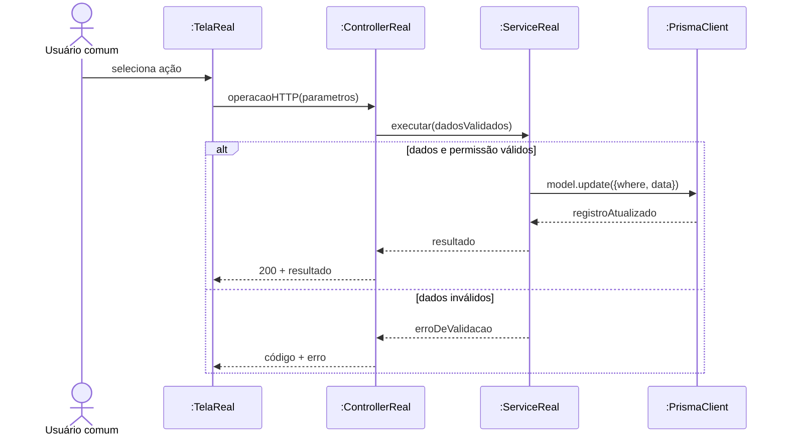
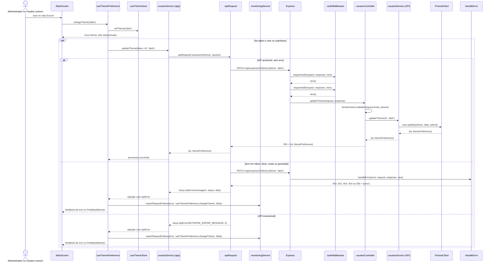
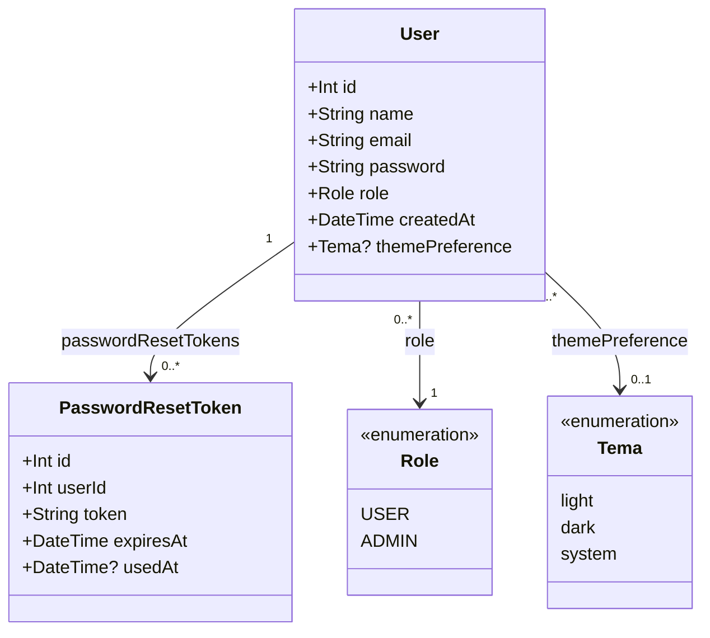
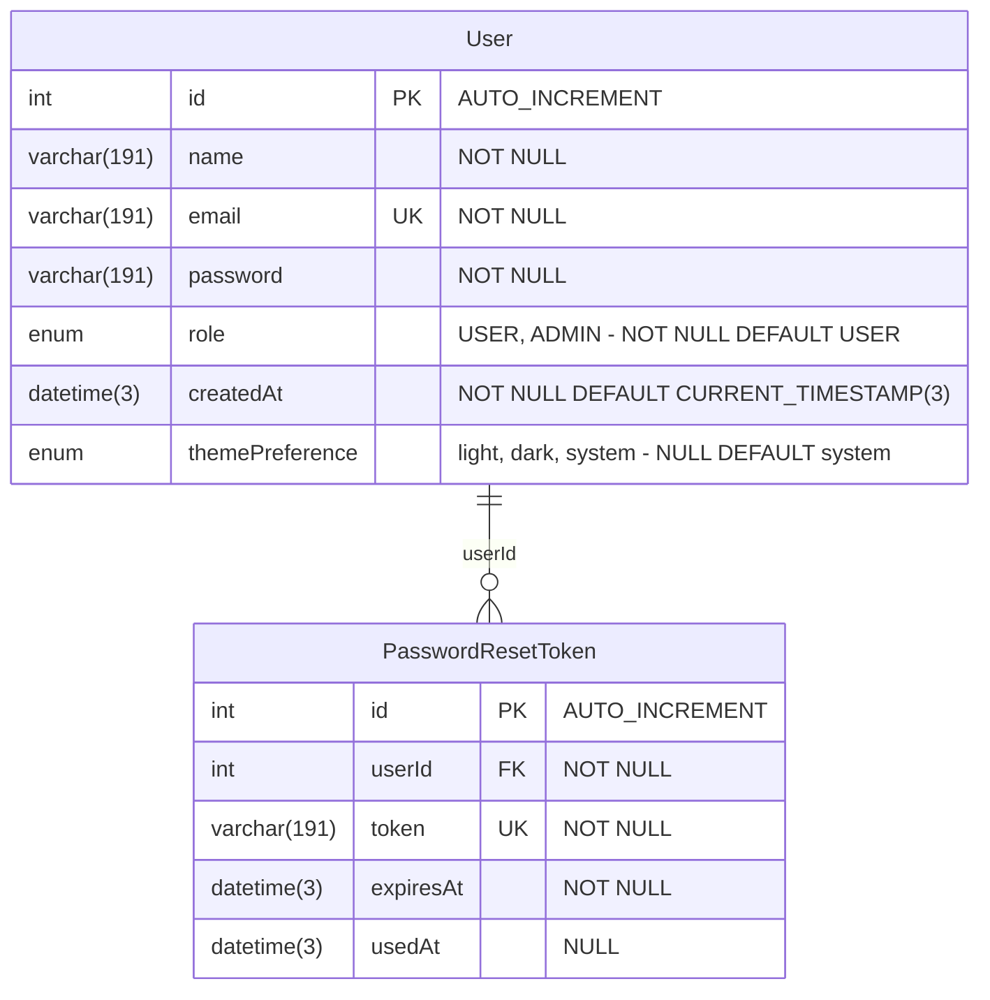

# Guia de Documentação — Better Meet

Este guia define o padrão de toda a documentação de requisitos, diagramas, dados e testes do Better Meet. O padrão de código está no [GUIA_DE_CODIFICACAO.md](GUIA_DE_CODIFICACAO.md).

Todo documento novo ou alterado deve seguir estas regras. Documento antigo que ainda não segue o guia é ajustado quando for alterado ou quando o professor pedir uma correção.

Quem usa IA generativa para escrever documentação deve anexar ao agente o arquivo [PROMPT_DOCUMENTACAO_IA.md](PROMPT_DOCUMENTACAO_IA.md), que resume estas mesmas regras. Se os dois divergirem, este guia vale. Ao mudar este guia, atualize o prompt no mesmo PR.

> **Situação:** padrão interno da equipe. Não equivale à aprovação do professor.

> **Refatoração de 2026-11-10:** a documentação foi reorganizada em um padrão único: classes, diagrama relacional e dicionário **unificados** por entrega; RF, caso de uso, sequência e RNF **individuais**; numeração única de UC e RF (**RFnn = UCnn**). O formato está na seção 2.5 (DOC-26), e o de-para dos números antigos, em [numeracao_uc_rf.md](documentos/numeracao_uc_rf.md). Os exemplos deste guia que citam o "RF06" (tema) agora são o **RF15**; o RF06 atual é "Excluir comissão".

> **Seções do guia:** 1. Regra principal · 2. Onde ficam os arquivos · 3. Identificadores · 4. Atores · 5. Estrutura de cada entrega · 6. Requisitos funcionais · 7. Casos de uso · 8. Diagramas de sequência · 9. Diagrama de classes · 10. Dados · 11. Requisitos não funcionais · 12. Testes · 13. Rastreabilidade · 14. Críticas do professor · 15. Checklist de revisão.

---

## 1. Regra principal: documentar o sistema real

### 1.1 Conferir a versão antes de escrever (DOC-01)

Confira a branch e o commit do incremento antes de escrever. Não presuma que a branch padrão tem o código mais recente. Registre os caminhos dos arquivos consultados.

### 1.2 Comparar as fontes e indicar divergências (DOC-02)

Compare documentos, Wiki, código-fonte, `schema.prisma`, migrations, rotas, services, telas, OpenAPI e testes. Quando houver divergência, registre-a, sem inventar implementação.

Use estas fontes, em ordem de prioridade:

| Prioridade | Fonte | Uso |
|---|---|---|
| 1 | Implementação: rotas, controllers, services, telas, `schema.prisma`, migrations, configuração e testes | Prova do que existe |
| 2 | `docs/openapi.yaml` (hoje só em `sistema/api`) | Contrato dos endpoints, a ser conferido com o código |
| 3 | `documentos/entregaN_<sigla>/` e Wiki | Propósito e regras de negócio, sujeitos a verificação |
| 4 | `aidlc-docs/` de cada app (engenharia reversa, requisitos, notas de migração) | Ponto de partida e histórico do trabalho feito com IA (DOC-25); são resumos escritos por IA, sujeitos a verificação, e nunca provam que algo existe |
| 5 | Observações do professor (seção 14) | Critério de qualidade e correção de notação |
| 6 | Propostas anteriores | Inspiração de formato, nunca prova de implementação |

A nomenclatura segue o [GUIA_DE_CODIFICACAO.md](GUIA_DE_CODIFICACAO.md). Os padrões da 1ª entrega valem apenas onde esse guia não os substituiu. Por exemplo, o snake_case da seção 1.6 do `padroes_interface_e_nomenclatura.md` não vale mais (seção 4.8 do guia de codificação).

### 1.3 Classificar o que é descrito (DOC-03)

Classifique cada item com um destes status:

| Status | Significado |
|---|---|
| Implementado | Verificado no código |
| Parcial | Parte verificada no código, com a lacuna descrita |
| Planejado | Ainda não implementado |
| Não verificado | Documentado, mas não localizado ou não conferido no código |

### 1.4 Não inventar (DOC-04)

- Não crie classes, métodos, colunas, endpoints, telas, papéis, respostas HTTP, regras de segurança ou testes fictícios como se fossem reais.
- Sem acesso ao código, não afirme que algo foi implementado: peça os arquivos ou marque `[A CONFIRMAR NO CÓDIGO]`.

### 1.5 Idioma e identificadores (DOC-05)

Escreva em português do Brasil. Mantenha classes, métodos, rotas, campos e enums exatamente como aparecem no código.

---

## 2. Onde ficam os arquivos

### 2.1 Local de cada tipo de arquivo (DOC-06)

| O quê | Onde |
|---|---|
| Guias de documentação | Raiz do repositório |
| Documentação da entrega (fonte oficial) | `documentos/entregaN_<sigla>/` (ex.: `entrega3_Di2/`) |
| Diagramas da entrega | `documentos/entregaN_<sigla>/Diagramas/` |
| Diagramas antigos, substituídos | `documentos/entregaN_<sigla>/Diagramas/legado/` (DOC-26) |
| Documentos de requisitos (índice, numeração) | `documentos/requisitos.md` e `documentos/numeracao_uc_rf.md` |
| Um arquivo por requisito | `documentos/entregaN_<sigla>/requisitos/` (DOC-26) |
| Publicação | Wiki do GitHub, gerada a partir da fonte |
| Artefatos de trabalho do AI-DLC (não são a documentação oficial) | `sistema/better-meet/aidlc-docs/` e `sistema/management-better-meet/web/aidlc-docs/` (ver DOC-25) |

Altere primeiro o arquivo em `documentos/`. A Wiki nunca recebe conteúdo que não exista na fonte. O `aidlc-docs/` não é fonte da Wiki nem substitui a documentação da entrega.

### 2.2 Nomes de arquivos (DOC-07)

| Tipo | Padrão | Exemplo |
|---|---|---|
| Documento | snake_case, sem acentos | `dicionario_de_dados.md`, `lista_presenca.md` |
| Registro de testes | `testes_<assunto>.md` | `testes_presenca_reuniao.md` |
| Caso de uso | `DCU-<Assunto>.puml` e `.svg` | `DCU-Relatorios.puml` |

Não use espaços em nomes novos. Ao alterar um arquivo com espaços, avalie o impacto nos links antes de renomeá-lo.

### 2.3 Publicar na Wiki (DOC-08)

1. Trabalhe em uma branch `feature/<nome>`, com commit do tipo `docs` e PR para a `development` (GT-01 e GT-02 do guia de codificação).
2. Depois da aprovação, copie o conteúdo para a página da Wiki.
3. Copie cada SVG para a pasta `images/` da Wiki.
4. Troque os links relativos das imagens pelo endereço da Wiki:

   ```markdown
   
   ```

5. Confira a renderização dos diagramas na página publicada.

Em `documentos/`, use link relativo: ``.

**Páginas da Wiki geradas a partir da fonte:**

| Página da Wiki | Fonte no repositório |
|---|---|
| Requisitos (resumo de cada RF e RNF) | `documentos/requisitos.md`; cada requisito traz o link "ver mais detalhes" para a página `RFnn` |
| `RFnn` | `documentos/entregaN_<sigla>/requisitos/RFnn_<assunto>.md` |
| `RNFnn` | `documentos/entregaN_<sigla>/requisitos/RNFnn_<titulo>.md` |

O índice lateral da Wiki lista "Requisitos Funcionais" (RF01 em diante, com o nome do requisito) e "Requisitos Não Funcionais" (RNF01 em diante), na ordem do número.

### 2.4 Documentar com IA: AI-DLC v1 (DOC-25)

Documentação feita com ajuda de um agente de IA segue o mesmo fluxo **AI-DLC v1** do código (seção 9.5 do [GUIA_DE_CODIFICACAO.md](GUIA_DE_CODIFICACAO.md) e regras 83 a 90 do [PROMPT_AGENTES_IA.md](PROMPT_AGENTES_IA.md)). O pedido começa com **"Using AI-DLC, ..."**, e o agente lê as regras em `sistema/better-meet/.aidlc-rule-details/`. Este guia define o **conteúdo** da documentação; o AI-DLC define o **processo**. Se houver conflito sobre o conteúdo, vale este guia.

Como o AI-DLC se aplica a uma tarefa de documentação:

| Etapa do AI-DLC | Na documentação |
|---|---|
| Workspace Detection e Reverse Engineering | Conferir branch e commit (DOC-01) e inspecionar o código (DOC-02). Reaproveite os arquivos de `aidlc-docs/inception/reverse-engineering/` do app **como ponto de partida**, conferindo cada afirmação no código |
| Requirements Analysis | Definir o assunto (RF, RNF, UC), a pasta da entrega e as lacunas. Perguntas ao responsável ficam em arquivo, nunca no chat |
| User Stories, Application Design, Units Generation e as etapas de Design | Normalmente dispensadas; o Workflow Planning registra por quê |
| Code Generation | Escrever os documentos. O plano lista os arquivos a criar ou alterar em `documentos/entregaN_<sigla>/` (caixas `[ ]`), e a execução marca cada passo |
| Build and Test | Verificar o documento: checklist da seção 15, links, renderização de Mermaid e SVG, e `Não executado` onde não houve teste |

Regras:

- **Onde fica o quê.** A documentação oficial é gravada em `documentos/entregaN_<sigla>/` (DOC-06). Em `aidlc-docs/` ficam só o plano, o resumo da execução, o `aidlc-state.md` e o `audit.md`. Nunca grave o documento da entrega só em `aidlc-docs/`. Para uma tarefa que mexe em `documentos/` inteiro (e não em um app só), o `aidlc-docs/` fica na **raiz do repositório**; para uma tarefa de um app, no `aidlc-docs/` dele.
- **Perguntas.** O padrão é o arquivo de perguntas (`requirement-verification-questions.md`). Se a pessoa pedir, o agente pode fazê-las pela ferramenta interativa do agente (caixas de seleção); nesse caso ele mantém o arquivo de perguntas como trilha, transcreve nele as perguntas e as respostas escolhidas e registra o texto exato no `audit.md`.
- **O `aidlc-docs/` não é evidência.** Resumos de engenharia reversa e notas de migração podem estar desatualizados. Todo fato citado na documentação é conferido no código da branch e do commit informados no cabeçalho (DOC-12).
- **O responsável não é a IA.** O campo "Responsável(eis)" é de quem revisa e assina (seção 5.1). O `audit.md` registra o que o agente fez, mas não substitui essa assinatura.
- **Aprovação humana em cada etapa**, inclusive a do plano de documentação, antes de o agente escrever.
- **Reinício automático.** Se o `aidlc-state.md` for de outra alteração (por exemplo, a migração do Expo) ou o fluxo anterior estiver concluído, o agente reinicia o AI-DLC com uma nova unidade (ex.: `documentacao-<assunto>`), sem aproveitar planos nem aprovações antigos e sem apagar os documentos anteriores.
- **Idioma:** tudo em pt-BR, como em todo o guia (DOC-05).
- **Versões:** ao citar versões de ferramentas, copie dos manifestos e lockfiles do commit consultado (DOC-22). Em 2026-11-08, os dois apps Expo usam o SDK 58 e o Jest 30; as versões de commits anteriores continuam valendo para os documentos que se referem a eles.

### 2.5 Formato dos documentos: unificados e individuais (DOC-26)

Os nomes das pastas `entrega1_AP`, `entrega2_Di1`, `entrega3_Di2` (e, adiante, `entrega4_Di3`) **não mudam**. Dentro de cada pasta de incremento:

| Tipo | Formato | Arquivo |
|---|---|---|
| Diagrama de classes | **Unificado e cumulativo**: cada entrega traz o acumulado até o seu incremento, com uma seção por assunto | `diagrama_de_classes.md` |
| Diagrama relacional | Unificado e cumulativo | `diagrama_relacional.md` |
| Dicionário de dados | Unificado e cumulativo | `dicionario_de_dados.md` |
| Requisito funcional e caso de uso | **Individual**: um arquivo por RF, com a ficha do UC (RFnn = UCnn) | `requisitos/RFnn_<assunto>.md` |
| Diagrama de sequência | Individual: dentro do arquivo do RF | `requisitos/RFnn_<assunto>.md` |
| Diagrama de casos de uso | Individual por **requisito dos slides** (um por assunto, como "Cadastro de Organização") | `Diagramas/DCU-<Requisito>.puml` e `.svg` |
| Requisito não funcional | Individual: um arquivo por RNF, na entrega em que nasceu | `requisitos/RNFnn_<titulo>.md` |
| Atores | Um arquivo por entrega | `atores.md` |
| Testes | Por assunto (DOC-23) | `testes_<assunto>.md` |
| Rastreabilidade | Uma matriz por incremento (DOC-24) | `rastreabilidade.md` |

Na raiz de `documentos/` ficam o índice de requisitos (`requisitos.md`) e a numeração (`numeracao_uc_rf.md`).

**Estrutura do arquivo `RFnn_<assunto>.md`**, nesta ordem: cabeçalho (DOC-12); Descrição; Formulário do requisito (Entradas, Origem, Saída, Destino, pré e pós-condições, efeitos colaterais e Ação); ficha do caso de uso UCnn; diagrama de casos de uso; diagrama de sequência (Mermaid); requisitos não funcionais atingidos; divergências e lacunas; testes (`CT-RFnn-xx`). O arquivo do `RNFnn` tem: cabeçalho, exigência, RF atingidos, métrica e método de verificação, versões, evidência e resultado.

**Regras:**

- Ao abrir um incremento novo, copie os três documentos unificados da entrega anterior e acrescente as seções do novo incremento; os que não mudaram permanecem. O que ainda não existe no código entra marcado **Planejado**.
- Um RF novo nasce com o seu UC, no próximo número livre, e é incluído no `requisitos.md` e na matriz de rastreabilidade.
- Diagramas substituídos vão para `Diagramas/legado/` com o nome `RFnn-RFnn_UCnn-UCnn_<nome-original>`; os diagramas atuais ficam em `Diagramas/`, sem espaços nem acentos (DOC-07).
- Nunca apague um documento antigo sem destino: o conteúdo precisa estar migrado, ou o arquivo vai para o legado, ou fica no histórico do git com a indicação no `numeracao_uc_rf.md`.

---

## 3. Identificadores

### 3.1 Numeração única (DOC-09)

| Item | Formato | Abrangência |
|---|---|---|
| Requisito funcional | `RF01` | Projeto inteiro |
| Requisito não funcional | `RNF01` | Projeto inteiro |
| Caso de uso | `UC01` | Projeto inteiro |
| Regra de negócio | `RN-<SIGLA>01` (ex.: `RN-LP01`) | Assunto |
| Caso de teste | `CT-RF14-01`, `CT-RNF02-01` | Requisito testado |

- Um número nunca é reutilizado nem renumerado, mesmo que o item seja removido. **Exceção única:** a renumeração de 2026-11-10, que eliminou números de UC repetidos entre documentos (ver [numeracao_uc_rf.md](documentos/numeracao_uc_rf.md)). Depois dela, os números voltam a ser imutáveis, e os números antigos só aparecem nesse arquivo.
- **Cada caso de uso é um requisito funcional, e o número é o mesmo: `RFnn = UCnn`.** Um UC novo recebe o próximo número livre e cria o RF de mesmo número. UC41 em diante estão reservados ao incremento 3.
- Os RNF têm numeração global (RNF01 em diante, com os números já usados nos documentos e na Wiki); um RNF novo usa o próximo número livre.
- O próximo número é o maior em uso mais um, somando os documentos e a Wiki.
- O índice de RF e RNF é o [documentos/requisitos.md](documentos/requisitos.md) (fonte da página [Requisitos](https://github.com/MiguelIFSP/BRTPDS2-PROJETO-E-DESENVOLVIMENTO-DE-SISTEMAS-2/wiki/Requisitos) da Wiki). Atualize-o ao criar um RF ou RNF novo, no mesmo PR.
- O índice de UC é a tabela de [numeracao_uc_rf.md](documentos/numeracao_uc_rf.md). Procure o maior número nele antes de criar um UC novo.

---

## 4. Atores

### 4.1 Usar atores concretos (DOC-10)

- Escreva **Atores**, nunca "Autores".
- **Não use "Usuário Autenticado".** Não crie ator abstrato para agrupar pessoas.
- Quando um caso de uso vale para mais de um perfil, ligue cada ator ao caso de uso com uma associação própria (por exemplo, Administrador e Usuário comum).
- Não use generalização entre atores humanos.
- Use os nomes do catálogo abaixo em todos os diagramas, fichas e tabelas.

| Ator | Origem no código | Quando usar |
|---|---|---|
| Administrador | `Role.ADMIN` | Pessoa com perfil de administrador da plataforma |
| Usuário comum | `Role.USER` | Pessoa sem perfil de administrador da plataforma |
| Criador, Gerente, Moderador ou Membro da organização | `PapelOrganizacao` | A permissão depende do papel na organização |
| Administrador, Facilitador, Secretário ou Membro da comissão | `PapelComissao` | A permissão depende do papel na comissão |
| Administrador do Servidor | Não é papel do sistema | Quem opera diretamente o servidor (setup e reset) |
| Sistemas externos e serviços agendados (ex.: PM2, Docker Engine, API de Monitoramento, Cron de Monitoramento) | Infraestrutura | Apenas se participarem de fato da interação |

**"Administrador" sozinho significa sempre `Role.ADMIN`.** O papel da comissão se escreve "Administrador da comissão". O "presidente" citado em textos antigos corresponde a `PapelComissao.ADMINISTRADOR`; não existe papel `PRESIDENTE`.

Antes de usar um ator, confira o catálogo com os enums de `sistema/api/prisma/schema.prisma`.

### 4.2 Tabela de atores (DOC-11)

Toda página com diagrama de casos de uso traz esta tabela:

| Ator | Tipo | Responsabilidade | Evidência |
|---|---|---|---|
| `[nome do catálogo]` | Humano / Sistema externo | `[descrição]` | `[RF, enum ou arquivo]` |

#### Exemplo preenchido: atores do RF15

> Todos os exemplos deste guia usam o RF15 (seção 6.1), salvo indicação. Foram conferidos em 2026-11-06 na branch `development`, commit `9e48774`, e não são atualizados junto com o código.

| Ator | Tipo | Responsabilidade | Evidência |
|---|---|---|---|
| Administrador | Humano | Altera o tema da própria conta | `Role.ADMIN` em `schema.prisma`; `PATCH /usuarios/:id/tema` usa `requireSelf`, sem restrição de `role` |
| Usuário comum | Humano | Altera o tema da própria conta | `Role.USER` em `schema.prisma`; mesma rota |

A tabela não usa "Usuário Autenticado": os dois perfis aparecem separados, cada um com sua associação.

---

## 5. Estrutura de cada entrega

### 5.1 Cabeçalho obrigatório (DOC-12)

Todo documento começa com:

```text
Incremento: [nome ou número]
Escopo: [RFs e UCs envolvidos]
Branch: [branch do código consultado]
Commit: [hash do código consultado]
Data de revisão: [AAAA-MM-DD]
Responsável(eis): [nomes]
Estado: [Implementado / Parcial / Planejado / Não verificado]
Fontes: [caminhos e links precisos]
```

#### Exemplo preenchido: cabeçalho do RF15

```text
Incremento: Entrega Di1 — Configurações de usuário
Escopo: RF15; caso de uso UC15 Alterar tema preferido
Branch: development
Commit: 9e48774
Data de revisão: 2026-11-06
Responsável(eis): [nome de quem assina o documento]
Estado: Parcial
Fontes: sistema/better-meet/src/hooks/useThemePreference.ts; sistema/better-meet/src/store/themeStore.ts; sistema/api/src/routes/usuarioRoutes.ts; sistema/api/src/services/usuarioService.ts; sistema/api/prisma/schema.prisma; página antiga RF15 da Wiki
```

O responsável fica em branco de propósito: é quem revisou e assina o documento, e não deve ser deduzido do histórico do git.

### 5.2 Conteúdo mínimo do incremento (DOC-13)

O conteúdo é dividido em arquivos da pasta da entrega, conforme o formato da seção 2.5 (DOC-26): requisitos, casos de uso e sequências **individuais** (um arquivo por RF), e classes, relacional e dicionário **unificados** e cumulativos. Um arquivo pode apontar para outro em vez de duplicá-lo, desde que o impacto do incremento fique explícito.

1. Resumo e escopo
2. Requisitos funcionais
3. Requisitos não funcionais
4. Atores e casos de uso UML
5. Diagramas de sequência por cenário
6. Diagrama de classes e descrição das classes
7. Diagrama relacional do banco principal e dos bancos associados
8. Dicionário de dados
9. Rastreabilidade
10. Testes e evidências
11. Pendências, divergências e limitações conhecidas

#### Exemplo preenchido: conteúdo do RF15

| Conteúdo | Onde está o exemplo neste guia |
|---|---|
| Resumo, escopo e requisito funcional | Seção 6.1 |
| Requisito não funcional | Seção 11.1 (RNF06, porque o RF15 não tem RNF próprio no catálogo) |
| Atores | Seção 4.2 |
| Caso de uso | Seções 7.1 e 7.3 |
| Sequência | Seção 8.1 |
| Classes | Seção 9.1 |
| Relacional e dicionário | Seções 10.1 e 10.2 |
| Testes | Seção 12.1 |
| Rastreabilidade | Seção 13.1 |
| Pendências e divergências | "Divergências encontradas", na seção 6.1 |

---

## 6. Requisitos funcionais

### 6.1 Modelo de requisito (DOC-14)

A estrutura Entradas, Origem, Saída, Destino e Ação vem da Wiki e deve ser mantida. Informe campos, tipos, rotas, tabelas e respostas verificáveis. **Cada caso de uso é um RF** (RFnn = UCnn): há um arquivo por RF (DOC-26), com a ficha do caso de uso e as sequências dentro dele, e o resumo vai para o [documentos/requisitos.md](documentos/requisitos.md) com o link "ver mais detalhes".

Copie o modelo abaixo. No documento do requisito, o título `RFxx` usa `#` e cada seção usa `##`.

#### RFxx — [Verbo e objeto]

- **Status:** [Implementado / Parcial / Planejado / Não verificado]
- **Objetivo:** [resultado de negócio]
- **Atores:** [nomes do catálogo]
- **Regras de negócio:** [RN-XX01...]
- **Referências do código:** `[arquivo:função]` / `[commit]`

#### Descrição

[O que o ator pretende fazer e qual resultado o sistema fornece.]

#### Entradas

| Campo | Origem (tela/rota) | Tipo/formato | Obrigatório | Domínio/validação | Exemplo |
|---|---|---|---|---|---|
| `[campoReal]` | `[tela ou parâmetro]` | `[Int/String/enum/DateTime]` | Sim/Não | `[regra exata]` | `[valor fictício]` |

[Detalhe também token, cabeçalhos, parâmetros de path e query e payload JSON, quando houver.]

#### Origem

[Tela, ação, componente, evento e requisição que disparam o comportamento. Se automático, job e periodicidade.]

#### Pré-condições

- [Autenticação, papel, estado do dado e dependências verificáveis.]

#### Ação

1. O ator [ação concreta na tela].
2. A interface chama `[MÉTODO /rota]` com `[campos]`.
3. `[middleware, controller ou service real]` valida `[campos e autorização]`.
4. `[service real]` consulta `[model]` com `[filtros]`.
5. O sistema executa `[INSERT/UPDATE/DELETE/SELECT]` em `[tabela]`, nos campos `[colunas]`.
6. A API retorna `[status + estrutura]` e a interface apresenta `[dados ou mensagem]`.

#### Saída

| Situação | Status/resposta | Campos de retorno | Comportamento visual |
|---|---|---|---|
| Sucesso | `[status real]` | `[campos tipados]` | `[mensagem ou atualização]` |
| Erro | `[status real]` | `[estrutura real]` | `[tratamento]` |

#### Destino

| Banco | Tabela/model | Operação | Campos | Vínculos |
|---|---|---|---|---|
| `[nome real]` | `[nome real]` | INSERT/UPDATE/... | `[campo: tipo]` | `[FK/relação]` |

[Sem persistência: diga que não há gravação e onde os dados ficam.]

#### Fluxos alternativos e exceções

- **3a:** [condição] → [resposta real e efeito].

#### Pós-condições

[Estado verificável após sucesso ou erro.]

#### Efeitos colaterais

[Notificações, auditoria, cache, outras tabelas, tarefas assíncronas. "Nenhum identificado" só depois de verificar.]

#### Diagramas e testes relacionados

[Links para UC, sequência, dicionário de dados e casos de teste.]

Descreva as camadas que existem de fato. Não monte uma sequência técnica com camadas que o código não tem.

#### Exemplo preenchido: RF15 — Alterar o tema preferido do aplicativo

> Exemplo real, conferido em 2026-11-06 na branch `development`, commit `9e48774`. Ele mostra o nível de detalhe esperado e não é atualizado junto com o código. Para documentar o RF15, confira a implementação novamente.

- **Status:** Parcial. A sincronização posterior prevista na Wiki não foi implementada (veja "Divergências encontradas").
- **Objetivo:** permitir que a pessoa escolha o tema visual e o mantenha entre sessões.
- **Atores:** Administrador e Usuário comum. A rota não restringe por `role`, apenas pelo dono da conta.
- **Regras de negócio:** nenhuma regra codificada.
- **Referências do código:**
  - App: `sistema/better-meet/src/app/(tabs)/mais/index.tsx`, `src/components/ui/Chip.tsx`, `src/components/ui/FeedbackBanner.tsx`, `src/hooks/useThemePreference.ts:changeTheme`, `src/hooks/useTheme.ts`, `src/hooks/useAppColorScheme.ts`, `src/store/themeStore.ts`, `src/services/usuarioService.ts:updateTheme`, `src/utils/apiClient.ts:apiRequest`
  - API: `sistema/api/src/server.ts`, `src/routes/usuarioRoutes.ts`, `src/middlewares/authMiddleware.ts:requireAuth,requireSelf`, `src/middlewares/errorMiddleware.ts:handleError`, `src/controllers/usuarioController.ts:updateTheme`, `src/schemas/usuarioSchema.ts:temaSchema`, `src/services/usuarioService.ts:updateTheme`

##### Descrição

A pessoa escolhe o tema claro, escuro ou o do sistema. O app aplica a escolha na hora, guarda no aparelho e tenta salvar na conta. No login seguinte, o valor salvo na conta volta a ser aplicado.

##### Entradas

| Campo | Origem (tela/rota) | Tipo/formato | Obrigatório | Domínio/validação | Exemplo |
|---|---|---|---|---|---|
| `theme` | Corpo JSON; valor do chip escolhido na aba Mais | `Tema` (string) | Sim | `light`, `dark` ou `system` (`temaSchema`) | `"dark"` |
| `id` | Parâmetro de path; `user.id` do `authStore` | `Int` | Sim | Inteiro positivo (`parseId`), igual ao usuário do token (`requireSelf`) | `42` |
| `Authorization` | Cabeçalho; `token` do `authStore` | `Bearer <JWT>` | Sim | Token válido de uma conta existente (`requireAuth`) | `Bearer <token>` |

##### Origem

Aba **Mais**, seção **Tema**: o toque nos chips **Claro**, **Escuro** ou **Sistema** chama `changeTheme`, que dispara `PATCH /api/usuarios/:id/tema`.

##### Pré-condições

- A pessoa está autenticada e a conta existe.
- O `id` da rota é o da própria conta.
- A opção escolhida é diferente do tema atual.

##### Ação

Existem dois `usuarioService`: o do app (`better-meet/src/services`) e o da API (`api/src/services`). Os passos 1 a 5 e 12 rodam no app; os passos 6 a 11, na API.

1. **Tela → hook.** A tela da aba Mais obtém `changeTheme` de `useThemePreference()` e o passa a cada `Chip`: `onPress={() => void changeTheme(opcao.value)}`. O `Chip` entrega esse `onPress` ao seu `Pressable`. Quando o ator toca no chip, `changeTheme` é chamado com `light`, `dark` ou `system`.
2. **Hook → store.** `changeTheme(newTheme)` compara o valor recebido com o `theme` atual. Se for diferente, chama `setTheme(newTheme)`, ação do `useThemeStore`. `setTheme` chama `applyToNative(theme)`, que atualiza o `Appearance` nativo (exceto no web), e depois `set({ theme })`, que altera o estado.
3. **Store → armazenamento e telas.** A alteração feita por `set` tem dois efeitos: o middleware `persist` grava o tema no `AsyncStorage`, e os componentes que usam `useTheme()` são redesenhados com as novas cores, porque `useTheme()` chama `useAppColorScheme()`, que lê `theme` do `useThemeStore`.
4. **Hook → service do app.** Depois de `setTheme`, ainda em `changeTheme`, o hook limpa o aviso anterior e lê `token` e `user` com `useAuthStore.getState()`. Havendo sessão, chama e aguarda `usuarioService.updateTheme(token, user.id, newTheme)`.
5. **Service do app → API.** `updateTheme` chama ``apiRequest(`/usuarios/${userId}/tema`, { method: 'PATCH', token, body: { theme }, ... })``. `apiRequest` junta o caminho ao `API_URL` (que termina em `/api`), monta os cabeçalhos `Authorization` e `Content-Type` e chama `fetch`, que envia `PATCH /api/usuarios/:id/tema`.
6. **Servidor → rota.** Em `server.ts`, a requisição passa pelos middlewares globais `express.json()`, que preenche `request.body`, e `cors`. O `app.use('/api', apiRouter)` a encaminha ao `apiRouter`, e o `apiRouter.use(usuarioRoutes)` a leva até a rota `PATCH /usuarios/:id/tema`.
7. **Rota → `requireAuth`.** A rota declara três funções, executadas em ordem: `routes.patch('/usuarios/:id/tema', requireAuth, requireSelf, usuarioController.updateTheme)`. O Express chama primeiro `requireAuth`, que lê o token do cabeçalho `Authorization`, valida-o com `verifyToken`, confirma a conta com `prisma.user.findUnique`, preenche `request.user` e chama `next()`.
8. **`requireAuth` → `requireSelf`.** O `next()` faz o Express chamar `requireSelf`, que obtém o `id` da rota com `parseId` e o compara com `request.user.id`. Se forem iguais, chama `next()`.
9. **`requireSelf` → controller.** O `next()` faz o Express chamar `usuarioController.updateTheme`, que obtém o `id` com `parseId`, valida `request.body` com `temaSchema.validate` e chama e aguarda `usuarioService.updateTheme(userId, theme)`.
10. **Service da API → banco.** `usuarioService.updateTheme` executa `prisma.user.update({ where: { id: userId }, data: { themePreference: theme }, select: { id: true, themePreference: true } })`. O Prisma faz o `UPDATE` em `User.themePreference` no banco `bettermeet` e devolve `{ id, themePreference }` ao service, que o retorna ao controller.
11. **Controller → resposta.** O controller responde com `response.status(200).json(user)`.
12. **Resposta → app.** O `fetch` recebe a resposta, e `apiRequest` lê o JSON e o devolve a `usuarioService.updateTheme`. A promessa aguardada no passo 4 termina e `changeTheme` encerra sem usar o retorno, pois o tema já foi aplicado no passo 2.

**Caminho de erro.** Nos passos 7 a 10, uma falha lança um erro, como `AppError` ou `yup.ValidationError`. O Express 5 encaminha o erro ao `handleError`, registrado em `server.ts` com `app.use(handleError)`, e as funções seguintes da rota não são executadas. O `handleError` responde com o status e o `{ error }` da tabela de Saída. No app, `apiRequest` transforma a resposta de erro em `ApiError`, ou lança `ApiError` com `status` 0 se o `fetch` falhar. O `catch` de `changeTheme` recebe esse erro, chama `monitoringService.reportRequestFailure` e `setFeedback`. A tela recebe `feedback` de `useThemePreference()` e o passa ao `FeedbackBanner`, que exibe o aviso.

##### Saída

| Situação | Status/resposta | Campos de retorno | Comportamento visual |
|---|---|---|---|
| Sucesso | `200` | `id: Int`, `themePreference: Tema` | Tema aplicado, sem mensagem |
| Id inválido ou tema ausente ou inválido | `400` | `error`: `Identificador do usuário inválido.`, `Informe o tema desejado.` ou `Tema inválido. Use: light, dark ou system.` | Tema mantido no aparelho, com aviso¹ |
| Sem token, token inválido ou conta excluída | `401` | `error`: `Autenticação necessária.`, `Token inválido ou expirado.`, `Token inválido.` ou `Sessão inválida. Entre novamente.` | Tema mantido no aparelho, com aviso¹ |
| Conta de outra pessoa | `403` | `error`: `Você só pode alterar a sua própria conta.` | Tema mantido no aparelho, com aviso¹ |
| Usuário não encontrado na gravação | `404` | `error`: `Usuário não encontrado.` | Tema mantido no aparelho, com aviso¹ |
| Erro inesperado na API | `500` | `error`: `Erro interno. Tente novamente mais tarde.` | Tema mantido no aparelho, com aviso¹ |
| API inacessível | Sem resposta (`ApiError` com `status` 0 no app) | Mensagem do app: `Não foi possível conectar ao servidor. Verifique sua conexão.` | Tema mantido no aparelho, com aviso¹ |

¹ O `FeedbackBanner` mostra `O tema foi aplicado neste aparelho, mas não foi salvo na sua conta: <mensagem>`.

##### Destino

| Banco | Tabela/model | Operação | Campos | Vínculos |
|---|---|---|---|---|
| `bettermeet` (MySQL) | `User` | `UPDATE` | `themePreference: ENUM('light','dark','system') NULL DEFAULT 'system'` | Nenhuma relação alterada |
| Sem banco: `AsyncStorage` do aparelho | Chave `better-meet-theme` | Gravação local | `theme: Tema` | Nenhum |

##### Fluxos alternativos e exceções

- **2a:** opção igual ao tema atual → `changeTheme` encerra sem alterar nada e sem chamar a API.
- **4a:** sem sessão no `authStore` → o tema fica só no aparelho, sem chamar a API.
- **5a:** API inacessível → o tema fica no aparelho e o aviso é exibido. Não há nova tentativa automática.
- **7a:** token ausente, inválido ou de conta excluída → `401`, sem gravação.
- **8a:** `id` malformado → `400`; `id` de outra pessoa → `403`, sem gravação.
- **9a:** `theme` ausente ou fora do domínio → `400`, sem gravação.
- **10a:** usuário não encontrado na gravação → `404`.

##### Pós-condições

- **Sucesso:** aparelho e `User.themePreference` têm o mesmo tema.
- **Falha na API:** o aparelho fica com o novo tema e o banco mantém o anterior. No próximo login, `applyUserPreference` aplica o valor do banco; `null` ou valor desconhecido vira `system`.
- **Abertura do app:** `onRehydrateStorage` reaplica o tema guardado no aparelho.

##### Efeitos colaterais

- Em qualquer falha da chamada, `changeTheme` aciona `monitoringService.reportRequestFailure`.
- `usuarioService.updateTheme` não altera outras tabelas nem cria notificações.

##### Diagramas e testes relacionados

- **Caso de uso:** `[A CONFIRMAR]`. A Wiki e os comentários do código usam `UC04`, número que também identifica outros casos de uso.
- **Sequência:** o diagrama da página antiga RF15 da Wiki precisa ser refeito, pois cita componentes que não existem mais.

| ID | Cenário | Arquivo | Status |
|---|---|---|---|
| CT-RF15-01 | `applyUserPreference` aceita os três temas e converte `roxo`, `null` e `undefined` em `system` (6 casos) | `sistema/better-meet/src/store/__tests__/stores.test.ts` | Passou em 2026-11-06 |
| CT-RF15-02 | `PATCH /api/usuarios/:id/tema`: sucesso e erros | Nenhum teste localizado | Não executado |

##### Divergências encontradas

| Item | Wiki ou documento | Código | Situação |
|---|---|---|---|
| Local da troca | página antiga RF15 da Wiki: menu lateral, `CustomDrawer.tsx` e `Switch` | Chips na aba Mais; `CustomDrawer` não existe mais | Atualizar a Wiki |
| API indisponível | página antiga RF15 da Wiki: sincronizar em uma próxima interação com rede | Só avisa, sem nova tentativa | Decidir entre implementar e corrigir o requisito |
| Número do caso de uso | `UC04` usado para o tema na Wiki e no código | `requisitos_e_casos_de_uso.md` usa `UC04` para a checagem periódica, e `DCU - Comissão.md` para adicionar membro | Renumerar |
| Tipo da coluna | `dicionario_de_dados.md`: `String? themePreference` | Migration: `ENUM('light','dark','system')` | Atualizar o dicionário |

---

## 7. Casos de uso

### 7.1 Notação UML com PlantUML (DOC-15)

**Todo diagrama de casos de uso deve seguir as normas do Diagrama de Casos de Uso e da notação UML.** Ele mostra quem interage com o sistema e com qual objetivo; não mostra a ordem dos passos, as telas nem o fluxo de dados. Esses detalhes ficam na ficha do caso de uso (DOC-17) e no diagrama de sequência (DOC-18).

| Elemento UML | Notação obrigatória | Regra |
|---|---|---|
| Ator | Boneco, com o nome abaixo | Fica fora da fronteira e representa um papel externo ao sistema. Componentes internos, como banco de dados e service, não são atores |
| Caso de uso | Elipse, com o nome dentro | Fica dentro da fronteira e tem nome de ação (verbo + objeto), igual ao da ficha |
| Fronteira do sistema | Retângulo, com o nome do sistema | Contém todos os casos de uso do diagrama |
| Associação | Linha contínua, sem seta | Liga um ator a um caso de uso. Não representa sequência |
| Inclusão | Seta tracejada do caso base para o incluído, com `<<include>>` | O comportamento incluído sempre faz parte do caso base |
| Extensão | Seta tracejada do caso que estende para o caso base, com `<<extend>>` | O comportamento é opcional. Documente a condição e o ponto de extensão |
| Generalização entre casos de uso | Linha contínua com triângulo vazado, apontando para o caso geral | O caso específico é um tipo do caso geral |

Também não são permitidos:

- setas de fluxo, losangos de decisão ou caixas no lugar de atores e casos de uso;
- ligações entre atores ou entre casos de uso que não sejam uma das relações da tabela;
- `<<include>>` ou `<<extend>>` usados apenas para mostrar a ordem dos passos;
- caso de uso solto, sem ligação com um ator ou com outro caso de uso;
- generalização entre atores humanos (DOC-10), embora a UML a permita: é uma decisão da equipe para manter os diagramas consistentes.

**A equipe usa PlantUML para casos de uso**, porque foi o formato mais bem aceito pelo professor. O Mermaid também tem recursos de diagramação UML e continua sendo usado nos diagramas de classes e de sequência, mas não é usado para casos de uso. Um `flowchart`, em especial, não é aceito, porque é um fluxograma, não um diagrama UML de casos de uso.

Versione a fonte `.puml` e o `.svg` gerado, lado a lado, e incorpore o SVG ao Markdown. A notação em PlantUML, com nomes fictícios:

```text
@startuml DCU-Assunto
!pragma layout smetana
left to right direction
skinparam packageStyle rectangle

actor "Usuário comum" as U
actor "Administrador" as A

rectangle "Nome do sistema" {
  usecase "UC90 - Caso base" as UC90
  usecase "UC91 - Caso incluído" as UC91
  usecase "UC92 - Caso que estende" as UC92
  usecase "UC93 - Caso específico" as UC93
}

' Associação
U -- UC90
A -- UC93
' Inclusão: do caso base para o incluído
UC90 .> UC91 : <<include>>
' Extensão: do caso que estende para o caso base
UC92 .> UC90 : <<extend>>
' Generalização: do caso específico para o geral
UC93 -|> UC90
@enduml
```

Para gerar o SVG:

```bash
java -jar plantuml.jar -tsvg "DCU-Assunto.puml"
```

#### Exemplo preenchido: diagrama do RF15

```text
@startuml DCU-Tema-Preferido
!pragma layout smetana
left to right direction
skinparam shadowing false
skinparam monochrome true
skinparam packageStyle rectangle

actor "Administrador" as Adm
actor "Usuário comum" as Usu

rectangle "Better Meet (App e API de Dados)" {
  usecase "Alterar tema preferido" as Tema
}

Adm -- Tema
Usu -- Tema
@enduml
```

- **Atores:** os dois perfis têm associação própria, sem ator abstrato.
- **Número do caso de uso:** fica de fora até ser resolvida a repetição do `UC04` (seção 6.1).
- **Relações:** não há `<<include>>`, `<<extend>>` nem generalização, porque o comportamento não se divide em outros casos de uso. Não crie relações só para preencher o diagrama. O exemplo real dessas relações é o [DCU-Gestao-Setup-Reset.puml](documentos/entrega2_Di1/Diagramas/DCU-Gestao-Setup-Reset.puml).

### 7.2 Referência aprovada (DOC-16)

O grupo indica como aceito pelo professor o diagrama UC07–UC12: [DCU-Gestao-Setup-Reset.puml](documentos/entrega2_Di1/Diagramas/DCU-Gestao-Setup-Reset.puml) e [DCU-Gestao-Setup-Reset.svg](documentos/entrega2_Di1/Diagramas/DCU-Gestao-Setup-Reset.svg).

Use-o como referência de notação e detalhamento. Confira a semântica de cada associação antes de repeti-la em outro domínio. O diagrama não prova que um endpoint, método ou tabela exista. Os atores técnicos dele pertencem ao escopo de infraestrutura e não devem ser copiados para outros diagramas sem necessidade.

### 7.3 Uma ficha para cada elipse (DOC-17)

A ficha do UCnn fica dentro do arquivo do RFnn (DOC-26). O diagrama de casos de uso é individual por requisito dos slides (por exemplo, "Cadastro de Organização") e é incluído em cada RF que ele cobre; cada RF documenta só o seu UC.

Cada elipse tem sua própria ficha, ou um link direto para ela. Pré e pós-condições gerais para o diagrama inteiro não valem: a pré-condição de *Autenticar administrador* não substitui a de *Iniciar, parar ou reiniciar um subsistema*.

```markdown
### UCxx — [Mesmo nome exibido na elipse]
- **Objetivo:** [resultado observável]
- **Atores:** [nomes do catálogo, um a um]
- **RF relacionado:** [RFxx]
- **Gatilho:** [evento que inicia o caso]
- **Entradas:** [campo, tipo, formato, obrigatório, validação e origem]
- **Pré-condições (deste UC):** [autenticação, permissão, estado anterior e dependências]
- **Fluxo principal:**
  1. [ação do ator]
  2. [chamada real na interface, endpoint ou método]
  3. [validação e persistência, se houver]
  4. [resultado exibido ou retornado]
- **Fluxos alternativos e erros:** [condição → comportamento ou código observado]
- **Pós-condições (deste UC):** [estado final, dados gravados ou ausência de alteração]
- **Relações UML:** [include, extend ou generalização; sentido, condição e ponto de extensão]
- **Rastreabilidade:** [classe ou método, tabela ou coluna, teste ou A CONFIRMAR]
```

Toda página termina com a tabela de auditoria:

| Elipse do diagrama | Ficha | Pré-condições | Pós-condições | Fluxos e erros | Verificado no código |
|---|---|---|---|---|---|
| UCxx | [link] | Sim/Não | Sim/Não | Sim/Não | Sim/Não |

#### Exemplo preenchido: ficha do RF15

##### UC15 — Alterar tema preferido

- **Objetivo:** deixar o aplicativo no tema escolhido e manter a escolha entre sessões.
- **Atores:** Administrador; Usuário comum.
- **RF relacionado:** RF15.
- **Gatilho:** toque em um dos chips **Claro**, **Escuro** ou **Sistema**, na seção **Tema** da aba **Mais**.
- **Entradas:** `theme` (`Tema`: `light`, `dark` ou `system`, obrigatório, valor do chip); `id` (`Int` positivo, obrigatório, `user.id` do `authStore`); `Authorization` (`Bearer <JWT>`, obrigatório, `token` do `authStore`).
- **Pré-condições (deste UC):** conta existente e autenticada; `id` da rota igual ao da conta; opção diferente do tema atual.
- **Fluxo principal:**
  1. O ator toca em um chip e `MaisScreen` chama `changeTheme(opcao.value)`.
  2. `changeTheme` chama `setTheme(newTheme)`; o tema é aplicado e guardado no aparelho.
  3. `changeTheme` chama `usuarioService.updateTheme(token, user.id, newTheme)`, que envia `PATCH /api/usuarios/:id/tema`.
  4. `requireAuth`, `requireSelf` e `usuarioController.updateTheme` validam a requisição, e `usuarioService.updateTheme` grava `User.themePreference`.
  5. A API responde `200` com `{ id, themePreference }`.
- **Fluxos alternativos e erros:**
  - Opção igual à atual → nada muda.
  - API inacessível ou resposta `400`, `401`, `403`, `404` ou `500` → o tema fica no aparelho, o banco não muda e o `FeedbackBanner` exibe o aviso.
- **Pós-condições (deste UC):**
  - Sucesso: aparelho e `User.themePreference` têm o mesmo tema.
  - Falha: o aparelho fica com o novo tema e o banco, com o anterior; o próximo login aplica o valor do banco.
- **Relações UML:** nenhuma; somente associações com os dois atores.
- **Rastreabilidade:** `useThemePreference.changeTheme`; `usuarioController.updateTheme`; `User.themePreference`; CT-RF15-01 e CT-RF15-02.

| Elipse do diagrama | Ficha | Pré-condições | Pós-condições | Fluxos e erros | Verificado no código |
|---|---|---|---|---|---|
| Alterar tema preferido | Ficha acima | Sim | Sim | Sim | Sim |

---

## 8. Diagramas de sequência

### 8.1 Participantes e mensagens reais (DOC-18)

Faça **um diagrama `sequenceDiagram` por cenário significativo**. Em funcionalidades grandes, separe envio, resposta, entrada, saída etc.

- Os participantes são objetos, componentes e classes reais. Não use "Sistema" nem "Banco de Dados" quando houver service ou classe concreta.
- As mensagens técnicas são chamadas reais, com argumentos: `reuniaoService.listMine(userId)`. "Registrar convites pendentes" não é um método. Mensagens do ator para a tela podem descrever a interação.
- Mostre retornos, erros com `alt`, opcionais com `opt` e repetições com `loop`.
- Siga o caminho ator → tela → rota → controller → service → dados → retorno, adequado às camadas reais.
- Cite os arquivos usados para montar o diagrama.

Modelo com **nomes fictícios**. Substitua-os somente por nomes encontrados no código:



#### Exemplo preenchido: sequência do RF15

**Cenário:** trocar o tema para escuro, com sessão ativa. Os valores `'dark'` e `42` são ilustrativos.

**Arquivos usados:** os listados em "Referências do código", na seção 6.1.



Se o chip escolhido já for o tema atual, `changeTheme` encerra antes de `setTheme`. O passo a passo com as ligações entre as funções está em "Ação", na seção 6.1.

---

## 9. Diagrama de classes

### 9.1 Declarar o tipo de modelo (DOC-19)

Use `classDiagram` e declare se é **modelo de domínio**, **modelo de persistência Prisma** ou **classes da implementação**. O `schema.prisma` mostra entidades e relações, mas não prova que existam classes com métodos no código.

- Mostre atributos e tipos reais, visibilidade quando aplicável, operações efetivas e multiplicidades.
- Use herança, composição e agregação apenas quando o código as sustentar.
- Mostre enums como `<<enumeration>>`.
- Não apresente dados em memória como se fossem persistidos.

Explique cada elemento do diagrama:

| Classe/modelo | Camada | Responsabilidade | Atributos e operações relevantes | Caminho no código |
|---|---|---|---|---|
| `[nome real]` | `[domínio/persistência/service]` | `[descrição]` | `[assinaturas]` | `[arquivo]` |

#### Exemplo preenchido: modelo de persistência do RF15

**Tipo de modelo:** modelo de persistência Prisma. O diagrama mostra o `User`, os enums de que ele depende e uma relação de exemplo. As demais relações de `User` não são afetadas pelo RF15 e foram omitidas.



Os models do Prisma não têm métodos. As operações do RF15 estão em objetos exportados pelos módulos, que não são classes e por isso não aparecem no diagrama. Eles estão descritos na tabela:

| Classe/modelo | Camada | Responsabilidade | Atributos e operações relevantes | Caminho no código |
|---|---|---|---|---|
| `User` | Persistência | Representa a conta e guarda a preferência de tema | `id`, `role`, `themePreference` | `sistema/api/prisma/schema.prisma` |
| `Tema` | Persistência (enum) | Limita os valores de tema | `light`, `dark`, `system` | `sistema/api/prisma/schema.prisma` |
| `PasswordResetToken` | Persistência | Guarda os tokens de recuperação de conta; não participa do RF15 | `userId`, `token`, `expiresAt`, `usedAt` | `sistema/api/prisma/schema.prisma` |
| `usuarioController` | Controller (objeto) | Recebe a requisição, valida o corpo e devolve a resposta | `updateTheme(request, response)` | `sistema/api/src/controllers/usuarioController.ts` |
| `usuarioService` (API) | Service (objeto) | Grava a preferência no banco | `updateTheme(userId: number, theme: Tema)` | `sistema/api/src/services/usuarioService.ts` |
| `useThemeStore` | Estado do app (store Zustand) | Guarda o tema no aparelho e o aplica | `theme`, `setTheme(theme)`, `applyUserPreference(theme)` | `sistema/better-meet/src/store/themeStore.ts` |

---

## 10. Dados

### 10.1 Diagrama relacional (DOC-20)

Use `erDiagram`.

- Cubra o **banco principal** (`sistema/api/prisma/schema.prisma`) e todas as entidades afetadas pelo incremento, além do banco de monitoramento (`sistema/monitoring-better-meet/prisma/schema.prisma`) quando for pertinente.
- Baseie-se no schema, nas migrations e, quando acessível, na estrutura física do MySQL. Registre divergências.
- Não desenhe FK física entre bancos diferentes.
- Use nomes físicos, `PK`, `FK`, `UK`, cardinalidade e tabelas associativas.
- Separe tabelas planejadas de implementadas.
- Para dados sem banco (memória ou armazenamento local), descreva o armazenamento real em seção própria, sem inventar tabela.

#### Exemplo preenchido: diagrama relacional do RF15

**Banco:** `bettermeet` (MySQL). **Fontes:** `schema.prisma` e migrations `20260918235817_config_usuario` e `20261014120100_adiciona_enums_status_tema`. A estrutura física não foi conferida em um banco em execução.

O RF15 altera apenas `User`. `PasswordResetToken` entra só para mostrar como registrar FK e cardinalidade. As demais tabelas ligadas a `User` foram omitidas.



**Dados sem banco:** o app também guarda o tema no `AsyncStorage` do aparelho, na chave `better-meet-theme`. Esse dado não é uma tabela e não aparece no diagrama.

### 10.2 Dicionário de dados (DOC-21)

Escreva uma linha por coluna. A referência de detalhamento é o [dicionario_de_dados.md](documentos/entrega2_Di1/dicionario_de_dados.md).

```markdown
**Banco:** `[nome]`
**Tabela:** `[nome físico]`
**Finalidade:** `[explicação]`
**Fonte:** `[schema, migration ou SQL]`

| Coluna | Tipo físico | Tipo lógico | Tamanho/domínio | Nulo? | Default | Chave/índice | Validação/descrição |
|---|---|---|---|---|---|---|---|
| `[nome]` | `[varchar(191)]` | `[String]` | `[até 191]` | Não | — | `[PK/FK/UK]` | `[regra]` |
```

Inclua também uma tabela de PK, UK, FK, índices e regras `ON DELETE` e `ON UPDATE` verificadas.

#### Exemplo preenchido: dicionário da tabela `User`

- **Banco:** `bettermeet`
- **Tabela:** `User`
- **Finalidade:** guarda as contas da plataforma, o perfil de acesso e a preferência de tema.
- **Fonte:** `sistema/api/prisma/schema.prisma`; migrations `20260918235817_config_usuario` e `20261014120100_adiciona_enums_status_tema`; validações em `sistema/api/src/schemas/commonSchema.ts` e `usuarioSchema.ts`.

| Coluna | Tipo físico | Tipo lógico | Tamanho/domínio | Nulo? | Default | Chave/índice | Validação/descrição |
|---|---|---|---|---|---|---|---|
| `id` | `int` | `Int` | Inteiro gerado pelo banco | Não | `AUTO_INCREMENT` | PK | Identifica a conta |
| `name` | `varchar(191)` | `String` | 2 a 80 caracteres na validação | Não | — | — | Nome da pessoa, recebido como `nome` na API (`nomeRule`) |
| `email` | `varchar(191)` | `String` | Até 160 caracteres na validação | Não | — | UK `User_email_key` | E-mail válido, sem espaços nas pontas e em minúsculas (`emailRule`) |
| `password` | `varchar(191)` | `String` | 64 caracteres hexadecimais gravados | Não | — | — | Hash SHA-256 da senha (`hashPassword`). A senha informada tem de 8 a 72 caracteres, com maiúscula, minúscula e número (`senhaForteRule`). Veja o RNF06 na seção 11.1 |
| `role` | `enum('USER','ADMIN')` | `Role` | `USER`, `ADMIN` | Não | `USER` | — | Perfil na plataforma. O cadastro público só aceita `USER` (`cadastroUsuarioSchema`) |
| `createdAt` | `datetime(3)` | `DateTime` | Data e hora com milissegundos | Não | `CURRENT_TIMESTAMP(3)` | — | Momento do cadastro |
| `themePreference` | `enum('light','dark','system')` | `Tema?` | `light`, `dark`, `system` | Sim | `system` | — | Tema preferido, alterado pelo RF15 (`temaSchema`). `NULL` é tratado como `system` |

**Restrições:**

| Tipo | Nome | Colunas | Integridade referencial |
|---|---|---|---|
| PK | `PRIMARY` | `id` | — |
| UK | `User_email_key` | `email` | — |
| FK recebida | `PasswordResetToken_userId_fkey` | `PasswordResetToken.userId` → `User.id` | `ON DELETE CASCADE`, `ON UPDATE CASCADE` |

Outras tabelas também têm FK para `User`, com regras próprias. No dicionário completo, liste todas.

---

## 11. Requisitos não funcionais

### 11.1 Propriedade verificável (DOC-22)

Se o texto descreve **o que o sistema faz**, normalmente é RF. RNF descreve uma propriedade, limite ou condição da solução.

```text
RNFxx — [Propriedade]
Categoria: [Desempenho / Segurança / Disponibilidade / Compatibilidade / Manutenibilidade / Tecnologia / Usabilidade]
Escopo: [componente, rota, operação ou ambiente]
Exigência: [restrição específica e verificável]
Métrica/critério de aceitação: [limiar, unidade, amostra, percentil e condições]
Método de verificação: [teste, inspeção, revisão de dependências ou ferramenta]
Versões/configuração: [versões confirmadas em manifestos e lockfiles]
Evidência: [log, captura, relatório ou caminho do arquivo]
Resultado: [Aprovado / Reprovado / Não executado]
```

- Evite "rápido", "seguro", "fácil", "não expor indevidamente" e "hash-256".
- Uma meta de tempo diz como medir: ambiente, amostra, rede e limite.
- Em senhas, cite o algoritmo e a biblioteca realmente usados, com sal e custo quando aplicável. Não confunda hash com criptografia reversível.
- Não afirme que containers separados garantem isolamento completo de falhas.
- Não deduza versões de Node, Expo, React Native, Express, Prisma ou MySQL a partir da Wiki: confira `package.json`, lockfile e configuração.

#### Exemplo preenchido: RNF06 — Armazenamento seguro de senha

O RF15 não tem RNF próprio no catálogo. Este exemplo usa o RNF06, um caso real da crítica do professor sobre "hash-256".

**Como está na Wiki:** "As senhas devem ser criptografadas em hash-256."

**Problemas desse texto:** hash não é criptografia reversível, "hash-256" não identifica um algoritmo, e não há sal, métrica nem forma de verificar.

```text
RNF06 — Armazenamento seguro de senha
Categoria: Segurança
Escopo: coluna User.password; gravação e conferência em authService e usuarioService, por meio de utils/passwordHash.ts
Exigência: gravar a senha sempre com sal, usando o algoritmo scrypt do Better Auth; nunca usar SHA-256 simples (regra EX-14 do guia de codificação)
Métrica/critério de aceitação: 100% das gravações de User.password usam hash com sal; a mesma senha gera hashes diferentes em contas diferentes
Método de verificação: CT-RNF06-01, inspeção de passwordHash.ts, de todas as chamadas a hashPassword e de package.json
Versões/configuração: node:crypto, módulo nativo do Node (versão de produção não declarada em package.json: A CONFIRMAR); better-auth não está em sistema/api/package.json
Evidência: sistema/api/src/utils/passwordHash.ts usa crypto.createHash('sha256') sem sal; chamadas em authService.ts e usuarioService.ts
Resultado: Reprovado em 2026-11-06. A migração para o Better Auth é uma pendência registrada na regra EX-14
```

Um RNF reprovado é um resultado válido. O documento registra a situação real, sem ajustar a exigência para fazê-la passar.

---

## 12. Testes

### 12.1 Registro por entrega (DOC-23)

Cada assunto tem um `testes_<assunto>.md` na pasta da entrega, como pede a regra GT-04 do guia de codificação. Código de teste não substitui esse registro.

````markdown
# Testes de [assunto]

[Cabeçalho da seção 5.1]

## O que foi testado

| ID | RF/RNF e UC | Rota ou tela | Cenário verificado | Arquivo ou passos | Status |
|---|---|---|---|---|---|
| CT-RF14-01 | RF14, UCxx | `[rota]` | `[regra verificada]` | `[arquivo de teste ou passo a passo]` | Passou / Falhou / Não executado |

## Como rodar

Ambiente, dados e ferramentas. Em `sistema/<subsistema>`:

```bash
npm test -- --runInBand [arquivo]
```

## Resultado

Execução de [AAAA-MM-DD]:

- [suítes e quantidade de testes]: [aprovados], [falhas].
- Falhas e defeitos encontrados: [causa e correção].
- Evidências: [link, captura ou log].
````

- Cubra, quando aplicável: sucesso, validação, autenticação, autorização, duplicidade, estados inválidos, falha de serviço e integridade.
- Teste manual traz passo a passo, resultado esperado e resultado obtido.
- **Não invente resultados.** Sem execução, registre `Não executado` e o motivo.
- Confira as mensagens e os códigos HTTP realmente retornados.
- Não exponha tokens, senhas ou dados pessoais nas evidências.

#### Exemplo preenchido: testes do RF15

##### O que foi testado

| ID | RF/RNF e UC | Rota ou tela | Cenário verificado | Arquivo ou passos | Status |
|---|---|---|---|---|---|
| CT-RF15-01 | RF15; UC15 | Login no app (`applyUserPreference`) | `dark`, `light` e `system` são mantidos; `roxo`, `null` e `undefined` viram `system` (6 casos) | `sistema/better-meet/src/store/__tests__/stores.test.ts` | Passou |
| CT-RF15-02 | RF15; UC15 | `PATCH /api/usuarios/:id/tema` | Sucesso e erros `400`, `401`, `403` e `404` | Nenhum teste localizado | Não executado |

##### Como rodar

Ambiente: Node 24.14.0, Jest 29.7 e `jest-expo` 57 (faixas `~` do `package.json` no commit `9e48774`; depois da migração para o Expo 58, o app usa Jest 30 e `jest-expo` 58, e um registro novo cita as versões do commit que testou). O teste chama o store diretamente, com o `AsyncStorage` simulado em `jest.setup.ts`, e não acessa a API nem o banco. Em `sistema/better-meet`:

```bash
npm test -- stores -t applyUserPreference
```

##### Resultado

Execução de 2026-11-06, branch `development`, commit `9e48774`:

- 1 suíte e 9 testes: 6 aprovados, 3 ignorados pelo filtro `-t` e nenhuma falha.
- Defeitos encontrados: nenhum nos casos executados.
- Lacuna: CT-RF15-02 não foi executado porque não há teste automatizado nem roteiro manual da rota. Por isso, os erros da tabela de Saída foram verificados apenas por leitura do código.
- Evidência: saída do comando acima, `Tests: 3 skipped, 6 passed, 9 total`.

---

## 13. Rastreabilidade

### 13.1 Matriz por incremento (DOC-24)

A matriz de cada incremento fica em `entregaN_<sigla>/rastreabilidade.md` (exemplos: `entrega2_Di1/rastreabilidade.md` e `entrega3_Di2/rastreabilidade.md`).

| RF/RNF | UC | Tela/componente | Endpoint/service | Classe/modelo | Tabela/campos | Diagrama | Teste | Status |
|---|---|---|---|---|---|---|---|---|
| RFxx | UCxx | `[arquivo]` | `[rota ou método]` | `[classe]` | `[tabela]` | `[link]` | CT-RFxx-01 | `[status]` |

Nenhum RF fica sem vínculo ou justificativa. Diagramas, matriz e código usam os mesmos nomes.

#### Exemplo preenchido: rastreabilidade do RF15 e do RNF06

| RF/RNF | UC | Tela/componente | Endpoint/service | Classe/modelo | Tabela/campos | Diagrama | Teste | Status |
|---|---|---|---|---|---|---|---|---|
| RF15 | UC15 (Alterar tema preferido) | `(tabs)/mais/index.tsx`, `useThemePreference`, `useThemeStore` | `PATCH /api/usuarios/:id/tema`; `usuarioController.updateTheme`; `usuarioService.updateTheme` | `User`, `Tema` | `User.themePreference` | Seções 7.1, 8.1, 9.1 e 10.1 | CT-RF15-01 (Passou); CT-RF15-02 (Não executado) | Parcial |
| RNF06 | Não se aplica: propriedade de segurança | Não se aplica | `hashPassword` e `verifyPassword`, usados por `authService` e `usuarioService` | `User` | `User.password` | Seção 10.1 | CT-RNF06-01 (Reprovado por inspeção) | Reprovado |

---

## 14. Críticas do professor

Estas são as regras para não repetir as críticas já recebidas.

| Item | Problema criticado | Como evitar | Regra |
|---|---|---|---|
| Casos de uso | Fluxogramas no lugar de UML; "autores" e atores indefinidos | UML em PlantUML, com seção de atores | DOC-10, DOC-11, DOC-15 |
| Casos de uso | Falta de padrão e herança inconsistente | Mesmo catálogo de atores, sem generalização entre pessoas | DOC-10 |
| Classes | Diagramas que não correspondem ao código | Declarar o tipo de modelo e conferir as classes | DOC-19 |
| Classes | Falta de métodos, relações ou explicação | Atributos, operações, multiplicidades e descrição | DOC-19 |
| Dicionário | Incompleto ou ausente | Uma linha por coluna, completa | DOC-21 |
| Relacional | Só o banco de monitoramento | Incluir o banco principal | DOC-20 |
| RF | Entradas e ações vagas | Campos, tipos, rotas, tabelas e respostas | DOC-14 |
| Sequência | Mensagens narrativas e objetos genéricos | Métodos, argumentos e participantes reais | DOC-18 |
| RNF | Vagos, misturados com RF, tecnologia sem versão | Métrica, verificação e versão confirmada | DOC-22 |
| Segurança | Termos imprecisos como "hash-256" | Algoritmo, biblioteca e configuração reais | DOC-22 |
| Testes | Ausência de evidências | Registro com resultado e evidência | DOC-23 |

---

## 15. Checklist de revisão

- [ ] Cabeçalho completo, com branch e commit do código consultado.
- [ ] Arquivo em `documentos/entregaN_<sigla>/`, com o nome no padrão; Wiki publicada a partir dele.
- [ ] Identificadores novos sem repetir número e índice de RF e RNF atualizado.
- [ ] Implementado, parcial, planejado e não verificado estão separados; divergências registradas.
- [ ] Atores do catálogo; nenhum "Usuário Autenticado", ator humano abstrato ou "Administrador" ambíguo.
- [ ] Casos de uso seguem as normas do Diagrama de Casos de Uso e da notação UML, em PlantUML, com fonte `.puml` e `.svg` versionados.
- [ ] Cada elipse tem ficha própria e a tabela de auditoria está completa.
- [ ] `include`, `extend` e generalizações explicados e semanticamente válidos.
- [ ] RFs com campos, tipos, origem, ação, saída, destino e exceções.
- [ ] Sequências com participantes e assinaturas reais, mostrando erros.
- [ ] Classes e modelos com tipo declarado, responsabilidades e relacionamentos explicados.
- [ ] Diagrama relacional do banco principal cobrindo o incremento.
- [ ] Dicionário completo, com tipos físicos, domínios, chaves e nulidade.
- [ ] RNFs mensuráveis, bem classificados e com versões confirmadas.
- [ ] Testes com ID `CT-…`, como rodar, resultado e evidências, ou `Não executado`.
- [ ] Matriz de rastreabilidade sem RF solto.
- [ ] Mermaid e SVG conferidos no GitHub e na Wiki.
- [ ] Nenhum segredo, credencial ou dado pessoal desnecessário.
- [ ] Pendências e limitações registradas.
- [ ] Formato da seção 2.5: um arquivo por RF (RFnn = UCnn), RNF individuais, classes, relacional e dicionário unificados e cumulativos na entrega.
- [ ] `documentos/requisitos.md` e `documentos/numeracao_uc_rf.md` atualizados; matriz `rastreabilidade.md` do incremento atualizada.
- [ ] Diagramas substituídos em `Diagramas/legado/`; nenhum nome com espaço ou acento em pasta de entrega nova.
- [ ] Trabalho com IA conduzido pelo AI-DLC v1: documento oficial em `documentos/`, `aidlc-state.md` e `audit.md` do app atualizados, etapas aprovadas e nenhum fato tirado só do `aidlc-docs/` (DOC-25).
