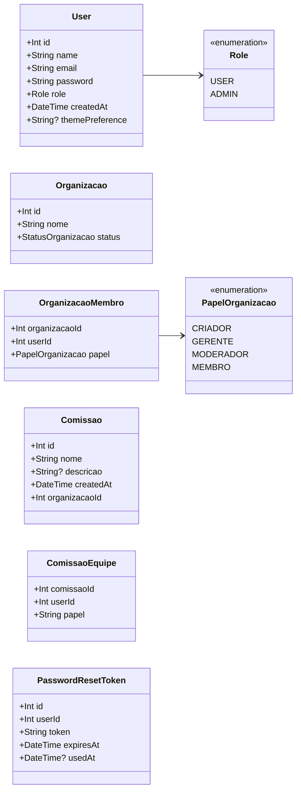
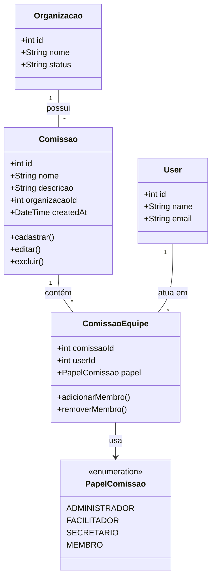
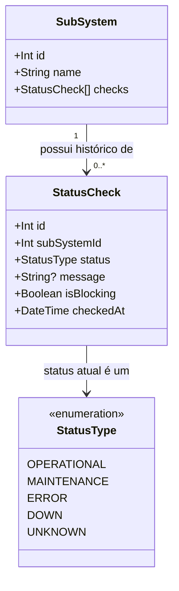
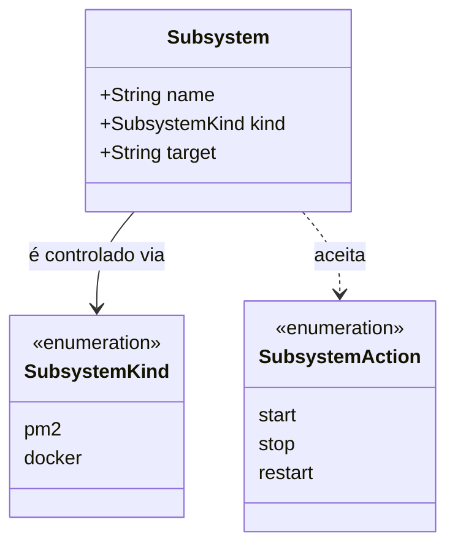
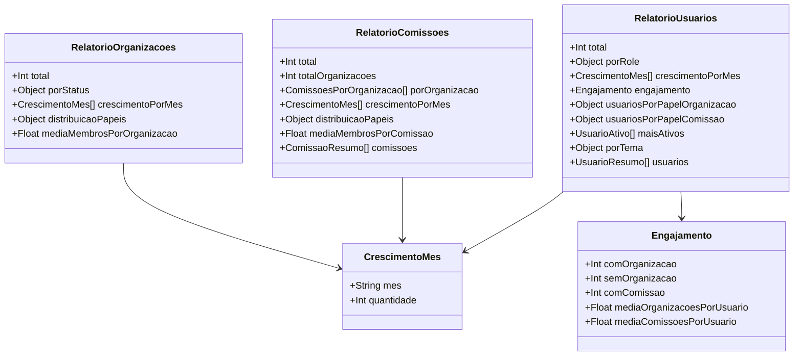

# Diagrama de classes — incremento 1

```text
Incremento: Di1 (unificado)
Escopo: Diagrama de classes de todos os requisitos do incremento 1 (RF01 a RF31)
Branch: feature/refatoracao-documentacao
Commit: 464c190
Data de revisão: 2026-11-10
Responsável(eis): [nome de quem revisa e assina o documento]
Estado: Parcial (conferido contra schema e migrations; não conferido em banco em execução)
Fontes: sistema/api/prisma/schema.prisma; sistema/api/prisma/migrations/; sistema/monitoring-better-meet/prisma/schema.prisma; sistema/docker-compose.yml; documentos/entrega2_Di1/requisitos/ (RF16 a RF31)
```

> Conferido contra o `schema.prisma` e as migrations em 2026-11-10. Correções em relação ao texto de origem: `User.themePreference` (`Tema`) e `Organizacao.status` (`StatusOrganizacao`) passaram a ser enums na migration `20261014120100_adiciona_enums_status_tema`, e o texto anterior os mostrava como `String`. A estrutura física **não** foi conferida em um banco em execução.

## Banco principal (Data API) — modelo de persistência Prisma

### Diagrama de Classes



#### Observações (do diagrama original)

- A modelagem relacional já representa as associações por meio de chaves estrangeiras e tabelas de junção.
- `OrganizacaoMembro` atua como entidade associativa entre `User` e `Organizacao`.
- `ComissaoEquipe` atua como entidade associativa entre `User` e `Comissao`.
- `PasswordResetToken` guarda tokens temporários para recuperação de senha.
- O diagrama mostra os conceitos principais do domínio, sem redundância com as relações já existentes no banco.

#### Complementos ao diagrama (conferidos no schema e no banco)

- `Organizacao` também possui o atributo `createdAt` (DateTime, default `now()`), usado pelos relatórios de crescimento mensal.
- `ComissaoEquipe.papel` é do tipo enum `PapelComissao` (`ADMINISTRADOR`, `FACILITADOR`, `SECRETARIO`, `MEMBRO`), e não um texto livre.

### Visão operacional de Comissão (diagrama original)



## Banco de monitoramento

### Diagrama de Classes



## API de Gestão (sem banco)

### Diagrama de Classes (modelo de domínio)



## Estrutura das respostas dos relatórios

### Diagrama de Classes (estrutura das respostas)


