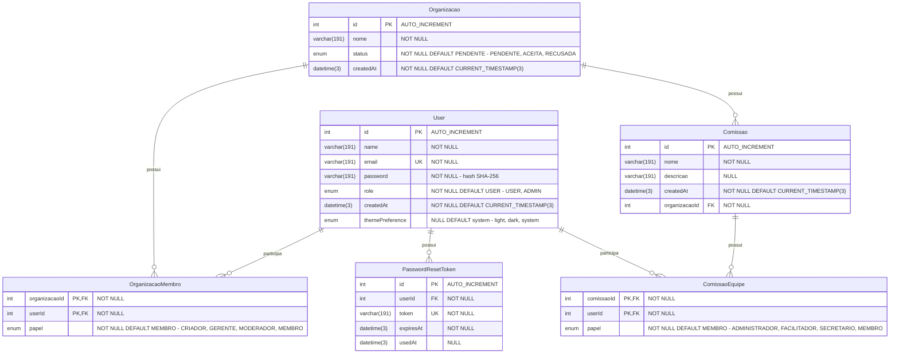
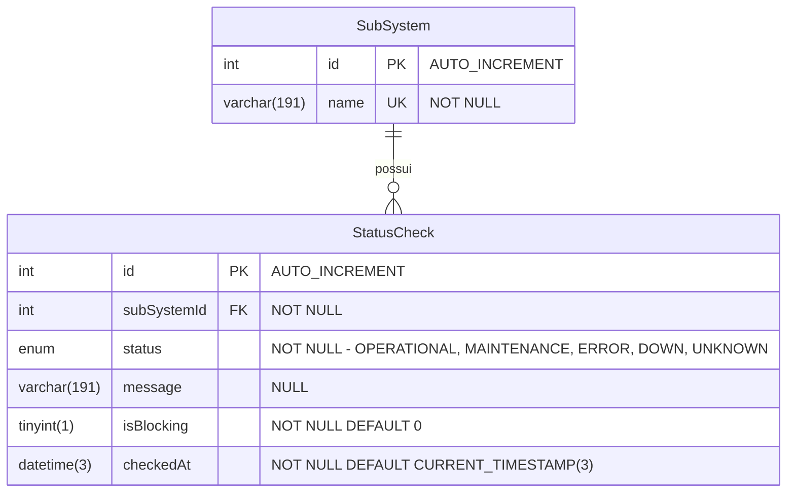

# Diagrama relacional — incremento 1

```text
Incremento: Di1 (unificado)
Escopo: Diagrama relacional de todos os requisitos do incremento 1 (RF01 a RF31)
Branch: feature/refatoracao-documentacao
Commit: 464c190
Data de revisão: 2026-11-10
Responsável(eis): [nome de quem revisa e assina o documento]
Estado: Parcial (conferido contra schema e migrations; não conferido em banco em execução)
Fontes: sistema/api/prisma/schema.prisma; sistema/api/prisma/migrations/; sistema/monitoring-better-meet/prisma/schema.prisma; sistema/docker-compose.yml; documentos/entrega2_Di1/requisitos/ (RF16 a RF31)
```

> Conferido contra o `schema.prisma` e as migrations em 2026-11-10. Correções em relação ao texto de origem: `User.themePreference` (`Tema`) e `Organizacao.status` (`StatusOrganizacao`) passaram a ser enums na migration `20261014120100_adiciona_enums_status_tema`, e o texto anterior os mostrava como `String`. A estrutura física **não** foi conferida em um banco em execução.

## Banco principal (Data API)

### Diagrama Relacional (MySQL)

Banco `bettermeet` (MySQL 8.4, `utf8mb4_unicode_ci`). Os nomes de tabelas e colunas abaixo são os nomes reais no banco — o Prisma não usa `@map`, então tabelas ficam em PascalCase e colunas em camelCase.



**Restrições e índices (nomes reais no banco)**:

| Tabela | Nome | Tipo | Colunas | Regra |
|---|---|---|---|---|
| `User` | `PRIMARY` | PK | `id` | — |
| `User` | `User_email_key` | UNIQUE | `email` | — |
| `Organizacao` | `PRIMARY` | PK | `id` | — |
| `OrganizacaoMembro` | `PRIMARY` | PK composta | `organizacaoId`, `userId` | O mesmo usuário não entra duas vezes na mesma organização |
| `OrganizacaoMembro` | `OrganizacaoMembro_organizacaoId_fkey` | FK → `Organizacao.id` | `organizacaoId` | `ON DELETE CASCADE` |
| `OrganizacaoMembro` | `OrganizacaoMembro_userId_fkey` | FK → `User.id` | `userId` | `ON DELETE CASCADE` |
| `Comissao` | `PRIMARY` | PK | `id` | — |
| `Comissao` | `Comissao_organizacaoId_fkey` | FK → `Organizacao.id` | `organizacaoId` | `ON DELETE CASCADE` |
| `ComissaoEquipe` | `PRIMARY` | PK composta | `comissaoId`, `userId` | O mesmo usuário não entra duas vezes na mesma comissão |
| `ComissaoEquipe` | `ComissaoEquipe_comissaoId_fkey` | FK → `Comissao.id` | `comissaoId` | `ON DELETE CASCADE` |
| `ComissaoEquipe` | `ComissaoEquipe_userId_fkey` | FK → `User.id` | `userId` | `ON DELETE CASCADE` |
| `PasswordResetToken` | `PRIMARY` | PK | `id` | — |
| `PasswordResetToken` | `PasswordResetToken_token_key` | UNIQUE | `token` | — |
| `PasswordResetToken` | `PasswordResetToken_userId_idx` | Índice | `userId` | — |
| `PasswordResetToken` | `PasswordResetToken_userId_fkey` | FK → `User.id` | `userId` | `ON DELETE CASCADE` |

**Regras de integridade (cascatas)**:
- Remover uma **organização** remove suas comissões, as equipes dessas comissões e os vínculos de membros da organização.
- Remover uma **comissão** remove sua equipe.
- Remover um **usuário** remove seus vínculos com organizações e comissões e seus tokens de recuperação — as organizações e comissões em si permanecem.

## Banco de monitoramento

### Diagrama Relacional (MySQL)

Banco `monitoring` (container `mysql_monitoring_better_meet_dev`, MySQL 8.4, `utf8mb4_unicode_ci`). Os nomes de tabelas e colunas abaixo são os nomes reais no banco — o Prisma não usa `@map`, então tabelas ficam em PascalCase e colunas em camelCase.



**Restrições e índices (nomes reais no banco)**:

| Tabela | Nome | Tipo | Colunas | Regra |
|---|---|---|---|---|
| `SubSystem` | `PRIMARY` | PK | `id` | — |
| `SubSystem` | `SubSystem_name_key` | UNIQUE | `name` | — |
| `StatusCheck` | `PRIMARY` | PK | `id` | — |
| `StatusCheck` | `StatusCheck_subSystemId_checkedAt_idx` | Índice composto | `subSystemId`, `checkedAt` | Otimiza as consultas de relatório diário e histórico, que sempre filtram por subsistema e por intervalo de data |
| `StatusCheck` | `StatusCheck_subSystemId_fkey` | FK → `SubSystem.id` | `subSystemId` | `ON DELETE CASCADE ON UPDATE CASCADE` |

**Regra de integridade**: por causa do `ON DELETE CASCADE`, se um `SubSystem` for removido, todo o histórico de checagens associado é removido junto (não há hoje um endpoint que remova `SubSystem`, mas a regra está definida no schema por segurança).

## API de Gestão (sem banco)

### Diagrama Relacional

Não aplicável — sem banco de dados próprio (ver justificativa acima e RNF24).

## Relatórios (sem tabela própria)

### Diagrama Relacional

Não aplicável — relatórios calculados sob demanda, sem persistência própria (ver RNF33 em `requisitos/` (RF16 a RF31)).
