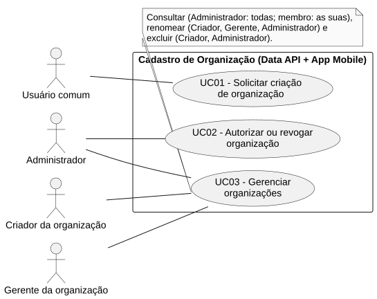
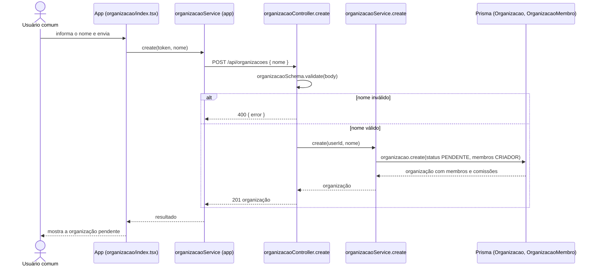

# RF01 — Solicitar criação de organização

```text
Incremento: Di1 — Cadastro (organização, comissão e usuário)
Escopo: RF01; UC01
Branch: feature/refatoracao-documentacao
Commit: 464c190
Data de revisão: 2026-11-10
Responsável(eis): [nome de quem revisa e assina o documento]
Estado: Implementado
Fontes: sistema/api/src/routes/organizacaoRoutes.ts; sistema/api/src/controllers/organizacaoController.ts; sistema/api/src/services/organizacaoService.ts; sistema/api/src/schemas/organizacaoSchema.ts; sistema/api/prisma/schema.prisma; sistema/better-meet/src/app/(tabs)/organizacao/index.tsx; sistema/better-meet/src/services/organizacaoService.ts
```

## Descrição

Um usuário autenticado pede a criação de uma organização. O pedido nasce `PENDENTE`, e o solicitante entra como `CRIADOR`. Enquanto o Administrador da plataforma não aceitar (RF02), a organização não recebe membros nem comissões.

## Formulário do requisito

| Campo | Conteúdo |
|---|---|
| Entradas | `nome` — texto; `trim`, obrigatório, até 80 caracteres (`organizacaoSchema`); vem do campo de nome da aba Organização<br/>Token JWT — identifica o solicitante (`request.user`) |
| Origem | Tela da aba Organização (`(tabs)/organizacao/index.tsx`), por `organizacaoService.create(token, nome)` do app. |
| Saída | `201` — organização criada, com `membros` ordenados por papel e `comissoes`.<br/>`400` — nome vazio ou com mais de 80 caracteres (mensagem do Yup).<br/>`401` — token ausente ou inválido. |
| Destino | Aba Organização: a organização aparece na lista do usuário com o estado "pendente". |
| Pré-condições | Usuário autenticado. |
| Pós-condições | Existem uma `Organizacao` `PENDENTE` e um `OrganizacaoMembro` `CRIADOR` ligando-a ao solicitante. |
| Efeitos colaterais | Nenhum aviso ou e-mail é enviado ao Administrador (não há código para isso). |

### Ação

1. O usuário informa o nome e envia.
2. O app chama `POST /api/organizacoes` com o token.
3. `requireAuth` valida o token; o controller valida o corpo com `organizacaoSchema`.
4. `organizacaoService.create(userId, nome)` grava `Organizacao` com `status = PENDENTE` e, na mesma operação, `OrganizacaoMembro` com `papel = CRIADOR`.
5. A API responde `201` com a organização (membros e comissões).

## Caso de uso UC01 — Solicitar criação de organização

| Item | Conteúdo |
|---|---|
| Objetivo | Um usuário autenticado pede a criação de uma organização. |
| Atores | Usuário comum (`Role.USER`). O Administrador (`Role.ADMIN`) também passa pela rota, que só exige autenticação; o código não o exclui. |
| Requisito | RF01 |
| Gatilho | O usuário toca em solicitar uma nova organização na aba Organização. |
| Fluxo principal | Ver "Ação". |
| Erros | Nome inválido (`400`); sem token (`401`). |
| Pós-condições | Existem uma `Organizacao` `PENDENTE` e um `OrganizacaoMembro` `CRIADOR` ligando-a ao solicitante. |
| Relações UML | Nenhum `include` nem `extend`. |
| Rastreabilidade | RF01; requisito do slide: Cadastro de organização; diagrama `DCU-Cadastro-de-Organizacao` |

### Diagrama de casos de uso



Fonte: [`DCU-Cadastro-de-Organizacao.puml`](../Diagramas/DCU-Cadastro-de-Organizacao.puml). O diagrama é do requisito inteiro (Cadastro de organização); este arquivo documenta só o UC01.

## Diagrama de sequência



## Requisitos não funcionais

RNF31 (escopo conforme o papel) não se aplica; sem RNF específico documentado para este requisito.

## Divergências e lacunas

- O slide diz que o usuário "realiza o cadastro" da organização; o código chama o fluxo de "solicitação" (estado `PENDENTE`), coerente com a autorização do RF02.
- Não há aviso ao Administrador sobre pedidos novos.

## Testes

Nenhum teste automatizado localizado para a criação (`CT-RF01-01`: `Não executado`).
