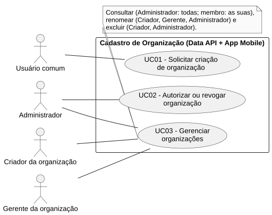
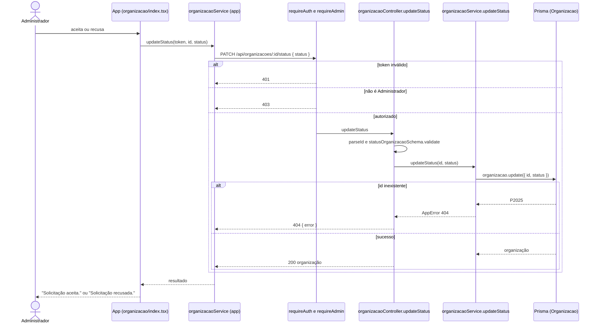

# RF02 — Autorizar ou revogar organização

```text
Incremento: Di1 — Cadastro (organização, comissão e usuário)
Escopo: RF02; UC02
Branch: feature/refatoracao-documentacao
Commit: 464c190
Data de revisão: 2026-11-10
Responsável(eis): [nome de quem revisa e assina o documento]
Estado: Implementado
Fontes: sistema/api/src/routes/organizacaoRoutes.ts; sistema/api/src/services/organizacaoService.ts; sistema/api/src/schemas/organizacaoSchema.ts; sistema/better-meet/src/app/(tabs)/organizacao/index.tsx
```

## Descrição

O Administrador da plataforma aceita ou recusa uma organização. Só organizações `ACEITA` recebem membros (RF11) e comissões (RF04).

## Formulário do requisito

| Campo | Conteúdo |
|---|---|
| Entradas | `id` da organização — inteiro positivo, na URL (`parseId`)<br/>`status` — `ACEITA` ou `RECUSADA` (`PENDENTE` não é aceito; `statusOrganizacaoSchema`)<br/>Token JWT com `role = ADMIN` |
| Origem | Telas da aba Organização (`index.tsx` e `[id].tsx`) para o Administrador, por `organizacaoService.updateStatus(token, id, status)`. |
| Saída | `200` — organização com o novo status.<br/>`400` — id inválido ou `status` fora de `ACEITA`/`RECUSADA`.<br/>`401` — sem token; `403` — usuário que não é Administrador.<br/>`404` — organização inexistente (`P2025` convertido em "Organização não encontrada."). |
| Destino | Aba Organização; mensagem "Solicitação aceita." ou "Solicitação recusada." no app. |
| Pré-condições | Administrador autenticado e organização existente. |
| Pós-condições | `Organizacao.status` igual ao valor escolhido. |
| Efeitos colaterais | Nenhum. Mudar uma organização de `ACEITA` para `RECUSADA` não remove membros nem comissões. |

### Ação

1. O Administrador escolhe aceitar ou recusar.
2. O app chama `PATCH /api/organizacoes/:id/status`.
3. `requireAuth` e `requireAdmin` conferem token e papel; o controller valida `status`.
4. `organizacaoService.updateStatus` atualiza `Organizacao.status` e devolve a organização.

## Caso de uso UC02 — Autorizar ou revogar organização

| Item | Conteúdo |
|---|---|
| Objetivo | O Administrador da plataforma aceita ou recusa uma organização. |
| Atores | Administrador (`Role.ADMIN`). |
| Requisito | RF02 |
| Gatilho | O Administrador abre uma solicitação pendente (ou uma organização já aceita) e escolhe aceitar ou recusar. |
| Fluxo principal | Ver "Ação". |
| Erros | Sem permissão (`403`), organização inexistente (`404`), status inválido (`400`). |
| Pós-condições | `Organizacao.status` igual ao valor escolhido. |
| Relações UML | Nenhum `include` nem `extend`. |
| Rastreabilidade | RF02; requisito do slide: Cadastro de organização; diagrama `DCU-Cadastro-de-Organizacao` |

### Diagrama de casos de uso



Fonte: [`DCU-Cadastro-de-Organizacao.puml`](../Diagramas/DCU-Cadastro-de-Organizacao.puml). O diagrama é do requisito inteiro (Cadastro de organização); este arquivo documenta só o UC02.

## Diagrama de sequência



## Requisitos não funcionais

RNF22 (autorização por papel) aplica-se em espírito (a rota exige `ADMIN`), mas o RNF22 hoje descreve a API de Gestão; `[A CONFIRMAR NA WIKI]` se existe um RNF de autorização para a Data API.

## Divergências e lacunas

- "Revogar" não é uma operação separada: o código apenas muda o status para `RECUSADA`, inclusive a partir de `ACEITA`, e não trata membros nem comissões já existentes.
- O `PENDENTE` não pode ser reatribuído.

## Testes

Nenhum teste automatizado localizado (`CT-RF02-01`: `Não executado`).
