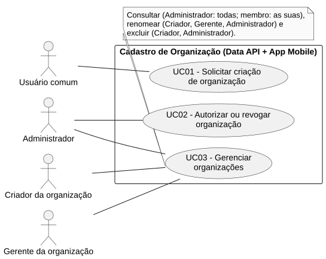
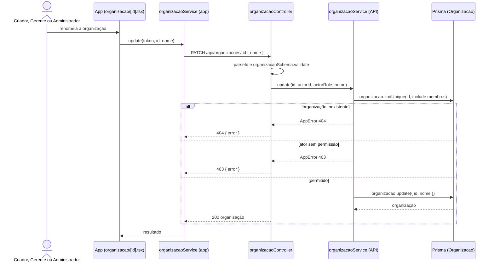

# RF03 — Gerenciar organizações

```text
Incremento: Di1 — Cadastro (organização, comissão e usuário)
Escopo: RF03; UC03
Branch: feature/refatoracao-documentacao
Commit: 464c190
Data de revisão: 2026-11-10
Responsável(eis): [nome de quem revisa e assina o documento]
Estado: Implementado
Fontes: sistema/api/src/routes/organizacaoRoutes.ts; sistema/api/src/services/organizacaoService.ts; sistema/api/src/schemas/organizacaoSchema.ts; sistema/api/tests/organizacaoComissaoDetalhe.test.mjs; sistema/better-meet/src/app/(tabs)/organizacao/index.tsx; sistema/better-meet/src/app/(tabs)/organizacao/[id].tsx
```

## Descrição

Consultar, renomear e excluir organizações. O Administrador vê todas; cada membro vê as suas. Os relatórios de organizações ficam no RF28.

## Formulário do requisito

| Campo | Conteúdo |
|---|---|
| Entradas | Token JWT<br/>`id` da organização (URL)<br/>`nome` — para renomear: `trim`, obrigatório, até 80 caracteres |
| Origem | Aba Organização (`index.tsx` e `[id].tsx`), por `organizacaoService.listMine`, `listAll`, `getById`, `update` e `delete` do app. |
| Saída | `200` — lista, detalhe ou organização renomeada; `200 { message: "Organização excluída com sucesso." }` na exclusão.<br/>`400` — id ou nome inválido.<br/>`401` — sem token.<br/>`403` — "Você não é membro desta organização.", "Somente o criador ou o gerente pode editar a organização." ou "Somente o criador pode excluir a organização.".<br/>`404` — "Organização não encontrada.". |
| Destino | Aba Organização (lista e detalhe). |
| Pré-condições | Usuário autenticado. |
| Pós-condições | Nome alterado ou organização removida, conforme a operação. |
| Efeitos colaterais | A exclusão remove, em cascata, membros, comissões e suas equipes. |

### Ação

1. `GET /api/organizacoes` (somente Administrador): lista todas, da mais nova para a mais antiga.
2. `GET /api/organizacoes/minhas`: as organizações em que o usuário é membro.
3. `GET /api/organizacoes/:id`: detalhe com membros ordenados por papel (criador, gerente, moderador, membro) e comissões; só membro ou Administrador.
4. `PATCH /api/organizacoes/:id`: renomeia; Criador, Gerente ou Administrador.
5. `DELETE /api/organizacoes/:id`: exclui; só o Criador ou o Administrador; membros, comissões e equipes saem junto (`onDelete: Cascade`).

## Caso de uso UC03 — Gerenciar organizações

| Item | Conteúdo |
|---|---|
| Objetivo | Consultar, renomear e excluir organizações. |
| Atores | Administrador (`Role.ADMIN`); Criador e Gerente da organização (`PapelOrganizacao`); Membro da organização, só para consultar. |
| Requisito | RF03 |
| Gatilho | O usuário abre a aba Organização ou o detalhe de uma organização. |
| Fluxo principal | Ver "Ação". |
| Erros | Sem permissão (`403`), inexistente (`404`), nome inválido (`400`). |
| Pós-condições | Nome alterado ou organização removida, conforme a operação. |
| Relações UML | Nenhum `include` nem `extend`. |
| Rastreabilidade | RF03; requisito do slide: Cadastro de organização; diagrama `DCU-Cadastro-de-Organizacao` |

### Diagrama de casos de uso



Fonte: [`DCU-Cadastro-de-Organizacao.puml`](../Diagramas/DCU-Cadastro-de-Organizacao.puml). O diagrama é do requisito inteiro (Cadastro de organização); este arquivo documenta só o UC03.

## Diagrama de sequência



## Requisitos não funcionais

RNF31 (escopo conforme o papel) aplica-se às listagens (Administrador vê todas, membro vê as suas).

## Divergências e lacunas

- "Gerenciar organizações" nos slides foi desdobrado em consultar, renomear e excluir; o código não tem outras operações (como suspender).
- Não há UC separado para o relatório de organizações: ele é o RF28.

## Testes

CT-RF03-01: `sistema/api/tests/organizacaoComissaoDetalhe.test.mjs` cobre o detalhe e a edição de organizações (ver `entrega2_Di1/testes_detalhe_organizacao_comissao.md`); a execução atual não foi repetida nesta etapa (`Não executado` na refatoração). Exclusão: nenhum teste localizado.
