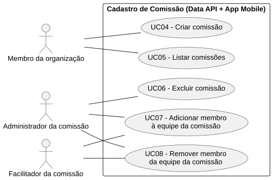
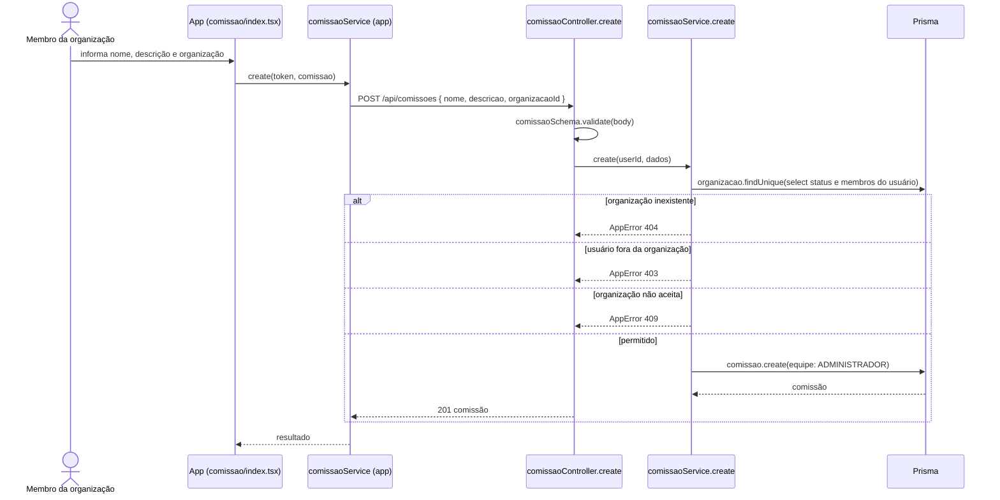

# RF04 — Criar comissão

```text
Incremento: Di1 — Cadastro (organização, comissão e usuário)
Escopo: RF04; UC04
Branch: feature/refatoracao-documentacao
Commit: 464c190
Data de revisão: 2026-11-10
Responsável(eis): [nome de quem revisa e assina o documento]
Estado: Implementado
Fontes: sistema/api/src/routes/comissaoRoutes.ts; sistema/api/src/controllers/comissaoController.ts; sistema/api/src/services/comissaoService.ts; sistema/api/src/schemas/comissaoSchema.ts; sistema/api/prisma/schema.prisma; sistema/better-meet/src/app/(tabs)/comissao/index.tsx; sistema/better-meet/src/services/comissaoService.ts
```

## Descrição

Cria uma comissão dentro de uma organização aceita. Quem cria vira `ADMINISTRADOR` da comissão.

## Formulário do requisito

| Campo | Conteúdo |
|---|---|
| Entradas | `nome` — `trim`, obrigatório, até 80 caracteres<br/>`descricao` — opcional, `trim`, até 500 caracteres (vazia vira `null`)<br/>`organizacaoId` — inteiro positivo, obrigatório<br/>Token JWT |
| Origem | Aba Comissão (`(tabs)/comissao/index.tsx`), por `comissaoService.create(token, comissao)` do app. |
| Saída | `201` — comissão criada.<br/>`400` — nome, descrição ou `organizacaoId` inválidos.<br/>`401` — sem token.<br/>`403` — "Você não é membro desta organização.".<br/>`404` — "Organização não encontrada.".<br/>`409` — "A organização ainda não foi aprovada.". |
| Destino | Aba Comissão e detalhe da organização. |
| Pré-condições | Usuário autenticado, membro de uma organização `ACEITA`. |
| Pós-condições | Existem uma `Comissao` e um `ComissaoEquipe` `ADMINISTRADOR` para o criador. |
| Efeitos colaterais | Nenhum. |

### Ação

1. O usuário informa nome, descrição e a organização.
2. `POST /api/comissoes` com o token.
3. O controller valida o corpo com `comissaoSchema`.
4. `comissaoService.create` confere se o usuário é membro da organização e se ela está `ACEITA` (`assertMembroDaOrganizacao`).
5. Grava `Comissao` e `ComissaoEquipe` com `papel = ADMINISTRADOR` para o criador, na mesma operação.

## Caso de uso UC04 — Criar comissão

| Item | Conteúdo |
|---|---|
| Objetivo | Cria uma comissão dentro de uma organização aceita. |
| Atores | Membro da organização (qualquer papel de `PapelOrganizacao`). |
| Requisito | RF04 |
| Gatilho | O membro da organização escolhe criar uma comissão. |
| Fluxo principal | Ver "Ação". |
| Erros | Não é membro (`403`), organização inexistente (`404`) ou não aprovada (`409`), dados inválidos (`400`). |
| Pós-condições | Existem uma `Comissao` e um `ComissaoEquipe` `ADMINISTRADOR` para o criador. |
| Relações UML | Nenhum `include` nem `extend`. |
| Rastreabilidade | RF04; requisito do slide: Cadastro de comissão; diagrama `DCU-Cadastro-de-Comissao` |

### Diagrama de casos de uso



Fonte: [`DCU-Cadastro-de-Comissao.puml`](../Diagramas/DCU-Cadastro-de-Comissao.puml). O diagrama é do requisito inteiro (Cadastro de comissão); este arquivo documenta só o UC04.

## Diagrama de sequência



## Requisitos não funcionais

Sem RNF específico documentado.

## Divergências e lacunas

- O slide diz que o "Administrador da organização" cadastra a comissão; no código qualquer membro da organização (inclusive `MEMBRO`) pode criar. `[A CONFIRMAR]` se a regra desejada é restringir.
- O `schema.prisma` avisa que o banco não garante a regra "só membros da organização entram na equipe"; ela está só no service.

## Testes

Nenhum teste automatizado localizado (`CT-RF04-01`: `Não executado`).
