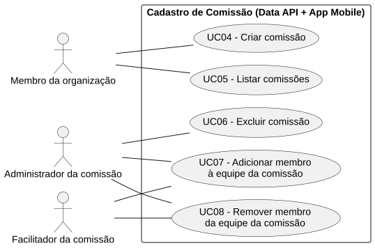
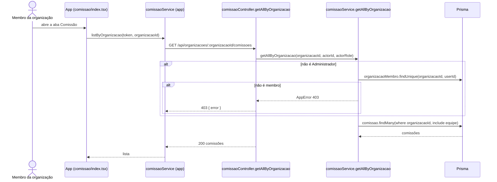

# RF05 — Listar comissões

```text
Incremento: Di1 — Cadastro (organização, comissão e usuário)
Escopo: RF05; UC05
Branch: feature/refatoracao-documentacao
Commit: 464c190
Data de revisão: 2026-11-10
Responsável(eis): [nome de quem revisa e assina o documento]
Estado: Implementado
Fontes: sistema/api/src/routes/comissaoRoutes.ts; sistema/api/src/services/comissaoService.ts; sistema/api/tests/organizacaoComissaoDetalhe.test.mjs; sistema/better-meet/src/app/(tabs)/comissao/index.tsx; sistema/better-meet/src/app/(tabs)/comissao/[id].tsx
```

## Descrição

Lista as comissões de uma organização e mostra o detalhe de uma comissão, com a equipe ordenada por papel. A edição de nome e descrição também fica aqui, porque o diagrama original não tinha um caso de uso próprio para ela.

## Formulário do requisito

| Campo | Conteúdo |
|---|---|
| Entradas | `organizacaoId` ou `id` da comissão (URL, inteiro positivo)<br/>`nome` e `descricao` — só na edição, com as mesmas regras do RF04<br/>Token JWT |
| Origem | Abas Comissão e Organização, por `comissaoService.listByOrganizacao`, `getById` e `update` do app. |
| Saída | `200` — lista, detalhe ou comissão editada.<br/>`400` — id, nome ou descrição inválidos.<br/>`401` — sem token.<br/>`403` — "Você não é membro desta organização." ou "Acesso negado. Apenas administrador ou facilitador pode editar a comissão.".<br/>`404` — "Comissão não encontrada.". |
| Destino | Aba Comissão (lista e detalhe). |
| Pré-condições | Usuário autenticado e membro da organização (ou Administrador da plataforma). |
| Pós-condições | Sem alteração, exceto na edição. |
| Efeitos colaterais | Nenhum. |

### Ação

1. `GET /api/organizacoes/:organizacaoId/comissoes`: membros da organização ou Administrador; da mais nova para a mais antiga, com `equipe`.
2. `GET /api/comissoes/:id`: detalhe com organização e equipe (ordem: administrador, facilitador, secretário, membro).
3. `PATCH /api/comissoes/:id`: edita nome e descrição; só `ADMINISTRADOR` ou `FACILITADOR` da comissão.

## Caso de uso UC05 — Listar comissões

| Item | Conteúdo |
|---|---|
| Objetivo | Lista as comissões de uma organização e mostra o detalhe de uma comissão, com a equipe ordenada por papel. |
| Atores | Membro da organização; Administrador (`Role.ADMIN`); na edição, Administrador ou Facilitador da comissão. |
| Requisito | RF05 |
| Gatilho | O usuário abre a aba Comissão. |
| Fluxo principal | Ver "Ação". |
| Erros | Fora da organização (`403`), inexistente (`404`). |
| Pós-condições | Sem alteração, exceto na edição. |
| Relações UML | Nenhum `include` nem `extend`. |
| Rastreabilidade | RF05; requisito do slide: Cadastro de comissão; diagrama `DCU-Cadastro-de-Comissao` |

### Diagrama de casos de uso



Fonte: [`DCU-Cadastro-de-Comissao.puml`](../Diagramas/DCU-Cadastro-de-Comissao.puml). O diagrama é do requisito inteiro (Cadastro de comissão); este arquivo documenta só o UC05.

## Diagrama de sequência



## Requisitos não funcionais

Sem RNF específico documentado.

## Divergências e lacunas

- A edição (`PATCH /api/comissoes/:id`) existe no código, mas não tinha UC no diagrama original; foi agrupada aqui. `[A CONFIRMAR]` se merece um UC próprio no incremento seguinte.

## Testes

CT-RF05-01: `sistema/api/tests/organizacaoComissaoDetalhe.test.mjs` cobre o detalhe e a edição de comissões (ver `testes_detalhe_organizacao_comissao.md`); não repetido nesta etapa (`Não executado`).
