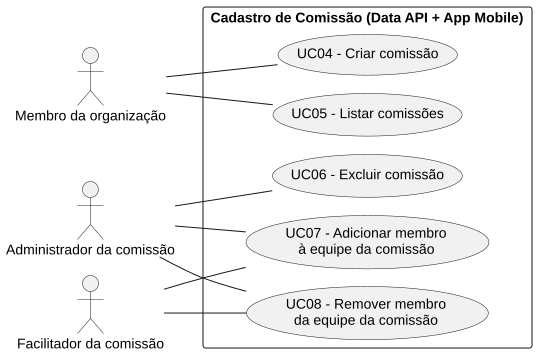
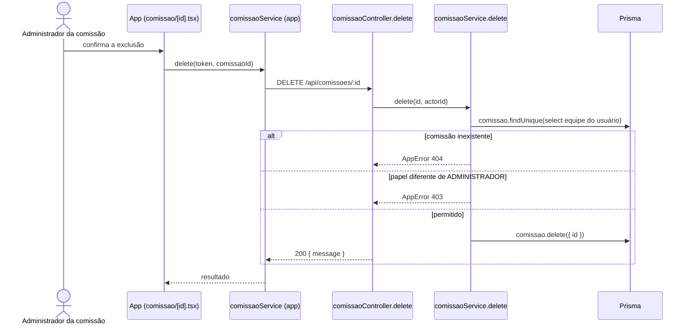

# RF06 — Excluir comissão

```text
Incremento: Di1 — Cadastro (organização, comissão e usuário)
Escopo: RF06; UC06
Branch: feature/refatoracao-documentacao
Commit: 464c190
Data de revisão: 2026-11-10
Responsável(eis): [nome de quem revisa e assina o documento]
Estado: Implementado
Fontes: sistema/api/src/routes/comissaoRoutes.ts; sistema/api/src/services/comissaoService.ts; sistema/api/prisma/schema.prisma; sistema/better-meet/src/app/(tabs)/comissao/[id].tsx
```

## Descrição

Remove uma comissão e a sua equipe. Só o `ADMINISTRADOR` da comissão pode excluir.

## Formulário do requisito

| Campo | Conteúdo |
|---|---|
| Entradas | `id` da comissão (URL, inteiro positivo)<br/>Token JWT |
| Origem | Detalhe da comissão (`comissao/[id].tsx`), por `comissaoService.delete(token, comissaoId)` do app. |
| Saída | `200 { message: "Comissão excluída com sucesso." }`.<br/>`400` — id inválido.<br/>`401` — sem token.<br/>`403` — "Acesso negado. Apenas o administrador pode excluir a comissão.".<br/>`404` — "Comissão não encontrada.". |
| Destino | Aba Comissão (a lista deixa de mostrar a comissão). |
| Pré-condições | Usuário autenticado e `ADMINISTRADOR` da comissão. |
| Pós-condições | `Comissao` e `ComissaoEquipe` removidas. |
| Efeitos colaterais | As reuniões da comissão também são excluídas: `Reuniao.comissao` tem `onDelete: Cascade` no `schema.prisma`, e convites, registros, lembretes e votações das reuniões acompanham a mesma cascata (`ConviteReuniao` e `ReuniaoRegistro` com `onDelete: Cascade`; `Votacao` e `LembreteEnviado` `[A CONFIRMAR NO CÓDIGO]`). |

### Ação

1. O Administrador da comissão confirma a exclusão.
2. `DELETE /api/comissoes/:id`.
3. `comissaoService.delete` descobre o papel do usuário (`getPapelNaComissao`) e exige `ADMINISTRADOR`.
4. `comissao.delete`; a equipe sai junto por `onDelete: Cascade`.

## Caso de uso UC06 — Excluir comissão

| Item | Conteúdo |
|---|---|
| Objetivo | Remove uma comissão e a sua equipe. |
| Atores | Administrador da comissão (`PapelComissao.ADMINISTRADOR`). |
| Requisito | RF06 |
| Gatilho | O Administrador da comissão escolhe excluí-la e confirma. |
| Fluxo principal | Ver "Ação". |
| Erros | Sem permissão (`403`), inexistente (`404`). |
| Pós-condições | `Comissao` e `ComissaoEquipe` removidas. |
| Relações UML | Nenhum `include` nem `extend`. |
| Rastreabilidade | RF06; requisito do slide: Cadastro de comissão; diagrama `DCU-Cadastro-de-Comissao` |

### Diagrama de casos de uso



Fonte: [`DCU-Cadastro-de-Comissao.puml`](../Diagramas/DCU-Cadastro-de-Comissao.puml). O diagrama é do requisito inteiro (Cadastro de comissão); este arquivo documenta só o UC06.

## Diagrama de sequência



## Requisitos não funcionais

Sem RNF específico documentado.

## Divergências e lacunas

- A exclusão da comissão apaga as suas reuniões por cascata (ver Efeitos colaterais); o aviso ao usuário antes de excluir não foi verificado.

## Testes

Nenhum teste automatizado localizado (`CT-RF06-01`: `Não executado`).
