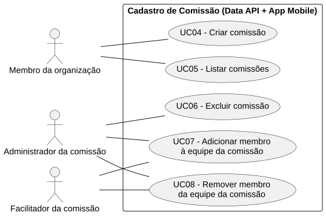
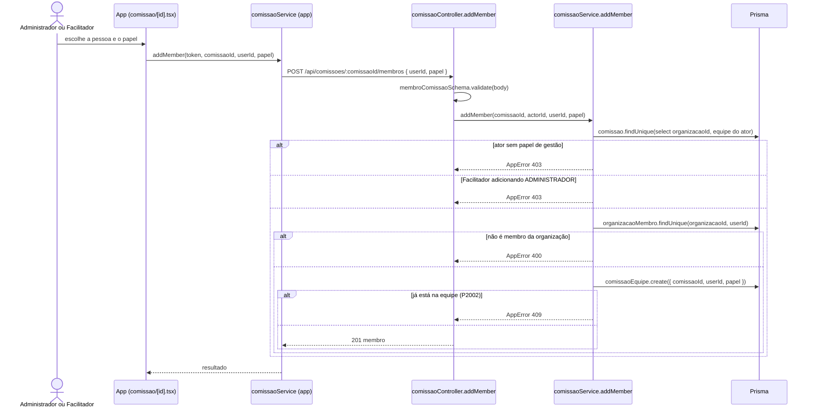

# RF07 — Adicionar membro à equipe da comissão

```text
Incremento: Di1 — Cadastro (organização, comissão e usuário)
Escopo: RF07; UC07
Branch: feature/refatoracao-documentacao
Commit: 464c190
Data de revisão: 2026-11-10
Responsável(eis): [nome de quem revisa e assina o documento]
Estado: Implementado
Fontes: sistema/api/src/routes/comissaoRoutes.ts; sistema/api/src/services/comissaoService.ts; sistema/api/src/schemas/comissaoSchema.ts; sistema/better-meet/src/app/(tabs)/comissao/[id].tsx
```

## Descrição

Inclui uma pessoa na equipe de uma comissão e permite promover ou rebaixar o papel de quem já faz parte. Papéis: `ADMINISTRADOR`, `FACILITADOR`, `SECRETARIO`, `MEMBRO`.

## Formulário do requisito

| Campo | Conteúdo |
|---|---|
| Entradas | `comissaoId` (URL) e, para alterar papel, `userId` (URL)<br/>`userId` — inteiro positivo (corpo, na inclusão)<br/>`papel` — `PapelComissao`; padrão `MEMBRO`<br/>Token JWT |
| Origem | Detalhe da comissão (`comissao/[id].tsx`), por `comissaoService.addMember` e `updateMemberRole` do app. |
| Saída | `201` — membro incluído; `200` — papel alterado (igual ao atual: devolve o registro sem alterar).<br/>`400` — "O usuário precisa ser membro da organização para entrar na comissão." ou "A comissão precisa de pelo menos um administrador.".<br/>`403` — "Acesso negado. Você não tem permissão para gerenciar a equipe." ou "Apenas o administrador pode adicionar outro administrador." (e variações para alterar papel).<br/>`404` — comissão ou "Membro não encontrado na comissão.".<br/>`409` — "Este usuário já faz parte da comissão.". |
| Destino | Detalhe da comissão (equipe atualizada). |
| Pré-condições | Usuário autenticado, com papel de gestão de equipe na comissão. |
| Pós-condições | `ComissaoEquipe` criada ou com papel alterado. |
| Efeitos colaterais | Nenhum. |

### Ação

1. Inclusão: `POST /api/comissoes/:comissaoId/membros` `{ userId, papel }`. O ator deve ser `ADMINISTRADOR` ou `FACILITADOR`; só o `ADMINISTRADOR` pode adicionar outro `ADMINISTRADOR`; o alvo precisa ser membro da organização da comissão.
2. Alteração de papel: `PATCH /api/comissoes/:comissaoId/membros/:userId` `{ papel }`, com as mesmas permissões; o Facilitador não mexe em `ADMINISTRADOR` nem cria um; o último `ADMINISTRADOR` não pode ser rebaixado.

## Caso de uso UC07 — Adicionar membro à equipe da comissão

| Item | Conteúdo |
|---|---|
| Objetivo | Inclui uma pessoa na equipe de uma comissão e permite promover ou rebaixar o papel de quem já faz parte. |
| Atores | Administrador ou Facilitador da comissão (`PapelComissao`). |
| Requisito | RF07 |
| Gatilho | O gestor da equipe escolhe adicionar uma pessoa ou mudar o papel dela. |
| Fluxo principal | Ver "Ação". |
| Erros | Ver "Saída". |
| Pós-condições | `ComissaoEquipe` criada ou com papel alterado. |
| Relações UML | Nenhum `include` nem `extend`. |
| Rastreabilidade | RF07; requisito do slide: Cadastro de comissão; diagrama `DCU-Cadastro-de-Comissao` |

### Diagrama de casos de uso



Fonte: [`DCU-Cadastro-de-Comissao.puml`](../Diagramas/DCU-Cadastro-de-Comissao.puml). O diagrama é do requisito inteiro (Cadastro de comissão); este arquivo documenta só o UC07.

## Diagrama de sequência



## Requisitos não funcionais

Sem RNF específico documentado.

## Divergências e lacunas

- A alteração de papel pertence ao antigo "gestão de equipe" (UC03 do diagrama original) e ficou neste RF e no RF08 por simplicidade.
- A busca de pessoas para incluir usa o RF11 (`GET /api/usuarios/busca`).

## Testes

Nenhum teste automatizado localizado (`CT-RF07-01`: `Não executado`).
