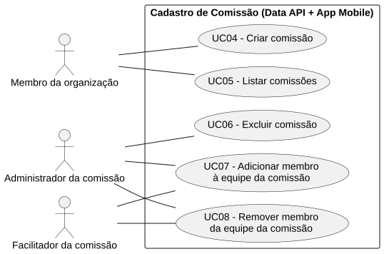
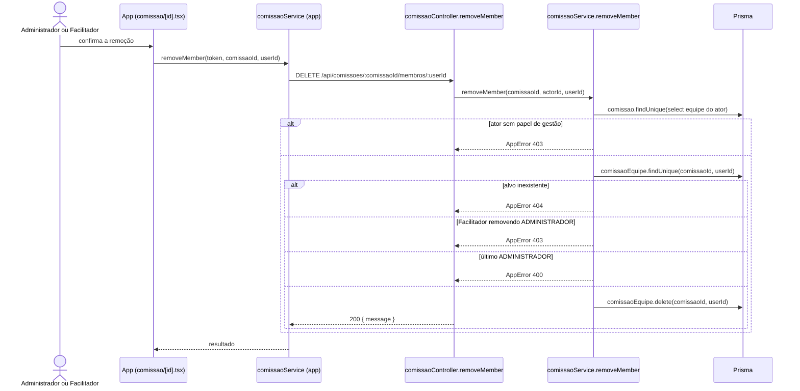

# RF08 — Remover membro da equipe da comissão

```text
Incremento: Di1 — Cadastro (organização, comissão e usuário)
Escopo: RF08; UC08
Branch: feature/refatoracao-documentacao
Commit: 464c190
Data de revisão: 2026-11-10
Responsável(eis): [nome de quem revisa e assina o documento]
Estado: Implementado
Fontes: sistema/api/src/routes/comissaoRoutes.ts; sistema/api/src/services/comissaoService.ts; sistema/better-meet/src/app/(tabs)/comissao/[id].tsx
```

## Descrição

Retira uma pessoa da equipe da comissão, preservando sempre ao menos um `ADMINISTRADOR`.

## Formulário do requisito

| Campo | Conteúdo |
|---|---|
| Entradas | `comissaoId` e `userId` (URL, inteiros positivos)<br/>Token JWT |
| Origem | Detalhe da comissão (`comissao/[id].tsx`), por `comissaoService.removeMember(token, comissaoId, userId)` do app. |
| Saída | `200 { message: "Membro removido com sucesso." }`.<br/>`400` — "A comissão precisa de pelo menos um administrador.".<br/>`401` — sem token.<br/>`403` — "Acesso negado. Você não tem permissão para remover membros." ou "Um facilitador não pode remover um administrador.".<br/>`404` — comissão ou "Membro não encontrado na comissão.". |
| Destino | Detalhe da comissão (equipe atualizada). |
| Pré-condições | Usuário autenticado, com papel de gestão de equipe na comissão. |
| Pós-condições | `ComissaoEquipe` removida. |
| Efeitos colaterais | Nenhum. |

### Ação

1. `DELETE /api/comissoes/:comissaoId/membros/:userId`.
2. O ator deve ser `ADMINISTRADOR` ou `FACILITADOR`.
3. O Facilitador não remove um `ADMINISTRADOR`.
4. O último `ADMINISTRADOR` não pode ser removido.
5. `comissaoEquipe.delete`.

## Caso de uso UC08 — Remover membro da equipe da comissão

| Item | Conteúdo |
|---|---|
| Objetivo | Retira uma pessoa da equipe da comissão, preservando sempre ao menos um `ADMINISTRADOR`.. |
| Atores | Administrador ou Facilitador da comissão. |
| Requisito | RF08 |
| Gatilho | O gestor da equipe escolhe remover uma pessoa. |
| Fluxo principal | Ver "Ação". |
| Erros | Ver "Saída". |
| Pós-condições | `ComissaoEquipe` removida. |
| Relações UML | Nenhum `include` nem `extend`. |
| Rastreabilidade | RF08; requisito do slide: Cadastro de comissão; diagrama `DCU-Cadastro-de-Comissao` |

### Diagrama de casos de uso



Fonte: [`DCU-Cadastro-de-Comissao.puml`](../Diagramas/DCU-Cadastro-de-Comissao.puml). O diagrama é do requisito inteiro (Cadastro de comissão); este arquivo documenta só o UC08.

## Diagrama de sequência



## Requisitos não funcionais

Sem RNF específico documentado.

## Divergências e lacunas

- O código não impede que alguém se remova da comissão nem trata o que acontece com convites e registros de reunião da pessoa removida; `[A CONFIRMAR NO CÓDIGO]` nos RF32 a RF35.

## Testes

Nenhum teste automatizado localizado (`CT-RF08-01`: `Não executado`).
