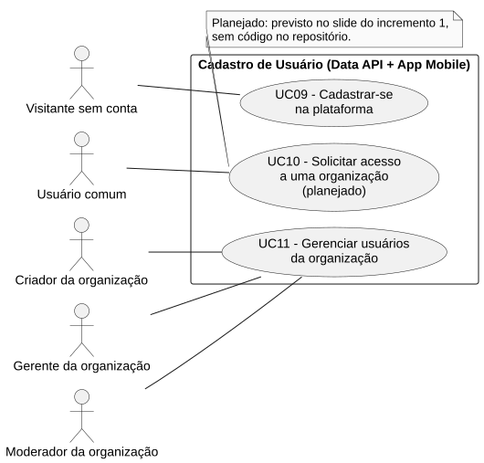
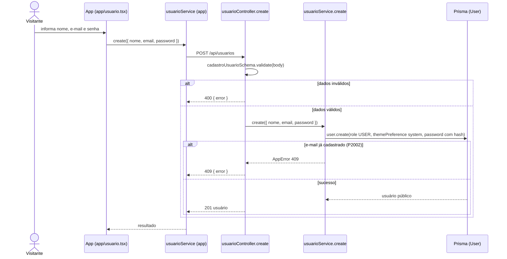

# RF09 — Cadastrar-se na plataforma

```text
Incremento: Di1 — Cadastro (organização, comissão e usuário)
Escopo: RF09; UC09
Branch: feature/refatoracao-documentacao
Commit: 464c190
Data de revisão: 2026-11-10
Responsável(eis): [nome de quem revisa e assina o documento]
Estado: Implementado
Fontes: sistema/api/src/routes/usuarioRoutes.ts; sistema/api/src/controllers/usuarioController.ts; sistema/api/src/services/usuarioService.ts; sistema/api/src/schemas/usuarioSchema.ts; sistema/api/src/schemas/commonSchema.ts; sistema/api/src/utils/passwordHash.ts; sistema/better-meet/src/app/usuario.tsx; sistema/better-meet/src/schemas/__tests__/usuarioSchema.test.ts
```

## Descrição

Uma pessoa cria a própria conta. A rota é pública, porque quem se cadastra ainda não tem token. A conta nasce como `Role.USER` com tema `system`.

## Formulário do requisito

| Campo | Conteúdo |
|---|---|
| Entradas | `nome` — `trim`, obrigatório, de 2 a 80 caracteres (`nomeRule`)<br/>`email` — `trim`, minúsculas, obrigatório, e-mail válido, até 160 caracteres (`emailRule`); único no banco<br/>`password` — de 8 a 72 caracteres, com letra maiúscula, letra minúscula e número (`senhaForteRule`)<br/>`role` — opcional; só aceita `USER` (recusa tentativa de criar administrador) |
| Origem | Tela de cadastro (`app/usuario.tsx`), por `usuarioService.create(usuario)` do app (sem token). |
| Saída | `201` — usuário criado (campos de `userPublicSelect`, sem `password`).<br/>`400` — validação (mensagens do Yup, em português).<br/>`409` — "Este e-mail já está cadastrado.". |
| Destino | Tela de login (o app leva o usuário de volta para entrar). |
| Pré-condições | Nenhuma (rota pública). |
| Pós-condições | Existe um `User` com o e-mail informado. |
| Efeitos colaterais | Nenhum e-mail de boas-vindas (não há código para isso). |

### Ação

1. A pessoa preenche nome, e-mail e senha.
2. O app valida com o schema do app e chama `POST /api/usuarios`.
3. O controller valida com `cadastroUsuarioSchema`.
4. `usuarioService.create` grava `User` com `role = USER`, `themePreference = system` e a senha transformada por `hashPassword`.
5. Responde `201` com o usuário público (sem senha).

## Caso de uso UC09 — Cadastrar-se na plataforma

| Item | Conteúdo |
|---|---|
| Objetivo | Uma pessoa cria a própria conta. |
| Atores | Visitante que ainda não tem conta (ator humano sem conta; vira Usuário comum, `Role.USER`). |
| Requisito | RF09 |
| Gatilho | A pessoa escolhe criar conta na tela inicial. |
| Fluxo principal | Ver "Ação". |
| Erros | Dados inválidos (`400`), e-mail repetido (`409`). |
| Pós-condições | Existe um `User` com o e-mail informado. |
| Relações UML | Nenhum `include` nem `extend`. |
| Rastreabilidade | RF09; requisito do slide: Cadastro de usuário; diagrama `DCU-Cadastro-de-Usuario` |

### Diagrama de casos de uso



Fonte: [`DCU-Cadastro-de-Usuario.puml`](../Diagramas/DCU-Cadastro-de-Usuario.puml). O diagrama é do requisito inteiro (Cadastro de usuário); este arquivo documenta só o UC09.

## Diagrama de sequência



## Requisitos não funcionais

RNF02 (proteção de dados sensíveis) e RNF06 (criptografia de senha) da Wiki aplicam-se. O `passwordHash.ts` compara `hashPassword(senha) === hash`, indício de hash determinístico; algoritmo e sal `[A CONFIRMAR NO CÓDIGO]` antes de afirmar qualquer coisa no RNF06.

## Divergências e lacunas

- O índice da Wiki chama o RF antigo de "Cadastro de usuário" (RF01 antigo); o slide também inclui a solicitação de acesso (RF10) e o gerenciamento de usuários da organização (RF11), documentados à parte.

- O diagrama de sequência original (`DS-Usuario.png`) misturava cadastrar, editar dados, excluir conta e gerenciar usuário; a exclusão de conta (`DELETE /api/usuarios/:id/dados-pessoais` e `/dados-completos`) existe no código e não tem UC na numeração aprovada.

## Testes

CT-RF09-01: `sistema/better-meet/src/schemas/__tests__/usuarioSchema.test.ts` testa o schema do app; não repetido nesta etapa (`Não executado`). Rota `POST /api/usuarios`: nenhum teste localizado.
