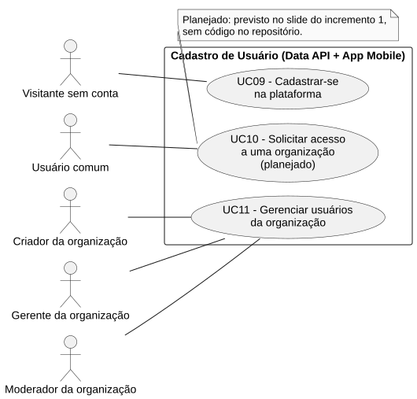

# RF10 — Solicitar acesso a uma organização

```text
Incremento: Di1 — Cadastro (organização, comissão e usuário)
Escopo: RF10; UC10
Branch: feature/refatoracao-documentacao
Commit: 464c190
Data de revisão: 2026-11-10
Responsável(eis): [nome de quem revisa e assina o documento]
Estado: Planejado
Fontes: Slide da aula 2 ("Solicitação de acesso em uma organização (administrador da organização deve aprovar/rejeitar)"); sistema/api/src/routes/organizacaoRoutes.ts; sistema/api/src/services/organizacaoService.ts; sistema/better-meet/src/app/(tabs)/organizacao/index.tsx; documentos/entrega2_Di1/Diagramas/legado/RF09-RF11_UC09-UC11_DCU-Usuario.png
```

## Descrição

O slide pede que o usuário solicite acesso a uma organização e que o administrador da organização aprove ou rejeite. **Não há código que implemente esse fluxo**: a única forma de alguém entrar em uma organização é um Criador, Gerente ou Moderador adicioná-la pelo e-mail (RF11).

## Formulário do requisito

| Campo | Conteúdo |
|---|---|
| Entradas | Não implementado. |
| Origem | Não implementado. |
| Saída | Não implementado. |
| Destino | Não implementado. |
| Pré-condições | Não aplicável. |
| Pós-condições | Não aplicável. |
| Efeitos colaterais | Não aplicável. |

### Ação

1. Fluxo pedido no slide (não implementado): o usuário pede acesso a uma organização; o administrador da organização aprova ou rejeita.
2. Não há rota, serviço, tabela nem tela para a solicitação (busca por "solicit" em `sistema/api/src` e `sistema/better-meet/src` só encontra a solicitação de **criação** de organização, RF01).

## Caso de uso UC10 — Solicitar acesso a uma organização

| Item | Conteúdo |
|---|---|
| Objetivo | O slide pede que o usuário solicite acesso a uma organização e que o administrador da organização aprove ou rejeite. |
| Atores | Usuário comum (`Role.USER`) e, para aprovar, o Criador, Gerente ou Moderador da organização `[A CONFIRMAR]` (o slide diz "administrador da organização"; essa figura não existe no código). |
| Requisito | RF10 |
| Gatilho | O usuário escolhe pedir acesso a uma organização. |
| Fluxo principal | Não implementado. |
| Erros | Não aplicável. |
| Pós-condições | Não aplicável. |
| Relações UML | Nenhum `include` nem `extend`. |
| Rastreabilidade | RF10; requisito do slide: Cadastro de usuário; diagrama `DCU-Cadastro-de-Usuario` |

### Diagrama de casos de uso



Fonte: [`DCU-Cadastro-de-Usuario.puml`](../Diagramas/DCU-Cadastro-de-Usuario.puml). O diagrama é do requisito inteiro (Cadastro de usuário); este arquivo documenta só o UC10.

## Diagrama de sequência

Não se aplica: o requisito não está implementado.

## Requisitos não funcionais

Não aplicável.

## Divergências e lacunas

- O diagrama original (`DCU - Usuário.png`) traz "Solicitar acesso" como caso de uso, mas o código não o implementa.
- O slide fala em "administrador da organização", e o código usa os papéis `CRIADOR`, `GERENTE` e `MODERADOR`.

## Testes

Não aplicável (requisito não implementado).
