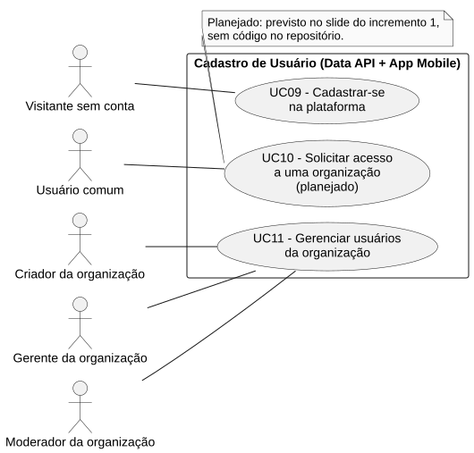
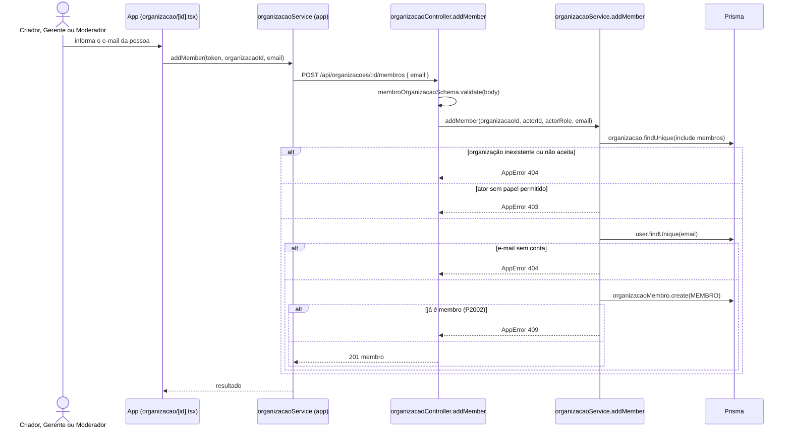

# RF11 — Gerenciar usuários da organização

```text
Incremento: Di1 — Cadastro (organização, comissão e usuário)
Escopo: RF11; UC11
Branch: feature/refatoracao-documentacao
Commit: 464c190
Data de revisão: 2026-11-10
Responsável(eis): [nome de quem revisa e assina o documento]
Estado: Implementado
Fontes: sistema/api/src/routes/organizacaoRoutes.ts; sistema/api/src/routes/usuarioRoutes.ts; sistema/api/src/services/organizacaoService.ts; sistema/api/src/services/usuarioService.ts; sistema/api/src/schemas/organizacaoSchema.ts; sistema/api/src/schemas/usuarioSchema.ts; sistema/better-meet/src/app/(tabs)/organizacao/[id].tsx
```

## Descrição

Quem gerencia a organização adiciona pessoas pelo e-mail, promove ou rebaixa papéis e remove membros. Papéis: `CRIADOR` (1), `GERENTE` (máximo 1), `MODERADOR` (máximo 2) e `MEMBRO`.

## Formulário do requisito

| Campo | Conteúdo |
|---|---|
| Entradas | `id` da organização e `userId` do membro (URL)<br/>`email` — para adicionar (`emailRule`)<br/>`papel` — `PapelOrganizacao`, para promover ou rebaixar<br/>`q` (2 a 160 caracteres) e `organizacaoId` — na busca de pessoas<br/>Token JWT |
| Origem | Detalhe da organização (`organizacao/[id].tsx`), por `organizacaoService.addMember`, `updateMemberRole`, `removeMember` e `usuarioService.search` do app. |
| Saída | `201` — membro adicionado; `200` — papel alterado ou mensagem "Membro removido com sucesso."; `200` — lista da busca.<br/>`400` — papel inválido, tentativa de atribuir `CRIADOR` sem ser o criador, alterar o papel do criador ou o próprio papel, remover o criador.<br/>`403` — sem permissão (mensagens por operação).<br/>`404` — "Organização aprovada não encontrada.", "Usuário não encontrado. A pessoa precisa criar uma conta primeiro." ou "Membro não encontrado.".<br/>`409` — "Este usuário já é membro da organização." ou "Esta organização já possui o máximo de N gerente(s)/moderador(es).". |
| Destino | Detalhe da organização (lista de membros atualizada). |
| Pré-condições | Usuário autenticado, com papel que permita a operação, e organização `ACEITA` para adicionar. |
| Pós-condições | `OrganizacaoMembro` criada, alterada ou removida. |
| Efeitos colaterais | Nenhum aviso à pessoa adicionada ou removida (não há código para isso). |

### Ação

1. Adicionar: `POST /api/organizacoes/:id/membros` `{ email }`; a organização deve estar `ACEITA`; Criador, Gerente, Moderador ou Administrador; a pessoa entra como `MEMBRO`.
2. Alterar papel: `PATCH /api/organizacoes/:id/membros/:userId` `{ papel }`; só o Criador (ou o Administrador); respeita os limites de Gerente e Moderador; atribuir `CRIADOR` é transferência, e o criador anterior vira `MEMBRO` na mesma transação.
3. Remover: `DELETE /api/organizacoes/:id/membros/:userId`; Criador, Gerente ou Administrador; o `CRIADOR` não pode ser removido.
4. Buscar pessoas: `GET /api/usuarios/busca?q=&organizacaoId=` (autenticado), até 10 resultados, por trecho do nome ou do e-mail, sem quem já é membro.

## Caso de uso UC11 — Gerenciar usuários da organização

| Item | Conteúdo |
|---|---|
| Objetivo | Quem gerencia a organização adiciona pessoas pelo e-mail, promove ou rebaixa papéis e remove membros. |
| Atores | Criador, Gerente e Moderador da organização (`PapelOrganizacao`); Administrador (`Role.ADMIN`). |
| Requisito | RF11 |
| Gatilho | O gestor abre o detalhe da organização e escolhe gerenciar membros. |
| Fluxo principal | Ver "Ação". |
| Erros | Ver "Saída". |
| Pós-condições | `OrganizacaoMembro` criada, alterada ou removida. |
| Relações UML | Nenhum `include` nem `extend`. |
| Rastreabilidade | RF11; requisito do slide: Cadastro de usuário; diagrama `DCU-Cadastro-de-Usuario` |

### Diagrama de casos de uso



Fonte: [`DCU-Cadastro-de-Usuario.puml`](../Diagramas/DCU-Cadastro-de-Usuario.puml). O diagrama é do requisito inteiro (Cadastro de usuário); este arquivo documenta só o UC11.

## Diagrama de sequência



## Requisitos não funcionais

Sem RNF específico documentado.

## Divergências e lacunas

- O slide fala em "administrador da organização gerencia usuários"; no código o papel é distribuído entre Criador, Gerente e Moderador, com regras diferentes para adicionar, promover e remover.
- A busca de pessoas aceita trecho do nome ou do e-mail (`GET /api/usuarios/busca`); o `GUIA_DE_CODIFICACAO.md` (EX-17) proíbe localizar pessoas pelo nome. Registrado como divergência de código, fora do escopo desta documentação.

## Testes

Nenhum teste automatizado localizado (`CT-RF11-01`: `Não executado`).
