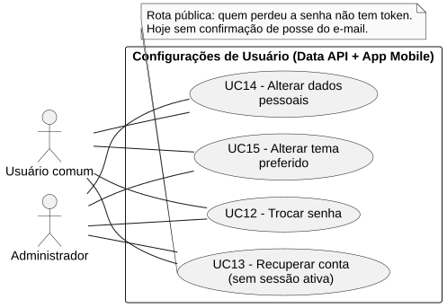
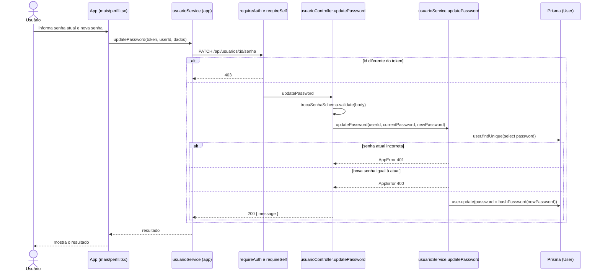

# RF12 — Trocar senha

```text
Incremento: Di1 — Configurações de usuário
Escopo: RF12; UC12
Branch: feature/refatoracao-documentacao
Commit: 464c190
Data de revisão: 2026-11-10
Responsável(eis): [nome de quem revisa e assina o documento]
Estado: Implementado
Fontes: sistema/api/src/routes/usuarioRoutes.ts; sistema/api/src/controllers/usuarioController.ts; sistema/api/src/services/usuarioService.ts (updatePassword); sistema/api/src/schemas/usuarioSchema.ts (trocaSenhaSchema); sistema/api/src/schemas/commonSchema.ts; sistema/api/src/utils/passwordHash.ts; sistema/better-meet/src/app/(tabs)/mais/perfil.tsx; sistema/better-meet/src/services/usuarioService.ts
```

## Descrição

O usuário logado troca a própria senha informando a senha atual. A rota só aceita o id do próprio usuário (`requireSelf`).

## Formulário do requisito

| Campo | Conteúdo |
|---|---|
| Entradas | `id` do usuário — URL; deve ser igual ao do token (`requireSelf`)<br/>`currentPassword` — texto, obrigatório<br/>`newPassword` — 8 a 72 caracteres, com letra maiúscula, letra minúscula e número (`senhaForteRule("A nova senha")`)<br/>Token JWT |
| Origem | Tela de perfil da aba Mais (`(tabs)/mais/perfil.tsx`), por `usuarioService.updatePassword(token, userId, ...)` do app. |
| Saída | `200 { message: "Senha alterada com sucesso." }`.<br/>`400` — validação da nova senha ou "A nova senha deve ser diferente da atual.".<br/>`401` — sem token ou "Senha atual incorreta.".<br/>`403` — id da URL diferente do usuário do token.<br/>`404` — "Usuário não encontrado.". |
| Destino | Tela de perfil (mensagem de sucesso). |
| Pré-condições | Usuário autenticado e id da URL igual ao do token. |
| Pós-condições | `User.password` com o hash da nova senha. |
| Efeitos colaterais | O token atual continua válido (não há revogação de sessões no código). |

### Ação

1. O usuário informa a senha atual e a nova senha.
2. O app chama `PATCH /api/usuarios/:id/senha`.
3. `requireAuth` valida o token e `requireSelf` compara o id da URL com o do token; o controller valida o corpo com `trocaSenhaSchema`.
4. `usuarioService.updatePassword` busca o `User`, confere a senha atual com `verifyPassword`, recusa nova senha igual à atual e grava `hashPassword(newPassword)`.

## Caso de uso UC12 — Trocar senha

| Item | Conteúdo |
|---|---|
| Objetivo | O usuário logado troca a própria senha informando a senha atual. |
| Atores | Usuário comum (`Role.USER`) e Administrador (`Role.ADMIN`), cada um para a própria conta. |
| Requisito | RF12 |
| Gatilho | O usuário escolhe trocar a senha na tela de perfil. |
| Fluxo principal | Ver "Ação". |
| Erros | Senha atual incorreta (`401`), nova senha fraca ou igual (`400`), id de outra pessoa (`403`). |
| Pós-condições | `User.password` com o hash da nova senha. |
| Relações UML | Nenhum `include` nem `extend`. |
| Rastreabilidade | RF12; requisito do slide: Configurações de usuário; diagrama `DCU-Configuracoes-de-Usuario` |

### Diagrama de casos de uso



Fonte: [`DCU-Configuracoes-de-Usuario.puml`](../Diagramas/DCU-Configuracoes-de-Usuario.puml). O diagrama é do requisito inteiro (Configurações de usuário); este arquivo documenta só o UC12.

## Diagrama de sequência



## Requisitos não funcionais

RNF02 (proteção de dados sensíveis) e RNF06 (criptografia de senha) da Wiki aplicam-se. O código grava `SHA-256` sem sal (`passwordHash.ts`); o próprio arquivo diz que isso não é adequado para senha (EX-14) e prevê a troca pelo Better Auth. O resultado do RNF06 é `Reprovado` por inspeção, conforme o catálogo; registrar no lote de RNF.

## Divergências e lacunas

- Senha guardada com `SHA-256` sem sal, o que não atende ao guia de codificação (EX-14).
- Não há revogação de tokens: trocar a senha não encerra sessões abertas.

## Testes

CT-RF12-01: `sistema/better-meet/src/schemas/__tests__/usuarioSchema.test.ts` testa o schema do app; a rota `PATCH /api/usuarios/:id/senha` não tem teste localizado. Nenhuma execução nesta etapa (`Não executado`).
