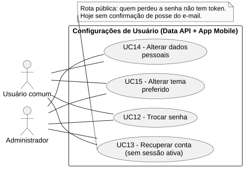
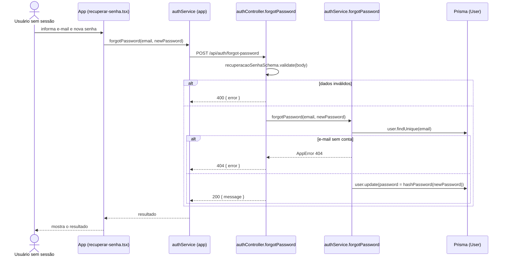

# RF13 — Recuperar conta

```text
Incremento: Di1 — Configurações de usuário
Escopo: RF13; UC13
Branch: feature/refatoracao-documentacao
Commit: 464c190
Data de revisão: 2026-11-10
Responsável(eis): [nome de quem revisa e assina o documento]
Estado: Parcial
Fontes: sistema/api/src/routes/authRoutes.ts; sistema/api/src/controllers/authController.ts; sistema/api/src/services/authService.ts (forgotPassword); sistema/api/src/schemas/authSchema.ts; sistema/api/src/services/emailService.ts; sistema/api/prisma/schema.prisma (PasswordResetToken); sistema/better-meet/src/app/recuperar-senha.tsx; documentos/entrega3_Di2/email_recuperacao.md
```

## Descrição

A pessoa que perdeu a senha informa o e-mail e define uma nova senha, sem estar logada. Hoje a rota **não confirma que a pessoa é dona do e-mail**; o envio de um código por e-mail foi entregue como serviço, mas ainda não está ligado a este fluxo.

## Formulário do requisito

| Campo | Conteúdo |
|---|---|
| Entradas | `email` — `trim`, minúsculas, obrigatório, e-mail válido, até 160 caracteres<br/>`newPassword` — 8 a 72 caracteres, com maiúscula, minúscula e número |
| Origem | Tela de recuperação (`app/recuperar-senha.tsx`), por `authService.forgotPassword(email, newPassword)` do app. Rota pública (quem perdeu a senha não tem token). |
| Saída | `200 { message: "Senha redefinida com sucesso. Você já pode fazer login." }`.<br/>`400` — e-mail ou senha inválidos.<br/>`404` — "E-mail não cadastrado.". |
| Destino | Tela de recuperação (mensagem de sucesso); a pessoa volta ao login. |
| Pré-condições | Nenhuma (rota pública). |
| Pós-condições | `User.password` com o hash da nova senha. |
| Efeitos colaterais | Nenhum e-mail é enviado nesta rota. |

### Ação

1. A pessoa informa o e-mail e a nova senha (com confirmação, só na tela).
2. O app valida e chama `POST /api/auth/forgot-password`.
3. O controller valida com `recuperacaoSenhaSchema`.
4. `authService.forgotPassword` procura o `User` pelo e-mail e grava `hashPassword(newPassword)`.
5. A API responde `200` com a mensagem de sucesso.

## Caso de uso UC13 — Recuperar conta

| Item | Conteúdo |
|---|---|
| Objetivo | A pessoa que perdeu a senha informa o e-mail e define uma nova senha, sem estar logada. |
| Atores | Usuário comum (`Role.USER`) e Administrador (`Role.ADMIN`) sem sessão ativa. |
| Requisito | RF13 |
| Gatilho | A pessoa escolhe recuperar a conta na tela de login. |
| Fluxo principal | Ver "Ação". |
| Erros | E-mail não cadastrado (`404`), dados inválidos (`400`). |
| Pós-condições | `User.password` com o hash da nova senha. |
| Relações UML | Nenhum `include` nem `extend`. |
| Rastreabilidade | RF13; requisito do slide: Configurações de usuário; diagrama `DCU-Configuracoes-de-Usuario` |

### Diagrama de casos de uso



Fonte: [`DCU-Configuracoes-de-Usuario.puml`](../Diagramas/DCU-Configuracoes-de-Usuario.puml). O diagrama é do requisito inteiro (Configurações de usuário); este arquivo documenta só o UC13.

## Diagrama de sequência



## Requisitos não funcionais

RNF02 e RNF06 da Wiki aplicam-se (senha em `SHA-256` sem sal, ver RF12). O serviço de e-mail usa `EMAIL_API_URL`, `EMAIL_API_KEY` e `EMAIL_FROM`, lidas em `src/config/env.ts` (EX-13).

## Divergências e lacunas

- **Segurança:** qualquer pessoa que saiba o e-mail de uma conta pode trocar a senha dela. O próprio `authController.ts` registra isso em comentário. O guia de codificação (EX-14) exige token ou código enviado ao e-mail cadastrado, com validade curta e uso único.
- A resposta `404` ("E-mail não cadastrado.") revela quais e-mails têm conta.
- A tabela `PasswordResetToken` existe no `schema.prisma`, mas nenhum arquivo de `sistema/api/src` a usa.
- O `emailService.enviarCodigoRecuperacao` foi entregue em 21/10/2026, com testes, mas não é chamado por nenhuma rota. O que foi entregue, a configuração e os resultados dessa verificação estão em `documentos/entrega3_Di2/email_recuperacao.md` (mantido até o lote L7).

## Testes

CT-RF13-01: testes do serviço de e-mail (`sistema/api/tests/email.test.mjs` e `emailRecuperacao.test.mjs`); o registro de 21/10/2026 em `email_recuperacao.md` cita 28 testes do serviço, 13 de configuração e 111 no total da API, todos aprovados, mas não foram reexecutados nesta etapa (`Não executado`). A rota `POST /api/auth/forgot-password`: nenhum teste localizado.
