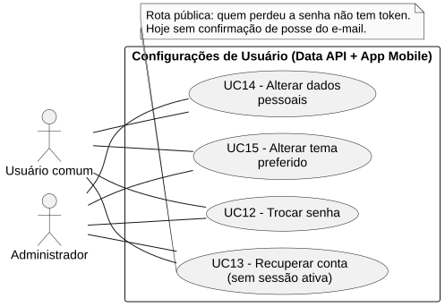
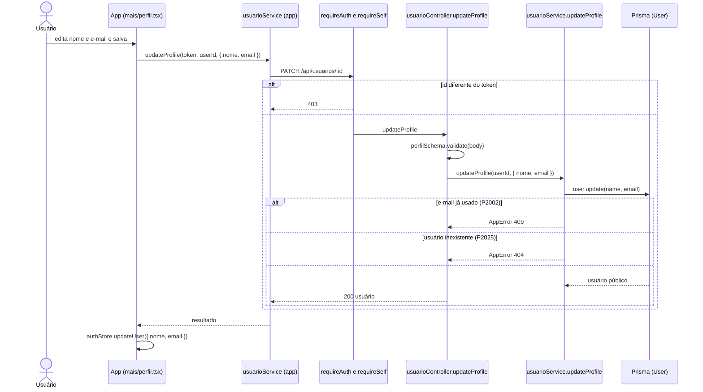

# RF14 — Alterar dados pessoais

```text
Incremento: Di1 — Configurações de usuário
Escopo: RF14; UC14
Branch: feature/refatoracao-documentacao
Commit: 464c190
Data de revisão: 2026-11-10
Responsável(eis): [nome de quem revisa e assina o documento]
Estado: Implementado
Fontes: sistema/api/src/routes/usuarioRoutes.ts; sistema/api/src/services/usuarioService.ts (updateProfile); sistema/api/src/schemas/usuarioSchema.ts (perfilSchema); sistema/better-meet/src/app/(tabs)/mais/perfil.tsx; sistema/better-meet/src/store/authStore.ts; sistema/better-meet/src/store/__tests__/stores.test.ts
```

## Descrição

O usuário logado altera o próprio nome e e-mail.

## Formulário do requisito

| Campo | Conteúdo |
|---|---|
| Entradas | `id` do usuário — URL; igual ao do token (`requireSelf`)<br/>`nome` — `trim`, obrigatório, de 2 a 80 caracteres<br/>`email` — `trim`, minúsculas, obrigatório, e-mail válido, até 160 caracteres<br/>Token JWT |
| Origem | Tela de perfil (`(tabs)/mais/perfil.tsx`), por `usuarioService.updateProfile(token, userId, { nome, email })` do app. |
| Saída | `200` — usuário atualizado (sem senha).<br/>`400` — nome ou e-mail inválidos.<br/>`401` — sem token; `403` — id de outra pessoa.<br/>`404` — "Usuário não encontrado.".<br/>`409` — "Este e-mail já está em uso.". |
| Destino | Tela de perfil e sessão do app (`authStore`). |
| Pré-condições | Usuário autenticado e id igual ao do token. |
| Pós-condições | `User.name` e `User.email` atualizados. |
| Efeitos colaterais | O token emitido no login continua com o e-mail antigo na claim `email`; se alguma parte do sistema lê essa claim, `[A CONFIRMAR NO CÓDIGO]`. |

### Ação

1. O usuário edita nome e e-mail e salva.
2. O app chama `PATCH /api/usuarios/:id`.
3. `requireAuth` e `requireSelf` validam token e id; o controller valida com `perfilSchema`.
4. `usuarioService.updateProfile` atualiza `User.name` e `User.email` e devolve o usuário público.
5. O app atualiza o `authStore` com `updateUser` (só nome e e-mail).

## Caso de uso UC14 — Alterar dados pessoais

| Item | Conteúdo |
|---|---|
| Objetivo | O usuário logado altera o próprio nome e e-mail.. |
| Atores | Usuário comum (`Role.USER`) e Administrador (`Role.ADMIN`), para a própria conta. |
| Requisito | RF14 |
| Gatilho | O usuário edita o perfil e salva. |
| Fluxo principal | Ver "Ação". |
| Erros | Ver "Saída". |
| Pós-condições | `User.name` e `User.email` atualizados. |
| Relações UML | Nenhum `include` nem `extend`. |
| Rastreabilidade | RF14; requisito do slide: Configurações de usuário; diagrama `DCU-Configuracoes-de-Usuario` |

### Diagrama de casos de uso



Fonte: [`DCU-Configuracoes-de-Usuario.puml`](../Diagramas/DCU-Configuracoes-de-Usuario.puml). O diagrama é do requisito inteiro (Configurações de usuário); este arquivo documenta só o UC14.

## Diagrama de sequência



## Requisitos não funcionais

RNF02 (proteção de dados sensíveis) da Wiki aplica-se: a resposta usa `userPublicSelect`, sem senha.

## Divergências e lacunas

- O slide chama o requisito de "alteração de dados pessoais"; o código altera só nome e e-mail.

## Testes

CT-RF14-01: `sistema/better-meet/src/store/__tests__/stores.test.ts` cobre `authStore.updateUser` (altera só nome e e-mail); não repetido nesta etapa (`Não executado`). A rota `PATCH /api/usuarios/:id`: nenhum teste localizado.
