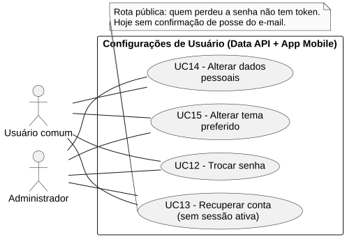
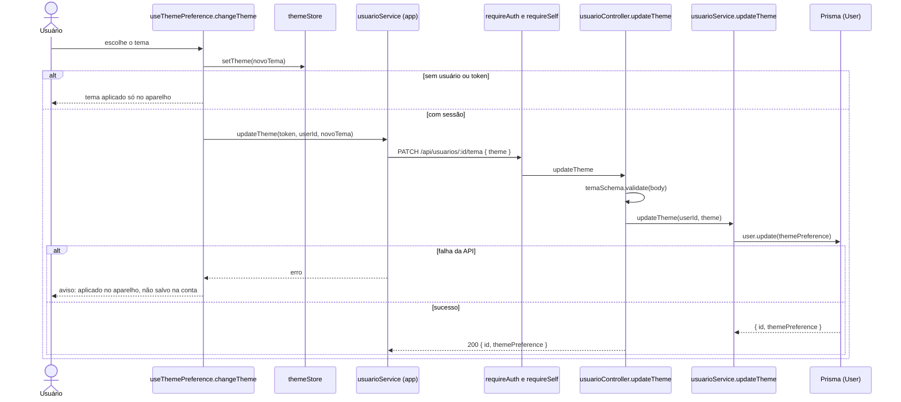

# RF15 — Alterar tema preferido

```text
Incremento: Di1 — Configurações de usuário
Escopo: RF15; UC15
Branch: feature/refatoracao-documentacao
Commit: 464c190
Data de revisão: 2026-11-10
Responsável(eis): [nome de quem revisa e assina o documento]
Estado: Implementado
Fontes: sistema/api/src/routes/usuarioRoutes.ts; sistema/api/src/services/usuarioService.ts (updateTheme); sistema/api/src/schemas/usuarioSchema.ts (temaSchema); sistema/api/prisma/schema.prisma (enum Tema; User.themePreference); sistema/better-meet/src/hooks/useThemePreference.ts; sistema/better-meet/src/store/themeStore.ts; sistema/better-meet/src/app/login.tsx; sistema/better-meet/src/store/__tests__/stores.test.ts
```

## Descrição

O usuário escolhe o tema do aplicativo (`light`, `dark` ou `system`). O app aplica na hora e, se houver sessão, grava a preferência na conta; no próximo login o app aplica o tema guardado.

## Formulário do requisito

| Campo | Conteúdo |
|---|---|
| Entradas | `id` do usuário — URL; igual ao do token (`requireSelf`)<br/>`theme` — `light`, `dark` ou `system` (enum `Tema`); obrigatório<br/>Token JWT |
| Origem | Tela de preferências (aba Mais), por `useThemePreference.changeTheme` e `usuarioService.updateTheme(token, userId, theme)` do app. |
| Saída | `200 { id, themePreference }`.<br/>`400` — "Tema inválido. Use: light, dark ou system." ou "Informe o tema desejado.".<br/>`401` — sem token; `403` — id de outra pessoa.<br/>`404` — "Usuário não encontrado.".<br/>No app, se a API recusar ou estiver fora do ar, o tema continua aplicado no aparelho e aparece o aviso "O tema foi aplicado neste aparelho, mas não foi salvo na sua conta". |
| Destino | Aparência do app e `User.themePreference`. |
| Pré-condições | Para gravar na conta: usuário autenticado e id igual ao do token. Sem sessão, a escolha vale só no aparelho. |
| Pós-condições | `User.themePreference` igual ao tema escolhido; app com o tema aplicado. |
| Efeitos colaterais | Falha ao gravar na conta é reportada ao serviço de monitoramento (`monitoringService.reportRequestFailure`). |

### Ação

1. O usuário escolhe o tema.
2. `changeTheme` aplica o tema no `themeStore` (feedback imediato).
3. Se há usuário e token, chama `PATCH /api/usuarios/:id/tema` `{ theme }`.
4. `usuarioService.updateTheme` grava `User.themePreference` e devolve `{ id, themePreference }`.
5. No login, a API devolve `themePreference` e `login.tsx` chama `applyUserPreference`.

## Caso de uso UC15 — Alterar tema preferido

| Item | Conteúdo |
|---|---|
| Objetivo | O usuário escolhe o tema do aplicativo (`light`, `dark` ou `system`). |
| Atores | Usuário comum (`Role.USER`) e Administrador (`Role.ADMIN`). |
| Requisito | RF15 |
| Gatilho | O usuário escolhe um tema nas preferências. |
| Fluxo principal | Ver "Ação". |
| Erros | Tema inválido (`400`), id de outra pessoa (`403`), falha de rede (aviso no app). |
| Pós-condições | `User.themePreference` igual ao tema escolhido; app com o tema aplicado. |
| Relações UML | Nenhum `include` nem `extend`. |
| Rastreabilidade | RF15; requisito do slide: Configurações de usuário; diagrama `DCU-Configuracoes-de-Usuario` |

### Diagrama de casos de uso



Fonte: [`DCU-Configuracoes-de-Usuario.puml`](../Diagramas/DCU-Configuracoes-de-Usuario.puml). O diagrama é do requisito inteiro (Configurações de usuário); este arquivo documenta só o UC15.

## Diagrama de sequência



## Requisitos não funcionais

Sem RNF específico documentado.

## Divergências e lacunas

- `User.themePreference` é opcional no `schema.prisma` (`Tema?`, padrão `system`), por causa de usuários antigos; `applyUserPreference` trata valores nulos ou desconhecidos como `system`.

## Testes

CT-RF15-01: `sistema/better-meet/src/store/__tests__/stores.test.ts`, grupo `themeStore.applyUserPreference`; não repetido nesta etapa (`Não executado`). A rota `PATCH /api/usuarios/:id/tema`: nenhum teste localizado.
