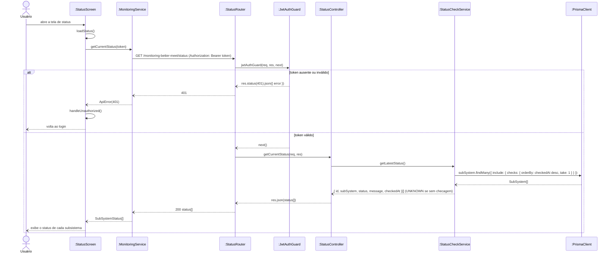

# RF16 — Consultar status atual dos subsistemas

```text
Incremento: Di1 — Informações do sistema
Escopo: RF16; UC16
Branch: feature/refatoracao-documentacao
Commit: 464c190
Data de revisão: 2026-11-10
Responsável(eis): [nome de quem revisa e assina o documento]
Estado: Implementado
Fontes: sistema/monitoring-better-meet/src/routes/status.routes.ts; sistema/monitoring-better-meet/src/controllers/status.controller.ts; sistema/monitoring-better-meet/src/services/statusCheck.service.ts; sistema/better-meet/src/app/(tabs)/mais/status.tsx; requisitos_e_casos_de_uso.md do commit 464c190, removido no lote L7 (conteúdo de origem, UC01 antigo)
```

## Descrição

Permite ao ator visualizar o status mais recente registrado de cada subsistema monitorado.

## Formulário do requisito

| Campo | Conteúdo |
|---|---|
| Entradas | Token JWT (`Authorization: Bearer`) |
| Origem | Tela "Status do Sistema" do app (aba Mais) e painel de gestão |
| Saída | Lista com id, nome, status, mensagem e data/hora da última checagem de cada subsistema; `401` sem token válido |
| Destino | Tela de status |
| Pré-condições | Ator autenticado (JWT válido, obtido no login da Data API) |
| Pós-condições | Ator visualiza o status atual de cada subsistema ao qual tem acesso |
| Efeitos colaterais e observações | Nenhuma observação registrada. |

### Ação

1. Ator abre a tela/painel de status.
2. Cliente envia `GET /monitoring-better-meet/status` com `Authorization: Bearer <token>`.
3. Sistema valida o token.
4. Sistema busca, para cada `SubSystem`, o `StatusCheck` mais recente.
5. Sistema retorna a lista (id, nome, status, mensagem, data/hora da última checagem).
6. Cliente exibe o status de cada subsistema.

### Fluxos alternativos e exceções

- 3a. Token ausente ou inválido → sistema retorna `401 Unauthorized`; cliente redireciona ao login.
- 4a. Subsistema sem nenhum `StatusCheck` ainda → retorna status `UNKNOWN`.

## Caso de uso UC16 — Consultar status atual dos subsistemas

| Item | Conteúdo |
|---|---|
| Objetivo | Permite ao ator visualizar o status mais recente registrado de cada subsistema monitorado. |
| Atores | Usuário comum (`Role.USER`) e Administrador (`Role.ADMIN`), pelo App Mobile; o Administrador também pelo Painel de Gestão |
| Requisito | RF16 |
| Relações UML | Ver o diagrama (`include`, `extend` e generalização, quando existirem). |
| Rastreabilidade | RF16; requisito do slide: Informações do sistema — Status do sistema e dos subsistemas; diagrama `DCU-Status-do-Sistema` |

### Diagrama de casos de uso


Fonte: [`DCU-Status-do-Sistema.puml`](../Diagramas/DCU-Status-do-Sistema.puml). O diagrama é do requisito inteiro; este arquivo documenta só o UC16.

## Diagrama de sequência



## Requisitos não funcionais

- RNF16 — Autenticação diferenciada por tipo de acesso
- RNF18 — Isolamento de infraestrutura
- RNF20 — Tecnologia (API de Monitoramento)

## Divergências e lacunas

- Conteúdo migrado do `requisitos_e_casos_de_uso.md` (incremento 1) e renumerado. Neste lote foram conferidos no código apenas rotas, métodos HTTP, o agendador e a presença dos arquivos citados; as demais afirmações do texto de origem **não foram reverificadas** (`[A CONFIRMAR NO CÓDIGO]`).
- O texto de origem usava os atores abstratos "Usuário Autenticado" e "Sistema Externo"; aqui e no diagrama eles foram trocados pelos atores concretos do catálogo (DOC-10).
- O formulário usa a ficha de caso de uso do incremento 1 (fluxo principal e fluxos alternativos); as linhas Entradas, Origem, Saída e Destino foram acrescentadas a partir desse texto.

## Testes

Nenhum teste automatizado localizado para este caso de uso (`monitoring-better-meet` e `management-better-meet/server` não têm testes; o `npm test` deles só exibe um erro). `CT-RF16-01`: `Não executado`.
