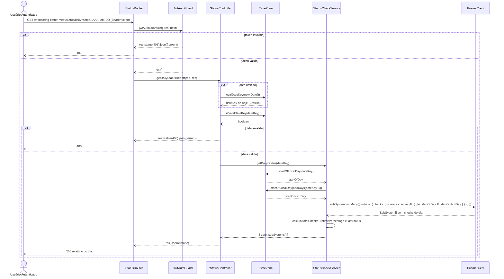

# RF17 — Consultar relatório diário de status

```text
Incremento: Di1 — Informações do sistema
Escopo: RF17; UC17
Branch: feature/refatoracao-documentacao
Commit: 464c190
Data de revisão: 2026-11-10
Responsável(eis): [nome de quem revisa e assina o documento]
Estado: Implementado (nenhuma tela usa o endpoint)
Fontes: sistema/monitoring-better-meet/src/routes/status.routes.ts; sistema/monitoring-better-meet/src/controllers/status.controller.ts; sistema/monitoring-better-meet/src/utils/timeZone.ts; requisitos_e_casos_de_uso.md do commit 464c190, removido no lote L7 (conteúdo de origem, UC02 antigo)
```

## Descrição

Permite consultar um resumo agregado (uptime e último status) de todos os subsistemas em um dia específico, junto com a lista das checagens daquele dia.

## Formulário do requisito

| Campo | Conteúdo |
|---|---|
| Entradas | `date` (AAAA-MM-DD, opcional; sem ela vale o dia atual em Brasília) e token JWT |
| Origem | Chamada direta à API; nenhuma tela usa este endpoint hoje |
| Saída | Resumo por subsistema (`totalChecks`, `uptimePercentage`, `lastStatus` e `checks`); `400` data inválida; `401` |
| Destino | Cliente da API |
| Pré-condições | Ator autenticado (JWT válido) |
| Pós-condições | Ator recebe o resumo do dia por subsistema |
| Efeitos colaterais e observações | O endpoint está implementado e protegido, mas **nenhuma tela o consome hoje** — tanto o app mobile quanto o painel de gestão usam UC16 + UC18. Fica disponível para uso futuro ou consulta direta à API |

### Ação

1. Ator informa a data desejada (ou omite, e o dia atual no fuso de Brasília é usado).
2. Cliente envia `GET /monitoring-better-meet/status/daily?date=YYYY-MM-DD` com Bearer token.
3. Sistema valida o token.
4. Sistema busca todas as checagens do dia por subsistema. O dia vai de 00:00 até antes de 00:00 do dia seguinte no fuso `America/Sao_Paulo`, independentemente do fuso da máquina onde a monitoring roda (os horários continuam gravados em UTC no banco).
5. Sistema calcula `totalChecks`, `uptimePercentage` e `lastStatus` por subsistema.
6. Sistema retorna o relatório agregado, com a lista `checks` (status, mensagem, data/hora) de cada subsistema.

### Fluxos alternativos e exceções

- 2a. Data inválida no parâmetro → `400 Bad Request`.
- 3a. Token inválido → `401 Unauthorized`.
- 4a. Subsistema sem nenhuma checagem no dia → `totalChecks: 0`, `uptimePercentage: null`, `lastStatus: UNKNOWN`.

## Caso de uso UC17 — Consultar relatório diário de status

| Item | Conteúdo |
|---|---|
| Objetivo | Permite consultar um resumo agregado (uptime e último status) de todos os subsistemas em um dia específico, junto com a lista das checagens daquele dia. |
| Atores | Usuário comum (`Role.USER`) e Administrador (`Role.ADMIN`), por qualquer cliente com JWT válido |
| Requisito | RF17 |
| Relações UML | Ver o diagrama (`include`, `extend` e generalização, quando existirem). |
| Rastreabilidade | RF17; requisito do slide: Informações do sistema — Status do sistema e dos subsistemas; diagrama `DCU-Status-do-Sistema` |

### Diagrama de casos de uso


Fonte: [`DCU-Status-do-Sistema.puml`](../Diagramas/DCU-Status-do-Sistema.puml). O diagrama é do requisito inteiro; este arquivo documenta só o UC17.

## Diagrama de sequência



## Requisitos não funcionais

- RNF16 — Autenticação diferenciada por tipo de acesso
- RNF18 — Isolamento de infraestrutura
- RNF20 — Tecnologia (API de Monitoramento)
- RNF38 — Dias no fuso do negócio

## Divergências e lacunas

- Conteúdo migrado do `requisitos_e_casos_de_uso.md` (incremento 1) e renumerado. Neste lote foram conferidos no código apenas rotas, métodos HTTP, o agendador e a presença dos arquivos citados; as demais afirmações do texto de origem **não foram reverificadas** (`[A CONFIRMAR NO CÓDIGO]`).
- O texto de origem usava os atores abstratos "Usuário Autenticado" e "Sistema Externo"; aqui e no diagrama eles foram trocados pelos atores concretos do catálogo (DOC-10).
- O formulário usa a ficha de caso de uso do incremento 1 (fluxo principal e fluxos alternativos); as linhas Entradas, Origem, Saída e Destino foram acrescentadas a partir desse texto.

## Testes

Nenhum teste automatizado localizado para este caso de uso (`monitoring-better-meet` e `management-better-meet/server` não têm testes; o `npm test` deles só exibe um erro). `CT-RF17-01`: `Não executado`.
