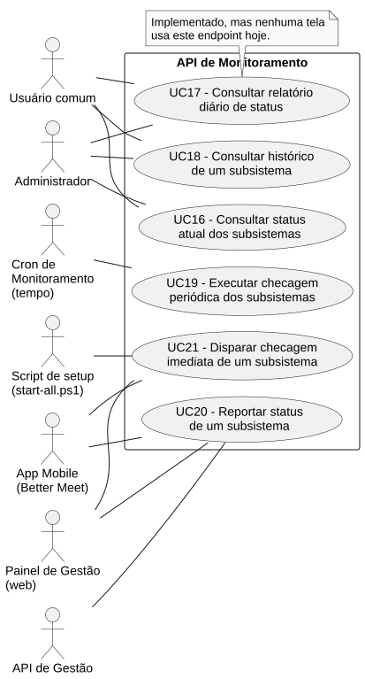
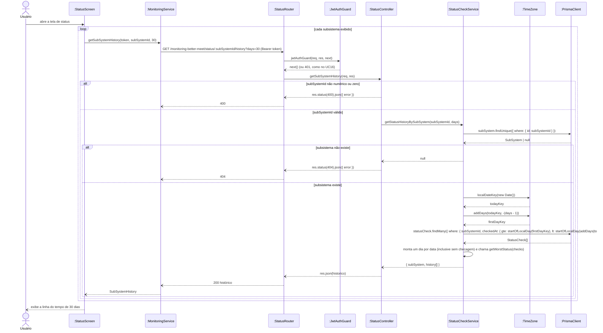

# RF18 — Consultar histórico de um subsistema

```text
Incremento: Di1 — Informações do sistema
Escopo: RF18; UC18
Branch: feature/refatoracao-documentacao
Commit: 464c190
Data de revisão: 2026-11-10
Responsável(eis): [nome de quem revisa e assina o documento]
Estado: Implementado
Fontes: sistema/monitoring-better-meet/src/routes/status.routes.ts; sistema/monitoring-better-meet/src/controllers/status.controller.ts; sistema/monitoring-better-meet/src/services/statusCheck.service.ts; requisitos_e_casos_de_uso.md do commit 464c190, removido no lote L7 (conteúdo de origem, UC03 antigo)
```

## Descrição

Permite consultar a evolução do status de UM subsistema ao longo de N dias.

## Formulário do requisito

| Campo | Conteúdo |
|---|---|
| Entradas | `subSystemId` (URL), `days` (opcional; padrão 7; as telas usam 30) e token JWT |
| Origem | Tela "Status do Sistema" do app e painel de gestão |
| Saída | Histórico por dia (`totalChecks`, `uptimePercentage`, `lastStatus`, `worstStatus`), inclusive dias sem checagem; `400`, `401`, `404` |
| Destino | Tela de status |
| Pré-condições | Ator autenticado (JWT válido); subsistema já existente na base |
| Pós-condições | Ator visualiza a linha do tempo de status do subsistema escolhido |
| Efeitos colaterais e observações | Nenhuma observação registrada. |

### Ação

1. Ator abre a tela/painel de status; o cliente pede o histórico de cada subsistema exibido (as telas atuais usam 30 dias; se o parâmetro for omitido, a API usa 7).
2. Cliente envia `GET /monitoring-better-meet/status/:subSystemId/history?days=N` com Bearer token.
3. Sistema valida o token.
4. Sistema monta o "esqueleto" de todos os dias do período (mesmo sem checagem), no fuso `America/Sao_Paulo`: uma checagem às 22h de Brasília cai no dia de Brasília, e não no dia seguinte em UTC.
5. Sistema preenche cada dia com `totalChecks`, `uptimePercentage`, `lastStatus` e `worstStatus`.
6. Sistema retorna o histórico.

### Fluxos alternativos e exceções

- 3a. Token inválido → `401 Unauthorized`.
- 2a. `subSystemId` não numérico ou zero → `400 Bad Request`.
- 2b. `subSystemId` não existe → `404 Not Found`.
- 5a. Dia sem nenhuma checagem → aparece no histórico com `totalChecks: 0` e `worstStatus: UNKNOWN`, útil para identificar "buracos" de monitoramento.

## Caso de uso UC18 — Consultar histórico de um subsistema

| Item | Conteúdo |
|---|---|
| Objetivo | Permite consultar a evolução do status de UM subsistema ao longo de N dias. |
| Atores | Usuário comum (`Role.USER`) e Administrador (`Role.ADMIN`), pelo App Mobile; o Administrador também pelo Painel de Gestão |
| Requisito | RF18 |
| Relações UML | Ver o diagrama (`include`, `extend` e generalização, quando existirem). |
| Rastreabilidade | RF18; requisito do slide: Informações do sistema — Status do sistema e dos subsistemas; diagrama `DCU-Status-do-Sistema` |

### Diagrama de casos de uso



Fonte: [`DCU-Status-do-Sistema.puml`](../Diagramas/DCU-Status-do-Sistema.puml). O diagrama é do requisito inteiro; este arquivo documenta só o UC18.

## Diagrama de sequência



## Requisitos não funcionais

- RNF16 — Autenticação diferenciada por tipo de acesso
- RNF18 — Isolamento de infraestrutura
- RNF19 — Retenção histórica
- RNF20 — Tecnologia (API de Monitoramento)
- RNF38 — Dias no fuso do negócio

## Divergências e lacunas

- Conteúdo migrado do `requisitos_e_casos_de_uso.md` (incremento 1) e renumerado. Neste lote foram conferidos no código apenas rotas, métodos HTTP, o agendador e a presença dos arquivos citados; as demais afirmações do texto de origem **não foram reverificadas** (`[A CONFIRMAR NO CÓDIGO]`).
- O texto de origem usava os atores abstratos "Usuário Autenticado" e "Sistema Externo"; aqui e no diagrama eles foram trocados pelos atores concretos do catálogo (DOC-10).
- O formulário usa a ficha de caso de uso do incremento 1 (fluxo principal e fluxos alternativos); as linhas Entradas, Origem, Saída e Destino foram acrescentadas a partir desse texto.

## Testes

Nenhum teste automatizado localizado para este caso de uso (`monitoring-better-meet` e `management-better-meet/server` não têm testes; o `npm test` deles só exibe um erro). `CT-RF18-01`: `Não executado`.
