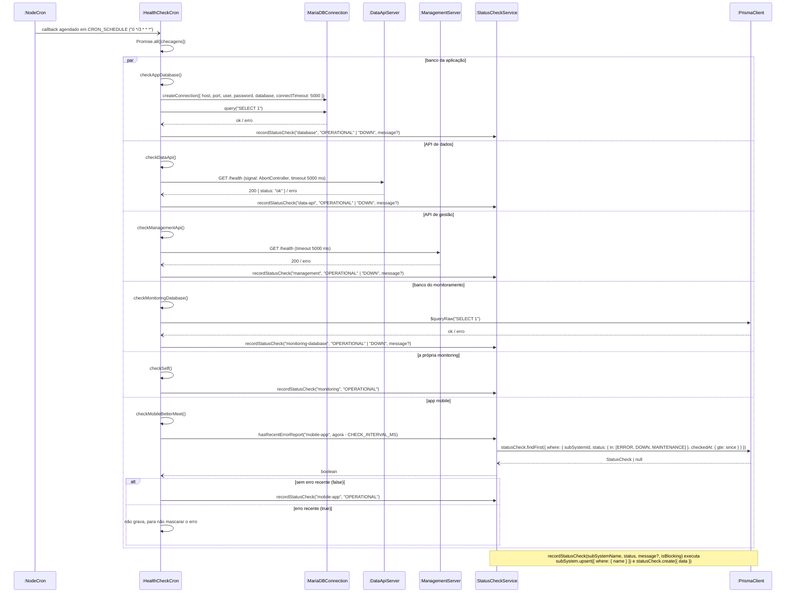

# RF19 — Executar checagem periódica dos subsistemas

```text
Incremento: Di1 — Informações do sistema
Escopo: RF19; UC19
Branch: feature/refatoracao-documentacao
Commit: 464c190
Data de revisão: 2026-11-10
Responsável(eis): [nome de quem revisa e assina o documento]
Estado: Implementado
Fontes: sistema/monitoring-better-meet/src/jobs/healthCheck.cron.ts; sistema/monitoring-better-meet/src/services/statusCheck.service.ts; requisitos_e_casos_de_uso.md do commit 464c190, removido no lote L7 (conteúdo de origem, UC04 antigo)
```

## Descrição

A cada 3 horas (00h, 03h, 06h, 09h, 12h, 15h, 18h, 21h), o sistema verifica a saúde de cada subsistema e registra o resultado, sem intervenção humana.

## Formulário do requisito

| Campo | Conteúdo |
|---|---|
| Entradas | Nenhuma (agendador `node-cron`, a cada 3 horas) |
| Origem | Cron de Monitoramento, dentro da própria API de monitoramento |
| Saída | Um `StatusCheck` por subsistema, `OPERATIONAL` ou `DOWN` |
| Destino | Banco de monitoramento |
| Pré-condições | Processo da API de monitoramento em execução |
| Pós-condições | Histórico de status atualizado para todos os subsistemas, disponível para consulta (UC16–UC18) |
| Efeitos colaterais e observações | Nenhuma observação registrada. |

### Ação

1. Agendador (`node-cron`, expressão `0 */3 * * *`) dispara o job.
2. Sistema executa, em paralelo, uma checagem por subsistema: `database` (conexão direta MySQL, `SELECT 1`), `data-api` e `management` (`GET /health`), `monitoring-database` (query no próprio Prisma), `monitoring` (sempre operacional, se o cron rodou o processo está de pé) e `mobile-app` (verifica se não há `ERROR`, `DOWN` ou `MAINTENANCE` reportado nas últimas 6h).
3. Cada checagem grava um `StatusCheck` (status `OPERATIONAL` ou `DOWN`, com a mensagem de erro se houver).

### Fluxos alternativos e exceções

- 2a. Falha ao conectar/checar um subsistema (timeout de 5s, conexão recusada, `/health` com status diferente de 2xx) → grava `DOWN` com a mensagem do erro, sem interromper as demais checagens (isoladas via `Promise.all` + try/catch individual).
- 2b. `mobile-app` com `ERROR`/`DOWN`/`MAINTENANCE` reportado nas últimas 6h → **não** grava `OPERATIONAL`, para não mascarar o erro recém-reportado.

## Caso de uso UC19 — Executar checagem periódica dos subsistemas

| Item | Conteúdo |
|---|---|
| Objetivo | A cada 3 horas (00h, 03h, 06h, 09h, 12h, 15h, 18h, 21h), o sistema verifica a saúde de cada subsistema e registra o resultado, sem intervenção humana. |
| Atores | Cron de Monitoramento (automático) |
| Requisito | RF19 |
| Relações UML | Ver o diagrama (`include`, `extend` e generalização, quando existirem). |
| Rastreabilidade | RF19; requisito do slide: Informações do sistema — Status do sistema e dos subsistemas; diagrama `DCU-Status-do-Sistema` |

### Diagrama de casos de uso


Fonte: [`DCU-Status-do-Sistema.puml`](../Diagramas/DCU-Status-do-Sistema.puml). O diagrama é do requisito inteiro; este arquivo documenta só o UC19.

## Diagrama de sequência



## Requisitos não funcionais

- RNF13 — Periodicidade das checagens automáticas
- RNF14 — Isolamento de falhas entre checagens
- RNF15 — Timeout de checagens externas
- RNF16 — Autenticação diferenciada por tipo de acesso
- RNF18 — Isolamento de infraestrutura
- RNF19 — Retenção histórica
- RNF20 — Tecnologia (API de Monitoramento)

## Divergências e lacunas

- Conteúdo migrado do `requisitos_e_casos_de_uso.md` (incremento 1) e renumerado. Neste lote foram conferidos no código apenas rotas, métodos HTTP, o agendador e a presença dos arquivos citados; as demais afirmações do texto de origem **não foram reverificadas** (`[A CONFIRMAR NO CÓDIGO]`).
- O texto de origem usava os atores abstratos "Usuário Autenticado" e "Sistema Externo"; aqui e no diagrama eles foram trocados pelos atores concretos do catálogo (DOC-10).
- O formulário usa a ficha de caso de uso do incremento 1 (fluxo principal e fluxos alternativos); as linhas Entradas, Origem, Saída e Destino foram acrescentadas a partir desse texto.

## Testes

Nenhum teste automatizado localizado para este caso de uso (`monitoring-better-meet` e `management-better-meet/server` não têm testes; o `npm test` deles só exibe um erro). `CT-RF19-01`: `Não executado`.
