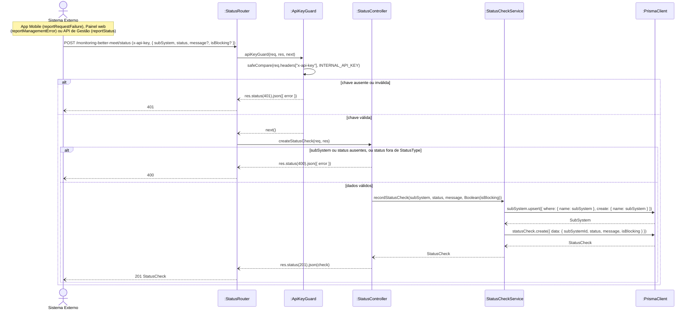

# RF20 — Reportar status de um subsistema

```text
Incremento: Di1 — Informações do sistema
Escopo: RF20; UC20
Branch: feature/refatoracao-documentacao
Commit: 464c190
Data de revisão: 2026-11-10
Responsável(eis): [nome de quem revisa e assina o documento]
Estado: Implementado
Fontes: sistema/monitoring-better-meet/src/routes/status.routes.ts; sistema/monitoring-better-meet/src/middlewares/apiKey.ts; sistema/monitoring-better-meet/src/controllers/status.controller.ts; requisitos_e_casos_de_uso.md do commit 464c190, removido no lote L7 (conteúdo de origem, UC05 antigo)
```

## Descrição

Permite que um sistema externo registre, ele mesmo, um evento de status (ex.: erro capturado no app ou no painel, ou "estou operacional" ao subir).

## Formulário do requisito

| Campo | Conteúdo |
|---|---|
| Entradas | `subSystem`, `status`, `message` e `isBlocking` opcionais, e o header `x-api-key` |
| Origem | App Mobile, Painel de Gestão e API de Gestão |
| Saída | `201` com o `StatusCheck` criado; `400`; `401` |
| Destino | Banco de monitoramento |
| Pré-condições | Ator possui a `x-api-key` válida configurada (`INTERNAL_API_KEY` / `EXPO_PUBLIC_MONITORING_API_KEY`, geradas pelo `start-all.ps1`) |
| Pós-condições | Novo `StatusCheck` disponível no histórico do subsistema |
| Efeitos colaterais e observações | Nenhuma observação registrada. |

### Ação

1. Ator captura um evento: erro no app mobile (`subSystem: mobile-app`, status `ERROR` ou `DOWN`), erro no painel web (`subSystem: management`), ou início/parada da API de Gestão (`OPERATIONAL` / `MAINTENANCE`).
2. Ator envia `POST /monitoring-better-meet/status` com header `x-api-key` e corpo `{ subSystem, status, message?, isBlocking? }`.
3. Sistema valida a `x-api-key` (comparação em tempo constante).
4. Sistema cria o `SubSystem` automaticamente se ainda não existir (upsert).
5. Sistema grava o `StatusCheck`.
6. Sistema retorna `201 Created` com o registro criado.

### Fluxos alternativos e exceções

- 3a. `x-api-key` ausente ou inválida → `401 Unauthorized`.
- 2a. `subSystem` ou `status` ausentes, ou `status` fora do enum → `400 Bad Request`.
- 1a. App mobile e painel web limitam o envio a 1 relatório a cada 5s (evita inundar a monitoring com erros repetidos); falha de rede ao reportar é ignorada silenciosamente para não gerar um loop de erros.

## Caso de uso UC20 — Reportar status de um subsistema

| Item | Conteúdo |
|---|---|
| Objetivo | Permite que um sistema externo registre, ele mesmo, um evento de status (ex.: erro capturado no app ou no painel, ou "estou operacional" ao subir). |
| Atores | App Mobile (Better Meet), Painel de Gestão (web), API de Gestão |
| Requisito | RF20 |
| Relações UML | Ver o diagrama (`include`, `extend` e generalização, quando existirem). |
| Rastreabilidade | RF20; requisito do slide: Informações do sistema — Status do sistema e dos subsistemas; diagrama `DCU-Status-do-Sistema` |

### Diagrama de casos de uso


Fonte: [`DCU-Status-do-Sistema.puml`](../Diagramas/DCU-Status-do-Sistema.puml). O diagrama é do requisito inteiro; este arquivo documenta só o UC20.

## Diagrama de sequência



## Requisitos não funcionais

- RNF16 — Autenticação diferenciada por tipo de acesso
- RNF17 — Comparação segura de credenciais
- RNF18 — Isolamento de infraestrutura
- RNF19 — Retenção histórica
- RNF20 — Tecnologia (API de Monitoramento)

## Divergências e lacunas

- Conteúdo migrado do `requisitos_e_casos_de_uso.md` (incremento 1) e renumerado. Neste lote foram conferidos no código apenas rotas, métodos HTTP, o agendador e a presença dos arquivos citados; as demais afirmações do texto de origem **não foram reverificadas** (`[A CONFIRMAR NO CÓDIGO]`).
- O texto de origem usava os atores abstratos "Usuário Autenticado" e "Sistema Externo"; aqui e no diagrama eles foram trocados pelos atores concretos do catálogo (DOC-10).
- O formulário usa a ficha de caso de uso do incremento 1 (fluxo principal e fluxos alternativos); as linhas Entradas, Origem, Saída e Destino foram acrescentadas a partir desse texto.

## Testes

Nenhum teste automatizado localizado para este caso de uso (`monitoring-better-meet` e `management-better-meet/server` não têm testes; o `npm test` deles só exibe um erro). `CT-RF20-01`: `Não executado`.
