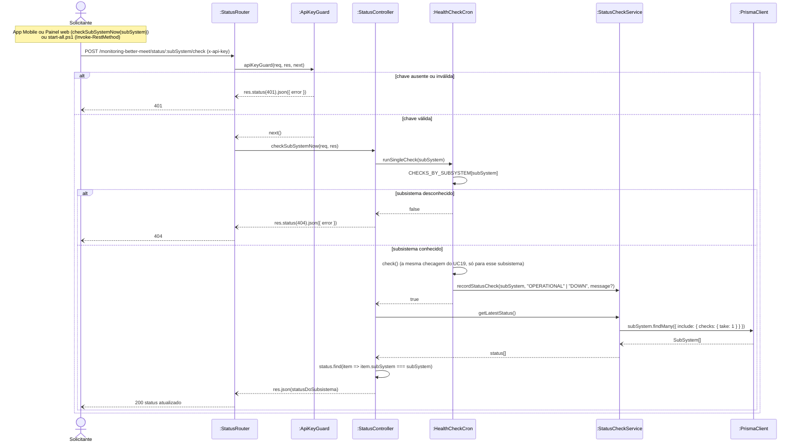

# RF21 — Disparar checagem imediata de um subsistema

```text
Incremento: Di1 — Informações do sistema
Escopo: RF21; UC21
Branch: feature/refatoracao-documentacao
Commit: 464c190
Data de revisão: 2026-11-10
Responsável(eis): [nome de quem revisa e assina o documento]
Estado: Implementado
Fontes: sistema/monitoring-better-meet/src/routes/status.routes.ts; sistema/monitoring-better-meet/src/middlewares/apiKey.ts; sistema/monitoring-better-meet/src/jobs/healthCheck.cron.ts; requisitos_e_casos_de_uso.md do commit 464c190, removido no lote L7 (conteúdo de origem, UC06 antigo)
```

## Descrição

Permite forçar a checagem de UM subsistema fora do horário do cron — usado depois de start/stop/restart de um serviço, para o painel ou o app refletir a mudança sem esperar até 3h.

## Formulário do requisito

| Campo | Conteúdo |
|---|---|
| Entradas | `subSystem` (URL) e o header `x-api-key` |
| Origem | Painel de Gestão e App Mobile (depois de uma ação) e `start-all.ps1` (setup) |
| Saída | Status mais recente do subsistema; `401`; `404` subsistema desconhecido |
| Destino | Cliente que pediu a checagem |
| Pré-condições | Ator possui a `x-api-key` válida; subsistema informado é um dos 6 conhecidos pelo sistema |
| Pós-condições | Status do subsistema atualizado imediatamente, refletido nas próximas consultas (UC16) |
| Efeitos colaterais e observações | Nenhuma observação registrada. |

### Ação

1. Administrador executa uma ação no painel ou no app (UC23) e o cliente aguarda 5s.
2. Cliente envia `POST /monitoring-better-meet/status/:subSystem/check` com `x-api-key`.
3. Sistema valida a `x-api-key`.
4. Sistema executa, imediatamente, a checagem correspondente àquele subsistema (mesma lógica do UC19, mas só para um).
5. Sistema grava o `StatusCheck` resultante.
6. Sistema retorna o status mais recente do subsistema.

### Fluxos alternativos e exceções

- 3a. `x-api-key` inválida → `401 Unauthorized`.
- 2a. Nome de subsistema desconhecido → `404 Not Found`.

## Caso de uso UC21 — Disparar checagem imediata de um subsistema

| Item | Conteúdo |
|---|---|
| Objetivo | Permite forçar a checagem de UM subsistema fora do horário do cron — usado depois de start/stop/restart de um serviço, para o painel ou o app refletir a mudança sem esperar até 3h. |
| Atores | Painel de Gestão (web, `management-better-meet/web`) e App Mobile (Better Meet); também usado pelo `start-all.ps1` no setup inicial (UC26) |
| Requisito | RF21 |
| Relações UML | Ver o diagrama (`include`, `extend` e generalização, quando existirem). |
| Rastreabilidade | RF21; requisito do slide: Informações do sistema — Status do sistema e dos subsistemas; diagrama `DCU-Status-do-Sistema` |

### Diagrama de casos de uso


Fonte: [`DCU-Status-do-Sistema.puml`](../Diagramas/DCU-Status-do-Sistema.puml). O diagrama é do requisito inteiro; este arquivo documenta só o UC21.

## Diagrama de sequência



## Requisitos não funcionais

- RNF15 — Timeout de checagens externas
- RNF16 — Autenticação diferenciada por tipo de acesso
- RNF17 — Comparação segura de credenciais
- RNF18 — Isolamento de infraestrutura
- RNF20 — Tecnologia (API de Monitoramento)

## Divergências e lacunas

- Conteúdo migrado do `requisitos_e_casos_de_uso.md` (incremento 1) e renumerado. Neste lote foram conferidos no código apenas rotas, métodos HTTP, o agendador e a presença dos arquivos citados; as demais afirmações do texto de origem **não foram reverificadas** (`[A CONFIRMAR NO CÓDIGO]`).
- O texto de origem usava os atores abstratos "Usuário Autenticado" e "Sistema Externo"; aqui e no diagrama eles foram trocados pelos atores concretos do catálogo (DOC-10).
- O formulário usa a ficha de caso de uso do incremento 1 (fluxo principal e fluxos alternativos); as linhas Entradas, Origem, Saída e Destino foram acrescentadas a partir desse texto.

## Testes

Nenhum teste automatizado localizado para este caso de uso (`monitoring-better-meet` e `management-better-meet/server` não têm testes; o `npm test` deles só exibe um erro). `CT-RF21-01`: `Não executado`.
