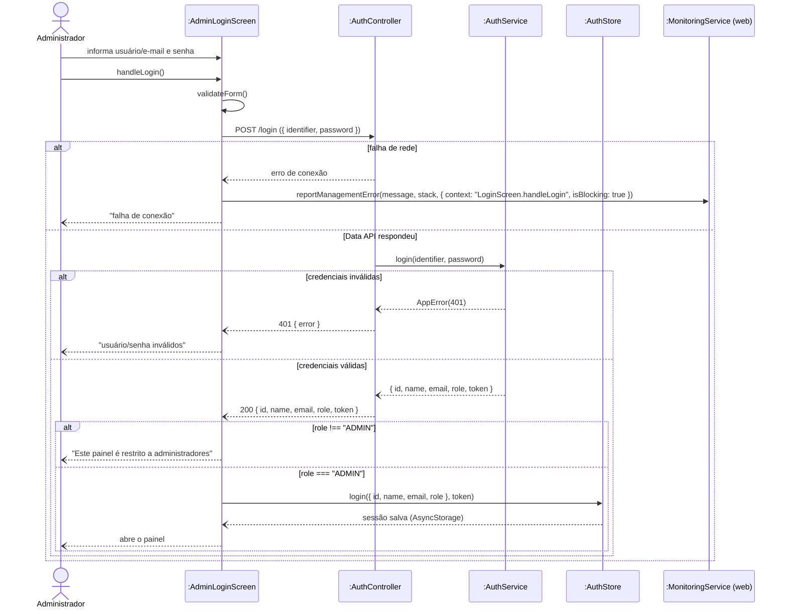

# RF22 — Autenticar administrador

```text
Incremento: Di1 — Informações do sistema
Escopo: RF22; UC22
Branch: feature/refatoracao-documentacao
Commit: 464c190
Data de revisão: 2026-11-10
Responsável(eis): [nome de quem revisa e assina o documento]
Estado: Implementado
Fontes: sistema/api/src/server.ts (POST /login); sistema/api/src/services/authService.ts; sistema/management-better-meet/web/src/app/login.tsx; requisitos_e_casos_de_uso.md do commit 464c190, removido no lote L7 (conteúdo de origem, UC07 antigo)
```

## Descrição

Permite que um usuário com `role: ADMIN` acesse o painel de gestão; usuários comuns são bloqueados mesmo com credenciais válidas. No app mobile não há login separado: o administrador entra pelo login normal do app (`POST /api/login`), e os botões de ação só aparecem quando o `role` devolvido é `ADMIN`.

## Formulário do requisito

| Campo | Conteúdo |
|---|---|
| Entradas | Usuário ou e-mail e senha |
| Origem | Tela de login do painel de gestão (`POST /login`) ou do app (`POST /api/login`) |
| Saída | `{ id, name, email, role, token }` (JWT de 7 dias); `401` credenciais inválidas |
| Destino | Painel de gestão ou app |
| Pré-condições | Usuário possui conta cadastrada na Data API |
| Pós-condições | Administrador autenticado, com token válido para as demais operações do painel |
| Efeitos colaterais e observações | Nenhuma observação registrada. |

### Ação

1. Administrador informa usuário/e-mail e senha na tela de login do painel.
2. Painel envia `POST /login` para a Data API. As demais rotas da Data API ficam sob o prefixo `/api`; o `POST /login` sem prefixo é mantido como exceção temporária só para o painel, até ele passar a chamar `/api/login`.
3. Data API valida as credenciais e retorna `{ id, name, email, role, token }` (JWT válido por 7 dias).
4. Painel verifica se `role === 'ADMIN'`.
5. Painel guarda o token (persistido via AsyncStorage) e libera o acesso ao painel.

### Fluxos alternativos e exceções

- 3a. Credenciais inválidas → `401 Unauthorized`; exibe mensagem, não reporta como erro de sistema (é comportamento normal do usuário).
- 4a. `role !== 'ADMIN'` → acesso negado pelo próprio painel ("Este painel é restrito a administradores"), mesmo com login válido.
- 2a. Falha de rede ao contatar a Data API → reporta erro à monitoring (`subSystem: management`) e exibe mensagem de falha de conexão.

## Caso de uso UC22 — Autenticar administrador

| Item | Conteúdo |
|---|---|
| Objetivo | Permite que um usuário com `role: ADMIN` acesse o painel de gestão; usuários comuns são bloqueados mesmo com credenciais válidas. No app mobile não há login separado: o administrador entra pelo login normal do app (`POST /api/login`), e os botões de ação só aparecem quando o `role` devolvido é `ADMIN`. |
| Atores | Administrador (`Role.ADMIN`), pelo Painel de Gestão |
| Requisito | RF22 |
| Relações UML | Ver o diagrama (`include`, `extend` e generalização, quando existirem). |
| Rastreabilidade | RF22; requisito do slide: Informações do sistema — Reinicialização, setup e reset; diagrama `DCU-Gestao-Setup-Reset` |

### Diagrama de casos de uso


Fonte: [`DCU-Gestao-Setup-Reset.puml`](../Diagramas/DCU-Gestao-Setup-Reset.puml). O diagrama é do requisito inteiro; este arquivo documenta só o UC22.

## Diagrama de sequência



## Requisitos não funcionais

- RNF22 — Autorização por papel
- RNF24 — Ausência de banco de dados próprio (API de Gestão)
- RNF26 — Tecnologia (API de Gestão e painel)

## Divergências e lacunas

- Conteúdo migrado do `requisitos_e_casos_de_uso.md` (incremento 1) e renumerado. Neste lote foram conferidos no código apenas rotas, métodos HTTP, o agendador e a presença dos arquivos citados; as demais afirmações do texto de origem **não foram reverificadas** (`[A CONFIRMAR NO CÓDIGO]`).
- O texto de origem usava os atores abstratos "Usuário Autenticado" e "Sistema Externo"; aqui e no diagrama eles foram trocados pelos atores concretos do catálogo (DOC-10).
- O formulário usa a ficha de caso de uso do incremento 1 (fluxo principal e fluxos alternativos); as linhas Entradas, Origem, Saída e Destino foram acrescentadas a partir desse texto.

## Testes

Nenhum teste automatizado localizado para este caso de uso (`monitoring-better-meet` e `management-better-meet/server` não têm testes; o `npm test` deles só exibe um erro). `CT-RF22-01`: `Não executado`.
