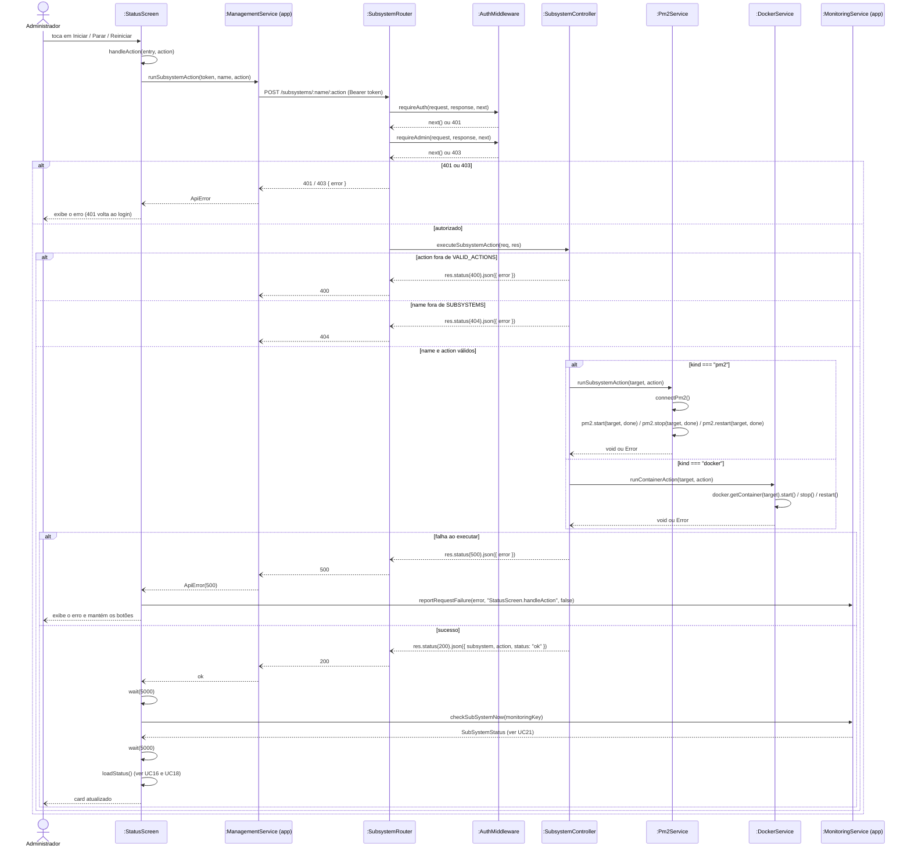

# RF23 — Iniciar, parar ou reiniciar um subsistema

```text
Incremento: Di1 — Informações do sistema
Escopo: RF23; UC23
Branch: feature/refatoracao-documentacao
Commit: 464c190
Data de revisão: 2026-11-10
Responsável(eis): [nome de quem revisa e assina o documento]
Estado: Implementado
Fontes: sistema/management-better-meet/server/src/routes/subsystem.routes.ts; sistema/management-better-meet/server/src/controllers/subsystem.controller.ts; sistema/management-better-meet/server/src/services; requisitos_e_casos_de_uso.md do commit 464c190, removido no lote L7 (conteúdo de origem, UC08 antigo)
```

## Descrição

Permite ao administrador controlar o ciclo de vida de qualquer subsistema (`api`, `monitoring`, `database`, `monitoring-database`) a partir do painel web ou do app mobile, sem precisar de acesso direto ao servidor.

## Formulário do requisito

| Campo | Conteúdo |
|---|---|
| Entradas | `name` e `action` (`start`, `stop` ou `restart`) na URL e token de Administrador |
| Origem | Painel de gestão e tela "Status e reset do sistema" do app |
| Saída | Resultado da ação sobre o subsistema; `400`, `401`, `403`, `404` |
| Destino | Painel ou app |
| Pré-condições | Administrador autenticado (UC22 no painel, ou login do app com `role: ADMIN`); a própria API de Gestão está operacional |
| Pós-condições | Subsistema no novo estado solicitado; painel ou app refletindo o status atualizado após o intervalo de checagem |
| Efeitos colaterais e observações | Nenhuma observação registrada. |

### Ação

1. Administrador clica em Iniciar/Parar/Reiniciar num card do painel ou da tela "Status e reset do sistema" do app (aba **Mais**).
2. Cliente envia `POST /subsystems/:name/:action` à API de Gestão (no app, pela URL `EXPO_PUBLIC_MANAGEMENT_API_URL`) com `Authorization: Bearer <token>`.
3. Sistema valida o token e exige `role: ADMIN`.
4. Sistema consulta a whitelist interna pra saber se o alvo é controlado via PM2 (`api`, `monitoring`) ou via Docker (`database`, `monitoring-database`).
5a. Se PM2: conecta ao daemon do PM2 e executa `start`/`stop`/`restart` pelo nome do processo.
5b. Se Docker: usa a API do Docker Engine (named pipe no Windows / socket Unix no Linux) pra executar a mesma ação no container.
6. Sistema retorna `200 OK`.
7. Cliente aguarda 5s, pede à API de Monitoramento pra checar aquele subsistema agora (checagem imediata, UC21), aguarda mais 5s, e então atualiza status e histórico na tela.

### Fluxos alternativos e exceções

- 3a. Token ausente/inválido → `401` (o app volta ao login); papel diferente de ADMIN → `403`.
- 2a. Ação diferente de `start`, `stop` ou `restart` → `400 Bad Request`.
- 4a. Nome de subsistema fora da whitelist → `404 Not Found` (nenhum comando arbitrário chega ao PM2/Docker).
- 4b. O card do aplicativo (no painel, "Aplicativo (Better Meet)"; no app, "App mobile", com a nota "Sem ações — roda no dispositivo do cliente") só exibe status — o app mobile não é um processo do servidor, então não tem botões de ação.
- 5a. Falha ao executar a ação (processo/container não existe, Docker inacessível) → `500`; o cliente exibe o erro, reporta à monitoring e mantém os botões habilitados pra nova tentativa.
- 1a. **No app**, se o status da `management` não for `OPERATIONAL`, todos os botões ficam desabilitados e o app exibe o aviso "Ações desabilitadas", com a instrução de religar no servidor (`pm2 start management`).
- 1b. **No app**, se a monitoring estiver inacessível, ou se ela ou o banco dela não estiverem `OPERATIONAL`, o app avisa que o status exibido pode ser só o último dado conhecido e mostra os comandos para religá-los (`pm2 start monitoring` / `docker start mysql_monitoring_better_meet_dev`). Esses avisos só aparecem para administradores.
- Ação sobre `management` → segue o fluxo especial do UC24, não este.

## Caso de uso UC23 — Iniciar, parar ou reiniciar um subsistema

| Item | Conteúdo |
|---|---|
| Objetivo | Permite ao administrador controlar o ciclo de vida de qualquer subsistema (`api`, `monitoring`, `database`, `monitoring-database`) a partir do painel web ou do app mobile, sem precisar de acesso direto ao servidor. |
| Atores | Administrador (`Role.ADMIN`), pelo Painel de Gestão ou pelo App Mobile, PM2, Docker Engine, API de Monitoramento |
| Requisito | RF23 |
| Relações UML | Ver o diagrama (`include`, `extend` e generalização, quando existirem). |
| Rastreabilidade | RF23; requisito do slide: Informações do sistema — Reinicialização, setup e reset; diagrama `DCU-Gestao-Setup-Reset` |

### Diagrama de casos de uso


Fonte: [`DCU-Gestao-Setup-Reset.puml`](../Diagramas/DCU-Gestao-Setup-Reset.puml). O diagrama é do requisito inteiro; este arquivo documenta só o UC23.

## Diagrama de sequência



## Requisitos não funcionais

- RNF21 — Whitelist fixa de subsistemas controláveis
- RNF22 — Autorização por papel
- RNF24 — Ausência de banco de dados próprio (API de Gestão)
- RNF25 — Portabilidade do acesso ao Docker
- RNF26 — Tecnologia (API de Gestão e painel)

## Divergências e lacunas

- Conteúdo migrado do `requisitos_e_casos_de_uso.md` (incremento 1) e renumerado. Neste lote foram conferidos no código apenas rotas, métodos HTTP, o agendador e a presença dos arquivos citados; as demais afirmações do texto de origem **não foram reverificadas** (`[A CONFIRMAR NO CÓDIGO]`).
- O texto de origem usava os atores abstratos "Usuário Autenticado" e "Sistema Externo"; aqui e no diagrama eles foram trocados pelos atores concretos do catálogo (DOC-10).
- O formulário usa a ficha de caso de uso do incremento 1 (fluxo principal e fluxos alternativos); as linhas Entradas, Origem, Saída e Destino foram acrescentadas a partir desse texto.

## Testes

Nenhum teste automatizado localizado para este caso de uso (`monitoring-better-meet` e `management-better-meet/server` não têm testes; o `npm test` deles só exibe um erro). `CT-RF23-01`: `Não executado`.
