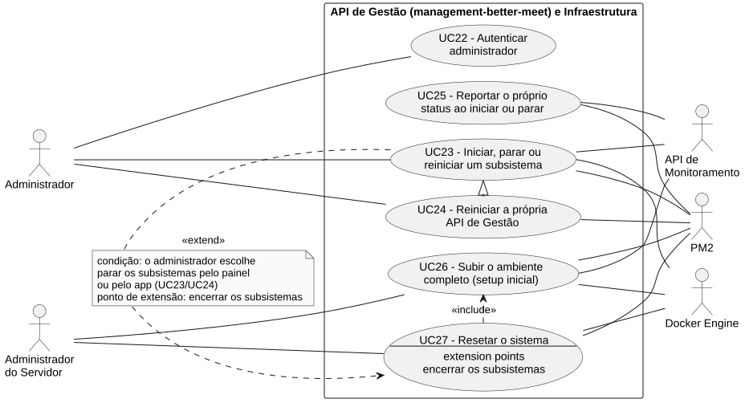
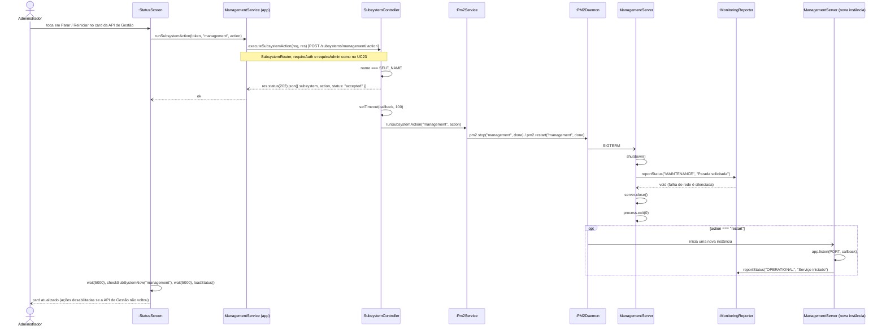

# RF24 — Reiniciar a própria API de Gestão

```text
Incremento: Di1 — Informações do sistema
Escopo: RF24; UC24
Branch: feature/refatoracao-documentacao
Commit: 464c190
Data de revisão: 2026-11-10
Responsável(eis): [nome de quem revisa e assina o documento]
Estado: Implementado
Fontes: sistema/management-better-meet/server/src/controllers/subsystem.controller.ts; requisitos_e_casos_de_uso.md do commit 464c190, removido no lote L7 (conteúdo de origem, UC09 antigo)
```

## Descrição

Caso especial do UC23: como a própria API de Gestão é quem processaria o pedido, ela precisa responder antes de se desligar — senão a conexão HTTP nunca receberia resposta.

## Formulário do requisito

| Campo | Conteúdo |
|---|---|
| Entradas | `action` em `POST /subsystems/management/:action` e token de Administrador |
| Origem | Card "API de Gestão (esta)" do painel e card equivalente do app |
| Saída | `202 { subsystem, action, status: "accepted" }` antes da ação |
| Destino | Painel ou app |
| Pré-condições | Administrador autenticado; API de Gestão operacional (pra receber o pedido) |
| Pós-condições | API de Gestão no novo estado; se ficou de pé, o painel volta a responder normalmente em poucos segundos |
| Efeitos colaterais e observações | Nenhuma observação registrada. |

### Ação

1. Administrador clica em Parar/Reiniciar no card "API de Gestão (esta)" do painel ou "API de gestão de subsistemas" do app.
2. Cliente envia `POST /subsystems/management/:action`.
3. Sistema responde imediatamente `202 Accepted`.
4. Depois de um pequeno atraso (100ms), sistema pede ao PM2 pra executar a ação sobre o próprio processo.
5. PM2 encerra o processo atual e, se a ação foi `start`/`restart`, sobe uma nova instância.
6. A nova instância reporta `OPERATIONAL` à monitoring ao subir (UC25).

### Fluxos alternativos e exceções

- 4a. Se a ação falhar depois do `202` já enviado, o erro só é registrado no log do servidor — o painel não recebe essa falha diretamente.
- Enquanto a própria `management` está fora do ar (ação `stop`, ou falha ao voltar), **nenhuma** ação de nenhum subsistema funciona pelo painel nem pelo app — inclusive religá-la de volta —, porque é ela quem serve o próprio painel e a API que executa as ações (no app, os botões ficam desabilitados, ver UC23 1a). Recuperação nesse caso é manual (`pm2 start management` direto no servidor).

## Caso de uso UC24 — Reiniciar a própria API de Gestão

| Item | Conteúdo |
|---|---|
| Objetivo | Caso especial do UC23: como a própria API de Gestão é quem processaria o pedido, ela precisa responder antes de se desligar — senão a conexão HTTP nunca receberia resposta. |
| Atores | Administrador (`Role.ADMIN`), pelo Painel de Gestão ou pelo App Mobile, PM2 |
| Requisito | RF24 |
| Relações UML | Ver o diagrama (`include`, `extend` e generalização, quando existirem). |
| Rastreabilidade | RF24; requisito do slide: Informações do sistema — Reinicialização, setup e reset; diagrama `DCU-Gestao-Setup-Reset` |

### Diagrama de casos de uso



Fonte: [`DCU-Gestao-Setup-Reset.puml`](../Diagramas/DCU-Gestao-Setup-Reset.puml). O diagrama é do requisito inteiro; este arquivo documenta só o UC24.

## Diagrama de sequência



## Requisitos não funcionais

- RNF22 — Autorização por papel
- RNF23 — Resposta antes de efeito colateral irreversível
- RNF24 — Ausência de banco de dados próprio (API de Gestão)
- RNF26 — Tecnologia (API de Gestão e painel)

## Divergências e lacunas

- Conteúdo migrado do `requisitos_e_casos_de_uso.md` (incremento 1) e renumerado. Neste lote foram conferidos no código apenas rotas, métodos HTTP, o agendador e a presença dos arquivos citados; as demais afirmações do texto de origem **não foram reverificadas** (`[A CONFIRMAR NO CÓDIGO]`).
- O texto de origem usava os atores abstratos "Usuário Autenticado" e "Sistema Externo"; aqui e no diagrama eles foram trocados pelos atores concretos do catálogo (DOC-10).
- O formulário usa a ficha de caso de uso do incremento 1 (fluxo principal e fluxos alternativos); as linhas Entradas, Origem, Saída e Destino foram acrescentadas a partir desse texto.

## Testes

Nenhum teste automatizado localizado para este caso de uso (`monitoring-better-meet` e `management-better-meet/server` não têm testes; o `npm test` deles só exibe um erro). `CT-RF24-01`: `Não executado`.
