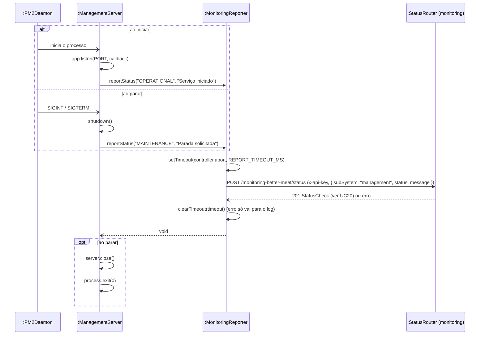

# RF25 — Reportar o próprio status ao iniciar ou parar

```text
Incremento: Di1 — Informações do sistema
Escopo: RF25; UC25
Branch: feature/refatoracao-documentacao
Commit: 464c190
Data de revisão: 2026-11-10
Responsável(eis): [nome de quem revisa e assina o documento]
Estado: Implementado
Fontes: sistema/management-better-meet/server/src/server.ts; requisitos_e_casos_de_uso.md do commit 464c190, removido no lote L7 (conteúdo de origem, UC10 antigo)
```

## Descrição

A API de Gestão se auto-reporta à monitoring nos dois extremos do seu ciclo de vida, pra refletir mudanças de estado sem esperar o próximo ciclo do cron (a cada 3h).

## Formulário do requisito

| Campo | Conteúdo |
|---|---|
| Entradas | Nenhuma do usuário: evento do ciclo de vida do processo (subir, `SIGINT`, `SIGTERM`) |
| Origem | PM2, ao iniciar ou encerrar a API de Gestão |
| Saída | `POST` de status à monitoring (`OPERATIONAL` ao subir, `MAINTENANCE` ao parar) |
| Destino | API de Monitoramento |
| Pré-condições | `MONITORING_API_URL` e `INTERNAL_API_KEY` configurados no `.env` da `management` |
| Pós-condições | Monitoring com o status mais recente da `management`, sem depender do cron |
| Efeitos colaterais e observações | Nenhuma observação registrada. |

### Ação

1a. Ao subir e começar a escutar na porta, sistema envia `POST /monitoring-better-meet/status` com `subSystem: "management"`, `status: "OPERATIONAL"`.
1b. Ao receber `SIGINT`/`SIGTERM` (comando de parada do PM2, inclusive o do próprio UC24), sistema envia o mesmo POST com `status: "MAINTENANCE"` **antes** de efetivamente sair do processo.

### Fluxos alternativos e exceções

- Falha de rede ao reportar → erro é silenciado (log local), não pode travar o start/stop da `management` por causa disso; timeout curto (1.5s) no report de parada, porque o PM2 mata o processo à força (~1.6s) se ele não sair rápido o suficiente.

## Caso de uso UC25 — Reportar o próprio status ao iniciar ou parar

| Item | Conteúdo |
|---|---|
| Objetivo | A API de Gestão se auto-reporta à monitoring nos dois extremos do seu ciclo de vida, pra refletir mudanças de estado sem esperar o próximo ciclo do cron (a cada 3h). |
| Atores | PM2 (inicia ou encerra o processo da API de Gestão, o que dispara o caso de uso), API de Monitoramento |
| Requisito | RF25 |
| Relações UML | Ver o diagrama (`include`, `extend` e generalização, quando existirem). |
| Rastreabilidade | RF25; requisito do slide: Informações do sistema — Reinicialização, setup e reset; diagrama `DCU-Gestao-Setup-Reset` |

### Diagrama de casos de uso


Fonte: [`DCU-Gestao-Setup-Reset.puml`](../Diagramas/DCU-Gestao-Setup-Reset.puml). O diagrama é do requisito inteiro; este arquivo documenta só o UC25.

## Diagrama de sequência



## Requisitos não funcionais

- RNF24 — Ausência de banco de dados próprio (API de Gestão)
- RNF26 — Tecnologia (API de Gestão e painel)

## Divergências e lacunas

- Conteúdo migrado do `requisitos_e_casos_de_uso.md` (incremento 1) e renumerado. Neste lote foram conferidos no código apenas rotas, métodos HTTP, o agendador e a presença dos arquivos citados; as demais afirmações do texto de origem **não foram reverificadas** (`[A CONFIRMAR NO CÓDIGO]`).
- O texto de origem usava os atores abstratos "Usuário Autenticado" e "Sistema Externo"; aqui e no diagrama eles foram trocados pelos atores concretos do catálogo (DOC-10).
- O formulário usa a ficha de caso de uso do incremento 1 (fluxo principal e fluxos alternativos); as linhas Entradas, Origem, Saída e Destino foram acrescentadas a partir desse texto.

## Testes

Nenhum teste automatizado localizado para este caso de uso (`monitoring-better-meet` e `management-better-meet/server` não têm testes; o `npm test` deles só exibe um erro). `CT-RF25-01`: `Não executado`.
