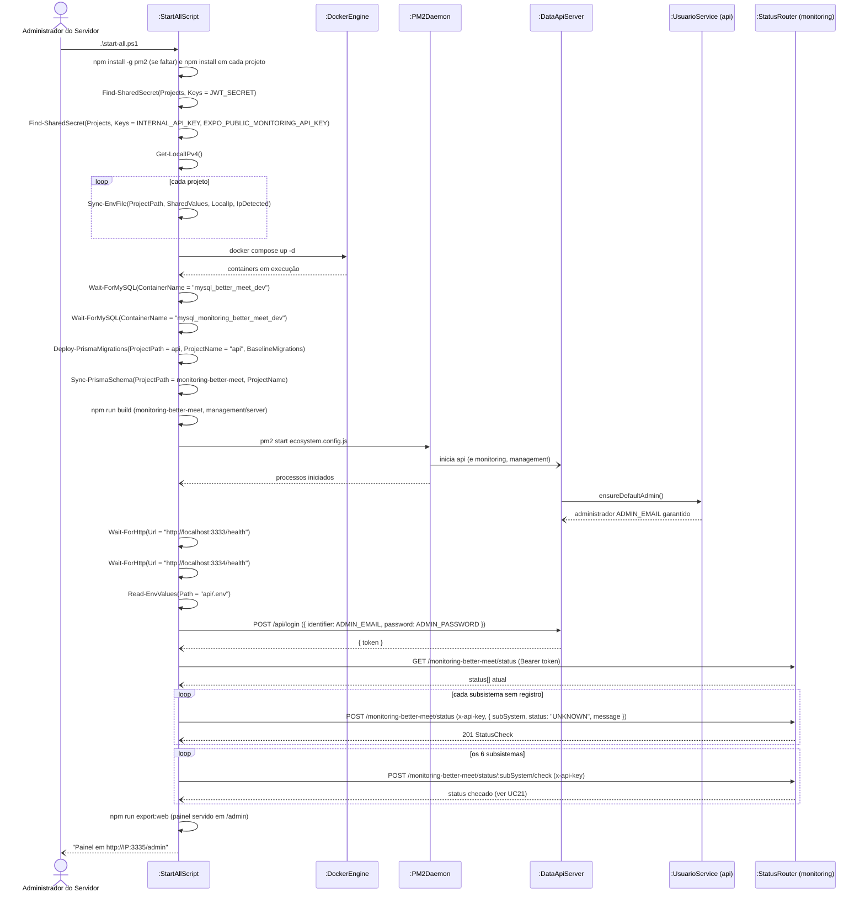

# RF26 — Subir o ambiente completo (setup inicial)

```text
Incremento: Di1 — Informações do sistema
Escopo: RF26; UC26
Branch: feature/refatoracao-documentacao
Commit: 464c190
Data de revisão: 2026-11-10
Responsável(eis): [nome de quem revisa e assina o documento]
Estado: Implementado
Fontes: sistema/start-all.ps1; sistema/docker-compose.yml; sistema/ecosystem.config.js; requisitos_e_casos_de_uso.md do commit 464c190, removido no lote L7 (conteúdo de origem, UC11 antigo)
```

## Descrição

Prepara e inicializa todos os subsistemas de uma vez, com um único script (`sistema/start-all.ps1`), numa máquina nova, depois de uma parada total ou depois de um reset (UC27) — não é uma ação do painel.

## Formulário do requisito

| Campo | Conteúdo |
|---|---|
| Entradas | Execução manual de `start-all.ps1` na pasta `sistema` |
| Origem | Administrador do Servidor, no terminal |
| Saída | Cinco subsistemas de servidor em execução e status inicial registrado |
| Destino | Servidor (PM2 e Docker) |
| Pré-condições | Node.js e Docker Desktop instalados e em execução na máquina (únicos pré-requisitos não automatizados, por segurança) |
| Pós-condições | Os cinco subsistemas de servidor (`api`, `monitoring`, `management` e os dois bancos) em execução, com status inicial registrado na monitoring; painel administrativo acessível em `/admin` |
| Efeitos colaterais e observações | Nenhuma observação registrada. |

### Ação

1. Administrador executa `.\start-all.ps1` na pasta `sistema`.
2. Script verifica o `pm2` e, se não existir, instala globalmente (`npm install -g pm2`).
3. Script roda `npm install` em `api`, `better-meet`, `monitoring-better-meet`, `management-better-meet/server` e `management-better-meet/web`, conferindo se o Prisma instalado é exatamente a versão `7.10.0` em `api` e `monitoring-better-meet`.
4. Script cria cada `.env` a partir do `.env.example` (ou corrige o existente): gera **um único** `JWT_SECRET` e **uma única** chave de API interna (`INTERNAL_API_KEY` / `EXPO_PUBLIC_MONITORING_API_KEY`) reaproveitados em todos os projetos, e troca `localhost`/`SEU_IP_AQUI` pelo IP da máquina na rede (para o app no celular físico alcançar as APIs). Isso inclui as três URLs do app mobile: `EXPO_PUBLIC_API_URL`, `EXPO_PUBLIC_MONITORING_API_URL` e `EXPO_PUBLIC_MANAGEMENT_API_URL` (esta última usada pelas ações de administrador do UC23).
5. Script sobe os bancos com `docker compose up -d` (cria containers e volumes na primeira vez, só inicia depois) e aguarda cada MySQL responder (`mysqladmin ping`, até 60s).
6a. Na `api`, script aplica as migrations versionadas com `prisma migrate deploy` (o banco da aplicação só muda por migration, nunca por `db push`). Se o banco foi criado antes por `db push` e não tem histórico de migrations (erro `P3005`), o script marca as migrations de baseline como já aplicadas (`prisma migrate resolve --applied`) uma única vez e repete o deploy. Em seguida, gera o Prisma Client.
6b. Na `monitoring-better-meet`, que ainda não tem migration inicial, script compara o schema com o banco (`prisma migrate diff`), roda `prisma db push` só se houver divergência, e gera o Prisma Client.
7. Script builda `monitoring-better-meet` e `management-better-meet/server` e sobe `api`, `monitoring` e `management` com `pm2 start ecosystem.config.js`.
8. Ao subir, a Data API garante a existência do administrador padrão, com o e-mail e a senha de `ADMIN_EMAIL` / `ADMIN_PASSWORD` do `api/.env` (no `.env.example`: `admin@bettermeet.com` / `Admin123!`).
9. Script aguarda `/health` da `api` e da `monitoring`, faz login como administrador padrão (`POST /api/login`, com as credenciais lidas do `api/.env`) e, para cada um dos 6 subsistemas sem nenhum registro, grava um status inicial `UNKNOWN` (UC20) e em seguida dispara a checagem real de cada um (UC21).
10. Script builda o painel web (`npm run export:web`), que passa a ser servido pela própria `management` em `/admin`, e exibe o endereço `http://<IP>:3335/admin`.

### Fluxos alternativos e exceções

- 2a. Falha ao instalar o `pm2` → script aborta e orienta a instalação manual.
- 3a. `npm install` falha ou a versão do Prisma diverge de `7.10.0` → script aborta indicando o projeto.
- 4a. IP da rede não detectado → usa `localhost` só onde ainda não há IP configurado, avisando que o app num celular físico não vai conseguir conectar.
- 5a. MySQL não responde em 60s → aviso; a sincronização do Prisma pode falhar.
- 6c. Falha ao aplicar as migrations da `api` → aviso "Não foi possível aplicar as migrations", com a saída do Prisma; o script continua.
- 8a. `ADMIN_EMAIL` ou `ADMIN_PASSWORD` ausentes no `api/.env` → a Data API sobe sem criar o administrador padrão (só registra um aviso no log), e o passo 9 falha no login e é pulado.
- 9a. `api` ou `monitoring` não respondem em 30s, ou o login/semente falha → etapa é pulada com aviso (não bloqueante); o painel mostra "Sem monitoramento ainda" até a próxima checagem.
- Rodar `start-all.ps1` de novo é seguro (idempotente): não duplica container, preserva `.env` e segredos já válidos, e o PM2 apenas reinicia o que já estava rodando.

## Caso de uso UC26 — Subir o ambiente completo (setup inicial)

| Item | Conteúdo |
|---|---|
| Objetivo | Prepara e inicializa todos os subsistemas de uma vez, com um único script (`sistema/start-all.ps1`), numa máquina nova, depois de uma parada total ou depois de um reset (UC27) — não é uma ação do painel. |
| Atores | Administrador do Servidor (acesso direto ao servidor, fora do painel web), PM2, Docker Engine, API de Monitoramento |
| Requisito | RF26 |
| Relações UML | Ver o diagrama (`include`, `extend` e generalização, quando existirem). |
| Rastreabilidade | RF26; requisito do slide: Informações do sistema — Reinicialização, setup e reset; diagrama `DCU-Gestao-Setup-Reset` |

### Diagrama de casos de uso


Fonte: [`DCU-Gestao-Setup-Reset.puml`](../Diagramas/DCU-Gestao-Setup-Reset.puml). O diagrama é do requisito inteiro; este arquivo documenta só o UC26.

## Diagrama de sequência



## Requisitos não funcionais

- RNF24 — Ausência de banco de dados próprio (API de Gestão)
- RNF25 — Portabilidade do acesso ao Docker
- RNF26 — Tecnologia (API de Gestão e painel)
- RNF27 — Setup idempotente
- RNF28 — Segredos compartilhados consistentes
- RNF30 — Persistência e backup via volumes

## Divergências e lacunas

- Conteúdo migrado do `requisitos_e_casos_de_uso.md` (incremento 1) e renumerado. Neste lote foram conferidos no código apenas rotas, métodos HTTP, o agendador e a presença dos arquivos citados; as demais afirmações do texto de origem **não foram reverificadas** (`[A CONFIRMAR NO CÓDIGO]`).
- O texto de origem usava os atores abstratos "Usuário Autenticado" e "Sistema Externo"; aqui e no diagrama eles foram trocados pelos atores concretos do catálogo (DOC-10).
- O formulário usa a ficha de caso de uso do incremento 1 (fluxo principal e fluxos alternativos); as linhas Entradas, Origem, Saída e Destino foram acrescentadas a partir desse texto.

## Testes

Nenhum teste automatizado localizado para este caso de uso (`monitoring-better-meet` e `management-better-meet/server` não têm testes; o `npm test` deles só exibe um erro). `CT-RF26-01`: `Não executado`.
