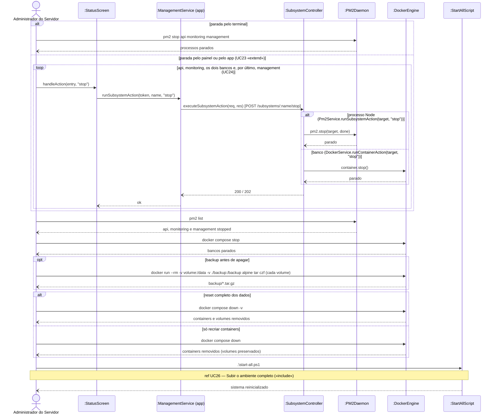

# RF27 — Resetar o sistema

```text
Incremento: Di1 — Informações do sistema
Escopo: RF27; UC27
Branch: feature/refatoracao-documentacao
Commit: 464c190
Data de revisão: 2026-11-10
Responsável(eis): [nome de quem revisa e assina o documento]
Estado: Implementado (procedimento operacional, sem endpoint)
Fontes: sistema/docker-compose.yml; sistema/ecosystem.config.js; sistema/start-all.ps1; requisitos_e_casos_de_uso.md do commit 464c190, removido no lote L7 (conteúdo de origem, UC12 antigo)
```

## Descrição

Procedimento operacional (não há endpoint nem botão de "reset" no sistema) para encerrar todos os subsistemas e, se desejado, apagar completamente os dados da aplicação e do monitoramento, voltando o sistema ao estado de primeira instalação. Opcionalmente, os dados podem ser salvos antes, a partir dos volumes definidos no `docker-compose.yml`.

## Formulário do requisito

| Campo | Conteúdo |
|---|---|
| Entradas | Comandos manuais de PM2 e Docker (não há endpoint nem botão de reset) |
| Origem | Administrador do Servidor, no terminal |
| Saída | Subsistemas encerrados e, se desejado, bancos sem dados |
| Destino | Servidor (PM2 e Docker) |
| Pré-condições | Acesso ao terminal da máquina onde o sistema roda (PM2 e Docker instalados); para usar o painel na etapa de parada, Administrador autenticado (UC22) |
| Pós-condições | Todos os subsistemas encerrados; se executada a Etapa 3, bancos da aplicação e do monitoramento sem nenhum dado (usuários, organizações, comissões e histórico de status apagados). Após a Etapa 4, sistema no estado de primeira instalação, apenas com o administrador padrão. Os arquivos `.env` **não** são apagados — segredos e configurações continuam valendo |
| Efeitos colaterais e observações | Nenhuma observação registrada. |

### Ação

**Etapa 1 — Encerrar os subsistemas.**
1. Administrador encerra os processos Node pelo PM2: `pm2 stop api monitoring management` (ou `pm2 stop all`). **Alternativa pelo painel de gestão ou pelo app mobile** (tela "Status e reset do sistema"): usar "Parar" (UC23) nos cards da API de dados, da API de monitoramento e dos dois bancos, e por **último** no card da API de Gestão (UC24) — depois disso nem o painel nem os botões do app respondem mais.
2. Administrador confere com `pm2 list` que os três processos estão `stopped`.
3. *(Opcional, para remover os processos da lista do PM2)* `pm2 delete api monitoring management`.
**Etapa 2 — Backup (opcional, recomendado).**
4. Com os bancos parados (`docker compose stop`, na pasta `sistema`), Administrador copia o conteúdo de cada volume para um arquivo compactado. Exemplo (PowerShell, na pasta `sistema`):
`docker run --rm -v sistema_db_better_meet_data:/data -v ${PWD}/backup:/backup alpine tar czf /backup/db_better_meet_data.tar.gz -C /data .`
`docker run --rm -v sistema_db_monitoring_better_meet_data:/data -v ${PWD}/backup:/backup alpine tar czf /backup/db_monitoring_better_meet_data.tar.gz -C /data .`
**Etapa 3 — Apagar os dados (reset completo).**
5. Administrador remove containers **e** volumes: `docker compose down -v` (na pasta `sistema`).
6. Administrador confere com `docker volume ls` que os volumes `sistema_db_better_meet_data` e `sistema_db_monitoring_better_meet_data` não existem mais.
**Etapa 4 — Reinicializar (inclui o UC26).**
7. Administrador executa `.\start-all.ps1` (UC26), que recria containers, volumes, tabelas (migrations da `api` e `db push` da monitoring), o administrador padrão e o status inicial dos subsistemas.

### Fluxos alternativos e exceções

- 1a. Se a `management` for parada antes dos demais pelo painel ou pelo app, as ações deixam de funcionar e o restante tem que ser parado pelo terminal (PM2/Docker).
- 5a. **Reset só dos containers, sem apagar dados**: `docker compose down` (sem `-v`) remove os containers mas **mantém os volumes** — ao rodar `start-all.ps1` de novo, os bancos voltam com todos os dados. Apagar só os containers **não** reseta os dados.
- 5b. Reset de apenas um banco: parar o container e remover só o volume correspondente (`docker rm -f mysql_better_meet_dev` + `docker volume rm sistema_db_better_meet_data`, ou o par da monitoring).
- 4a. O prefixo `sistema_` do nome dos volumes vem do nome do projeto do Docker Compose (a pasta onde está o `docker-compose.yml`); se o projeto tiver sido criado com outro nome, conferir o nome real com `docker volume ls` antes do backup/remoção.
- **Restauração de um backup**: com o volume recriado e o container parado, `docker run --rm -v sistema_db_better_meet_data:/data -v ${PWD}/backup:/backup alpine sh -c "rm -rf /data/* && tar xzf /backup/db_better_meet_data.tar.gz -C /data"`, e então `.\start-all.ps1`. O backup deve ser restaurado na mesma versão do MySQL (`mysql:8.4.0`).

## Caso de uso UC27 — Resetar o sistema

| Item | Conteúdo |
|---|---|
| Objetivo | Procedimento operacional (não há endpoint nem botão de "reset" no sistema) para encerrar todos os subsistemas e, se desejado, apagar completamente os dados da aplicação e do monitoramento, voltando o sistema ao estado de primeira instalação. Opcionalmente, os dados podem ser salvos antes, a partir dos volumes definidos no `docker-compose.yml`. |
| Atores | Administrador do Servidor (acesso direto ao servidor), PM2, Docker Engine; opcionalmente Administrador (`Role.ADMIN`), pelo Painel de Gestão para a etapa de parada |
| Requisito | RF27 |
| Relações UML | Ver o diagrama (`include`, `extend` e generalização, quando existirem). |
| Rastreabilidade | RF27; requisito do slide: Informações do sistema — Reinicialização, setup e reset; diagrama `DCU-Gestao-Setup-Reset` |

### Diagrama de casos de uso


Fonte: [`DCU-Gestao-Setup-Reset.puml`](../Diagramas/DCU-Gestao-Setup-Reset.puml). O diagrama é do requisito inteiro; este arquivo documenta só o UC27.

## Diagrama de sequência



## Requisitos não funcionais

- RNF24 — Ausência de banco de dados próprio (API de Gestão)
- RNF26 — Tecnologia (API de Gestão e painel)
- RNF29 — Reset destrutivo apenas manual
- RNF30 — Persistência e backup via volumes

## Divergências e lacunas

- Conteúdo migrado do `requisitos_e_casos_de_uso.md` (incremento 1) e renumerado. Neste lote foram conferidos no código apenas rotas, métodos HTTP, o agendador e a presença dos arquivos citados; as demais afirmações do texto de origem **não foram reverificadas** (`[A CONFIRMAR NO CÓDIGO]`).
- O texto de origem usava os atores abstratos "Usuário Autenticado" e "Sistema Externo"; aqui e no diagrama eles foram trocados pelos atores concretos do catálogo (DOC-10).
- O formulário usa a ficha de caso de uso do incremento 1 (fluxo principal e fluxos alternativos); as linhas Entradas, Origem, Saída e Destino foram acrescentadas a partir desse texto.

## Testes

Nenhum teste automatizado localizado para este caso de uso (`monitoring-better-meet` e `management-better-meet/server` não têm testes; o `npm test` deles só exibe um erro). `CT-RF27-01`: `Não executado`.
