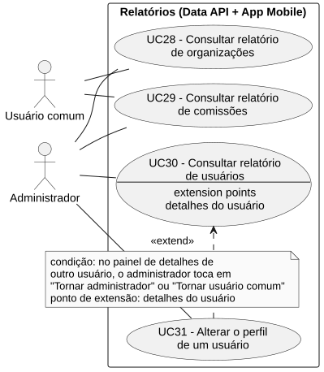
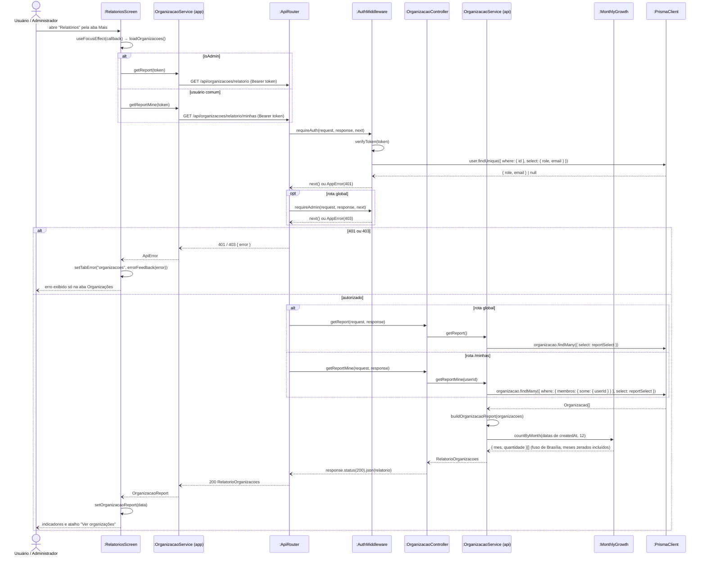

# RF28 — Consultar relatório de organizações

```text
Incremento: Di1 — Informações do sistema
Escopo: RF28; UC28
Branch: feature/refatoracao-documentacao
Commit: 464c190
Data de revisão: 2026-11-10
Responsável(eis): [nome de quem revisa e assina o documento]
Estado: Implementado
Fontes: sistema/api/src/routes/organizacaoRoutes.ts; sistema/api/src/services/organizacaoService.ts (getReport, getReportMine); sistema/better-meet/src/app/(tabs)/mais/relatorios; requisitos_e_casos_de_uso.md do commit 464c190, removido no lote L7 (conteúdo de origem, UC13 antigo)
```

## Descrição

Permite visualizar indicadores agregados das organizações: total, quantidade por status, crescimento mensal, distribuição de papéis dos membros e média de membros por organização.

## Formulário do requisito

| Campo | Conteúdo |
|---|---|
| Entradas | Token JWT (e papel `ADMIN` na rota global) |
| Origem | Tela "Relatórios" do app (aba Mais) |
| Saída | `total`, `porStatus`, `crescimentoPorMes`, `distribuicaoPapeis` e `mediaMembrosPorOrganizacao`; `401`; `403` |
| Destino | Tela de relatórios |
| Pré-condições | Ator autenticado (JWT válido obtido no `POST /api/login`) |
| Pós-condições | Ator visualiza os indicadores das organizações às quais tem acesso. O relatório é recarregado sempre que a tela volta a ficar em foco (ex.: depois de aprovar uma organização em outra tela) |
| Efeitos colaterais e observações | Nenhuma observação registrada. |

### Ação

1. Ator abre "Relatórios" pela aba **Mais** (aba "Organizações", padrão). O app já pede, ao mesmo tempo, os relatórios de todas as abas que o ator pode ver.
2. App envia `GET /api/organizacoes/relatorio` (Administrador) ou `GET /api/organizacoes/relatorio/minhas` (membro), com `Authorization: Bearer <token>`.
3. Data API valida o token (e o papel `ADMIN`, nas rotas globais, lido do banco — ver RNF39).
4. Data API busca as organizações (todas, ou só aquelas em que o usuário é membro) com os papéis dos membros.
5. Data API calcula: `total`; `porStatus` (`PENDENTE`, `ACEITA`, `RECUSADA`); `crescimentoPorMes` (organizações criadas em cada um dos últimos 12 meses no fuso de Brasília, incluindo meses zerados); `distribuicaoPapeis` (`CRIADOR`, `GERENTE`, `MODERADOR`, `MEMBRO`) e `mediaMembrosPorOrganizacao`, esses dois considerando apenas organizações `ACEITA`.
6. Data API retorna `200 OK` com o relatório; o app exibe os indicadores e o atalho "Ver organizações", que abre a aba Organizações do app com a lista e os detalhes de cada uma.

### Fluxos alternativos e exceções

- 3a. Token ausente ou inválido, ou conta excluída depois do login → `401 Unauthorized`.
- 3b. Usuário comum chamando a rota global → `403 Forbidden` (o app sempre escolhe a rota conforme o papel, então isso só ocorre em chamada direta à API).
- 4a. Membro sem nenhuma organização → relatório com `total: 0` e contadores zerados.
- 6a. Falha em um dos relatórios → mensagem de erro exibida só naquela aba; as demais abas continuam carregando normalmente.

## Caso de uso UC28 — Consultar relatório de organizações

| Item | Conteúdo |
|---|---|
| Objetivo | Permite visualizar indicadores agregados das organizações: total, quantidade por status, crescimento mensal, distribuição de papéis dos membros e média de membros por organização. |
| Atores | Usuário comum (`Role.USER`), Administrador (`Role.ADMIN`) |
| Requisito | RF28 |
| Relações UML | Ver o diagrama (`include`, `extend` e generalização, quando existirem). |
| Rastreabilidade | RF28; requisito do slide: Informações do sistema — Relatórios; diagrama `DCU-Relatorios` |

### Diagrama de casos de uso



Fonte: [`DCU-Relatorios.puml`](../Diagramas/DCU-Relatorios.puml). O diagrama é do requisito inteiro; este arquivo documenta só o UC28.

## Diagrama de sequência



## Requisitos não funcionais

- RNF31 — Escopo do relatório conforme o papel
- RNF33 — Relatórios calculados sob demanda
- RNF34 — Isolamento de falhas entre relatórios
- RNF35 — Série temporal completa

## Divergências e lacunas

- Conteúdo migrado do `requisitos_e_casos_de_uso.md` (incremento 1) e renumerado. Neste lote foram conferidos no código apenas rotas, métodos HTTP, o agendador e a presença dos arquivos citados; as demais afirmações do texto de origem **não foram reverificadas** (`[A CONFIRMAR NO CÓDIGO]`).
- O texto de origem usava os atores abstratos "Usuário Autenticado" e "Sistema Externo"; aqui e no diagrama eles foram trocados pelos atores concretos do catálogo (DOC-10).
- O formulário usa a ficha de caso de uso do incremento 1 (fluxo principal e fluxos alternativos); as linhas Entradas, Origem, Saída e Destino foram acrescentadas a partir desse texto.

## Testes

Nenhum teste automatizado localizado para os relatórios de organizações. `CT-RF28-01`: `Não executado`.
