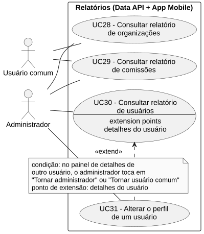
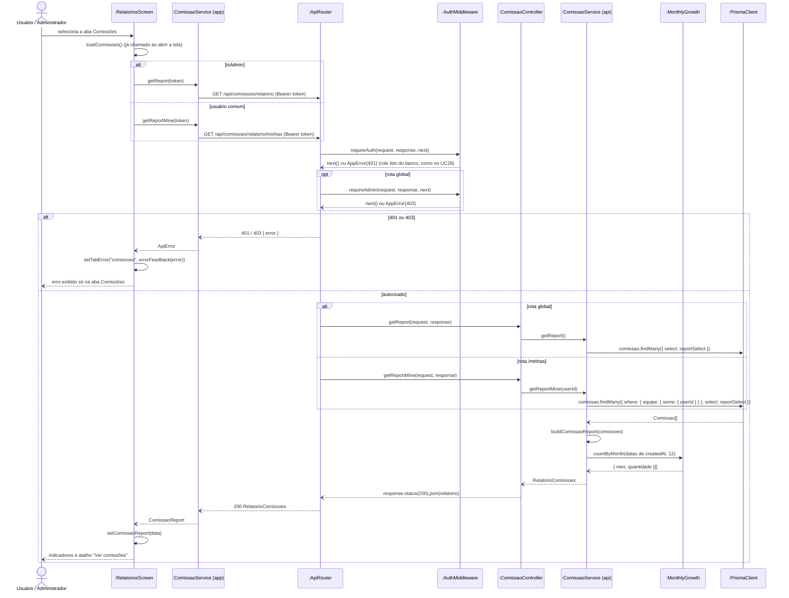

# RF29 — Consultar relatório de comissões

```text
Incremento: Di1 — Informações do sistema
Escopo: RF29; UC29
Branch: feature/refatoracao-documentacao
Commit: 464c190
Data de revisão: 2026-11-10
Responsável(eis): [nome de quem revisa e assina o documento]
Estado: Implementado
Fontes: sistema/api/src/routes/comissaoRoutes.ts; sistema/api/src/services/comissaoService.ts (getReport, getReportMine); sistema/better-meet/src/app/(tabs)/mais/relatorios; requisitos_e_casos_de_uso.md do commit 464c190, removido no lote L7 (conteúdo de origem, UC14 antigo)
```

## Descrição

Permite visualizar indicadores agregados das comissões: total, quantidade por organização, crescimento mensal, distribuição de papéis na equipe e média de membros por comissão.

## Formulário do requisito

| Campo | Conteúdo |
|---|---|
| Entradas | Token JWT (e papel `ADMIN` na rota global) |
| Origem | Tela "Relatórios" do app, aba Comissões |
| Saída | `total`, `totalOrganizacoes`, `porOrganizacao`, `crescimentoPorMes`, `distribuicaoPapeis`, `mediaMembrosPorComissao` e `comissoes`; `401`; `403` |
| Destino | Tela de relatórios |
| Pré-condições | Ator autenticado (JWT válido) |
| Pós-condições | Ator visualiza os indicadores das comissões às quais tem acesso |
| Efeitos colaterais e observações | Nenhuma observação registrada. |

### Ação

1. Ator seleciona a aba "Comissões" na tela de Relatórios (o relatório já foi pedido ao abrir a tela).
2. App envia `GET /api/comissoes/relatorio` (Administrador) ou `GET /api/comissoes/relatorio/minhas` (membro), com Bearer token.
3. Data API valida o token (e o papel `ADMIN`, na rota global).
4. Data API busca as comissões (todas, ou só aquelas em cuja equipe o usuário está), com a organização e os papéis da equipe.
5. Data API calcula: `total`; `totalOrganizacoes`; `porOrganizacao` (ordenado da maior para a menor quantidade); `crescimentoPorMes` (últimos 12 meses, no fuso de Brasília); `distribuicaoPapeis` (`ADMINISTRADOR`, `FACILITADOR`, `SECRETARIO`, `MEMBRO`); `mediaMembrosPorComissao`; e a lista `comissoes` (id, nome, descrição, data de criação, organização e número de membros), da mais recente para a mais antiga.
6. Data API retorna `200 OK`; o app exibe os indicadores e o atalho "Ver comissões", que abre a aba Comissões do app com a lista e os detalhes de cada uma (a lista `comissoes` da resposta não é mais exibida no relatório).

### Fluxos alternativos e exceções

- 3a. Token ausente ou inválido → `401 Unauthorized`.
- 3b. Usuário comum chamando a rota global → `403 Forbidden`.
- 4a. Usuário sem nenhuma comissão → relatório com `total: 0` e lista vazia.
- 6a. Falha → mensagem de erro exibida só nesta aba.

## Caso de uso UC29 — Consultar relatório de comissões

| Item | Conteúdo |
|---|---|
| Objetivo | Permite visualizar indicadores agregados das comissões: total, quantidade por organização, crescimento mensal, distribuição de papéis na equipe e média de membros por comissão. |
| Atores | Usuário comum (`Role.USER`), Administrador (`Role.ADMIN`) |
| Requisito | RF29 |
| Relações UML | Ver o diagrama (`include`, `extend` e generalização, quando existirem). |
| Rastreabilidade | RF29; requisito do slide: Informações do sistema — Relatórios; diagrama `DCU-Relatorios` |

### Diagrama de casos de uso



Fonte: [`DCU-Relatorios.puml`](../Diagramas/DCU-Relatorios.puml). O diagrama é do requisito inteiro; este arquivo documenta só o UC29.

## Diagrama de sequência



## Requisitos não funcionais

- RNF31 — Escopo do relatório conforme o papel
- RNF33 — Relatórios calculados sob demanda
- RNF34 — Isolamento de falhas entre relatórios
- RNF35 — Série temporal completa

## Divergências e lacunas

- Conteúdo migrado do `requisitos_e_casos_de_uso.md` (incremento 1) e renumerado. Neste lote foram conferidos no código apenas rotas, métodos HTTP, o agendador e a presença dos arquivos citados; as demais afirmações do texto de origem **não foram reverificadas** (`[A CONFIRMAR NO CÓDIGO]`).
- O texto de origem usava os atores abstratos "Usuário Autenticado" e "Sistema Externo"; aqui e no diagrama eles foram trocados pelos atores concretos do catálogo (DOC-10).
- O formulário usa a ficha de caso de uso do incremento 1 (fluxo principal e fluxos alternativos); as linhas Entradas, Origem, Saída e Destino foram acrescentadas a partir desse texto.

## Testes

Nenhum teste automatizado localizado para os relatórios de comissões. `CT-RF29-01`: `Não executado`.
