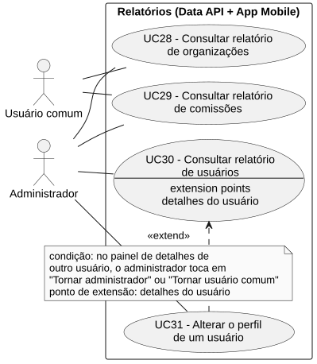
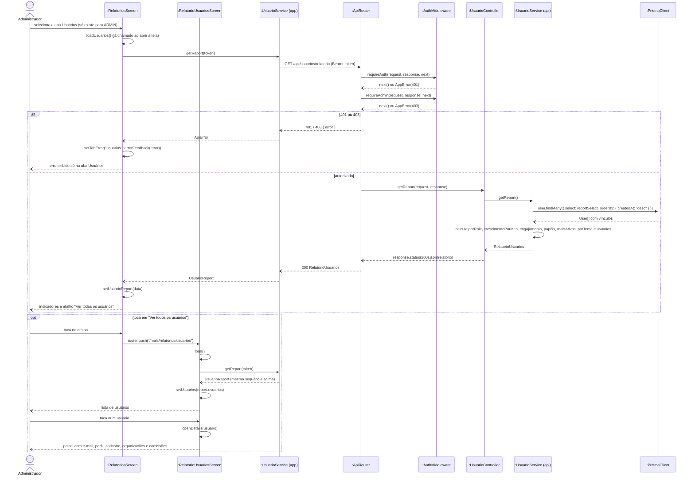

# RF30 — Consultar relatório de usuários

```text
Incremento: Di1 — Informações do sistema
Escopo: RF30; UC30
Branch: feature/refatoracao-documentacao
Commit: 464c190
Data de revisão: 2026-11-10
Responsável(eis): [nome de quem revisa e assina o documento]
Estado: Implementado
Fontes: sistema/api/src/routes/usuarioRoutes.ts; sistema/api/src/services/usuarioService.ts; sistema/better-meet/src/app/(tabs)/mais/relatorios; requisitos_e_casos_de_uso.md do commit 464c190, removido no lote L7 (conteúdo de origem, UC15 antigo)
```

## Descrição

Permite ao administrador visualizar indicadores sobre todos os usuários da plataforma: total, quantidade por papel, crescimento mensal, engajamento em organizações/comissões, papéis de responsabilidade, ranking dos mais ativos, tema preferido e a lista detalhada de usuários com seus vínculos.

## Formulário do requisito

| Campo | Conteúdo |
|---|---|
| Entradas | Token JWT de Administrador |
| Origem | Tela "Relatórios" do app, aba Usuários (só para Administrador) |
| Saída | Indicadores e lista de usuários da plataforma; `401`; `403`; `500` |
| Destino | Tela de relatórios |
| Pré-condições | Ator autenticado com `role: ADMIN` |
| Pós-condições | Administrador visualiza os indicadores e a lista de usuários da plataforma |
| Efeitos colaterais e observações | Nenhuma observação registrada. |

### Ação

1. Administrador seleciona a aba "Usuários" na tela de Relatórios (a aba só aparece para administradores).
2. App envia `GET /api/usuarios/relatorio` com Bearer token.
3. Data API valida o token e exige `role: ADMIN` (lido do banco — RNF39).
4. Data API busca todos os usuários com seus vínculos de organização e comissão.
5. Data API calcula: `total`; `porRole` (`ADMIN`, `USER`); `crescimentoPorMes` (últimos 12 meses, no fuso de Brasília); `engajamento` (usuários com e sem organização, com comissão, e média de organizações e de comissões por usuário); `usuariosPorPapelOrganizacao` (`CRIADOR`, `GERENTE`, `MODERADOR`) e `usuariosPorPapelComissao` (`ADMINISTRADOR`, `FACILITADOR`, `SECRETARIO`), contando cada usuário uma vez por papel; `maisAtivos` (5 usuários com mais vínculos); `porTema` (`light`, `dark`, `system` — preferência nula conta como `system`); e a lista `usuarios` (id, nome, e-mail, papel, data de cadastro, organizações e comissões com o papel em cada uma).
6. Data API retorna `200 OK`; o app exibe os indicadores e o atalho "Ver todos os usuários" (com a quantidade).
7. Ao tocar no atalho, o app abre a tela "Usuários" (`relatorios/usuarios.tsx`), que lista nome, e-mail e o selo "Administrador" de cada usuário, a partir da mesma lista `usuarios`.
8. Ao tocar num usuário, o app abre um painel com e-mail, perfil, data de cadastro, organizações e comissões (com o papel em cada uma) e, se não for o próprio administrador, o botão de alterar o perfil (UC31).

### Fluxos alternativos e exceções

- 1a. Usuário comum → a aba não é exibida e a requisição não é feita; se abrir a tela "Usuários" por link direto, é redirecionado de volta aos relatórios.
- 3a. Token ausente ou inválido → `401 Unauthorized`.
- 3b. Usuário sem papel `ADMIN` chamando a rota diretamente → `403 Forbidden`.
- 5a. Erro inesperado → `500` com "Não foi possível gerar o relatório de usuários."; mensagem exibida só nesta aba.

## Caso de uso UC30 — Consultar relatório de usuários

| Item | Conteúdo |
|---|---|
| Objetivo | Permite ao administrador visualizar indicadores sobre todos os usuários da plataforma: total, quantidade por papel, crescimento mensal, engajamento em organizações/comissões, papéis de responsabilidade, ranking dos mais ativos, tema preferido e a lista detalhada de usuários com seus vínculos. |
| Atores | Administrador (`Role.ADMIN`) |
| Requisito | RF30 |
| Relações UML | Ver o diagrama (`include`, `extend` e generalização, quando existirem). |
| Rastreabilidade | RF30; requisito do slide: Informações do sistema — Relatórios; diagrama `DCU-Relatorios` |

### Diagrama de casos de uso



Fonte: [`DCU-Relatorios.puml`](../Diagramas/DCU-Relatorios.puml). O diagrama é do requisito inteiro; este arquivo documenta só o UC30.

## Diagrama de sequência



## Requisitos não funcionais

- RNF31 — Escopo do relatório conforme o papel
- RNF32 — Proteção de dados pessoais no relatório de usuários
- RNF33 — Relatórios calculados sob demanda
- RNF34 — Isolamento de falhas entre relatórios
- RNF35 — Série temporal completa
- RNF39 — Perfil lido do banco a cada requisição

## Divergências e lacunas

- Conteúdo migrado do `requisitos_e_casos_de_uso.md` (incremento 1) e renumerado. Neste lote foram conferidos no código apenas rotas, métodos HTTP, o agendador e a presença dos arquivos citados; as demais afirmações do texto de origem **não foram reverificadas** (`[A CONFIRMAR NO CÓDIGO]`).
- O texto de origem usava os atores abstratos "Usuário Autenticado" e "Sistema Externo"; aqui e no diagrama eles foram trocados pelos atores concretos do catálogo (DOC-10).
- O formulário usa a ficha de caso de uso do incremento 1 (fluxo principal e fluxos alternativos); as linhas Entradas, Origem, Saída e Destino foram acrescentadas a partir desse texto.

## Testes

Nenhum teste automatizado localizado para o relatório de usuários. `CT-RF30-01`: `Não executado`.
