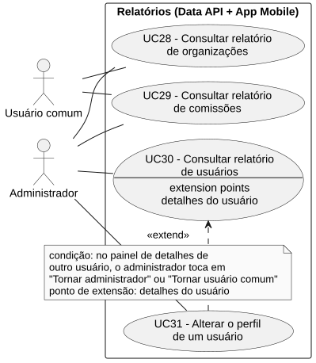
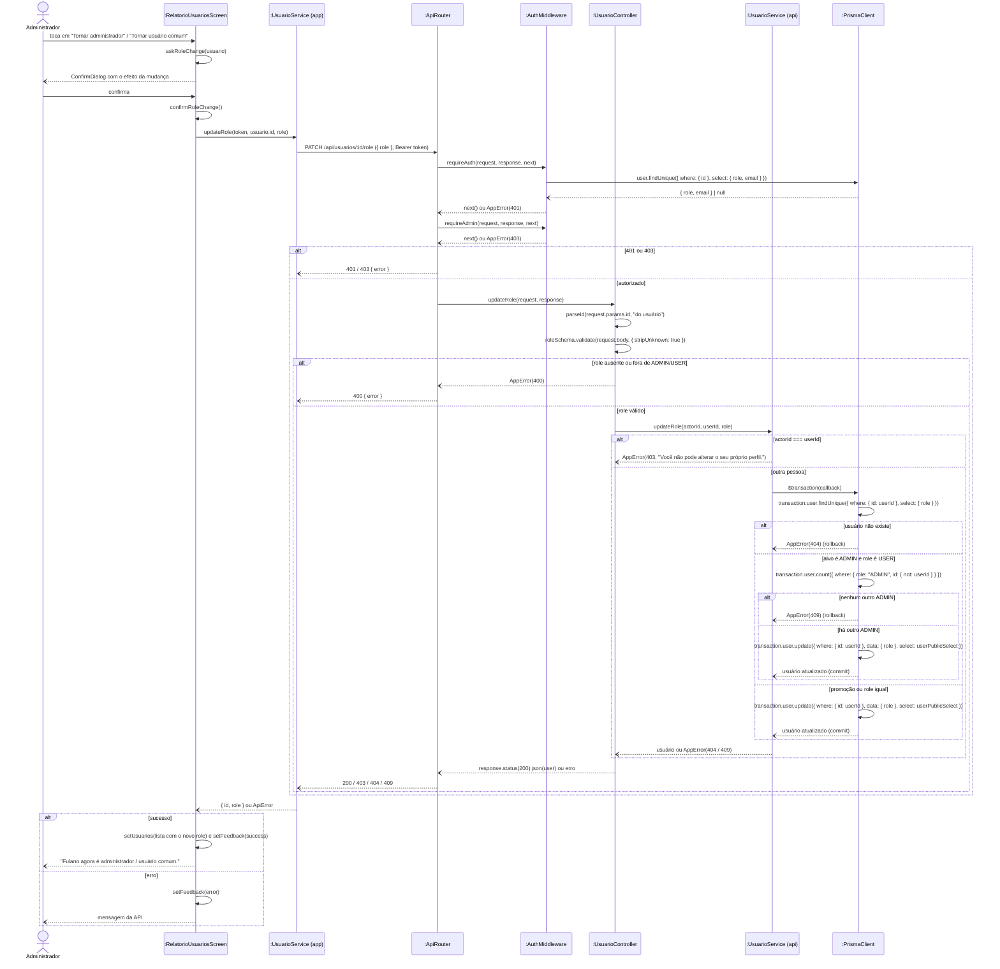

# RF31 — Alterar o perfil de um usuário (promover ou rebaixar)

```text
Incremento: Di1 — Informações do sistema
Escopo: RF31; UC31
Branch: feature/refatoracao-documentacao
Commit: 464c190
Data de revisão: 2026-11-10
Responsável(eis): [nome de quem revisa e assina o documento]
Estado: Implementado
Fontes: sistema/api/src/routes/usuarioRoutes.ts; sistema/api/src/services/usuarioService.ts (updateRole); sistema/api/tests/usuarioRole.test.mjs; requisitos_e_casos_de_uso.md do commit 464c190, removido no lote L7 (conteúdo de origem, UC16 antigo)
```

## Descrição

Permite ao administrador tornar outra pessoa administradora (`ADMIN`) ou rebaixá-la a usuário comum (`USER`), a partir da listagem de usuários do relatório, sem acesso ao banco. A plataforma nunca fica sem administrador.

## Formulário do requisito

| Campo | Conteúdo |
|---|---|
| Entradas | `id` do usuário (URL), `role` (`ADMIN` ou `USER`) e token de Administrador |
| Origem | Painel de detalhes do usuário, na lista do relatório de usuários |
| Saída | Usuário com o novo perfil; `400`, `401`, `403`, `404`, `409` |
| Destino | Tela de relatórios |
| Pré-condições | Ator autenticado com `role: ADMIN`, na tela "Usuários" (UC30, passos 7 e 8) |
| Pós-condições | O usuário tem o novo perfil. Na Data API, a mudança vale já na próxima requisição da pessoa, porque o `requireAuth` lê o perfil no banco, e não no token (RNF39). No app da pessoa afetada, as abas e botões de administrador só mudam no próximo login (o app guarda o perfil recebido no login); até lá, as rotas restritas respondem `403`. Na API de Gestão, que lê o perfil do token, a mudança só vale quando o token vence ou a pessoa entra de novo (ver limitação no RNF22) |
| Efeitos colaterais e observações | Nenhuma observação registrada. |

### Ação

1. Administrador toca num usuário da lista e, no painel de detalhes, em "Tornar administrador" (se o usuário for comum) ou "Tornar usuário comum" (se for administrador).
2. App fecha o painel e pede confirmação, explicando o efeito: o novo administrador passa a poder aprovar organizações, ver os relatórios de toda a plataforma e alterar o perfil de outras pessoas; o rebaixado passa a ver só as organizações e comissões das quais participa.
3. Administrador confirma ("Tornar administrador" ou "Rebaixar").
4. App envia `PATCH /api/usuarios/:id/role` com `{ role }` e Bearer token.
5. Data API valida o token e exige `role: ADMIN` (lido do banco).
6. Data API valida o corpo (`role` obrigatório, `ADMIN` ou `USER`).
7. Em uma única transação, Data API busca o usuário e, se for um rebaixamento de `ADMIN`, confere se existe pelo menos outro administrador; então grava o novo perfil.
8. Data API retorna `200 OK` com o usuário atualizado, sem dados sensíveis.
9. App atualiza o selo na lista e exibe "<nome> agora é administrador / usuário comum.".

### Fluxos alternativos e exceções

- 1a. O próprio administrador → o botão não é exibido.
- 3a. Administrador cancela a confirmação → nada é enviado.
- 5a. Token ausente ou inválido → `401`; quem pediu não é `ADMIN` → `403`.
- 5b. Administrador tenta alterar o próprio perfil chamando a API diretamente → `403` "Você não pode alterar o seu próprio perfil."
- 6a. `role` ausente ou fora de `ADMIN`/`USER` → `400` "Perfil inválido. Use: ADMIN ou USER."
- 7a. Usuário não existe → `404`.
- 7b. Rebaixar o único administrador → `409` "Este é o único administrador da plataforma. Promova outra pessoa antes de rebaixá-lo." A contagem fica na mesma transação da gravação, para dois rebaixamentos simultâneos não zerarem os administradores.
- Em qualquer falha, o app exibe a mensagem da API e mantém a lista como estava.

## Caso de uso UC31 — Alterar o perfil de um usuário (promover ou rebaixar)

| Item | Conteúdo |
|---|---|
| Objetivo | Permite ao administrador tornar outra pessoa administradora (`ADMIN`) ou rebaixá-la a usuário comum (`USER`), a partir da listagem de usuários do relatório, sem acesso ao banco. A plataforma nunca fica sem administrador. |
| Atores | Administrador (`Role.ADMIN`) |
| Requisito | RF31 |
| Relações UML | Ver o diagrama (`include`, `extend` e generalização, quando existirem). |
| Rastreabilidade | RF31; requisito do slide: Informações do sistema — Relatórios; diagrama `DCU-Relatorios` |

### Diagrama de casos de uso



Fonte: [`DCU-Relatorios.puml`](../Diagramas/DCU-Relatorios.puml). O diagrama é do requisito inteiro; este arquivo documenta só o UC31.

## Diagrama de sequência



## Requisitos não funcionais

- RNF39 — Perfil lido do banco a cada requisição
- RNF40 — Plataforma sempre com administrador
- RNF41 — Confirmação de ações de perfil

## Divergências e lacunas

- Conteúdo migrado do `requisitos_e_casos_de_uso.md` (incremento 1) e renumerado. Neste lote foram conferidos no código apenas rotas, métodos HTTP, o agendador e a presença dos arquivos citados; as demais afirmações do texto de origem **não foram reverificadas** (`[A CONFIRMAR NO CÓDIGO]`).
- O texto de origem usava os atores abstratos "Usuário Autenticado" e "Sistema Externo"; aqui e no diagrama eles foram trocados pelos atores concretos do catálogo (DOC-10).
- O formulário usa a ficha de caso de uso do incremento 1 (fluxo principal e fluxos alternativos); as linhas Entradas, Origem, Saída e Destino foram acrescentadas a partir desse texto.

## Testes

CT-RF31-01: `sistema/api/tests/usuarioRole.test.mjs` (Jest + Supertest, `PATCH /api/usuarios/:id/role`); não reexecutado nesta etapa (`Não executado`).
