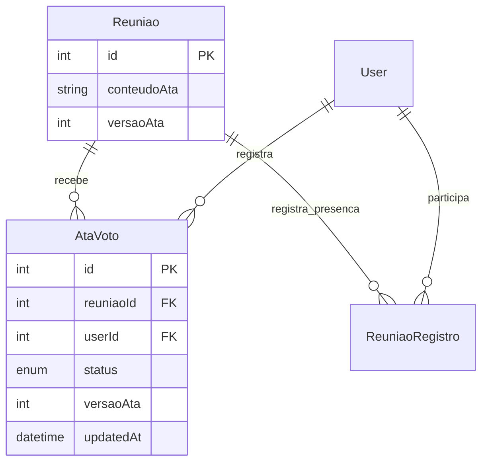

# Ata de reunião

Implementado em 09/11/2026. Migração aplicada ao banco configurado, com histórico atualizado.

Editor ampliado em 10/11/2026. Esta ampliação não exige migração adicional.

## Requisitos e casos de uso

| ID | Requisito | Caso de uso |
|---|---|---|
| RF-ATA-01 | Redigir e editar uma ata com formatação textual, parágrafos e tabelas | UC-ATA-01 — Redigir ata |
| RF-ATA-02 | Ler a ata salva, sem controles de edição para facilitador/membro | UC-ATA-02 — Consultar ata |
| RF-ATA-03 | Aprovar ou reprovar a ata, com um voto por integrante e possibilidade de troca | UC-ATA-03 — Votar na ata |
| RF-ATA-04 | Exigir vínculo atual com a comissão e registro de entrada na reunião | Todos |
| RF-ATA-05 | Sanitizar HTML, detectar edições concorrentes e invalidar votos ao alterar o texto | UC-ATA-01 e UC-ATA-03 |
| RF-ATA-06 | Oferecer barra horizontal com ícones, histórico e menu de tabelas no celular e na web | UC-ATA-01 — Redigir ata |

### Permissões

| Cargo na comissão | Consultar | Redigir/editar | Votar após a ata ser salva |
|---|---|---|---|
| ADMINISTRADOR | Sim | Sim | Sim |
| SECRETARIO | Sim | Sim | Sim |
| FACILITADOR | Sim | Não | Sim |
| MEMBRO | Sim | Não | Sim |

Todas as permissões exigem uma `ReuniaoRegistro` para o usuário e a reunião solicitada. Ter registrado saída não revoga o acesso, conforme definição do requisito. Um convite aceito sem registro de entrada não é suficiente. Ex-integrantes não têm acesso. O perfil global `ADMIN` não ignora essas restrições.

O JWT identifica a pessoa. O cargo da comissão é consultado no banco em cada operação; cargos fornecidos no corpo ou em claims adicionais do token não concedem acesso. `requireAtaEditor` bloqueia a edição antes do controller, e o service repete a autorização dentro da transação.

### Fluxos

1. Registrar entrada na tela de detalhes da reunião e abrir **Ata de reunião**.
2. Administrador/secretário redige o texto e salva. Os demais integrantes veem uma mensagem de espera enquanto não houver ata.
3. Após salvar, os presentes podem aprovar ou reprovar. A tela exibe totais e o voto do próprio usuário, sem divulgar os votos individuais de terceiros.
4. Alterar o texto incrementa sua versão e remove os votos, atomicamente. Se houver votos carregados na tela, o app pede confirmação. Salvar texto idêntico não altera a versão nem os votos.
5. Edição ou voto sobre versão antiga recebe 409. O app preserva o rascunho e orienta atualizar. Atualizar ou sair com alterações locais exige confirmação.

Salvar disponibiliza a ata para votação; não há uma etapa separada de publicação, quórum, encerramento ou resultado coletivo automático. Essas regras não foram solicitadas.

## Dados

`Reuniao.conteudoAta`: `String? @db.LongText`, nulo antes da primeira gravação. O contrato limita o HTML a 50.000 caracteres e exige texto não vazio após sanitização.

`Reuniao.versaoAta`: inteiro, inicialmente zero, incrementado a cada alteração efetiva do conteúdo. A escrita condicional bloqueia a linha da reunião até o fim da transação para serializar edição e voto.

`AtaVoto`: `id`, `reuniaoId`, `userId`, `status`, `versaoAta`, `updatedAt`. `StatusAtaVoto` admite `APROVADO` ou `REPROVADO`. A chave única `(reuniaoId, userId)` impede votos duplicados; exclusão da reunião ou do usuário remove os votos em cascata.



## API

Todos os endpoints usam `Authorization: Bearer <token>` e o prefixo `/api`.

| Método e caminho | Corpo | Comportamento |
|---|---|---|
| `GET /reunioes/:id/ata` | — | Retorna texto, versão, cargo, permissões, voto próprio e totais |
| `PUT /reunioes/:id/ata` | `{ "conteudoAta": "<p>Decisões...</p>", "versaoAta": 0 }` | Cria/edita como administrador ou secretário presente |
| `POST /reunioes/:id/ata/votar` | `{ "status": "APROVADO", "versaoAta": 1 }` | Registra ou troca voto na versão atual |

O cliente obtém `versaoAta` no GET e a envia no PUT/POST. Respostas de sucesso usam 200. Erros: 400 (dados inválidos), 401 (sessão ausente/inválida), 403 (cargo/presença/vínculo), 404 (reunião inexistente), 409 (versão antiga ou votação antes da redação), 500 (erro interno).

Contrato completo: `sistema/api/docs/openapi.yaml`, disponível em `/api/docs`.

## Interface e HTML

- Rota: `better-meet/src/app/(tabs)/(reunioes)/ata/[id].tsx`.
- Conteúdo da tela: `better-meet/src/components/AtaReuniao.tsx`.
- Android/iOS: `react-native-pell-rich-editor` e WebView 14.0.1, versão indicada pelo Expo 58. A leitura usa WebView sem JavaScript, com CSP e bloqueio de navegação externa.
- Web: Tiptap para edição e DOMPurify para leitura. Os módulos web não entram no bundle nativo.
- API: `sanitize-html` 2.18.1 preserva elementos de formatação textual e tabelas. Atributos são limitados a alinhamento, fonte da escala permitida, estilo de borda enumerado e dimensões de células entre 1 e 10. Scripts, imagens, eventos, CSS arbitrário e conteúdo externo são removidos. A leitura também sanitiza conteúdo legado.
- O botão da ata aparece nos detalhes somente para quem tem registro de entrada e cargo na comissão; o servidor valida independentemente da interface.

Referências consultadas: [Expo 58 — WebView](https://docs.expo.dev/versions/v58.0.0/sdk/webview/), [Pell Rich Editor](https://github.com/wxik/react-native-rich-editor), [Tiptap para React](https://tiptap.dev/docs/editor/getting-started/install/react), [DOMPurify](https://github.com/cure53/DOMPurify).

### Controles do editor

| Grupo | Controles |
|---|---|
| Histórico | Desfazer e refazer, desabilitados quando indisponíveis |
| Texto | Negrito, itálico, sublinhado e rasurado |
| Fonte | Diminuir e aumentar entre 10, 13, 16, 18, 24, 32 e 48 pixels; indicador do tamanho na seleção |
| Títulos | H1, H2 e H3; tocar novamente retorna ao parágrafo |
| Parágrafo | Esquerda, centro, direita e justificado |
| Listas e recuo | Marcadores, numeração, aumentar e diminuir recuo |
| Tabela | Menu com 1–10 linhas, 1–6 colunas e cabeçalho opcional |

A barra usa `ScrollView` horizontal, alvos de toque de pelo menos 44 pixels, nomes acessíveis em português e ícones do Pell/Ionicons. Seu fundo usa `Colors.dark.backgroundElement`, com seleção e ações em `Colors.dark.primary`. Os demais componentes seguem o tema escolhido no app.

O menu de tabelas oferece todas as bordas, externas, internas, horizontais, verticais, somente superior, inferior, esquerda, direita e sem bordas. Ao selecionar uma célula de uma tabela existente, o mesmo menu permite trocar suas bordas, adicionar linha abaixo/coluna à direita, excluir linha/coluna ou excluir a tabela. Não há mesclagem de células nem edição de bordas individuais de cada célula.

`data-ata-border` registra a opção escolhida. A folha de estilos compartilhada entre editores e leitores converte esse valor em bordas, mantendo o HTML salvo sem CSS arbitrário. Fontes `<font size="1..7">` produzidas pelo editor nativo são convertidas em `<span style="font-size:...px">`. O recuo de parágrafos usa `blockquote` sem decoração de citação; em listas, os comandos alteram o nível do item.

Na web foram adicionadas as extensões [TextAlign](https://tiptap.dev/docs/editor/extensions/functionality/textalign), [FontSize/TextStyle](https://tiptap.dev/docs/editor/extensions/functionality/fontsize) e [Table](https://tiptap.dev/docs/editor/extensions/nodes/table), versão 3.33.0. No celular, a ponte do Pell preserva a seleção ao abrir o painel de tabelas e usa comandos do navegador para conservar o histórico. A normalização de input do Pell é suspensa apenas durante esses comandos, evitando que uma alteração adicional apague o histórico de refazer. Alternar o estado editável do Tiptap durante o salvamento não emite alterações de conteúdo.

## Instalação e migração

Requer Node 24.9 ou superior. O Jest da API foi alinhado à versão 30.5 usada pelo app para testar as dependências ESM do sanitizador atual, sem substituir a sanitização por mocks. Ver [suporte ESM do Jest](https://jestjs.io/docs/ecmascript-modules).

Na pasta `sistema/api`:

```powershell
npm install
npm run prisma:generate
npm run prisma:deploy
```

Na pasta `sistema/better-meet`:

```powershell
npm install
npm start
```

Migração: `api/prisma/migrations/20261109140000_ata_reuniao/migration.sql`. Adiciona duas colunas e a tabela de votos, sem excluir tabelas ou dados existentes.

`prisma migrate dev --name ata_reuniao --create-only` encontrou P3014/P1010: o usuário do banco configurado não pode criar o banco temporário (shadow database). O SQL foi gerado por `prisma migrate diff` entre o schema anterior e o novo, revisado e mantido no histórico de migrations. `prisma migrate status` confirmou que somente a migração da ata estava pendente. Ela foi aplicada com sucesso por `prisma migrate deploy`, que não depende de shadow database, sem reset ou remoção de dados existentes. O Prisma Client já foi gerado; processos de API/Expo que estavam abertos precisam ser reiniciados para carregar o código e as dependências.

## Testes

Data: 09/11/2026. Os testes da API usam Prisma simulado e Supertest, sem alterar o banco de desenvolvimento.

| IDs | Requisito/caso de uso | Cenários automatizados |
|---|---|---|
| CT-ATA-01 | RF-ATA-01, UC-ATA-01 | Administrador e secretário editam; facilitador/membro recebem 403 inclusive com ADMIN global |
| CT-ATA-02 | RF-ATA-04, todos | Ausentes, ex-integrantes, token inválido e presença em outra reunião não concedem acesso; saída não revoga presença |
| CT-ATA-03 | RF-ATA-02/05, UC-ATA-02 | HTML sanitizado na gravação e leitura, preservação de formatação, bloqueio de scripts e recursos externos |
| CT-ATA-04 | RF-ATA-03, UC-ATA-03 | Quatro cargos votam; duplicação, troca, voto próprio e totais; bloqueio antes de existir conteúdo |
| CT-ATA-05 | RF-ATA-05, UC-ATA-01/03 | Edição invalida votos, conteúdo idêntico preserva votos, versão antiga e concorrência recebem 409 |
| CT-ATA-06 | RF-ATA-01/02/03, todos | Interface condicional, gravação/voto, rascunho preservado em erros e confirmações |

```powershell
# sistema/api
npm test -- --runInBand
npm run typecheck
npm run lint
npx prisma validate

# sistema/better-meet
npm test -- --runInBand
npm run test:web -- --runInBand
npm run typecheck
npm run lint
npx expo export --platform all --output-dir <pasta-temporaria>
```

Resultados finais:

| Verificação | Resultado |
|---|---|
| API — Jest/Supertest | 13 suítes, 247 testes aprovados; 44 testes novos de ata |
| App — Jest/React Native Testing Library | 21 suítes, 173 testes aprovados; 12 testes novos de ata |
| HTML web — Jest/DOM | 1 suíte, 3 testes aprovados com o sanitizador real |
| Typecheck e lint | API e app aprovados |
| Prisma | Schema validado, Prisma Client gerado, migração aplicada e histórico atualizado |
| OpenAPI | YAML válido, sem referências internas quebradas |
| Expo export | Android, iOS e web gerados com sucesso |
| Navegador real — Chrome/Playwright | Editor Tiptap, negrito, gravação do HTML/versão, aprovação, leitura sem editor, troca para reprovação e bloqueio 403 aprovados, sem erros JavaScript; API simulada |
| Alterações anteriores do usuário | Lockfile do app preservado; nenhuma versão de dependência preexistente foi alterada |

O arquivo local `.expo/types/router.d.ts` foi regenerado pelo gerador do Expo, resolvendo os quatro erros de navegação anteriores e incluindo a rota da ata. Não houve alteração das rotas anteriores para contornar o typecheck.

O teste em navegador utilizou a exportação temporária e respostas HTTP simuladas, sem escrita no banco. Os testes de concorrência da API verificam os conflitos de escrita por versão; não substituem um teste concorrente contra MySQL real.

### Verificação manual em dispositivo

Usar quatro integrantes com os cargos diferentes: registrar entrada, redigir no celular, aplicar negrito/itálico/listas, salvar e ler com cada papel. Testar teclado, seleção e rolagem em Android/iOS; votar, trocar voto, editar a ata após votos e verificar a reinicialização. Com duas sessões, editar simultaneamente e conferir o conflito. Confirmar acesso após saída e bloqueio sem entrada.

Essa validação com dispositivo e banco real ainda não foi executada. Exportar bundles comprova compilação e resolução de dependências, não a interação nativa com teclado e seleção de texto.

### Validação da ampliação — 10/11/2026

| IDs | Requisito/caso de uso | Cobertura adicionada |
|---|---|---|
| CT-ATA-07 | RF-ATA-01/05, UC-ATA-01/02 | Salvar/reler títulos, sublinhado, rasurado, recuo, fonte e os dez estilos de borda; normalizar fonte nativa; rejeitar CSS/atributos inválidos e tabela sem texto |
| CT-ATA-08 | RF-ATA-01/06, UC-ATA-01 | Comandos reais do Tiptap: alinhamentos, títulos, fonte, recuo, histórico e edição de tabela, com sanitização e reabertura |
| CT-ATA-09 | RF-ATA-06, UC-ATA-01 | Barra horizontal, nomes acessíveis, estados ativo/desabilitado e escolha de tamanho/bordas |
| CT-ATA-10 | RF-ATA-03/06, UC-ATA-01/03 | Alternar salvamento não cria alterações pendentes; ponte nativa preserva histórico e filtra mensagens |

Resultados: API com 261 testes aprovados (13 suítes), app com 177 testes aprovados (22 suítes) e web com 29 testes aprovados (4 suítes). Typecheck e lint aprovados na API e no app. Exportação Expo aprovada para Android, iOS e web.

Chrome/Playwright em largura de 390 pixels: aplicação real com Tiptap, formatação, recuo, fonte, desfazer/refazer, inserir tabela, trocar bordas, adicionar linha, salvar, reabrir, votar, ler sem editor e bloquear acesso 403. As respostas HTTP foram simuladas com o sanitizador real da API na gravação. Não houve escrita no banco. Sem erros JavaScript ou transbordamento horizontal da página.

O HTML real do Pell e sua ponte foram executados em Chrome para validar formatação, H1–H3, recuo, fonte, histórico, seleção após perda de foco, inserção de tabela, linhas/colunas e bordas. Isso não substitui a validação física em Android/iOS: conferir teclado, seleção de trechos, rolagem horizontal da barra, abertura/fechamento do painel e edição nas células, especialmente após desfazer/refazer. Repetir os fluxos de gravação/leitura entre celular e web.
