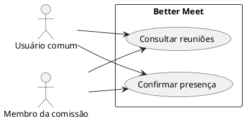
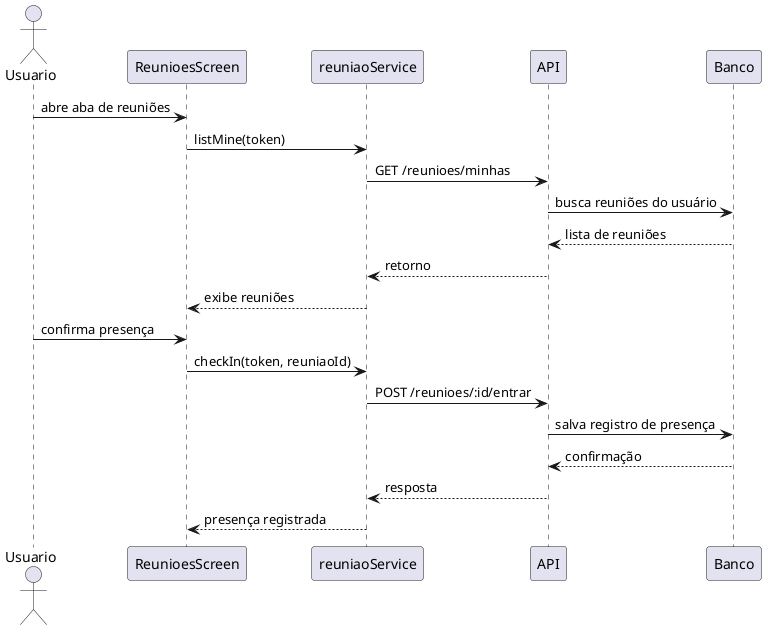

# Incremento 3 — Histórico de reuniões

```text
Incremento: Histórico de reuniões
Escopo: histórico de reuniões em que o usuário participou
Branch: development
Commit: [a confirmar no código consultado]
Data de revisão: 2026-11-12
Responsável(eis): [preencher na revisão final]
Estado: Parcial
Fontes:
- sistema/better-meet/src/app/(tabs)/(reunioes)/index.tsx
- sistema/better-meet/src/services/reuniaoService.ts
- sistema/better-meet/src/components/__tests__/ReunioesData.test.tsx
- sistema/api/tests/reuniaoCheckIn.test.mjs
- sistema/api/tests/reuniaoNotificacoes.test.mjs
```

## 1. Objetivo

Este incremento tem como foco principal criar o histórico de reuniões em que o usuário participou. A funcionalidade deve permitir ao usuário consultar as reuniões relacionadas ao seu perfil e registrar a sua presença.

## 2. Escopo

- listar reuniões do usuário;
- exibir reuniões em que participou;
- registrar presença com check-in;
- manter o histórico de participação no app.

## 3. Atores

| Ator | Tipo | Responsabilidade |
|---|---|---|
| Usuário comum | Humano | consulta e acompanha o histórico de reuniões e confirma participação |
| Membro da comissão | Humano | participa das reuniões e registra presença |

## 4. Requisito funcional

### RF01 — Histórico de reuniões do usuário

- Status: Parcial
- Objetivo: permitir ao usuário acompanhar as reuniões nas quais participou.
- Referências do código:
  - `sistema/better-meet/src/app/(tabs)/(reunioes)/index.tsx`
  - `sistema/better-meet/src/services/reuniaoService.ts`

#### Descrição

Quando o usuário entra na aba de reuniões, o sistema carrega as reuniões relacionadas ao seu perfil. A partir dessa listagem, ele consegue visualizar as reuniões em que participou e acompanhar o seu histórico de presença.

#### Entradas

| Campo | Origem | Tipo | Obrigatório |
|---|---|---|---|
| `token` | sessão autenticada | string | Sim |
| `reuniaoId` | seleção da reunião | number | Sim |
| `status` | resposta de presença/convite | string | Não |

#### Origem

- aba de reuniões do app;
- serviço de reuniões;
- endpoints de listagem e check-in.

#### Ação

1. O usuário acessa a aba de reuniões.
2. O app busca as reuniões do usuário.
3. O sistema lista as reuniões e os dados básicos da reunião.
4. O usuário confirma presença na reunião.
5. O sistema registra o check-in e mantém o histórico de participação.

#### Saída

| Situação | Resultado |
|---|---|
| sucesso | reunião aparece na lista e a presença é registrada |
| sem registros | a tela pode mostrar lista vazia |
| erro | mensagem de falha no carregamento ou no registro |

## 5. Casos de uso

### UC01 — Consultar reuniões do usuário

| Campo | Descrição |
|---|---|
| Ator(es) | Usuário comum, Membro da comissão |
| Descrição | Exibe as reuniões relacionadas ao usuário |
| Pré-condições | usuário autenticado |
| Fluxo principal | 1. abre a aba; 2. lista as reuniões; 3. visualiza o histórico |
| Pós-condições | usuário vê as reuniões em que participou |

### UC02 — Confirmar presença na reunião

| Campo | Descrição |
|---|---|
| Ator(es) | Usuário comum, Membro da comissão |
| Descrição | Registra a entrada do usuário em uma reunião |
| Pré-condições | reunião existente |
| Fluxo principal | 1. toca em confirmar presença; 2. app chama o endpoint de check-in; 3. registro é salvo |
| Pós-condições | presença passa a constar no histórico |

## 6. Diagrama de casos de uso



## 7. Diagrama de sequência



## 8. Evidências no código

- `sistema/better-meet/src/app/(tabs)/(reunioes)/index.tsx` concentra a lógica da aba de reuniões.
- `sistema/better-meet/src/services/reuniaoService.ts` expõe os métodos para listar reuniões e confirmar presença.
- `sistema/api/tests/reuniaoCheckIn.test.mjs` valida parte do fluxo de check-in.
- `sistema/better-meet/src/components/__tests__/ReunioesData.test.tsx` valida a criação e regras da data da reunião.

## 9. Conclusão

Este incremento trata apenas do histórico de reuniões do usuário: listagem das reuniões relacionadas ao perfil e registro de presença. A funcionalidade principal é manter um histórico de participação do usuário dentro do app, sem ampliar o escopo para relatórios ou módulos adicionais.
