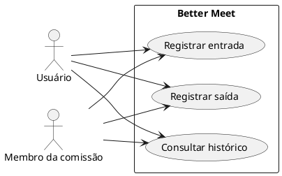
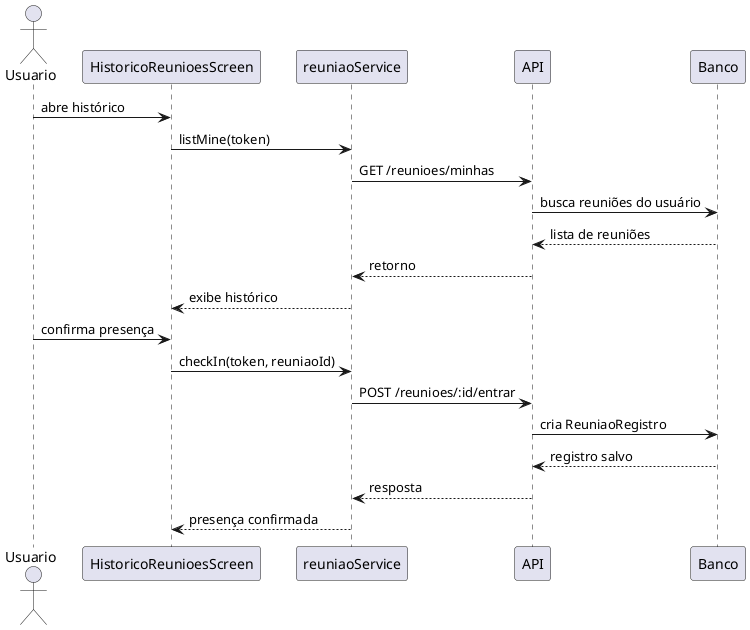

# Incremento 3 — Histórico de reuniões

```text
Incremento: Histórico de reuniões
Escopo: histórico de reuniões em que o usuário participou
Branch: development
Commit: [a confirmar no código consultado]
Data de revisão: 2026-11-12
Responsável(eis):
Estado: Parcial
Fontes:
- sistema/better-meet/src/app/(tabs)/(reunioes)/historico.tsx
- sistema/better-meet/src/services/reuniaoService.ts
- sistema/better-meet/src/components/ReuniaoCheckIn.tsx
- sistema/api/src/services/reuniaoService.ts
- sistema/api/src/controllers/reuniaoController.ts
- sistema/api/src/routes/reuniaoRoutes.ts
- sistema/api/tests/reuniaoCheckIn.test.mjs
- sistema/better-meet/src/components/__tests__/ReuniaoCheckIn.test.tsx
```

## Entrega atual e limites

A funcionalidade atual cobre o histórico de reuniões em que o usuário participou e o registro de presença na reunião. O fluxo inclui a listagem do histórico, a confirmação de entrada, a marcação de saída e a persistência do registro em banco.

Este incremento é restrito ao histórico de reuniões. Ele não cobre relatórios, ata, votação, lista de presença consolidada, exportação de dados nem outros módulos do sistema.

## Objetivo

Permitir que o usuário visualize as reuniões em que participou e acompanhe o registro de presença dentro do app, sem ampliar o escopo para funcionalidades paralelas.

## Atores

| Ator | Tipo | Responsabilidade |
|---|---|---|
| Usuário comum | Humano | consulta o histórico e registra presença na reunião |
| Membro da comissão | Humano | participa da reunião, confirma entrada e registra saída |

## Regras de negócio

| ID | Regra | Onde está |
|---|---|---|
| RN-HIST-01 | O histórico mostra apenas reuniões em que o usuário possui registro de presença | `historico.tsx` e `reuniaoService.listMine` |
| RN-HIST-02 | A listagem é ordenada por data e hora | `historico.tsx` |
| RN-HIST-03 | O usuário só pode registrar entrada se tiver vínculo com a reunião | `api/src/services/reuniaoService.ts` |
| RN-HIST-04 | A presença é registrada uma única vez por reunião e usuário | `ReuniaoRegistro` com chave única |
| RN-HIST-05 | A saída só pode ser registrada após a entrada já existir | `checkOut` |
| RN-HIST-06 | Reuniões fora do status `AGENDADA` não aceitam check-in | `checkIn` |

## Requisitos funcionais detalhados

### RF-HIST-01 — Consultar histórico de reuniões

- **Status:** Parcial
- **Objetivo:** exibir as reuniões em que o usuário participou.
- **Fluxo principal:** o usuário acessa a aba de reuniões e a tela busca as reuniões relacionadas ao seu perfil, filtrando apenas as que possuem `meuRegistro`.
- **Saída esperada:** a tela mostra o histórico com data, horário, local/organização e registro de presença.
- **Referência do código:** `sistema/better-meet/src/app/(tabs)/(reunioes)/historico.tsx`.

### RF-HIST-02 — Registrar entrada

- **Status:** Parcial
- **Objetivo:** confirmar presença do usuário em uma reunião agendada.
- **Fluxo principal:** o usuário toca em confirmar presença; a app chama `checkIn(token, reuniaoId)`; a API valida o vínculo e cria o registro de presença.
- **Saída esperada:** o sistema grava `entradaAt` e retorna o registro salvo.
- **Referência do código:** `sistema/api/src/services/reuniaoService.ts`, `sistema/better-meet/src/services/reuniaoService.ts`.

### RF-HIST-03 — Registrar saída

- **Status:** Parcial
- **Objetivo:** registrar a saída do usuário após a entrada.
- **Fluxo principal:** o usuário toca em registrar saída; a API valida o registro anterior e atualiza `saidaAt`.
- **Saída esperada:** a presença passa a conter a saída registrada sem apagar a entrada original.
- **Referência do código:** `checkOut` em `sistema/api/src/services/reuniaoService.ts`.

## Casos de uso



### UC-HIST-01 — Consultar histórico de reuniões

| Campo | Descrição |
|---|---|
| Ator(es) | Usuário comum, Membro da comissão |
| Descrição | Exibe as reuniões em que o usuário teve presença registrada |
| Pré-condição | usuário autenticado |
| Fluxo principal | 1. usuário entra na aba de reuniões; 2. app chama `listMine`; 3. a API retorna as reuniões; 4. a tela exibe somente registros válidos |
| Pós-condição | usuário visualiza o histórico de reuniões em que participou |

### UC-HIST-02 — Registrar entrada

| Campo | Descrição |
|---|---|
| Ator(es) | Usuário comum, Membro da comissão |
| Descrição | Confirma presença do usuário em uma reunião agendada |
| Pré-condição | reunião existente; usuário vinculado à reunião; status `AGENDADA` |
| Fluxo principal | 1. usuário toca em confirmar presença; 2. app chama `checkIn`; 3. API valida e cria `ReuniaoRegistro` |
| Pós-condição | presença fica registrada para aquele usuário e reunião |

### UC-HIST-03 — Registrar saída

| Campo | Descrição |
|---|---|
| Ator(es) | Usuário comum, Membro da comissão |
| Descrição | Fecha o registro de presença do usuário |
| Pré-condição | existe registro de entrada |
| Fluxo principal | 1. usuário toca em registrar saída; 2. app chama `checkOut`; 3. API grava `saidaAt` |
| Pós-condição | usuário passa a ter presença fechada, sem perder o registro de entrada |

## Diagrama de sequência



## Entradas e saídas

| Campo | Origem | Tipo | Obrigatório | Observação |
|---|---|---|---|---|
| `token` | sessão autenticada | string | Sim | JWT válido |
| `reuniaoId` | seleção da reunião | number | Sim | id da reunião |
| `entradaAt` | banco | datetime | Sim | gerado pelo sistema |
| `saidaAt` | banco | datetime | Não | preenchido na saída |

### Saídas do fluxo

| Situação | Resultado |
|---|---|
| histórico carregado | lista com reuniões em que o usuário participou |
| sem registros | tela mostra mensagem de ausência de histórico |
| check-in bem sucedido | presença registrada |
| check-in duplicado | retorna `jaRegistrado: true` sem nova criação |
| check-out sem entrada | retorna erro `409` |
| reunião fora do status | retorna erro `409` |

## Rastreabilidade no código

| Funcionalidade | Arquivo |
|---|---|
| tela de histórico | `sistema/better-meet/src/app/(tabs)/(reunioes)/historico.tsx` |
| listagem do histórico | `sistema/better-meet/src/services/reuniaoService.ts` |
| registro de entrada/saída | `sistema/api/src/services/reuniaoService.ts` |
| rotas de API | `sistema/api/src/routes/reuniaoRoutes.ts` |
| controle da API | `sistema/api/src/controllers/reuniaoController.ts` |
| testes relevantes | `sistema/api/tests/reuniaoCheckIn.test.mjs` |

## Testes relacionados

| ID | Cenário | Arquivo | Status |
|---|---|---|---|
| CT-HIST-01 | listagem do histórico do usuário | `sistema/better-meet/src/components/__tests__/ReunioesData.test.tsx` | Parcial |
| CT-HIST-02 | confirmação de presença | `sistema/api/tests/reuniaoCheckIn.test.mjs` | Parcial |
| CT-HIST-03 | registro de entrada e saída | `sistema/better-meet/src/components/__tests__/ReuniaoCheckIn.test.tsx` | Parcial |

## Divergências encontradas

| Item | Situação |
|---|---|
| API e interface | a tela filtra somente reuniões com `meuRegistro`, enquanto a API lista o conjunto relacionado ao usuário |
| unidade de presença | a chave única evita duplicação, mas a regra deve ser confirmada em execução real |
| status da reunião | a API admite entrada somente quando a reunião está `AGENDADA` |

## Conclusão

Este incremento trata do histórico de reuniões do usuário e do registro de presença em reuniões. A funcionalidade principal é mostrar as reuniões em que o usuário participou e registrar a entrada e saída de forma persistente, sem misturar o escopo com relatórios, ata, votos ou outros módulos do sistema.
