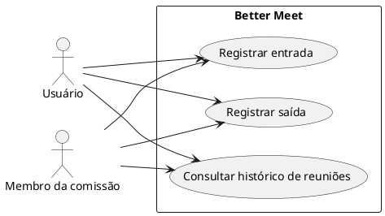
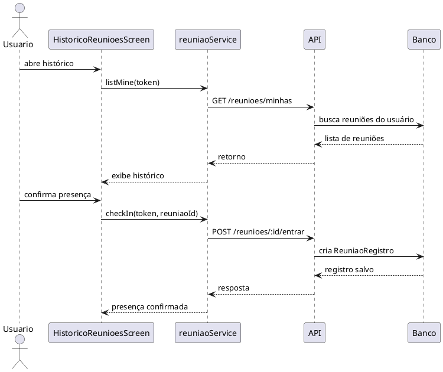

# Incremento 3 — Histórico de reuniões

```text
Incremento: Histórico de reuniões
Escopo: histórico de reuniões em que o usuário participou
Branch: development
Commit: [a confirmar no código consultado]
Data de revisão: 2026-11-12
Responsável(eis):
Estado: Parcial
Fontes:
- sistema/better-meet/src/app/(tabs)/(reunioes)/historico.tsx
- sistema/better-meet/src/services/reuniaoService.ts
- sistema/better-meet/src/components/ReuniaoCheckIn.tsx
- sistema/api/src/services/reuniaoService.ts
- sistema/api/src/controllers/reuniaoController.ts
- sistema/api/src/routes/reuniaoRoutes.ts
- sistema/api/tests/reuniaoCheckIn.test.mjs
- sistema/better-meet/src/components/__tests__/ReuniaoCheckIn.test.tsx
```

Este documento cobre somente o histórico de reuniões do usuário e o registro de presença. Ele não inclui relatórios, ata, votações, lista de presença consolidada nem outros módulos adicionais.

# RF-HIST-01 — Histórico de reuniões do usuário

- **Status:** Parcial.
- **Objetivo:** permitir que o usuário veja as reuniões em que participou e mantenha o registro de entrada e saída.
- **Atores:** Usuário comum e membro da comissão.
- **Referências do código:** `historico.tsx`, `reuniaoService` do app, `reuniaoController` e `reuniaoService` da API.

## Descrição

A tela de histórico listada na aba de reuniões consulta as reuniões relacionadas ao usuário e filtra apenas as que possuem registro de presença. A funcionalidade também oferece a confirmação de entrada em reunião agendada e o registro de saída quando o usuário já havia entrado.

## Regras de negócio

| ID | Regra | Onde está |
|---|---|---|
| RN-HIST-01 | O histórico deve mostrar apenas reuniões em que o usuário tem registro de presença | `historico.tsx` e `reuniaoService.listMine` |
| RN-HIST-02 | A listagem deve ordenar pela data e horário em ordem decrescente | `historico.tsx` |
| RN-HIST-03 | O usuário só pode registrar entrada se for membro da comissão ou tiver convite aceito para a reunião | `api/src/services/reuniaoService.ts` |
| RN-HIST-04 | A entrada é única por usuário e reunião | `reuniaoId_userId` em `ReuniaoRegistro` |
| RN-HIST-05 | A saída só pode acontecer após a entrada existir e ainda não ter sido fechada | `checkOut` |
| RN-HIST-06 | Reuniões fora do status `AGENDADA` não aceitam check-in | `checkIn` |

## Atores

| Ator | Tipo | Responsabilidade | Evidência |
|---|---|---|---|
| Usuário comum | Humano | visualiza o histórico de reuniões e registra presença | `historico.tsx` |
| Membro da comissão | Humano | participa de reuniões e registra entrada/saída | `assertMembroDaComissao` |

## Entradas

| Campo | Origem (tela/rota) | Tipo/formato | Obrigatório | Domínio/validação | Exemplo |
|---|---|---|---|---|---|
| `Authorization` | Cabeçalho; token do `authStore` | `Bearer <JWT>` | Sim | `requireAuth` | `Bearer abc123` |
| `reuniaoId` | rota `/reunioes/:id/entrar` e `/reunioes/:id/sair` | `Int` | Sim | inteiro positivo | `31` |
| `token` | aba de reuniões e tela de histórico | `String` | Sim | JWT válido | `jwt-teste` |
| `status` | resposta de presença/convite | `String` | Não | `ACEITO`, `PENDENTE`, etc. | `ACEITO` |

## Origem

- Tela de histórico em `sistema/better-meet/src/app/(tabs)/(reunioes)/historico.tsx`.
- Serviço do app `reuniaoService.listMine(token)`.
- Rotas da API `GET /reunioes/minhas`, `POST /reunioes/:id/entrar` e `POST /reunioes/:id/sair`.
- Componente `ReuniaoCheckIn` para confirmar presença e saída.

## Pré-condições

- O usuário está autenticado.
- A reunião existe e está vinculada ao perfil do usuário ou a um convite aceito.
- O usuário faz parte da comissão da reunião ou foi convidado e aceitou o convite.
- Para check-in, a reunião deve estar em status `AGENDADA`.

## Ação

1. O usuário entra na aba de reuniões e acessa a tela de histórico.
2. O app chama `reuniaoService.listMine(token)`.
3. A API busca as reuniões do usuário, incluindo as em que ele é criador ou participante aceito.
4. O app filtra apenas os itens com `meuRegistro` preenchido para mostrar o histórico.
5. O usuário toca em confirmar presença em uma reunião agendada.
6. O app chama `checkIn(token, reuniaoId)`.
7. A API valida a reunião e o vínculo do usuário.
8. Se não houver registro anterior, a entrada é criada com `entradaAt` e o registro fica salvo.
9. Se o usuário já registrou entrada, a API retorna `jaRegistrado: true` sem duplicar o registro.
10. A saída segue o mesmo fluxo, validando a existência da entrada antes de registrar `saidaAt`.

## Saída

| Situação | Status/resposta | Comportamento |
|---|---|---|
| Histórico carregado | `200` | lista de reuniões com registro de presença |
| Sem registros | `200` | tela mostra "Você ainda não participou de nenhuma reunião." |
| Check-in bem sucedido | `200`/`201` | presença registrada e retorno do registro |
| Check-in duplicado | `200` | mantém o primeiro registro e retorna `jaRegistrado: true` |
| Reunião não encontrada | `404` | erro indicando que a reunião não existe |
| Sem vínculo ou convite pendente | `403` | falha ao registrar presença |
| Reunião não agendada | `409` | rejeita entrada fora do status permitido |
| Falha de rede | sem resposta | exibem mensagem de erro no app |

## Destino

| Banco | Tabela/modelo | Operação | Campos relevantes | Vínculos |
|---|---|---|---|---|
| MySQL (via Prisma) | `Reuniao` | consulta e associação | `id`, `titulo`, `data`, `horaInicio`, `horaFim`, `status`, `criadoPorUserId` | FK com `comissao` e `user` |
| MySQL (via Prisma) | `ReuniaoRegistro` | `create`/`findUnique`/`updateMany` | `reuniaoId`, `userId`, `entradaAt`, `saidaAt` | chave única `reuniaoId_userId` |
| MySQL (via Prisma) | `ConviteReuniao` | consulta de vínculo | `userId`, `status`, `reuniaoId` | identifica participação aceita |

## Fluxos alternativos e exceções

- **1a:** sem token no app, a tela não tenta carregar o histórico.
- **3a:** se não houver reuniões com registro, a listagem aparece vazia.
- **6a:** o usuário repete o check-in, e a API retorna `jaRegistrado: true` em vez de duplicar o registro.
- **8a:** se a reunião não estiver em `AGENDADA`, a entrada é negada com `409` e a tela mostra a mensagem correspondente.
- **9a:** o usuário tenta sair sem ter entrado antes; a API responde `409` com a mensagem "Registre sua entrada antes de sair da reunião.".

## Pós-condições

- O histórico do usuário contém as reuniões em que ele registrou entrada.
- A presença fica persistida pela chave única da tabela de registros.
- A saída atualiza o campo `saidaAt` sem apagar o evento de entrada.
- A reunião não é removida do histórico quando o usuário sai; apenas o registro de saída é preenchido.

## Efeitos colaterais

- O processo de presença afeta apenas a tabela de registros e o histórico do usuário, sem alterar o status da reunião.
- A API e a tela não geram e-mail nem notificação específica para a ação de check-in/check-out.
- A entrada e saída não alteram a comissão, convites ou ata da reunião.

## Diagramas e testes relacionados

### Diagrama de casos de uso



### Diagrama de sequência



### Testes relevantes

| ID | Cenário | Arquivo | Status |
|---|---|---|---|
| CT-HIST-01 | Carga do histórico por usuário | `sistema/better-meet/src/components/__tests__/ReunioesData.test.tsx` | Não executado nesta revisão |
| CT-HIST-02 | Confirmar presença na reunião | `sistema/api/tests/reuniaoCheckIn.test.mjs` | Validado em parte |
| CT-HIST-03 | Registro de entrada e saída | `sistema/better-meet/src/components/__tests__/ReuniaoCheckIn.test.tsx` | Cobertura parcial |

## Divergências encontradas

| Item | Documento ou expectativa | Código | Situação |
|---|---|---|---|
| status da reunião | A entrada só deve aceitar reuniões agendadas | `checkIn` também valida `status` | Conformidade parcial |
| múltiplos registros | o sistema deve impedir duplicação | há chave única em `reuniaoId_userId` | atendido |
| histórico | a tela filtra apenas reuniões com `meuRegistro` | a API lista todas as reuniões do usuário | comportamento correto do app, mas não da API pura |
| saidaAt | deve ser preenchido somente após entrada | `checkOut` exige registro prévio | atendido |

# Casos de uso

### UC01 — Consultar histórico de reuniões

- **Objetivo:** visualizar reuniões em que o usuário participou.
- **Atores:** Usuário comum; membro da comissão.
- **Gatilho:** entrada na aba de reuniões / tela de histórico.
- **Entradas:** token JWT.
- **Pré-condições:** usuário autenticado.
- **Fluxo principal:** 1. o app chama `listMine`; 2. a API retorna reuniões; 3. a tela exibe somente registros com presença.
- **Pós-condições:** o usuário vê o histórico de reuniões em que participou.

### UC02 — Registrar entrada

- **Objetivo:** confirmar presença do usuário em uma reunião agendada.
- **Atores:** Usuário comum; membro da comissão.
- **Gatilho:** toque em "Confirmar presença".
- **Entradas:** `reuniaoId`; token;
- **Pré-condições:** reunião existe; usuário tem vínculo com a reunião; status `AGENDADA`.
- **Fluxo principal:** 1. app chama `checkIn`; 2. API valida vínculo e status; 3. cria `ReuniaoRegistro`.
- **Pós-condições:** a presença fica registrada para aquele usuário e reunião.

### UC03 — Registrar saída

- **Objetivo:** fechar a presença do usuário após a entrada.
- **Atores:** Usuário comum; membro da comissão.
- **Gatilho:** toque em "Registrar saída".
- **Entradas:** `reuniaoId`; token.
- **Pré-condições:** há registro de entrada existente.
- **Fluxo principal:** 1. app chama `checkOut`; 2. API valida registro; 3. grava `saidaAt`.
- **Pós-condições:** a presença passa a ter saída registrada sem perder a entrada.

## Conclusão

Este incremento trata da funcionalidade de histórico de reuniões do usuário, incluindo listagem de reuniões em que participou e registro de presença. O comportamento principal está ligado ao fluxo de `listMine`, `checkIn` e `checkOut`, com persistência por meio da tabela `ReuniaoRegistro`, sem ampliar o escopo para módulos distintos do projeto.
