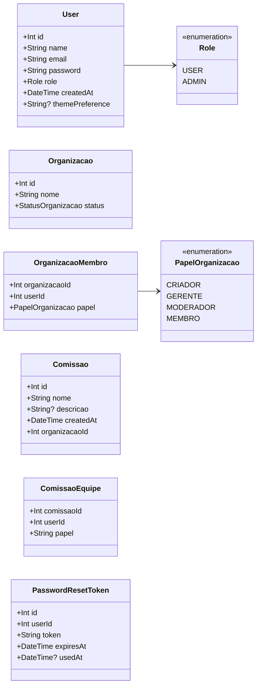
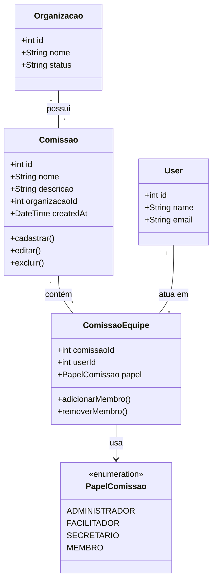
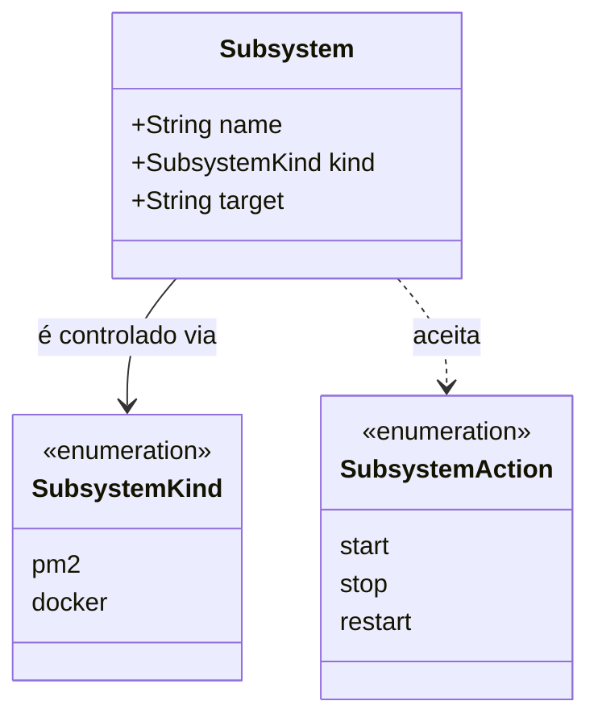
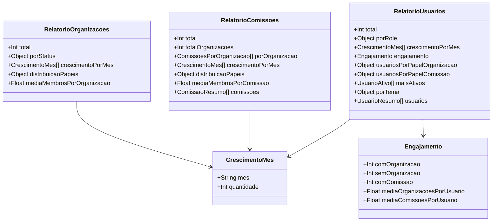
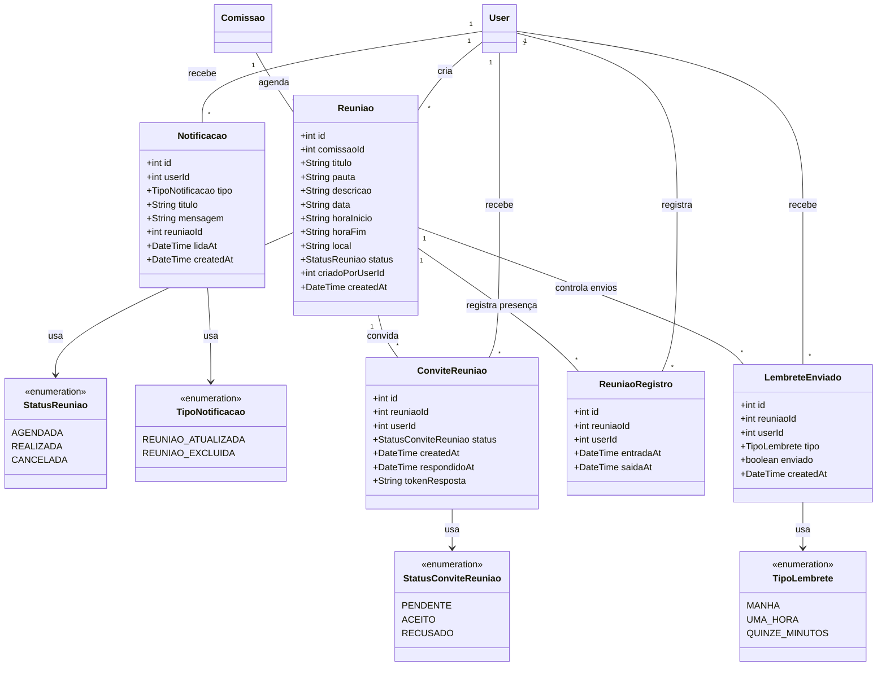
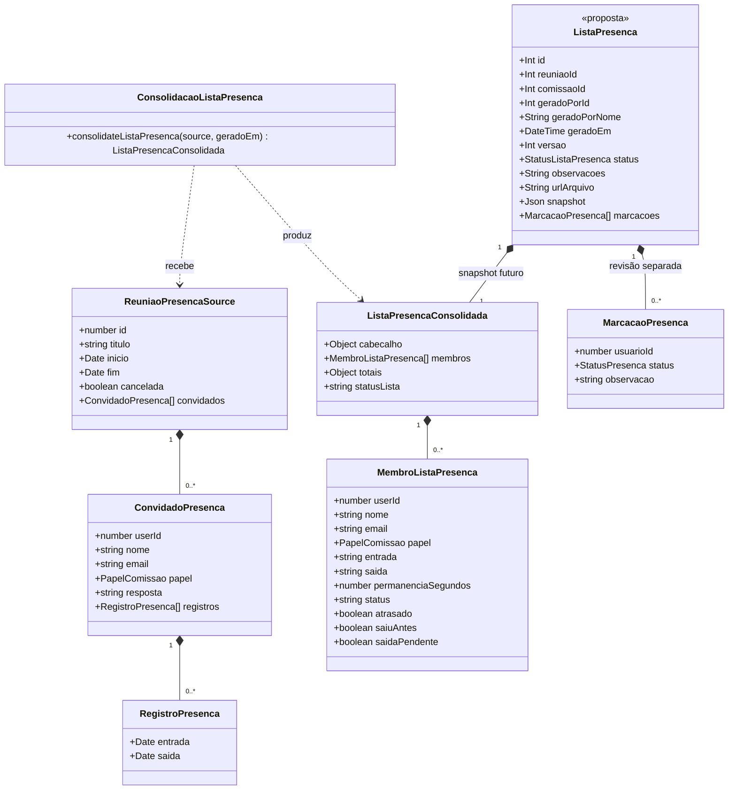

# Diagrama de classes — incremento 2 (cumulativo: Di1 + Di2)

```text
Incremento: Di2 (unificado, cumulativo)
Escopo: Diagrama de classes de todos os requisitos até o incremento 2 (RF01 a RF40); o impacto do Di2 está nas seções "Reunião" e "Lista de presença"
Branch: feature/refatoracao-documentacao
Commit: 464c190
Data de revisão: 2026-11-10
Responsável(eis): [nome de quem revisa e assina o documento]
Estado: Parcial (conferido contra schema e migrations; não conferido em banco em execução)
Fontes: sistema/api/prisma/schema.prisma; sistema/api/prisma/migrations/; sistema/monitoring-better-meet/prisma/schema.prisma; sistema/docker-compose.yml; documentos/entrega2_Di1/requisitos/ (RF16 a RF31); sistema/api/prisma/migrations/20261021120000_registra_tabelas_reuniao a 20261023140000_token_resposta_convite; documentos/entrega3_Di2/lista_presenca.md (proposta)
```

> Conferido contra o `schema.prisma` e as migrations em 2026-11-10. Correções em relação ao texto de origem: `User.themePreference` (`Tema`) e `Organizacao.status` (`StatusOrganizacao`) passaram a ser enums na migration `20261014120100_adiciona_enums_status_tema`, e o texto anterior os mostrava como `String`. A estrutura física **não** foi conferida em um banco em execução.

## Banco principal (Data API) — modelo de persistência Prisma

### Diagrama de Classes



#### Observações (do diagrama original)

- A modelagem relacional já representa as associações por meio de chaves estrangeiras e tabelas de junção.
- `OrganizacaoMembro` atua como entidade associativa entre `User` e `Organizacao`.
- `ComissaoEquipe` atua como entidade associativa entre `User` e `Comissao`.
- `PasswordResetToken` guarda tokens temporários para recuperação de senha.
- O diagrama mostra os conceitos principais do domínio, sem redundância com as relações já existentes no banco.

#### Complementos ao diagrama (conferidos no schema e no banco)

- `Organizacao` também possui o atributo `createdAt` (DateTime, default `now()`), usado pelos relatórios de crescimento mensal.
- `ComissaoEquipe.papel` é do tipo enum `PapelComissao` (`ADMINISTRADOR`, `FACILITADOR`, `SECRETARIO`, `MEMBRO`), e não um texto livre.

### Visão operacional de Comissão (diagrama original)



## Banco de monitoramento

### Diagrama de Classes



```mermaid
classDiagram
    class SubSystem {
        +Int id
        +String name
        +StatusCheck[] checks
    }

    class StatusCheck {
        +Int id
        +Int subSystemId
        +StatusType status
        +String? message
        +Boolean isBlocking
        +DateTime checkedAt
    }

    class StatusType {
        <<enumeration>>
        OPERATIONAL
        MAINTENANCE
        ERROR
        DOWN
        UNKNOWN
    }

    SubSystem "1" --> "0..*" StatusCheck : possui histórico de
    StatusCheck --> StatusType : status atual é um
```

## API de Gestão (sem banco)

### Diagrama de Classes (modelo de domínio)



## Estrutura das respostas dos relatórios

### Diagrama de Classes (estrutura das respostas)



## Reunião (incremento 2) — modelo de persistência Prisma

Tipo de modelo: **persistência Prisma** (`sistema/api/prisma/schema.prisma`). Os serviços e controllers da API são objetos exportados por módulos e não aparecem como classes. As votações (`Votacao`, `VotacaoOpcao`, `VotacaoVoto`) já existem no schema, mas pertencem ao incremento 3 e não são documentadas aqui.



| Elemento | Responsabilidade |
|---|---|
| `Reuniao` | Reunião agendada de uma comissão, com título, pauta, local (endereço ou link), data `AAAA-MM-DD` e horários `HH:mm` em texto |
| `ConviteReuniao` | Convite de uma pessoa para uma reunião; `tokenResposta` permite responder pelo botão do e-mail sem login |
| `ReuniaoRegistro` | Presença de uma pessoa: entrada e saída, no máximo um registro por pessoa e reunião |
| `Notificacao` | Aviso do sino do app; sem relação com `Reuniao` de propósito, para o aviso de exclusão sobreviver à reunião |
| `LembreteEnviado` | Lembretes por e-mail já tratados (manhã, uma hora, quinze minutos), um por reunião, pessoa e tipo |

## Lista de presença — proposta futura

> **Estado: Planejado.** As classes abaixo vêm do texto de origem da lista de presença (mockup com dados fictícios). Não há model Prisma, tabela nem migração de lista de presença no repositório.

Tipos e consolidação representam a preparação atual. `ListaPresenca` é a proposta de entidade persistida, não um model Prisma criado. A representação UML não exige converter os tipos ou objetos de serviço em classes TypeScript.



As nulabilidades estão nos dicionários, embora o diagrama resuma o tipo base.
