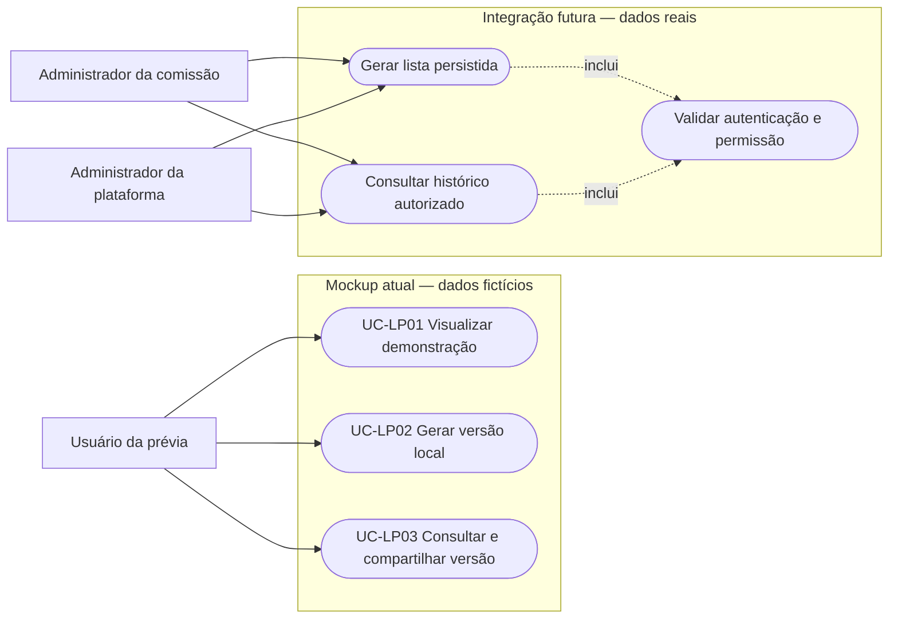
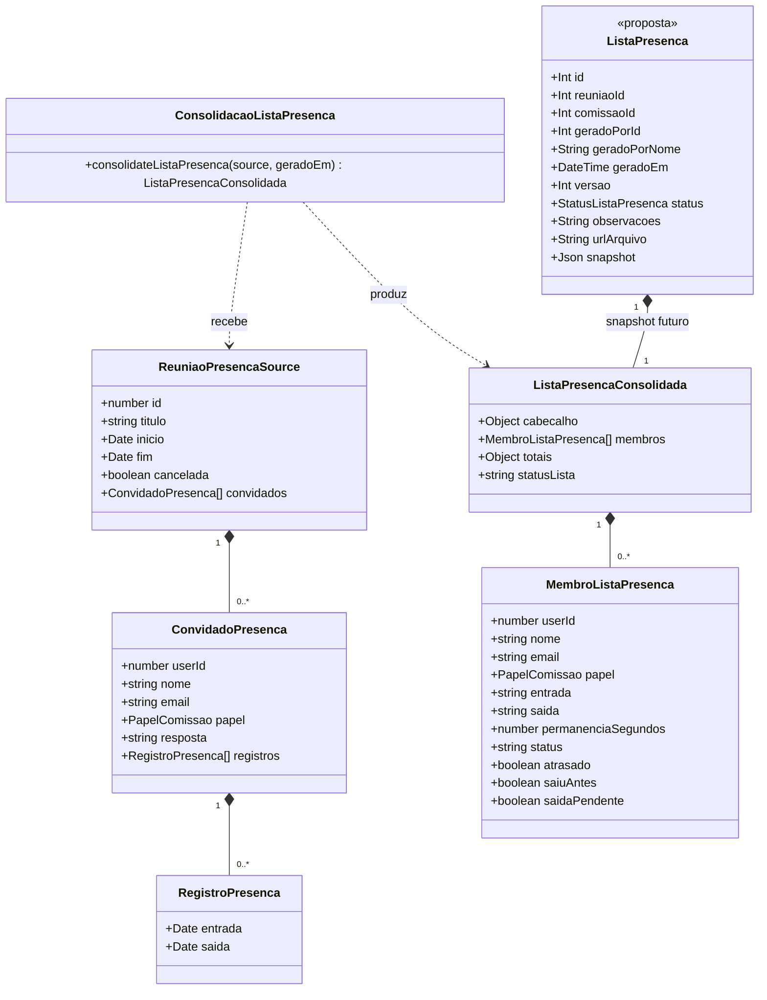
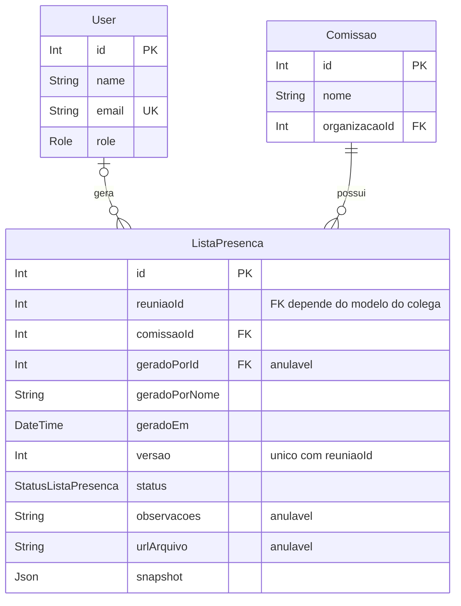
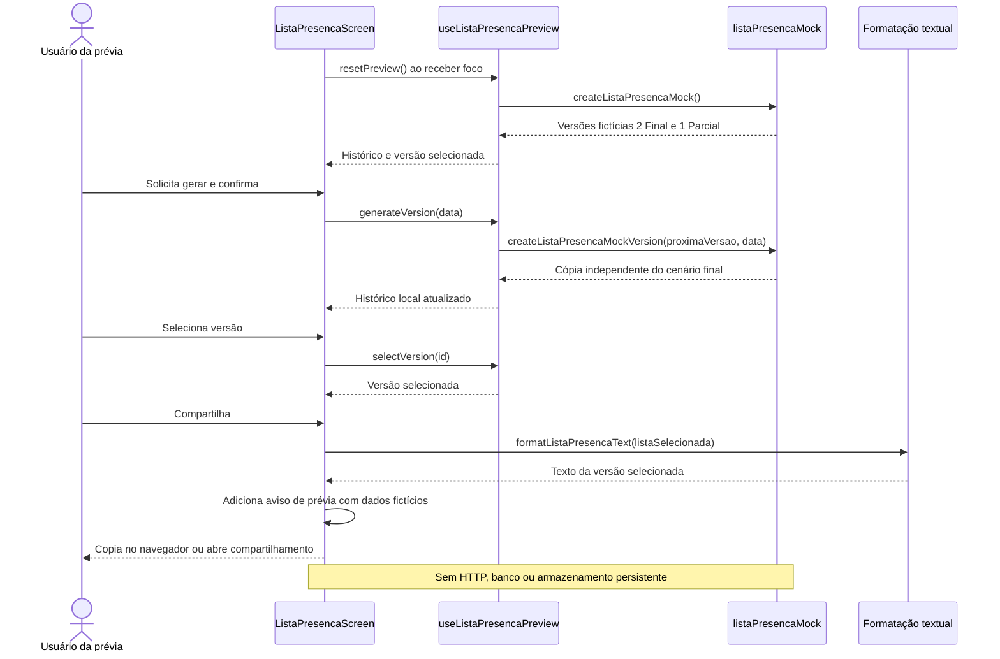
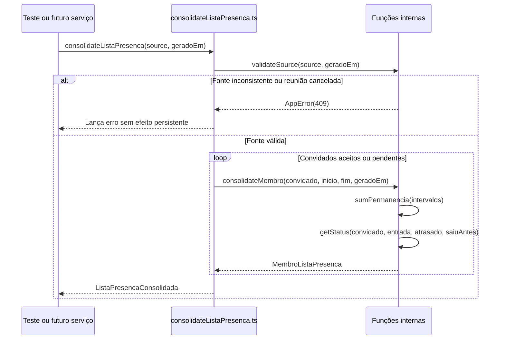
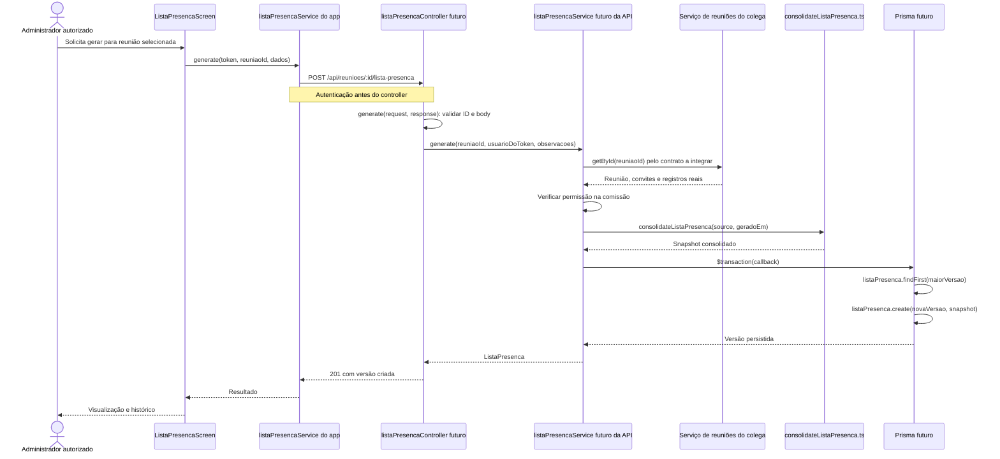

# Lista de presença — prévia e preparação da integração

## Entrega atual e limites

A entrega atual é um **mockup navegável com dados fictícios e histórico em memória**. Permite avaliar a apresentação da lista, os status, observações, seleção de versões e compartilhamento em texto. O aviso de demonstração identifica que o resultado não é uma lista oficial.

**O mockup não cadastra reuniões, convites, entradas, saídas ou listas reais. Não cria tabelas, aplica migrações nem registra endpoints de lista de presença.** A implementação de reuniões continua com o colega responsável. O núcleo puro de consolidação foi preparado separadamente, sem HTTP ou banco, para testar as regras e facilitar a futura integração.

As seções de API e banco deste documento são propostas futuras, não recursos disponíveis. A prévia não valida permissões de servidor. PDF, assinatura digital, envio automático de e-mail e links públicos não são implementados; o compartilhamento é textual.

| Responsabilidade                | Limite                                                                                                                         |
| ------------------------------- | ------------------------------------------------------------------------------------------------------------------------------ |
| Módulo de reuniões do colega    | Cadastro, título, pauta, datas, local/plataforma e cancelamento.                                                               |
| Módulos de convites e registros | Convites e respostas; entradas, saídas e suas correções.                                                                       |
| Lista de presença               | Consolidar os dados recebidos e apresentar versões. Agora, demonstrar a interface com dados locais e preparar as regras puras. |

Não são recriadas telas ou regras dos colegas, nem solicitado que o usuário digite IDs internos.

## Funcionamento da prévia

O menu abre `/lista-presenca`, identificado como prévia, sem exigir uma reunião real ou parâmetro de ID. `src/mocks/listaPresencaMock.ts` fornece `createListaPresencaMock()` e `createListaPresencaMockVersion(versao, data)`. O hook `useListaPresencaPreview()` mantém versões e seleção em memória, com `generateVersion(data)`, `selectVersion(id)` e `resetPreview()`.

Os exemplos iniciais são versões independentes: uma parcial às 10h30 e uma final às 11h10, com quatro convidados fictícios, sendo três aceitos e um pendente. A parcial apresenta um presente, um atrasado, um ausente e um sem resposta. A final apresenta um presente, um que saiu antes — e também atrasou —, um ausente e um sem resposta.

Gerar nova versão **copia o cenário final demonstrativo**, com snapshot independente, observações e data fictícia. Não consulta dados atuais de reunião nem executa o núcleo do backend. Ao sair e voltar à tela, o reset em foco restaura os exemplos; não há persistência durável. O service HTTP preparado para uma futura integração não é chamado pela prévia.

No navegador, compartilhar copia o texto quando a área de transferência está disponível; no dispositivo móvel, abre o compartilhamento do sistema. O texto também deve indicar que é demonstração.

## Regras de negócio preparadas

As regras de cálculo são implementadas pelo núcleo puro; as regras de observações e histórico temporário são demonstradas pela interface e seu hook local. Elas orientam a futura integração. O mockup usa resultados fictícios compatíveis para demonstrar a apresentação.

| Código  | Regra                                                                                                                                                                                                                                  |
| ------- | -------------------------------------------------------------------------------------------------------------------------------------------------------------------------------------------------------------------------------------- |
| RN-LP01 | Incluir convidados `ACEITO` e `PENDENTE`. Excluir `RECUSADO` das linhas e totais da lista; não há status de linha “Recusou”.                                                                                                           |
| RN-LP02 | Cada convidado aparece uma vez por usuário. Nome, e-mail e papel são copiados para a versão.                                                                                                                                           |
| RN-LP03 | `PENDENTE` sempre resulta em `SEM_RESPOSTA`, mesmo com entrada. Horário ou duração não transforma pendência em aceite.                                                                                                                 |
| RN-LP04 | `ACEITO` sem entrada válida observada resulta em `AUSENTE`, com duração zero. Na parcial, descreve apenas os dados disponíveis na geração.                                                                                             |
| RN-LP05 | Atraso significa primeira entrada válida posterior ao início, sem tolerância. Entrada exatamente no início não é atraso.                                                                                                               |
| RN-LP06 | Saída antecipada significa última saída observada anterior ao fim, desde que não exista sessão aberta. Saída exatamente no fim não é antecipada.                                                                                       |
| RN-LP07 | Para quem aceitou e entrou, prioridade do status: `SAIU_ANTES` → `ATRASADO` → `PRESENTE`. Flags `atrasado` e `saiuAntes` preservam condições simultâneas.                                                                              |
| RN-LP08 | `PRESENTE` significa aceite com entrada, sem atraso ou saída antecipada. Pode coexistir com `saidaPendente: true`; não confirma que uma saída já foi registrada.                                                                       |
| RN-LP09 | Permanência soma a união dos intervalos observados, sem duplicar sobreposições. Entrada anterior ao início conta como tempo registrado; limite superior `min(geradoEm, fim)`.                                                          |
| RN-LP10 | Sessão aberta usa esse limite apenas no cálculo: saída continua nula e `saidaPendente` verdadeira. Nenhuma saída é inventada ou gravada na origem.                                                                                     |
| RN-LP11 | Entrada posterior à geração ou ao fim previsto é ignorada para status, flags e duração. Entrada exatamente no fim é válida e pode resultar em `ATRASADO` com zero segundos. Saída posterior à geração ainda é pendente naquela versão. |
| RN-LP12 | `PARCIAL` antes do fim; `FINAL` a partir do instante exato do fim, inclusive com saída pendente. Final não garante completude de todos os registros.                                                                                   |
| RN-LP13 | Fonte inválida ou reunião cancelada impede o cálculo. A consolidação não corrige dados dos outros módulos.                                                                                                                             |
| RN-LP14 | Nova geração deve preservar as versões anteriores. Na prévia, o histórico é somente temporário em memória.                                                                                                                             |
| RN-LP15 | Observações opcionais com trim e máximo de 2.000 caracteres.                                                                                                                                                                           |

Exemplo: sessões 09h50–10h30 e 10h20–10h45 somam 55 minutos, contando a sobreposição uma vez. Se a segunda sessão estiver aberta e a geração ocorrer às 10h40, a permanência será de 50 minutos e a saída continuará pendente.

### Acesso real planejado

Na integração, somente `Role.ADMIN` da plataforma ou `PapelComissao.ADMINISTRADOR` da comissão da reunião poderá gerar e consultar versões. A leitura terá a mesma restrição, pois contém nomes e e-mails. Administrador de outra comissão não terá acesso por esse papel.

O “presidente” do roteiro corresponde ao papel existente `ADMINISTRADOR`; não é criado `PRESIDENTE`. A verificação real deverá ocorrer na API a partir da identidade autenticada, não apenas no botão ou no body. A prévia não demonstra essa proteção.

### Classificação

| Convite  | Dados observados                             | Resultado                               |
| -------- | -------------------------------------------- | --------------------------------------- |
| Recusado | Quaisquer                                    | Excluído.                               |
| Pendente | Com ou sem entrada                           | Sem resposta.                           |
| Aceito   | Sem entrada válida                           | Ausente.                                |
| Aceito   | Entrada no início e saída no fim             | Presente.                               |
| Aceito   | Entrada após início e saída no fim           | Atrasado.                               |
| Aceito   | Última saída antes do fim, sem sessão aberta | Saiu antes.                             |
| Aceito   | Atraso e saída antecipada                    | Saiu antes; ambas as flags verdadeiras. |
| Aceito   | Entrada no início e sessão aberta            | Presente com saída pendente.            |

## Requisitos funcionais detalhados

### RF-LP01 — Consolidar presença

Receber reunião, convidados, respostas e sessões; produzir cabeçalho, membros, horários consolidados, permanência, flags, status e totais. Aceitos sem entrada ficam ausentes, pendentes continuam sem resposta e recusados são excluídos. Se ninguém comparecer, os aceitos ficam ausentes; sem convidados, uma fonte válida produz lista vazia e totais zero.

Datas devem ser válidas, fim posterior ao início, convidados sem usuário duplicado, papel entre os quatro valores existentes e saída não anterior à entrada. Cancelamento ou inconsistência impede gerar resultado. O núcleo não altera a fonte.

**Atual:** função pura preparada e testável sem banco; não ligada às reuniões reais nem usada como chamada de API pelo mockup.

### RF-LP02 — Apresentar a lista

Mostrar organização, comissão, título, datas, local/plataforma e versão no cabeçalho; nome, e-mail, papel, primeira entrada, última saída, permanência e status no corpo; autoria, geração e observações no rodapé. Distinguir saída pendente de saída real e não exibir IDs internos como conteúdo de negócio.

**Atual:** tela de demonstração com dados fictícios e aviso visível, acessível sem cadastrar reunião.

### RF-LP03 — Demonstrar novas versões

Gerar nova versão local e permitir selecionar versões anteriores. A nova versão recebe snapshot independente e não altera as anteriores. Observações são validadas antes da confirmação e geração.

**Atual:** cópia do cenário final fictício com nova numeração; histórico em memória reiniciado no foco. Não há reserva de versão no banco, persistência após recarga ou garantia de concorrência.

### RF-LP04 — Compartilhar texto

Compartilhar a versão selecionada com seu conteúdo e indicação de demonstração. Usar cópia no navegador ou compartilhamento do dispositivo, informando indisponibilidade em pt-BR.

**Atual:** texto, sem PDF, assinatura, envio automático ou link público.

### RF-LP05 — Integrar futuramente

Consumir os modelos reais dos colegas por uma camada de serviço, sem recriar cadastro de reuniões, convites ou sessões. Aplicar autorização no servidor e persistir snapshots versionados.

**Atual:** contrato documentado e núcleo de cálculo preparado. Não há endpoints, adaptador de reunião ativo, schema ou migração de lista de presença. Não se anuncia resposta HTTP `503` como comportamento implementado.

## Requisitos não funcionais verificáveis

Critérios não representam resultados de execução. As metas de API/banco dependem da integração futura.

| Código   | Métrica                                                                                                                        | Verificação / escopo                                                            |
| -------- | ------------------------------------------------------------------------------------------------------------------------------ | ------------------------------------------------------------------------------- |
| RNF-LP01 | `presentes + atrasados + sairamAntes + ausentes = aceitos`, e linhas = aceitos + sem resposta, em 100% dos resultados válidos. | Combinações de convite e status; núcleo puro.                                   |
| RNF-LP02 | Sobreposições contadas uma vez; permanência não negativa e limitada a `min(geradoEm, fim)`.                                    | Sessões repetidas, sobrepostas e abertas; núcleo puro.                          |
| RNF-LP03 | 100% dos rótulos e mensagens visíveis em pt-BR.                                                                                | Inspeção de tela e texto compartilhado; mockup.                                 |
| RNF-LP04 | Aviso de dados fictícios visível; nenhuma gravação real ao gerar na prévia.                                                    | Inspecionar origem dos dados e chamadas de rede.                                |
| RNF-LP05 | Nova versão não muda nenhum campo de versões locais anteriores.                                                                | Comparação de snapshots antes/depois.                                           |
| RNF-LP06 | Nenhum ID interno exigido por digitação ou exibido como conteúdo da lista.                                                     | Inspeção da navegação e visualização.                                           |
| RNF-LP07 | Futura geração real em até 3 segundos para até 50 convidados, com serviços disponíveis.                                        | Medição em ambiente integrado, com configuração/amostras registradas; pendente. |
| RNF-LP08 | Futura API: `401` sem autenticação e `403` sem permissão, sem expor dados pessoais.                                            | Testes HTTP; não validado por mockup.                                           |
| RNF-LP09 | Futuro banco: nenhum par `reuniaoId, versao` duplicado.                                                                        | Chave única e teste concorrente em banco exclusivo de teste; pendente.          |
| RNF-LP10 | TypeScript estrito mantido e sem `any` no código novo.                                                                         | Verificações de qualidade e resultados no relatório.                            |

Não há requisito de arquivo A4 nesta etapa, pois não há exportação PDF.

## Casos de uso

### UC-LP01 — Visualizar demonstração

| Campo              | Descrição                                                                                                   |
| ------------------ | ----------------------------------------------------------------------------------------------------------- |
| Descrição / ator   | Usuário da prévia consulta a estrutura da lista com dados fictícios.                                        |
| Entrada / origem   | Acesso pelo menu à tela `/lista-presenca`; cenário local.                                                   |
| Saída / destino    | Cabeçalho, membros, totais e rodapé na interface.                                                           |
| Pré-condição       | Aplicativo disponível; não exige reunião real cadastrada.                                                   |
| Ação               | 1. Abrir prévia. 2. Carregar exemplos locais. 3. Exibir aviso de demonstração e versão selecionada. |
| Pós-condição       | Apresentação avaliada sem alterar dados reais.                                                              |
| Efeitos colaterais | Nenhum registro no banco ou módulo de reuniões.                                                             |

### UC-LP02 — Gerar versão local

| Campo              | Descrição                                                                                                                                                                 |
| ------------------ | ------------------------------------------------------------------------------------------------------------------------------------------------------------------------- |
| Descrição / ator   | Usuário da prévia demonstra geração e versionamento em memória.                                                                                                           |
| Entrada / origem   | Dados fictícios e observações opcionais; botão de geração.                                                                                                                |
| Saída / destino    | Nova versão temporária e sua visualização.                                                                                                                                |
| Pré-condição       | Cenário local disponível e observações válidas.                                                                                                                           |
| Ação               | 1. Solicitar geração. 2. Validar observações e confirmar. 3. Criar cópia independente do cenário final. 4. Selecionar resultado, preservando histórico local. |
| Exceções           | Validação inválida impede gerar; cancelar confirmação preserva o estado.                                                                                                  |
| Pós-condição       | Nova versão local selecionada; sem persistência durável.                                                                                                                  |
| Efeitos colaterais | Nenhuma escrita real ou correção de presença.                                                                                                                             |

### UC-LP03 — Consultar e compartilhar versão

| Campo            | Descrição                                                                                                                                    |
| ---------------- | -------------------------------------------------------------------------------------------------------------------------------------------- |
| Descrição / ator | Usuário da prévia seleciona uma versão e compartilha seu texto.                                                                              |
| Entrada / origem | Versão no histórico e ação de compartilhamento.                                                                                              |
| Pré-condição     | Versão demonstrativa disponível.                                                                                                             |
| Ação             | 1. Selecionar versão. 2. Apresentar seu conteúdo. 3. Formatar texto selecionado. 4. Copiar ou abrir compartilhamento do sistema. |
| Saída / destino  | Texto demonstrativo copiado ou enviado ao compartilhamento.                                                                                  |
| Exceções         | Recurso indisponível: feedback em pt-BR sem alterar a lista.                                                                                 |
| Pós-condição     | Histórico e versões inalterados.                                                                                                             |

### Caso de uso futuro — Gerar lista real

| Campo              | Proposta                                                                                                                                                                                                                             |
| ------------------ | ------------------------------------------------------------------------------------------------------------------------------------------------------------------------------------------------------------------------------------ |
| Descrição          | Consolidar a reunião selecionada em snapshot persistido.                                                                                                                                                                             |
| Ator primário      | Administrador da comissão (`ADMINISTRADOR`).                                                                                                                                                                                         |
| Ator secundário    | Administrador da plataforma (`ADMIN`).                                                                                                                                                                                               |
| Entradas / origem  | Reunião selecionada no módulo do colega, observações e identidade autenticada.                                                                                                                                                       |
| Saída / destino    | Lista versionada na futura tabela `ListaPresenca`.                                                                                                                                                                                   |
| Pré-condição       | Token e permissão válidos, fonte disponível/consistente, reunião não cancelada e persistência preparada.                                                                                                                             |
| Ação               | 1. Validar autenticação e dados. 2. Consultar fonte real. 3. Conferir permissão. 4. Consolidar. 5. Reservar versão e gravar snapshot em transação. 6. Retornar a lista.                                          |
| Exceções propostas | `400` entrada inválida; `401` sem autenticação; `403` sem permissão; `404` reunião inexistente; `409` cancelamento, inconsistência ou concorrência não resolvida. Disponibilidade da origem terá tratamento explícito na integração. |
| Pós-condição       | Nova versão persistida e consultável pelos papéis autorizados.                                                                                                                                                                       |
| Efeitos colaterais | Apenas a lista é gravada; não altera convites ou sessões.                                                                                                                                                                            |

## Contrato de dados preparado

### Entrada da consolidação pura

`ReuniaoPresencaSource` é recebido por `consolidateListaPresenca(source, geradoEm)` diretamente em memória. A função não conhece HTTP ou Prisma.

| Campo                              | Tipo                           | Significado / restrição                                             |
| ---------------------------------- | ------------------------------ | ------------------------------------------------------------------- |
| `id`                               | `number`                       | Inteiro positivo da reunião de origem.                              |
| `titulo`                           | `string`                       | Título não vazio.                                                   |
| `inicio`, `fim`                    | `Date`                         | Válidos; fim posterior ao início.                                   |
| `local`, `plataforma`              | `string` ou `null`             | Local físico ou informação online.                                  |
| `cancelada`                        | `boolean`                      | Impede consolidar se verdadeiro.                                    |
| `organizacao`                      | `{ id: number, nome: string }` | Identidade e nome da organização.                                   |
| `comissao`                         | `{ id: number, nome: string }` | Identidade e nome da comissão.                                      |
| `convidados`                       | Array                          | Sem duplicar usuário.                                               |
| `convidados[].userId`              | `number`                       | Inteiro positivo.                                                   |
| `convidados[].nome`, `email`       | `string`                       | Textos não vazios.                                                  |
| `convidados[].papel`               | `PapelComissao`                | `ADMINISTRADOR`, `FACILITADOR`, `SECRETARIO` ou `MEMBRO`.           |
| `convidados[].resposta`            | União literal                  | `ACEITO`, `RECUSADO` ou `PENDENTE`.                                 |
| `convidados[].registros`           | Array                          | Sessões, incluindo reentradas.                                      |
| `convidados[].registros[].entrada` | `Date`                         | Instante válido da entrada.                                         |
| `convidados[].registros[].saida`   | `Date` ou `null`               | Nulo para sessão aberta; quando preenchida, não anterior à entrada. |

Datas são comparadas como instantes absolutos, não como textos de horário formatados. O resultado usa ISO 8601.

### Resultado consolidado e futuro snapshot

`ListaPresencaConsolidada` contém os campos abaixo. Na prévia a representação é local; na integração futura poderá ser gravada em JSON por versão.

| Campo                                                      | Tipo / conteúdo                              | Regra                                                                     |
| ---------------------------------------------------------- | -------------------------------------------- | ------------------------------------------------------------------------- |
| `cabecalho.reuniao`                                        | ID, título, início, fim, local e plataforma. | Datas ISO 8601 e dados copiados da fonte.                                 |
| `cabecalho.organizacao`                                    | ID e nome.                                   | Nome preservado na versão.                                                |
| `cabecalho.comissao`                                       | ID e nome.                                   | Mesma comissão da fonte.                                                  |
| `membros`                                                  | Array de `MembroListaPresenca`.              | Somente aceitos e pendentes, uma linha por usuário.                       |
| `membros[].userId`                                         | `number`                                     | Identidade de origem, não exibida como ID.                                |
| `membros[].nome`, `email`                                  | `string`                                     | Identificação copiada.                                                    |
| `membros[].papel`                                          | `PapelComissao`                              | Papel copiado.                                                            |
| `membros[].entrada`                                        | ISO 8601 ou `null`                           | Primeira entrada válida observada.                                        |
| `membros[].saida`                                          | ISO 8601 ou `null`                           | Última saída observada; nulo com sessão aberta.                           |
| `membros[].permanenciaSegundos`                            | Inteiro não negativo                         | União dos intervalos em segundos, truncando a fração de segundo do total. |
| `membros[].status`                                         | União de status                              | `PRESENTE`, `ATRASADO`, `SAIU_ANTES`, `AUSENTE` ou `SEM_RESPOSTA`.        |
| `membros[].atrasado`                                       | `boolean`                                    | Primeira entrada posterior ao início.                                     |
| `membros[].saiuAntes`                                      | `boolean`                                    | Última saída anterior ao fim, sem sessão aberta.                          |
| `membros[].saidaPendente`                                  | `boolean`                                    | Existe sessão ainda aberta na geração.                                    |
| `totais.aceitos`                                           | `number`                                     | Quantidade de convites aceitos.                                           |
| `totais.semResposta`                                       | `number`                                     | Membros com convite pendente.                                             |
| `totais.presentes`, `atrasados`, `sairamAntes`, `ausentes` | `number` por campo                           | Contagem dos status principais dos aceitos.                               |
| `statusLista`                                              | `PARCIAL` ou `FINAL`                         | Geração antes do fim ou a partir dele.                                    |

O resultado não guarda a lista bruta de sessões nem campo independente de resposta do convite. Guarda horários consolidados, duração, status e flags. Autoria, observações, geração e número da versão são metadados da versão, fora desse resultado puro.

## Diagrama de classes

Tipos e consolidação representam a preparação atual. `ListaPresenca` é a proposta de entidade persistida, não um model Prisma criado. A representação UML não exige converter os tipos ou objetos de serviço em classes TypeScript.

As nulabilidades estão nos dicionários, embora o diagrama resuma o tipo base.

## Banco — proposta futura, não aplicada

### Diagrama relacional proposto

`User` e `Comissao` já existem; `ListaPresenca` é proposta. O modelo de reunião será definido pelo colega: não se inventa tabela ou FK de reunião neste checkout. A futura relação deverá ser acordada e migrada com o modelo real.

### Dicionário proposto de `ListaPresenca`

| Campo           | Tipo planejado                       | Nulo? | Significado / restrição futura                                                  |
| --------------- | ------------------------------------ | ----- | ------------------------------------------------------------------------------- |
| `id`            | `Int`                                | Não   | Chave primária autoincrementada.                                                |
| `reuniaoId`     | `Int`                                | Não   | Identificador da reunião; relação depende do modelo real.                       |
| `comissaoId`    | `Int`                                | Não   | FK para `Comissao.id`; proposta de exclusão em cascata.                         |
| `geradoPorId`   | `Int?`                               | Sim   | FK para `User.id`; proposta `SetNull` ao excluir autor. Obtido da autenticação. |
| `geradoPorNome` | `String`                             | Não   | Nome do autor na geração, preservado após mudança de nome ou exclusão.          |
| `geradoEm`      | `DateTime`                           | Não   | Instante de referência para geração e cálculo.                                  |
| `versao`        | `Int`                                | Não   | Inteiro positivo, a partir de 1 por reunião.                                    |
| `status`        | `StatusListaPresenca`                | Não   | Futuro enum Prisma `PARCIAL` / `FINAL`.                                         |
| `observacoes`   | `String?` com armazenamento de texto | Sim   | Trim, máximo de 2.000 caracteres; vazio pode ser nulo.                          |
| `urlArquivo`    | `String?`                            | Sim   | Reserva para futura exportação; sem PDF agora.                                  |
| `snapshot`      | `Json`                               | Não   | Conteúdo consolidado, copiado por versão.                                       |

Proposta de unicidade: `@@unique([reuniaoId, versao])`. A gravação futura deverá consultar a maior versão e inserir a seguinte na mesma transação, com repetição limitada em conflito de unicidade. Não deverá reescrever versões anteriores.

Se a política `Cascade` para comissão for adotada, excluir a comissão também excluirá suas listas; imutabilidade por versionamento não equivale a retenção após exclusão da entidade. `SetNull` para o autor preservaria seu nome histórico. Essas políticas precisam ser confirmadas na etapa de persistência.

Nenhum desses itens aplica migração no banco compartilhado. Alteração futura de schema exige migração versionada/revisada segundo o guia, sem alterar migrações existentes ou usar `db push`.

## API — contrato proposto, sem endpoints nesta entrega

| Método e caminho futuro                 | Requisição proposta                             | Resposta proposta                   | Acesso                                                    |
| --------------------------------------- | ----------------------------------------------- | ----------------------------------- | --------------------------------------------------------- |
| `POST /api/reunioes/:id/lista-presenca` | Token; ID positivo; `{ observacoes?: string }`. | `201` com a versão criada.          | `ADMIN` global ou `ADMINISTRADOR` da comissão da reunião. |
| `GET /api/reunioes/:id/lista-presenca`  | Token e ID positivo.                            | `200` com `{ podeGerar, versoes }`. | Mesma proteção do POST.                                   |

O autor virá exclusivamente da identidade autenticada. O cliente não deverá fornecer identidade, papel, snapshot, convidados ou registros para controlar a consolidação. A camada de serviço consultará a fonte real dos colegas.

O prefixo `/api` deverá ser aplicado uma vez, conforme o projeto. O service HTTP do aplicativo permanece preparatório e não é usado no mockup. A OpenAPI só deverá anunciar essas rotas quando forem implementadas. Não há rota de PDF nesta entrega.

## Diagramas de sequência com objetos e métodos

### Prévia local atual

### Consolidação pura preparada

`AppError` não registra rota nem produz sozinho resposta HTTP. O chamador atual recebe um erro da função.

### Integração futura proposta

Os controllers e serviços de backend desta sequência são desenho futuro; não estão registrados nesta entrega.

O mockup não percorre esse fluxo HTTP. A integração dependerá do módulo de reuniões, autorização no servidor, persistência e testes próprios.

## Plano de testes

### Ambientes

- Núcleo puro: fonte e relógio controlados, sem banco.
- Mockup: fixtures, navegação, versões locais, observações e compartilhamento textual.
- Integração futura: API, autorização, migração e concorrência; banco exclusivo de teste, nunca desenvolvimento.

As ferramentas do guia são Jest, React Native Testing Library e Supertest para futuras rotas. Resultados reais ficam no relatório de implementação; os cenários abaixo são critérios de aceitação.

### Núcleo puro

| ID      | Requisito | Cenário                                                      | Resultado esperado                                               |
| ------- | --------- | ------------------------------------------------------------ | ---------------------------------------------------------------- |
| TP-LP01 | RF-LP01   | Aceitos entram no início e saem no fim.                      | Presentes, duração correta e totais coerentes.                   |
| TP-LP02 | RF-LP01   | Aceito sem entrada.                                          | Ausente, zero segundos e horários nulos.                         |
| TP-LP03 | RF-LP01   | Entrada após início.                                         | Atrasado, salvo prioridade de saída antecipada.                  |
| TP-LP04 | RF-LP01   | Entrada no início e saída no fim exatos.                     | Presente, flags falsas.                                          |
| TP-LP05 | RF-LP01   | Última saída antes do fim, sem sessão aberta.                | Saiu antes.                                                      |
| TP-LP06 | RF-LP01   | Atraso e saída antecipada.                                   | Saiu antes, duas flags verdadeiras.                              |
| TP-LP07 | RF-LP01   | Convite pendente com e sem entrada.                          | Sem resposta em ambos.                                           |
| TP-LP08 | RF-LP01   | Recusado com registros.                                      | Fora dos membros e totais.                                       |
| TP-LP09 | RF-LP01   | Gerar antes do fim.                                          | Parcial; duração limitada à geração.                             |
| TP-LP10 | RF-LP01   | Gerar exatamente no fim e após.                              | Final nos dois casos.                                            |
| TP-LP11 | RF-LP01   | Sessão aberta após o fim.                                    | Saída nula, pendência, duração limitada.                         |
| TP-LP12 | RF-LP01   | 09h50–10h30 e 10h20–10h45.                                   | 3.300 segundos, sem duplicar sobreposição.                       |
| TP-LP13 | RF-LP01   | Sessão fechada seguida de reentrada aberta.                  | Pendência verdadeira; sem saída antecipada pela sessão anterior. |
| TP-LP14 | RF-LP01   | Entrada após geração ou após fim.                            | Ignorada para presença, flags e duração.                         |
| TP-LP15 | RF-LP01   | Entrada exatamente no fim.                                   | Entrada válida; atrasado com zero segundos.                      |
| TP-LP16 | RF-LP01   | Saída após geração.                                          | Saída ainda pendente no snapshot.                                |
| TP-LP17 | RF-LP01   | Ninguém comparece.                                           | Aceitos ausentes, pendentes sem resposta e recusados excluídos.  |
| TP-LP18 | RF-LP01   | Fonte válida sem convidados.                                 | Lista vazia, totais zero.                                        |
| TP-LP19 | RF-LP01   | Cancelamento ou fonte inválida: datas, duplicidade ou papel. | Erro, sem corrigir a fonte.                                      |
| TP-LP20 | RNF-LP01  | Mistura de respostas e status.                               | Invariantes de totais satisfeitas.                               |

### Mockup

| ID      | Requisito / UC    | Ação                                    | Resultado esperado                                       |
| ------- | ----------------- | --------------------------------------- | -------------------------------------------------------- |
| TM-LP01 | RF-LP02 / UC-LP01 | Abrir prévia.                           | Aviso fictício visível; cabeçalho, membros e rodapé.     |
| TM-LP02 | RF-LP03 / UC-LP02 | Gerar duas versões locais.              | Numeração crescente e histórico temporário.              |
| TM-LP03 | RF-LP03 / UC-LP03 | Selecionar versões anteriores.          | Conteúdo preservado.                                     |
| TM-LP04 | RF-LP03 / UC-LP02 | Observações acima de 2.000 caracteres.  | Validação impede valor inválido.                         |
| TM-LP05 | RF-LP03 / UC-LP02 | Cancelar confirmação.                   | Nenhuma nova versão.                                     |
| TM-LP06 | RF-LP04 / UC-LP03 | Compartilhar seleção.                   | Texto correspondente e indicação de demonstração.        |
| TM-LP07 | RF-LP04 / UC-LP03 | Cópia ou compartilhamento indisponível. | Feedback de erro; lista preservada.                      |
| TM-LP08 | RNF-LP04          | Navegar/gerar com inspeção de rede.     | Nenhuma gravação de lista ou reunião real.               |
| TM-LP09 | RNF-LP06          | Percorrer controles.                    | Sem digitação ou exibição de IDs internos como conteúdo. |
| TM-LP10 | RF-LP02           | Conferir saída pendente.                | Não apresentada como horário real de saída.              |
| TM-LP11 | RF-LP03           | Sair e voltar à tela.                   | Exemplos iniciais restaurados pelo reset em foco.        |

### Integração futura — pendente

| ID      | Cenário                                           | Resultado esperado                                 |
| ------- | ------------------------------------------------- | -------------------------------------------------- |
| TI-LP01 | Sem token válido.                                 | `401`, sem dados pessoais.                         |
| TI-LP02 | Usuário comum ou administrador de outra comissão. | `403`, sem snapshots.                              |
| TI-LP03 | Administrador correto da comissão ou global.      | Acesso conforme as regras da reunião.              |
| TI-LP04 | Duas gerações reais.                              | Versões 1 e 2 persistidas.                         |
| TI-LP05 | Corrigir saída na origem e gerar novamente.       | Nova versão reflete correção, anterior idêntica.   |
| TI-LP06 | Gerações simultâneas em banco de teste.           | Sem duplicar par reunião/versão; conflito tratado. |
| TI-LP07 | Reunião cancelada ou inexistente.                 | Erro apropriado, sem gravar lista.                 |
| TI-LP08 | Identidade/fonte enviada no body.                 | Não controla autor, permissão nem fonte real.      |
| TI-LP09 | Até 50 convidados em ambiente integrado.          | Até 3 segundos, com medição registrada.            |
| TI-LP10 | Excluir autor, se adotado `SetNull`.              | Nome histórico preservado e lista legível.         |

### Roteiro manual da prévia

1. Abrir “Lista de presença (prévia)” e conferir o aviso de dados fictícios.
2. Conferir título, organização, comissão, datas e membros sem cadastrar reunião.
3. Gerar versão local com observações e confirmar o resultado.
4. Gerar novamente e alternar versões, conferindo a preservação do histórico temporário.
5. Conferir atraso, saída antecipada, ausência e saída pendente.
6. Compartilhar seleção e comparar texto/visualização.
7. Sair e voltar, conferindo que os exemplos são restaurados.
8. Confirmar ausência de criação/alteração de reuniões, convites e registros reais.

PDF não possui teste de execução nesta etapa. Arquivo válido e padrão A4 deverão ser especificados quando essa exportação existir.

## Registro de resultados

Em 16/10/2026, foram aprovados 39 testes do núcleo na API e 64 testes em 10 suítes do aplicativo, além de lint dos dois subsistemas, TypeScript da API e exportação web do Expo. O TypeScript do aplicativo apresenta um erro preexistente em `src/utils/__tests__/apiClient.test.ts:16`, reproduzido também com os arquivos originais; esse arquivo de outro módulo não foi alterado.

Os comandos, evidências e limites estão em [RELATORIO_LISTA_PRESENCA.md](../../RELATORIO_LISTA_PRESENCA.md). Esses resultados não significam execução de todos os cenários deste plano: teste unitário ou exportação não comprova integração com reuniões reais, autorização HTTP ou banco. A entrega atual continua sendo o mockup e o núcleo puro preparatório; persistência e endpoints permanecem propostas futuras.
