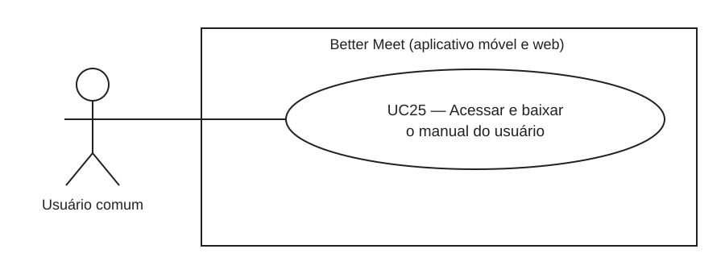
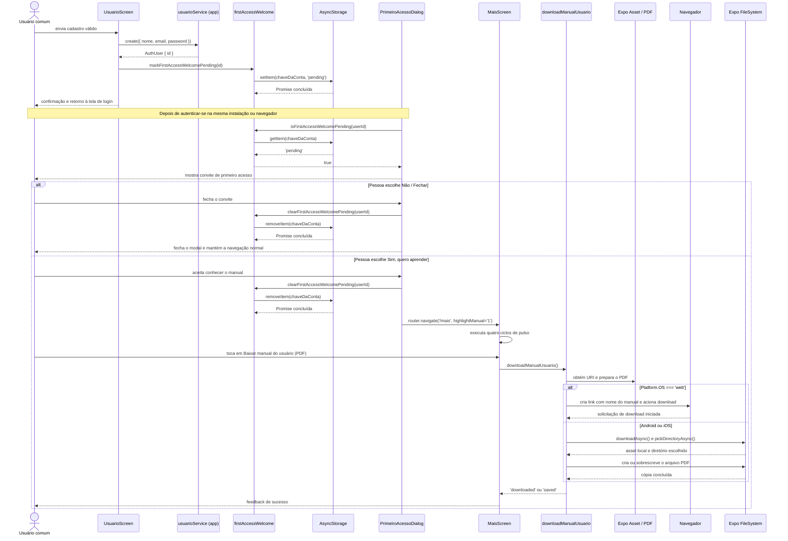

# RF18 — Disponibilizar e acessar o manual do usuário

Incremento: Incremento 3 — Manual de utilização (Aula4Thiago) 
Escopo: RF18, RNF45 e UC25 
Branch: `feature/manual` 
Commit: `0146791` 
Data de revisão: 2026-11-13 
Responsável(eis): [preencher por quem revisar e assinar] 
Estado: Parcial — fluxo implementado no armazenamento local da instalação que fez o cadastro; a sinalização não é sincronizada entre instalações/navegadores 
Fontes: `Aula4Thiago.pptx` (slides 8 e 12, material fornecido); `GUIA_DE_DOCUMENTACAO.md`; `PROMPT_DOCUMENTACAO_IA.md`; arquivos do app e PDF listados em [Fontes consultadas](#fontes-consultadas).

## Resumo e escopo

O slide 8 do Aula4Thiago descreve um manual digital para consulta sobre a utilização do sistema. Este documento registra somente esse requisito do Incremento 3: o convite de primeiro acesso, o acesso ao manual pela aba **Mais** e a disponibilização do arquivo PDF. Não descreve os demais requisitos do incremento.

O app inclui o arquivo [Manual-do-Usuario-Better-Meet.pdf](../manual_usuario/Manual-do-Usuario-Better-Meet.pdf) como asset. Na aba **Mais**, seção **Ajuda**, a pessoa pode baixar o PDF. Após o cadastro, o app marca localmente que há uma apresentação inicial pendente. Depois que a pessoa entra na conta, o app consulta essa marcação e pode mostrar o convite para abrir a aba **Mais**, destacar o botão do manual ou fechar o aviso.

O comportamento é implementado no app, sem endpoint, tabela, migration ou gravação relacionada ao manual na API. A apresentação inicial depende do `AsyncStorage` local da instalação do app ou do navegador em que o cadastro foi feito; portanto, não há controle sincronizado por conta entre instalações ou navegadores. A classificação e essa limitação estão detalhadas em RF18.

## Atores

| Ator | Tipo | Responsabilidade | Evidência |
|---|---|---|---|
| Usuário comum | Humano | Cadastrar-se, entrar no app, decidir se abre o manual e solicitar o PDF pela aba Mais | `Role.USER` em `sistema/api/prisma/schema.prisma`; `sistema/better-meet/src/app/usuario.tsx`; `sistema/better-meet/src/app/(tabs)/mais/index.tsx` |

O Administrador não tem um fluxo específico para esta funcionalidade. A apresentação inicial é associada ao ID da conta que se cadastrou, não ao papel de administrador.

## Requisito funcional

- **Status:** Parcial. O app implementa o convite local de primeiro acesso e o download do PDF. A condição de “primeiro cadastro na plataforma” não é sincronizada entre dispositivos; a marcação é local e pode falhar sem invalidar o cadastro.
- **Objetivo:** permitir que a pessoa encontre e salve o manual em PDF, tanto pelo convite de primeiro acesso quanto pela seção Ajuda da aba Mais.
- **Atores:** Usuário comum.
- **Regras de negócio:** RN-MU01, RN-MU02, RN-MU03 e RN-MU04.
- **Referências do código:** `sistema/better-meet/src/app/usuario.tsx:handleCreateUser`; `sistema/better-meet/src/components/PrimeiroAcessoDialog.tsx`; `sistema/better-meet/src/utils/firstAccessWelcome.ts`; `sistema/better-meet/src/app/_layout.tsx:RootLayout`; `sistema/better-meet/src/app/(tabs)/mais/index.tsx:MaisScreen,handleDownloadManual`; `sistema/better-meet/src/utils/downloadManualUsuario.ts:downloadManualUsuario`; `sistema/better-meet/assets/manual/Manual-do-Usuario-Better-Meet.pdf`.

## Descrição

Depois de um cadastro bem-sucedido, o app grava no armazenamento local uma indicação pendente para a conta criada. Quando essa conta entra no app na mesma instalação ou no mesmo navegador, a apresentação inicial consulta a indicação. Se ela estiver pendente, o app oferece dois caminhos: abrir a área Mais com o botão do manual destacado ou fechar o aviso. Em qualquer momento posterior, o usuário também pode abrir **Mais → Ajuda** e solicitar o mesmo PDF.

O app utiliza uma implementação diferente conforme a plataforma: no navegador, aciona o download do asset pelo nome `Manual-do-Usuario-Better-Meet.pdf`; em Android e iOS, abre a seleção de diretório e copia o PDF para o local escolhido, substituindo um arquivo com o mesmo nome se já existir.

## Entradas

| Campo | Origem | Tipo/formato | Obrigatório | Domínio/validação | Exemplo |
|---|---|---|---|---|---|
| `userId` | Resultado de `usuarioService.create` após cadastro bem-sucedido | `number` (`AuthUser.id`) | Sim para a marcação inicial | ID retornado pela criação da conta; não é digitado pela pessoa | `17` |
| `highlightManual` | Parâmetro de navegação enviado pelo aviso inicial | `string` | Não | O destaque é ativado quando o valor é `'1'` | `'1'` |
| Plataforma atual | `Platform.OS` em `downloadManualUsuario` | `string` | Sim | Caminho web quando igual a `'web'`; demais plataformas usam o fluxo de arquivo nativo | `'web'`, `'android'` ou `'ios'` |
| Arquivo do manual | Asset incluído no app | PDF | Sim | `Manual-do-Usuario-Better-Meet.pdf` | Arquivo em `assets/manual/` |
| Diretório de destino | Seletor de diretório do Expo FileSystem, em Android/iOS | Diretório selecionado pela pessoa | Sim no fluxo nativo | O destino é escolhido durante o download; o app não define um caminho fixo | Diretório selecionado no dispositivo |

O download não envia payload à API e não exige que a pessoa informe IDs, caminho de arquivo ou outros campos. O cadastro é uma operação preexistente de RF01; este requisito usa o ID que ela retorna apenas para guardar a marcação local.

## Origem

1. **Convite inicial:** a tela Cadastro de usuário termina `usuarioService.create`, grava a marcação local e apresenta a confirmação de cadastro. Após a confirmação, retorna à tela de login. Depois de uma autenticação bem-sucedida, `PrimeiroAcessoDialog` consulta a marcação.
2. **Acesso direto:** uma pessoa autenticada abre **Mais**, seção **Ajuda**, e toca em **Baixar manual do usuário (PDF)**.
3. **Download:** `MaisScreen` chama `downloadManualUsuario`; não há requisição HTTP para buscar o arquivo.

## Pré-condições

- Para o convite inicial, o cadastro foi concluído e a marcação `pending` foi gravada no `AsyncStorage` local da instalação ou navegador.
- Para exibir o convite, a pessoa está autenticada no app e o ID da sessão corresponde ao ID associado à marcação local.
- Para baixar o arquivo, o asset PDF está incluído na instalação e a pessoa acessa a aba Mais.
- No fluxo nativo, a pessoa precisa selecionar um diretório de destino.

## Ação

1. Na tela de cadastro, `UsuarioScreen.handleCreateUser` valida o formulário e chama `usuarioService.create`, que envia `POST /api/usuarios`.
2. Quando a criação retorna um `AuthUser`, a tela chama `markFirstAccessWelcomePending(createdUser.id)`.
3. `firstAccessWelcome` grava o valor `'pending'` na chave `better-meet:first-access-welcome:<userId>` do `AsyncStorage`.
4. Após a pessoa autenticar-se, `PrimeiroAcessoDialog` verifica `isAuthenticated`, obtém `user.id` do `authStore` e chama `isFirstAccessWelcomePending(userId)`.
5. Se o valor local for `pending`, o app apresenta um modal temático com as opções **Sim, quero aprender** e **Não / Fechar**.
6. Se a pessoa fechar o aviso, o app oculta o modal e chama `clearFirstAccessWelcomePending(userId)`.
7. Se escolher aprender, o app também limpa a marcação e navega para `/mais` com `highlightManual=1`. `MaisScreen` executa quatro ciclos de pulso no contorno do botão de download.
8. Ao tocar em **Baixar manual do usuário (PDF)**, `MaisScreen` mostra o estado de carregamento e chama `downloadManualUsuario`.
9. No navegador, o utilitário obtém a URI do asset, cria temporariamente um link de download com o nome do PDF, aciona o link e o remove.
10. Em Android/iOS, o utilitário prepara o asset, solicita um diretório, localiza ou cria o arquivo com o nome do manual e copia o conteúdo com sobrescrita permitida.
11. O app apresenta uma mensagem de sucesso correspondente à plataforma. Se ocorrer erro, a tela apresenta a mensagem derivada do erro ou o fallback **Não foi possível baixar o manual.**

## Saída

| Situação | Resposta | Comportamento visual |
|---|---|---|
| Cadastro concluído e marcação local gravada | `AsyncStorage.setItem(..., 'pending')` concluído | Confirmação de cadastro; retorno ao login depois da mensagem |
| Primeiro acesso com marcação pendente | Valor local `'pending'` | Modal com pergunta de boas-vindas e as duas opções |
| Escolha de aprender | Marcação removida; navegação para `/mais?highlightManual=1` | Aba Mais aberta e botão do PDF destacado por animação temporária |
| Fechamento/recusa | Marcação removida | Modal fechado; a navegação normal fica disponível |
| Download no navegador | Resultado local `downloaded` | Feedback **Manual em PDF baixado.** |
| Arquivo salvo em diretório nativo | Resultado local `saved` | Feedback **Manual em PDF salvo na pasta escolhida.** |
| Erro na preparação ou gravação | Exceção capturada por `MaisScreen` | Feedback de erro; não é exibida confirmação de sucesso |

O download do manual não tem status HTTP ou corpo de resposta de API. O `POST /api/usuarios` pertence ao cadastro de usuário e não é uma chamada de download.

## Destino e persistência

| Destino | Operação | Conteúdo | Observação |
|---|---|---|---|
| `AsyncStorage` local | `setItem` depois do cadastro; `getItem` após autenticação; `removeItem` ao escolher um caminho | Chave `better-meet:first-access-welcome:<userId>` com o valor temporário `'pending'` | Usa o armazenamento da instalação ou navegador; não é sincronizado com o servidor nem entre instalações/navegadores. O valor deixa de existir depois que a pessoa escolhe uma das opções |
| Asset do app | Leitura via `Asset.fromModule` | `Manual-do-Usuario-Better-Meet.pdf` | Recurso estático incluído em `sistema/better-meet/assets/manual/` |
| Navegador | Acionamento de link temporário | Mesmo PDF e nome definido no utilitário | O navegador realiza o download |
| Android/iOS | Criação ou sobrescrita no diretório escolhido | Mesmo PDF e nome definido no utilitário | O caminho escolhido não é salvo pelo app |
| Banco de dados/API | Nenhuma gravação ou endpoint relacionado ao manual | — | Não há tabela, migration ou rota do manual identificada |

## Fluxos alternativos e exceções

- **2a — falha ao marcar o primeiro acesso:** o cadastro permanece concluído; o app escreve um aviso no console. A apresentação inicial não fica garantida e o cadastro não é mostrado como falha.
- **4a — marcação ausente ou usuário diferente:** a apresentação não é exibida. As chaves incluem o ID da conta, portanto uma marcação de outra conta não satisfaz a consulta.
- **4b — falha ao consultar o armazenamento:** o app registra um aviso e não apresenta confirmação de que o convite foi mostrado.
- **6a/7a — falha ao remover a marcação:** o modal é fechado visualmente e o erro é registrado. Como a remoção pode não ter sido concluída, a marcação ainda pode ser encontrada em uma abertura posterior.
- **7b — pessoa escolhe Não / Fechar:** o aviso é encerrado e a navegação segue sem abrir o manual. A marcação é removida, portanto o aviso não é oferecido novamente nessa instalação ou navegador.
- **7c — acesso posterior:** a pessoa abre Mais e usa o botão de download sem precisar do convite inicial.
- **9a — navegador indisponível ou URI ausente:** `downloadManualUsuario` lança erro; a tela apresenta feedback de falha.
- **10a — asset não preparado:** se não houver `localUri`, o utilitário lança erro e não apresenta sucesso.
- **10b — gravação no diretório falha ou é cancelada:** a exceção é capturada pela tela e apresentada como feedback de erro; o resultado exato de cancelamento depende do comportamento do seletor da plataforma.

## Pós-condições

- **Convite aceito:** marcação local removida; rota Mais aberta com realce temporário; nenhum download ocorre até a pessoa tocar no botão.
- **Convite fechado:** modal fechado e remoção da marcação solicitada; não há navegação automática para o manual.
- **Download web:** o navegador recebe a solicitação de baixar o asset com o nome definido pelo utilitário.
- **Download Android/iOS:** cópia do asset criada ou sobrescrita no diretório escolhido.
- **Falha:** não há confirmação de download; a tela comunica erro.

## Efeitos colaterais

- A apresentação inicial grava e remove uma chave no armazenamento local.
- O download nativo grava um arquivo no diretório escolhido; no navegador, solicita um download.
- Falhas ao gravar/ler o estado inicial são registradas com `console.warn`.
- Falhas no download são convertidas em feedback visual por `getErrorMessage`.
- Não foram identificadas alterações de perfil, notificações, API ou banco associadas ao download.

## Regras de negócio

| Código | Regra |
|---|---|
| RN-MU01 | A marcação pendente só é criada depois de um cadastro concluído e usa o ID retornado para a conta criada. |
| RN-MU02 | O convite só é apresentado quando há sessão autenticada e uma marcação pendente local para o ID dessa sessão. |
| RN-MU03 | Qualquer uma das opções do convite encerra o modal e solicita a remoção da marcação. A opção de aprender navega para Mais com `highlightManual=1`; a outra permite continuar sem redirecionamento. |
| RN-MU04 | O botão da seção Ajuda oferece o asset `Manual-do-Usuario-Better-Meet.pdf`; no fluxo nativo, o destino é escolhido pela pessoa e um arquivo homônimo pode ser sobrescrito. |

## Diagramas e testes relacionados

- **Diagrama de casos de uso:** [DCU-Manual-Usuario.svg](Diagramas/DCU-Manual-Usuario.svg); fonte [DCU-Manual-Usuario.puml](Diagramas/DCU-Manual-Usuario.puml).
- **Caso de uso:** UC25 — Acessar e baixar o manual do usuário.
- **Sequência:** seção [Diagrama de sequência](#diagrama-de-sequência).
- **Classes e dados:** seções [Modelo de implementação](#modelo-de-implementação) e [Dados e persistência](#dados-e-persistência).
- **Testes:** [testes_manual_usuario.md](testes_manual_usuario.md).

## Diagrama de casos de uso

O caso de uso é iniciado pelo Usuário comum. Não há relações `include` ou `extend`: abrir o manual pelo primeiro acesso e localizar o botão posteriormente são caminhos alternativos para a mesma capacidade.

## Descrição do caso de uso

### UC25 — Acessar e baixar o manual do usuário

- **Objetivo:** encontrar e obter o manual do Better Meet em PDF.
- **Atores:** Usuário comum.
- **RF relacionado:** RF18.
- **Gatilho:** a pessoa aceita o convite inicial ou toca no botão do manual na seção Ajuda da aba Mais.
- **Entradas:** `userId` interno para consultar/remover a marcação local; `highlightManual='1'` no caminho do convite aceito; escolha de diretório somente no fluxo nativo. A pessoa não digita esses valores.
- **Pré-condições (deste UC):** a pessoa está autenticada para usar Mais; para o convite, há marcação pendente local; o asset PDF está incluído no app.
- **Fluxo principal:**
  1. Após o cadastro e a autenticação subsequente, o app lê a marcação local da conta.
  2. Quando a marcação é `pending`, o app apresenta o modal de primeiro acesso.
  3. A pessoa seleciona **Sim, quero aprender**.
  4. O app remove a marcação e navega para Mais com `highlightManual=1`.
  5. O app destaca o botão por quatro ciclos de pulso.
  6. A pessoa toca em **Baixar manual do usuário (PDF)**.
  7. O app usa o asset local e inicia o download web ou a gravação nativa no diretório escolhido.
  8. O app apresenta a mensagem de sucesso correspondente.
- **Fluxos alternativos e erros:**
  - **2a:** não há marcação pendente → o modal não é apresentado; a pessoa pode abrir Mais normalmente.
  - **3a:** a pessoa seleciona **Não / Fechar** ou solicita o fechamento → o aviso fecha e a navegação normal continua.
  - **4a:** o armazenamento local falha ao gravar a marcação → o cadastro continua concluído, mas o convite não é garantido.
  - **7a:** URI/asset indisponível, seletor cancelado ou gravação falha → não há mensagem de sucesso; a tela apresenta o feedback de erro.
- **Pós-condições (deste UC):** o convite tem sua remoção solicitada quando uma opção é selecionada; depois de um download concluído, o navegador ou o diretório escolhido contém a solicitação/cópia do PDF.
- **Relações UML:** nenhuma.
- **Rastreabilidade:** `PrimeiroAcessoDialog`, `firstAccessWelcome`, `MaisScreen`, `downloadManualUsuario`, `AsyncStorage` e asset PDF; CT-RF18-01 a CT-RF18-07 e CT-RNF45-01 na página de testes.

### Auditoria da ficha

| Elipse do diagrama | Ficha | Pré-condições | Pós-condições | Fluxos e erros | Verificado no código |
|---|---|---|---|---|---|
| UC25 — Acessar e baixar o manual do usuário | Sim | Sim | Sim | Sim | Sim; integração em plataforma não executada |

## Diagrama de sequência

O cenário abaixo percorre o cadastro, a apresentação no login subsequente, o aceite do convite e a obtenção do PDF. A opção de fechar e a alternativa de plataforma são explicitadas em `alt`. O cadastro usa a chamada existente de RF01; as operações do manual permanecem locais.

## Modelo de implementação

### Classes

**Diagrama de classes: não aplicável.** O fluxo está implementado com funções/componentes React, módulos utilitários e APIs do Expo; não foram identificadas classes de domínio ou classes próprias com atributos e operações. Modelar esses módulos como classes UML afirmaria uma estrutura que o código não possui.

| Componente/módulo | Camada | Responsabilidade | Operações relevantes | Caminho |
|---|---|---|---|---|
| `UsuarioScreen` | Tela de cadastro | Cria a conta e tenta marcar o convite inicial após sucesso | `handleCreateUser` | `sistema/better-meet/src/app/usuario.tsx` |
| `PrimeiroAcessoDialog` | Componente de interface | Consulta a marcação e exibe as opções de primeiro acesso | `close`, `openManual` | `sistema/better-meet/src/components/PrimeiroAcessoDialog.tsx` |
| `firstAccessWelcome` | Utilitário de persistência local | Marca, consulta e remove a indicação pendente por ID | `markFirstAccessWelcomePending`, `isFirstAccessWelcomePending`, `clearFirstAccessWelcomePending` | `sistema/better-meet/src/utils/firstAccessWelcome.ts` |
| `MaisScreen` | Tela da aba Mais | Exibe a seção Ajuda, dispara o download e apresenta feedback | `handleDownloadManual` | `sistema/better-meet/src/app/(tabs)/mais/index.tsx` |
| `downloadManualUsuario` | Utilitário de plataforma | Obtém o asset e usa o fluxo de download adequado à plataforma | `downloadManualUsuario` | `sistema/better-meet/src/utils/downloadManualUsuario.ts` |

## Dados e persistência

### Diagrama relacional

**Não se aplica ao RF18.** O requisito não acrescenta nem altera tabelas no banco principal ou no banco de monitoramento, não cria models Prisma nem migrations. A indicação de primeiro acesso é local ao app e o manual é um arquivo estático; não se representam esses elementos como tabelas ou relacionamentos relacionais.

### Dicionário do estado local

| Elemento | Tipo | Domínio/estrutura | Ciclo de vida | Persistência |
|---|---|---|---|---|
| Prefixo da chave inicial | `string` | `better-meet:first-access-welcome:` | Constante do utilitário | Código do app |
| Sufixo da chave inicial | ID numérico da conta | `userId` retornado pelo cadastro | Usado para separar contas no mesmo armazenamento local | Parte do nome da chave AsyncStorage |
| Valor da chave | `string` | Literal `'pending'` | Gravado depois do cadastro e removido ao escolher um caminho | `AsyncStorage` local da instalação ou navegador; não sincronizado |
| Manual | Arquivo PDF | `Manual-do-Usuario-Better-Meet.pdf` | Incluído no app; lido pelo utilitário | Asset `sistema/better-meet/assets/manual/` |
| Destino nativo | Arquivo no diretório selecionado | Mesmo nome do asset; conteúdo copiado com sobrescrita permitida | Criado/sobrescrito sob ação explícita da pessoa | Diretório escolhido no aparelho; caminho não é registrado pelo app |

## Requisitos não funcionais

### RNF45 — Compatibilidade multiplataforma do arquivo do manual

- **Categoria:** Compatibilidade.
- **Escopo:** seção Ajuda da aba Mais e utilitário `downloadManualUsuario` em navegador, Android e iOS.
- **Exigência:** as plataformas suportadas devem disponibilizar o mesmo asset PDF e o mesmo nome de arquivo; navegador deve iniciar o download e Android/iOS devem permitir que a pessoa escolha o diretório de destino. Falhas não podem ser apresentadas como sucesso.
- **Métrica/critério de aceitação:** em 100% de uma execução em cada plataforma alvo (Web, Android e iOS), o fluxo deve terminar com o arquivo PDF correspondente ao asset e com o nome `Manual-do-Usuario-Better-Meet.pdf`; se a operação falhar, deve apresentar feedback de erro em vez de feedback de sucesso.
- **Método de verificação:** roteiro manual CT-RNF45-01 em navegador, Android e iOS; conferir nome, assinatura/formato PDF e SHA-256 do arquivo salvo contra o asset empacotado; injetar ou provocar uma falha de arquivo e confirmar o feedback.
- **Versões/configuração:** Expo `~58.0.23`, `expo-asset` `~58.0.20`, `expo-file-system` `~58.0.13`, React Native `0.88.1` e `react-native-web` `~0.21.4`, conforme `sistema/better-meet/package.json`. Versões do navegador e dos sistemas operacionais usados no teste: não informadas.
- **Evidência:** caminhos específicos para web e nativo em `sistema/better-meet/src/utils/downloadManualUsuario.ts`; feedback em `sistema/better-meet/src/app/(tabs)/mais/index.tsx`; asset em `sistema/better-meet/assets/manual/Manual-do-Usuario-Better-Meet.pdf`.
- **Resultado:** Não executado em 2026-11-13. A inspeção confirma os caminhos no código; nenhum teste de download foi concluído nos três ambientes.

## Rastreabilidade

| RF/RNF | UC | Tela/componente | Endpoint/service | Classe/modelo | Tabela/campos | Diagrama | Teste | Estado |
|---|---|---|---|---|---|---|---|---|
| RF18 | UC25 | `UsuarioScreen`, `PrimeiroAcessoDialog`, `MaisScreen` | `usuarioService.create` apenas no cadastro; sem endpoint de download | Não há classes/modelos próprios | Sem tabela; chave AsyncStorage e asset PDF | DCU, sequência e tabelas desta página | CT-RF18-01 a CT-RF18-07 | Parcial |
| RNF45 | UC25 | `MaisScreen`, `downloadManualUsuario` | Nenhum endpoint de download | Não se aplica | Arquivo estático | Critério de teste nesta página | CT-RNF45-01 | Não executado |

## Divergências, limitações e publicação

1. **Marcação local:** o Aula4 descreve um manual para usuários; a especificação anterior do primeiro acesso pedia exibição no primeiro cadastro. O código grava a pendência no `AsyncStorage` local da instalação ou navegador usados no cadastro, e não no servidor. Assim, a apresentação não é garantida em outra instalação ou navegador e pode não ocorrer se a gravação local falhar.
2. **Repetição após falha ao remover:** a interface fecha o modal mesmo se `removeItem` falhar; o valor pode continuar pendente e a apresentação pode voltar a aparecer.
3. **Reprodutibilidade do PDF:** o arquivo final está versionado como asset. O gerador `documentos/manual_usuario/gerar-pdf.cjs` usa `Manual-do-Usuario-Better-Meet.txt` como fonte padrão, mas esse TXT não está no repositório. Para regenerar o PDF é necessário fornecer uma fonte por `MANUAL_SOURCE_PATH`; não foi criada uma cópia TXT nesta documentação.
4. **Índice da Wiki:** a página `Requisitos` lista RF01–RF16, enquanto a Wiki já possui a página RF17 de histórico de reuniões. Ao publicar, atualizar o índice com RF17 (histórico) e RF18 (manual), além de incluir RNF45. A Wiki não tem índice central de UC; UC25 segue o maior identificador encontrado, UC24.
5. **Status de verificação:** RF18 foi conferido por inspeção do código no commit indicado. O teste automatizado existente não iniciou por erro de resolução de módulo; os testes de interface e de download multiplataforma continuam não executados. Ver [testes_manual_usuario.md](testes_manual_usuario.md).

### Fontes consultadas

- `GUIA_DE_DOCUMENTACAO.md` e `PROMPT_DOCUMENTACAO_IA.md`.
- `Aula4Thiago.pptx`, slides 8 (Manual de utilização) e 12 (documentação requerida).
- `sistema/better-meet/src/app/usuario.tsx`.
- `sistema/better-meet/src/app/_layout.tsx`.
- `sistema/better-meet/src/app/(tabs)/mais/index.tsx`.
- `sistema/better-meet/src/components/PrimeiroAcessoDialog.tsx`.
- `sistema/better-meet/src/utils/firstAccessWelcome.ts` e `src/utils/__tests__/firstAccessWelcome.test.ts`.
- `sistema/better-meet/src/utils/downloadManualUsuario.ts`.
- `sistema/better-meet/src/services/usuarioService.ts`.
- `sistema/better-meet/package.json`.
- `sistema/api/prisma/schema.prisma`.
- `sistema/better-meet/assets/manual/Manual-do-Usuario-Better-Meet.pdf`.
- Wiki `Requisitos`, página RF17 e páginas de casos de uso até UC24; consulta realizada em 2026-11-13.

Para publicar esta fonte na Wiki, copie a página depois da revisão. Ajuste o link relativo do SVG segundo o padrão da Wiki e disponibilize o PDF por um link/arquivo acessível na própria Wiki. Este documento não foi publicado nem fez alterações remotas.
