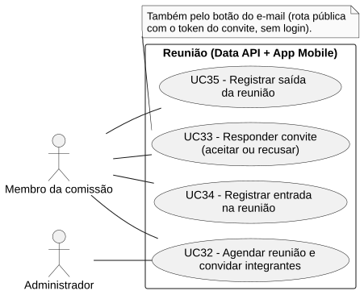
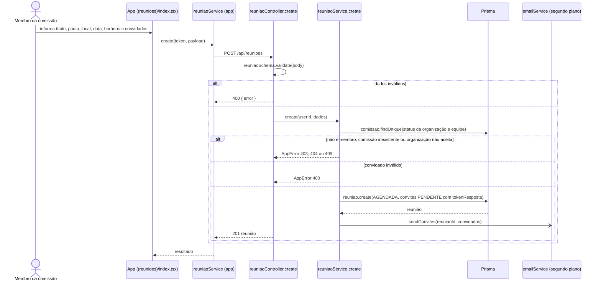

# RF32 — Agendar reunião e convidar integrantes

```text
Incremento: Di2 — Reunião
Escopo: RF32; UC32
Branch: feature/refatoracao-documentacao
Commit: 464c190
Data de revisão: 2026-11-10
Responsável(eis): [nome de quem revisa e assina o documento]
Estado: Implementado
Fontes: sistema/api/src/routes/reuniaoRoutes.ts; sistema/api/src/controllers/reuniaoController.ts; sistema/api/src/services/reuniaoService.ts; sistema/api/src/schemas/reuniaoSchema.ts; sistema/api/prisma/schema.prisma; sistema/better-meet/src/app/(tabs)/(reunioes)/index.tsx; sistema/better-meet/src/app/(tabs)/(reunioes)/reuniao/[id].tsx; sistema/better-meet/src/services/reuniaoService.ts; sistema/api/tests/reuniaoSchema.test.mjs; sistema/api/tests/reuniaoNotificacoes.test.mjs
```

## Descrição

Um membro da comissão agenda uma reunião e convida outros membros da mesma comissão. Cada convidado recebe um convite (`PENDENTE`) e um e-mail com botões de aceitar e recusar; quem agenda não recebe convite.

## Formulário do requisito

| Campo | Conteúdo |
|---|---|
| Entradas | `comissaoId` — inteiro positivo, obrigatório<br/>`titulo` — obrigatório, até 80 caracteres<br/>`pauta` — obrigatória, até 1000 caracteres<br/>`descricao` — opcional, até 2000 caracteres<br/>`local` — endereço ou link, obrigatório, até 500 caracteres<br/>`data` — `AAAA-MM-DD`, data existente<br/>`horaInicio` e `horaFim` — `HH:mm`; o fim deve ser posterior ao início e o início não pode estar no passado<br/>`convidados` — lista de ids de membros da comissão, sem repetição<br/>Token JWT |
| Origem | Aba Reuniões do app (`(reunioes)/index.tsx`), por `reuniaoService.create(token, payload)`; novos convites pela tela da reunião (`reuniao/[id].tsx`), por `reuniaoService.inviteMembers`. |
| Saída | `201` — reunião criada, com os convites.<br/>`400` — validação do corpo ("O início da reunião não pode ser no passado.", "O horário final deve ser posterior ao horário inicial." etc.), "O criador não precisa receber convite." ou "Todos os convidados precisam participar da comissão.".<br/>`401` — sem token; `403` — "Você não é membro desta comissão.".<br/>`404` — "Comissão não encontrada."; `409` — "A organização da comissão ainda não foi aprovada.".<br/>Convites adicionais: `200`/`201` conforme o controller, com "N convite(s) enviado(s)." e `403`/`400` por regra. |
| Destino | Aba Reuniões (lista) e e-mails dos convidados. |
| Pré-condições | Usuário autenticado, membro de uma comissão de organização `ACEITA`. |
| Pós-condições | Existem uma `Reuniao` `AGENDADA` e um `ConviteReuniao` `PENDENTE` por convidado. |
| Efeitos colaterais | Envio de e-mail (com arquivo `.ics`) a cada convidado, em segundo plano; falha do e-mail não impede a criação. |

### Ação

1. O membro da comissão informa os dados da reunião e escolhe os convidados.
2. O app chama `POST /api/reunioes`.
3. O controller valida o corpo com `reuniaoSchema`.
4. `reuniaoService.create` confere se a comissão existe, se a organização está `ACEITA` e se o usuário é membro da comissão (`assertMembroDaComissao`); recusa convidar o próprio criador ou quem não é da comissão.
5. Na mesma transação grava `Reuniao` (`AGENDADA`) e um `ConviteReuniao` por convidado, cada um com `tokenResposta`.
6. Depois de responder, dispara em segundo plano o e-mail de convite (`sendConvites`).
7. Convidar mais pessoas depois: `POST /api/reunioes/:id/convites` `{ convidados }`, pelo criador ou por um Administrador; só quem ainda não tinha convite recebe o e-mail.

## Caso de uso UC32 — Agendar reunião e convidar integrantes

| Item | Conteúdo |
|---|---|
| Objetivo | Um membro da comissão agenda uma reunião e convida outros membros da mesma comissão. |
| Atores | Membro da comissão (qualquer `PapelComissao`) como organizador; Administrador (`Role.ADMIN`) só para convidar. |
| Requisito | RF32 |
| Gatilho | O membro da comissão escolhe agendar uma reunião. |
| Fluxo principal | Ver "Ação". |
| Erros | Ver "Saída". |
| Pós-condições | Existem uma `Reuniao` `AGENDADA` e um `ConviteReuniao` `PENDENTE` por convidado. |
| Relações UML | Nenhum `include` nem `extend`. |
| Rastreabilidade | RF32; requisito do slide: Reunião; diagrama `DCU-Reuniao` |

### Diagrama de casos de uso



Fonte: [`DCU-Reuniao.puml`](../Diagramas/DCU-Reuniao.puml). O diagrama é do requisito inteiro (Reunião); este arquivo documenta só o UC32.

## Diagrama de sequência



## Requisitos não funcionais

Sem RNF atribuído no catálogo.

## Divergências e lacunas

- O slide diz que o **presidente da comissão** (Administrador da comissão) agenda a reunião; no código qualquer membro da comissão pode agendar. `[A CONFIRMAR]` se a regra deve ser restringida.
- Operações da reunião que existem no código e não têm UC próprio na numeração aprovada: listar as minhas (`GET /api/reunioes/minhas`), detalhar (`GET /api/reunioes/:id`), editar (`PATCH`, com aviso por e-mail), excluir (`DELETE`, com aviso), convites pendentes (`GET /api/reunioes/convites`), avisos (`/api/notificacoes`) e lembretes por e-mail. `[A CONFIRMAR]` onde serão documentadas.
- O slide do incremento 2 também lista "criação da ata" e "aprovação da ata"; por decisão do usuário elas pertencem ao incremento 3.

## Testes

CT-RF32-01: `sistema/api/tests/reuniaoSchema.test.mjs` (validação do corpo); CT-RF32-02: `sistema/api/tests/reuniaoNotificacoes.test.mjs` (edição, exclusão, listagem e avisos; ver `testes_notificacoes_email.md`); `testes_data_reuniao.md` registra a correção do formato de data. A rota `POST /api/reunioes` e os convites adicionais não têm teste localizado. Nenhuma execução nesta etapa (`Não executado`).
