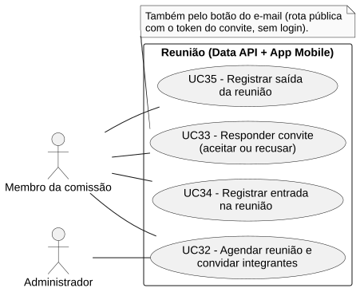
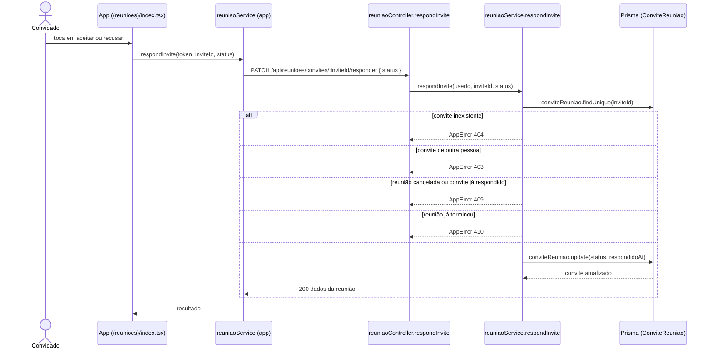

# RF33 — Responder convite (aceitar ou recusar)

```text
Incremento: Di2 — Reunião
Escopo: RF33; UC33
Branch: feature/refatoracao-documentacao
Commit: 464c190
Data de revisão: 2026-11-10
Responsável(eis): [nome de quem revisa e assina o documento]
Estado: Implementado
Fontes: sistema/api/src/routes/reuniaoRoutes.ts; sistema/api/src/routes/conviteRespostaRoutes.ts; sistema/api/src/controllers/conviteRespostaController.ts; sistema/api/src/services/reuniaoService.ts; sistema/api/src/schemas/conviteRespostaSchema.ts; sistema/better-meet/src/app/(tabs)/(reunioes)/index.tsx; sistema/better-meet/src/services/reuniaoService.ts
```

## Descrição

O convidado aceita ou recusa o convite, pelo app ou pelos botões do e-mail. Depois do fim da reunião o convite não pode mais ser respondido.

## Formulário do requisito

| Campo | Conteúdo |
|---|---|
| Entradas | `inviteId` — na URL do app (`PATCH /api/reunioes/convites/:inviteId/responder`) com o `status` (`ACEITO` ou `RECUSADO`) e token JWT<br/>Ou `token` do convite — na URL pública do e-mail (`GET` e `POST /api/convites/:token`), sem login |
| Origem | Lista de convites no app (`(reunioes)/index.tsx`), por `reuniaoService.respondInvite(token, id, status)`; ou página aberta pelo botão do e-mail. |
| Saída | `200` — convite respondido, com título, data, horários, local e comissão.<br/>`403` — "Você não pode responder a este convite.".<br/>`404` — "Convite não encontrado.".<br/>`409` — "Não é possível responder a um convite cancelado." ou "Este convite já foi respondido.".<br/>`410` — "Esta reunião já terminou; o convite não pode mais ser respondido.".<br/>No e-mail, os mesmos erros aparecem em uma página HTML. |
| Destino | Lista de convites do app ou página de confirmação do e-mail. |
| Pré-condições | Convite `PENDENTE` para a pessoa, reunião não cancelada e ainda não terminada. |
| Pós-condições | `ConviteReuniao.status` igual a `ACEITO` ou `RECUSADO`. |
| Efeitos colaterais | Só quem aceitou entra na lista da reunião (`listMine`) e pode registrar entrada e saída (RF34 e RF35). |

### Ação

1. O convidado escolhe aceitar ou recusar.
2. Pelo app: `PATCH /api/reunioes/convites/:inviteId/responder`. Pelo e-mail: `POST /api/convites/:token` (formulário HTML).
3. `reuniaoService.respondInvite` confere o dono do convite, se a reunião não foi cancelada, se o convite ainda está `PENDENTE` e se a reunião não terminou (`isConviteExpirado`, no fuso `TZ_REUNIOES`).
4. Grava `status` e `respondidoAt` e devolve os dados da reunião.

## Caso de uso UC33 — Responder convite (aceitar ou recusar)

| Item | Conteúdo |
|---|---|
| Objetivo | O convidado aceita ou recusa o convite, pelo app ou pelos botões do e-mail. |
| Atores | Membro da comissão convidado (`PapelComissao`); no link do e-mail, a própria pessoa convidada sem login. |
| Requisito | RF33 |
| Gatilho | O convidado toca em aceitar ou recusar, no app ou no e-mail. |
| Fluxo principal | Ver "Ação". |
| Erros | Ver "Saída". |
| Pós-condições | `ConviteReuniao.status` igual a `ACEITO` ou `RECUSADO`. |
| Relações UML | Nenhum `include` nem `extend`. |
| Rastreabilidade | RF33; requisito do slide: Reunião; diagrama `DCU-Reuniao` |

### Diagrama de casos de uso



Fonte: [`DCU-Reuniao.puml`](../Diagramas/DCU-Reuniao.puml). O diagrama é do requisito inteiro (Reunião); este arquivo documenta só o UC33.

## Diagrama de sequência



## Requisitos não funcionais

Sem RNF atribuído no catálogo.

## Divergências e lacunas

- O botão do e-mail usa rotas **públicas** (`/api/convites/:token`) e o token do convite faz o papel do login; o corpo vem de formulário HTML, não JSON.
- O slide diz "convite com recusa e aceite"; o código também bloqueia respostas depois do fim da reunião (`410`).

## Testes

Não foi localizado teste automatizado dedicado à resposta de convite (o `email.test.mjs` cobre o e-mail de convite). `CT-RF33-01`: `Não executado`.
