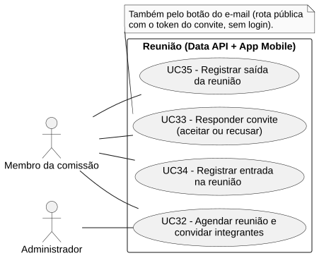
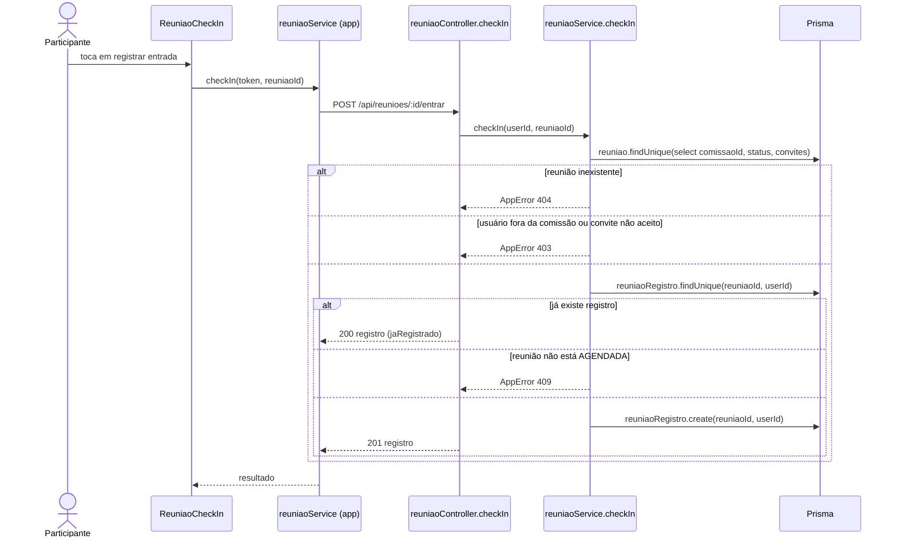

# RF34 — Registrar entrada na reunião

```text
Incremento: Di2 — Reunião
Escopo: RF34; UC34
Branch: feature/refatoracao-documentacao
Commit: 464c190
Data de revisão: 2026-11-10
Responsável(eis): [nome de quem revisa e assina o documento]
Estado: Implementado
Fontes: sistema/api/src/routes/reuniaoRoutes.ts; sistema/api/src/controllers/reuniaoController.ts; sistema/api/src/services/reuniaoService.ts (checkIn); sistema/api/prisma/schema.prisma (ReuniaoRegistro); sistema/better-meet/src/components/ReuniaoCheckIn.tsx; sistema/api/tests/reuniaoCheckIn.test.mjs; sistema/better-meet/src/components/__tests__/ReuniaoCheckIn.test.tsx
```

## Descrição

Quem participa da reunião registra a própria entrada. O usuário e o horário vêm do token e do servidor, nunca do corpo da requisição.

## Formulário do requisito

| Campo | Conteúdo |
|---|---|
| Entradas | `id` da reunião — URL, inteiro positivo<br/>Token JWT (nada é aceito do corpo) |
| Origem | Componente `ReuniaoCheckIn` na tela da reunião, por `reuniaoService.checkIn(token, reuniaoId)` do app. |
| Saída | `201` — "Presença confirmada." (primeiro registro) ou `200` — "Sua presença já está registrada nesta reunião." (repetição).<br/>`401` — sem token.<br/>`403` — "Você não é membro desta comissão." ou "Aceite o convite antes de registrar sua entrada na reunião.".<br/>`404` — "Reunião não encontrada."; `409` — "Esta reunião não está disponível para entrada." ou organização não aprovada. |
| Destino | Tela da reunião (estado de presença do usuário). |
| Pré-condições | Usuário autenticado, membro da comissão, criador da reunião ou convidado que aceitou, e reunião `AGENDADA`. |
| Pós-condições | Existe um `ReuniaoRegistro` com `entradaAt` para o usuário. |
| Efeitos colaterais | Nenhum além da gravação. |

### Ação

1. O participante toca em registrar entrada.
2. O app chama `POST /api/reunioes/:id/entrar`.
3. `reuniaoService.checkIn` busca a reunião, confere que o usuário é membro da comissão e que organização está `ACEITA`, e exige que seja o criador ou tenha **aceitado** o convite.
4. Se já existe registro, devolve o primeiro (`jaRegistrado`), mesmo depois do encerramento.
5. Senão, exige reunião `AGENDADA` e grava `ReuniaoRegistro` com `entradaAt` gerado pelo banco; em corrida entre duas requisições, a chave única decide e a outra devolve o mesmo registro.

## Caso de uso UC34 — Registrar entrada na reunião

| Item | Conteúdo |
|---|---|
| Objetivo | Quem participa da reunião registra a própria entrada. |
| Atores | Membro da comissão (criador da reunião ou convidado que aceitou). |
| Requisito | RF34 |
| Gatilho | O participante toca em registrar entrada. |
| Fluxo principal | Ver "Ação". |
| Erros | Ver "Saída". |
| Pós-condições | Existe um `ReuniaoRegistro` com `entradaAt` para o usuário. |
| Relações UML | Nenhum `include` nem `extend`. |
| Rastreabilidade | RF34; requisito do slide: Reunião; diagrama `DCU-Reuniao` |

### Diagrama de casos de uso



Fonte: [`DCU-Reuniao.puml`](../Diagramas/DCU-Reuniao.puml). O diagrama é do requisito inteiro (Reunião); este arquivo documenta só o UC34.

## Diagrama de sequência



## Requisitos não funcionais

Sem RNF atribuído no catálogo.

## Divergências e lacunas

- O slide diz "integrante (e/ou presidente) informa entrada"; no código o criador da reunião e os convidados que aceitaram usam a mesma rota.
- Não há correção de entrada: a segunda chamada devolve o primeiro registro.

## Testes

CT-RF34-01: `sistema/api/tests/reuniaoCheckIn.test.mjs` (22 testes no registro de 23/10/2026: JWT e horário do servidor, repetição, concorrência, 401, 403, 404, 409 e falha de gravação; ver `testes_presenca_reuniao.md`); CT-RF34-02: `sistema/better-meet/src/components/__tests__/ReuniaoCheckIn.test.tsx`. Não reexecutados nesta etapa (`Não executado`).
