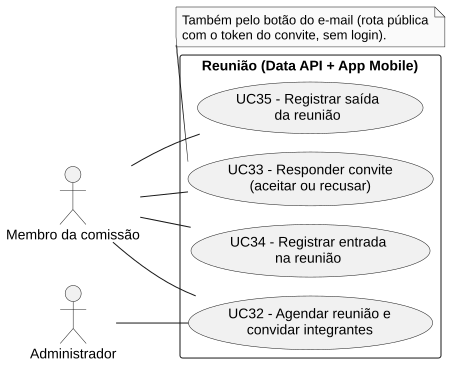
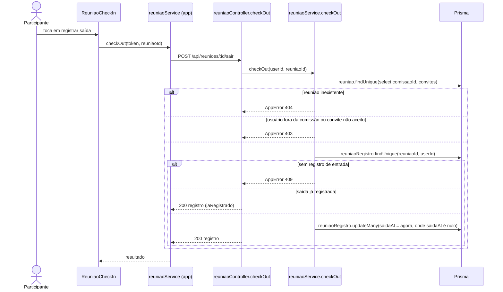

# RF35 — Registrar saída da reunião

```text
Incremento: Di2 — Reunião
Escopo: RF35; UC35
Branch: feature/refatoracao-documentacao
Commit: 464c190
Data de revisão: 2026-11-10
Responsável(eis): [nome de quem revisa e assina o documento]
Estado: Implementado
Fontes: sistema/api/src/routes/reuniaoRoutes.ts; sistema/api/src/controllers/reuniaoController.ts; sistema/api/src/services/reuniaoService.ts (checkOut); sistema/api/prisma/schema.prisma (ReuniaoRegistro); sistema/better-meet/src/components/ReuniaoCheckIn.tsx; sistema/api/tests/reuniaoCheckIn.test.mjs
```

## Descrição

Quem registrou entrada registra a própria saída. A repetição mantém o primeiro horário de saída.

## Formulário do requisito

| Campo | Conteúdo |
|---|---|
| Entradas | `id` da reunião — URL, inteiro positivo<br/>Token JWT (nada é aceito do corpo) |
| Origem | Componente `ReuniaoCheckIn`, por `reuniaoService.checkOut(token, reuniaoId)` do app. |
| Saída | `200` — "Saída registrada." ou "Sua saída já está registrada nesta reunião." (repetição).<br/>`401` — sem token.<br/>`403` — "Você não é membro desta comissão." ou "Aceite o convite antes de registrar sua saída na reunião.".<br/>`404` — "Reunião não encontrada." ou "Registro de presença não encontrado."; `409` — "Registre sua entrada antes de sair da reunião.". |
| Destino | Tela da reunião (estado de presença do usuário). |
| Pré-condições | Usuário autenticado, com entrada registrada (RF34). |
| Pós-condições | `ReuniaoRegistro.saidaAt` preenchido com o horário do servidor. |
| Efeitos colaterais | Nenhum além da gravação. |

### Ação

1. O participante toca em registrar saída.
2. O app chama `POST /api/reunioes/:id/sair`.
3. `reuniaoService.checkOut` repete as conferências de comissão e de convite aceito, exige que exista registro de entrada e, se a saída ainda não foi registrada, grava `saidaAt` (somente onde `saidaAt` é nulo).

## Caso de uso UC35 — Registrar saída da reunião

| Item | Conteúdo |
|---|---|
| Objetivo | Quem registrou entrada registra a própria saída. |
| Atores | Membro da comissão (criador da reunião ou convidado que aceitou). |
| Requisito | RF35 |
| Gatilho | O participante toca em registrar saída. |
| Fluxo principal | Ver "Ação". |
| Erros | Ver "Saída". |
| Pós-condições | `ReuniaoRegistro.saidaAt` preenchido com o horário do servidor. |
| Relações UML | Nenhum `include` nem `extend`. |
| Rastreabilidade | RF35; requisito do slide: Reunião; diagrama `DCU-Reuniao` |

### Diagrama de casos de uso



Fonte: [`DCU-Reuniao.puml`](../Diagramas/DCU-Reuniao.puml). O diagrama é do requisito inteiro (Reunião); este arquivo documenta só o UC35.

## Diagrama de sequência



## Requisitos não funcionais

Sem RNF atribuído no catálogo.

## Divergências e lacunas

- Não há reabertura de saída nem correção de horário depois do primeiro registro.
- O slide diz "integrante (e/ou presidente) informa saída"; o código usa a mesma regra para criador e convidados que aceitaram.

## Testes

CT-RF35-01: `sistema/api/tests/reuniaoCheckIn.test.mjs` (grupo `POST /api/reunioes/:id/sair`; ver `testes_presenca_reuniao.md`); não reexecutado nesta etapa (`Não executado`).
