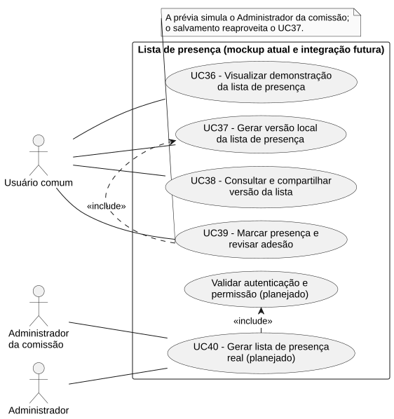

# RF36 — Visualizar demonstração da lista de presença

```text
Incremento: Di2 — Reunião (lista de presença)
Escopo: RF36; UC36
Branch: feature/refatoracao-documentacao
Commit: 464c190
Data de revisão: 2026-11-10
Responsável(eis): [nome de quem revisa e assina o documento]
Estado: Parcial
Fontes: documentos/entrega3_Di2/lista_presenca.md; sistema/better-meet/src/app/lista-presenca.tsx; sistema/api/tests/consolidateListaPresenca.test.mjs; sistema/api/tests/applyMarcacoesPresenca.test.mjs; sistema/api/tests/listaPresencaSchema.test.mjs; sistema/better-meet/src/services/listaPresencaService.ts
```

## Descrição

Usuário da prévia consulta a estrutura da lista com dados fictícios.

Texto do requisito de origem (`lista_presenca.md`):

> Mostrar organização, comissão, título, datas, local/plataforma e versão no cabeçalho; nome, e-mail, papel, primeira entrada, última saída, permanência e status no corpo; autoria, geração e observações no rodapé. Distinguir saída pendente de saída real e não exibir IDs internos como conteúdo de negócio.
> **Atual:** tela de demonstração com dados fictícios e aviso visível, acessível sem cadastrar reunião.

## Formulário do requisito

| Campo | Conteúdo |
|---|---|
| Entradas | Acesso pelo menu à tela `/lista-presenca`; cenário local. |
| Origem | Ver "Entradas" (a origem é a mesma coluna do texto de origem). |
| Saída | Cabeçalho, membros, totais e rodapé na interface. |
| Destino | Ver "Saída". |
| Pré-condições | Aplicativo disponível; não exige reunião real cadastrada. |
| Pós-condições | Apresentação avaliada sem alterar dados reais. |
| Efeitos colaterais | Nenhum registro no banco ou módulo de reuniões. |

### Ação

1. Abrir prévia.
2. Carregar exemplos locais.
3. Exibir aviso de demonstração e versão selecionada.

## Caso de uso UC36 — Visualizar demonstração da lista de presença

| Item | Conteúdo |
|---|---|
| Objetivo | Usuário da prévia consulta a estrutura da lista com dados fictícios.. |
| Atores | Usuário comum (`Role.USER`), usando a prévia com dados fictícios. |
| Requisito | RF36 |
| Gatilho | O usuário abre a tela `/lista-presenca` pelo menu. |
| Fluxo principal | Ver "Ação". |
| Erros | Nenhuma registrada. |
| Pós-condições | Apresentação avaliada sem alterar dados reais. |
| Relações UML | Nenhum `include` nem `extend`. |
| Rastreabilidade | RF36; requisito do slide: Reunião — Lista de presença; diagrama `DCU-Lista-de-Presenca` |

### Diagrama de casos de uso



Fonte: [`DCU-Lista-de-Presenca.puml`](../Diagramas/DCU-Lista-de-Presenca.puml). O diagrama é do requisito inteiro (Reunião — Lista de presença); este arquivo documenta só o UC36.

## Diagrama de sequência

Este caso de uso usa o diagrama de sequência "Prévia local atual" do [RF37](RF37_gerar_versao_local_da_lista_de_presenca.md). Ele é compartilhado e não é repetido aqui.

## Requisitos não funcionais

- RNF44 — Rótulos e mensagens em português do Brasil
- RNF45 — Aviso de dados fictícios e nenhuma gravação real na prévia
- RNF47 — Nenhum ID interno digitado ou exibido
- RNF51 — TypeScript estrito e sem `any` no código novo

## Divergências e lacunas

- A entrega é um **mockup** com dados fictícios e histórico em memória: não cadastra reuniões, convites, entradas ou listas reais.
- O texto de origem (`lista_presenca.md`) chamava este caso de uso de UC-LP01 e o requisito de RF-LP02.

## Testes

CT-RF36-01 a CT-RF36-04 (roteiro manual, mockup): TM-LP01 (abrir a prévia, aviso fictício visível), TM-LP08 (nenhuma gravação real), TM-LP09 (sem IDs internos), TM-LP10 (saída pendente) e TM-LP11 (reset em foco). O registro de resultados de `lista_presenca.md` (seção "Registro de resultados") é a fonte; não reexecutado nesta etapa (`Não executado`).
