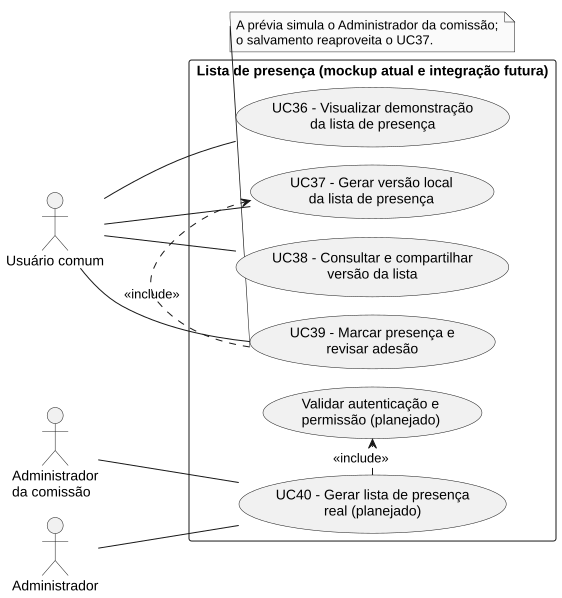
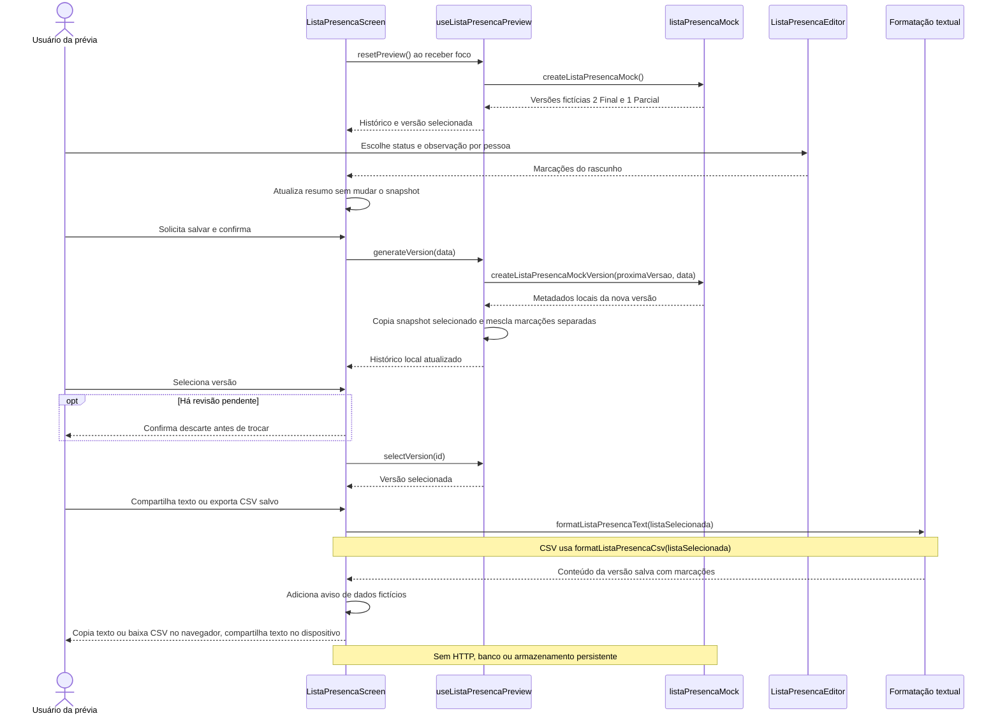
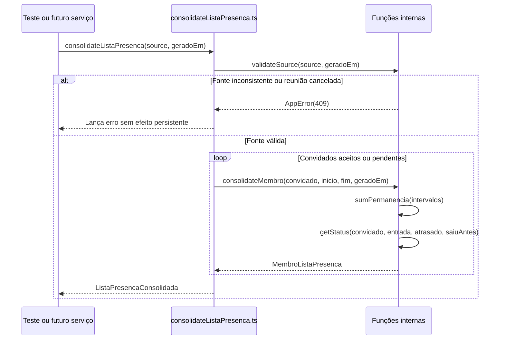

# RF37 — Gerar versão local da lista de presença

```text
Incremento: Di2 — Reunião (lista de presença)
Escopo: RF37; UC37
Branch: feature/refatoracao-documentacao
Commit: 464c190
Data de revisão: 2026-11-10
Responsável(eis): [nome de quem revisa e assina o documento]
Estado: Parcial
Fontes: documentos/entrega3_Di2/lista_presenca.md; sistema/better-meet/src/app/lista-presenca.tsx; sistema/api/tests/consolidateListaPresenca.test.mjs; sistema/api/tests/applyMarcacoesPresenca.test.mjs; sistema/api/tests/listaPresencaSchema.test.mjs; sistema/better-meet/src/services/listaPresencaService.ts
```

## Descrição

Usuário da prévia demonstra geração e versionamento em memória. O núcleo puro de consolidação (`RF-LP01` do texto de origem: presentes, atrasados, saída antecipada, ausentes e sem resposta) está preparado e testado, mas não é chamado por nenhuma rota.

Texto do requisito de origem (`lista_presenca.md`):

> Salvar as marcações e observações em nova versão local e permitir selecionar versões anteriores. A revisão copia o snapshot da versão selecionada, preserva seus registros e mantém as escolhas manuais separadas. Observações são validadas antes da confirmação e gravação local. A troca de versão exige confirmação para descartar alterações pendentes.
> **Atual:** revisão da versão selecionada com nova numeração e cópias independentes; histórico em memória reiniciado no foco. Não há reserva de versão no banco, persistência após recarga ou garantia de concorrência.

## Formulário do requisito

| Campo | Conteúdo |
|---|---|
| Entradas | Versão fictícia selecionada, marcações manuais e observações opcionais; botão de salvar. |
| Origem | Ver "Entradas" (a origem é a mesma coluna do texto de origem). |
| Saída | Nova versão temporária e sua visualização. |
| Destino | Ver "Saída". |
| Pré-condições | Cenário local disponível e observações válidas. |
| Pós-condições | Nova versão local selecionada; sem persistência durável. |
| Efeitos colaterais | Nenhuma escrita real ou correção de presença. |

### Ação

1. Revisar a versão selecionada.
2. Validar marcações/observações e confirmar.
3. Copiar snapshot selecionado e guardar marcações separadas.
4. Selecionar nova versão, preservando histórico local.

## Caso de uso UC37 — Gerar versão local da lista de presença

| Item | Conteúdo |
|---|---|
| Objetivo | Usuário da prévia demonstra geração e versionamento em memória. |
| Atores | Usuário comum (`Role.USER`), simulando o Administrador da comissão na prévia. |
| Requisito | RF37 |
| Gatilho | O usuário salva uma revisão da versão selecionada. |
| Fluxo principal | Ver "Ação". |
| Erros | Validação inválida impede gerar; cancelar confirmação preserva o estado. |
| Pós-condições | Nova versão local selecionada; sem persistência durável. |
| Relações UML | Nenhum `include` nem `extend`. |
| Rastreabilidade | RF37; requisito do slide: Reunião — Lista de presença; diagrama `DCU-Lista-de-Presenca` |

### Diagrama de casos de uso



Fonte: [`DCU-Lista-de-Presenca.puml`](../Diagramas/DCU-Lista-de-Presenca.puml). O diagrama é do requisito inteiro (Reunião — Lista de presença); este arquivo documenta só o UC37.

## Diagrama de sequência

Prévia local atual:



Consolidação pura preparada (função de núcleo, sem banco):



## Requisitos não funcionais

- RNF42 — Consistência da contagem do snapshot
- RNF43 — Sobreposições contadas uma vez e permanência limitada
- RNF44 — Rótulos e mensagens em português do Brasil
- RNF46 — Nova versão não altera versões anteriores
- RNF47 — Nenhum ID interno digitado ou exibido
- RNF51 — TypeScript estrito e sem `any` no código novo

## Divergências e lacunas

- O histórico de versões vive em memória e é reiniciado ao voltar à tela; não há versão no banco.
- O texto de origem chamava este caso de uso de UC-LP02, e os requisitos de RF-LP03 (versões) e RF-LP01 (consolidação).

## Testes

CT-RF37-01 a CT-RF37-05: TM-LP02, TM-LP04, TM-LP05, TM-LP11 e TM-LP14 (roteiro manual, mockup) e TP-LP01 a TP-LP20 (núcleo puro, `sistema/api/tests/consolidateListaPresenca.test.mjs`). Resultados: ver o "Registro de resultados" do `lista_presenca.md`; não reexecutados nesta etapa (`Não executado`).
