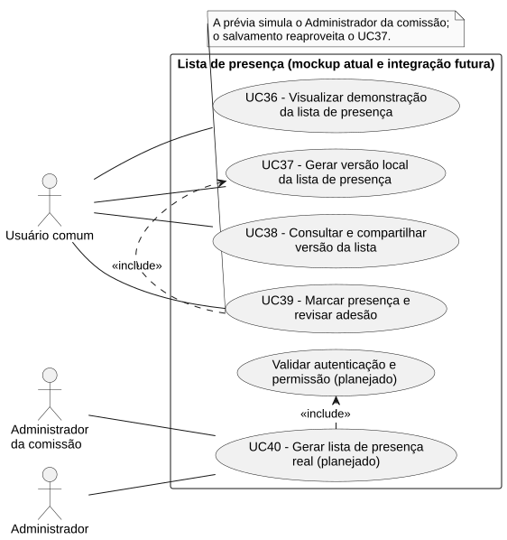

# RF38 — Consultar e compartilhar versão da lista

```text
Incremento: Di2 — Reunião (lista de presença)
Escopo: RF38; UC38
Branch: feature/refatoracao-documentacao
Commit: 464c190
Data de revisão: 2026-11-10
Responsável(eis): [nome de quem revisa e assina o documento]
Estado: Parcial
Fontes: documentos/entrega3_Di2/lista_presenca.md; sistema/better-meet/src/app/lista-presenca.tsx; sistema/api/tests/consolidateListaPresenca.test.mjs; sistema/api/tests/applyMarcacoesPresenca.test.mjs; sistema/api/tests/listaPresencaSchema.test.mjs; sistema/better-meet/src/services/listaPresencaService.ts
```

## Descrição

Usuário da prévia seleciona uma versão salva e compartilha texto ou exporta CSV.

Texto do requisito de origem (`lista_presenca.md`):

> Compartilhar a versão salva selecionada com seu conteúdo, marcações e indicação de demonstração. Usar cópia no navegador ou compartilhamento do dispositivo, informando indisponibilidade em pt-BR. Exportar CSV em arquivo no navegador ou compartilhar seu conteúdo textual no dispositivo. Impedir as duas ações enquanto houver alterações pendentes.
> **Atual:** compartilhamento textual e CSV; sem PDF, assinatura digital, envio automático ou link público.

## Formulário do requisito

| Campo | Conteúdo |
|---|---|
| Entradas | Versão no histórico e ação de compartilhamento. |
| Origem | Ver "Entradas" (a origem é a mesma coluna do texto de origem). |
| Saída | Texto demonstrativo copiado ou compartilhado; CSV baixado no navegador ou compartilhado como texto no dispositivo. |
| Destino | Ver "Saída". |
| Pré-condições | Versão demonstrativa disponível e nenhuma alteração pendente. |
| Pós-condições | Histórico e versões inalterados. |
| Efeitos colaterais | Nenhum registrado. |

### Ação

1. Selecionar versão, confirmando descarte se houver rascunho.
2. Apresentar conteúdo salvo.
3. Formatar texto ou CSV.
4. Copiar texto/baixar CSV no navegador ou abrir compartilhamento no dispositivo.

## Caso de uso UC38 — Consultar e compartilhar versão da lista

| Item | Conteúdo |
|---|---|
| Objetivo | Usuário da prévia seleciona uma versão salva e compartilha texto ou exporta CSV.. |
| Atores | Usuário comum (`Role.USER`), usando a prévia. |
| Requisito | RF38 |
| Gatilho | O usuário seleciona uma versão e escolhe compartilhar texto ou exportar CSV. |
| Fluxo principal | Ver "Ação". |
| Erros | Recurso indisponível: feedback em pt-BR sem alterar a lista. |
| Pós-condições | Histórico e versões inalterados. |
| Relações UML | Nenhum `include` nem `extend`. |
| Rastreabilidade | RF38; requisito do slide: Reunião — Lista de presença; diagrama `DCU-Lista-de-Presenca` |

### Diagrama de casos de uso



Fonte: [`DCU-Lista-de-Presenca.puml`](../Diagramas/DCU-Lista-de-Presenca.puml). O diagrama é do requisito inteiro (Reunião — Lista de presença); este arquivo documenta só o UC38.

## Diagrama de sequência

Este caso de uso usa o diagrama de sequência "Prévia local atual" do [RF37](RF37_gerar_versao_local_da_lista_de_presenca.md). Ele é compartilhado e não é repetido aqui.

## Requisitos não funcionais

- RNF44 — Rótulos e mensagens em português do Brasil
- RNF46 — Nova versão não altera versões anteriores
- RNF47 — Nenhum ID interno digitado ou exibido
- RNF51 — TypeScript estrito e sem `any` no código novo
- RNF53 — CSV com acentos e proteção contra fórmula executável

## Divergências e lacunas

- Não há PDF, assinatura digital, envio automático de e-mail nem link público; o compartilhamento é textual e em CSV.
- O texto de origem chamava este caso de uso de UC-LP03 e o requisito de RF-LP04.

## Testes

CT-RF38-01 a CT-RF38-05: TM-LP03, TM-LP06, TM-LP07, TM-LP15, TM-LP16, TM-LP17 e TM-LP18 (roteiro manual, mockup; TM-LP18 cobre acentos, aspas e prefixos de fórmula no CSV). Fonte: `lista_presenca.md`; não reexecutado nesta etapa (`Não executado`).
