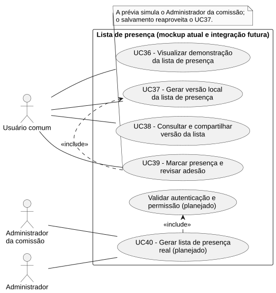

# RF39 — Marcar presença e revisar adesão

```text
Incremento: Di2 — Reunião (lista de presença)
Escopo: RF39; UC39
Branch: feature/refatoracao-documentacao
Commit: 464c190
Data de revisão: 2026-11-10
Responsável(eis): [nome de quem revisa e assina o documento]
Estado: Parcial
Fontes: documentos/entrega3_Di2/lista_presenca.md; sistema/better-meet/src/app/lista-presenca.tsx; sistema/api/tests/consolidateListaPresenca.test.mjs; sistema/api/tests/applyMarcacoesPresenca.test.mjs; sistema/api/tests/listaPresencaSchema.test.mjs; sistema/better-meet/src/services/listaPresencaService.ts
```

## Descrição

Usuário da prévia simula a revisão pelo administrador da comissão. Os cinco status e o resumo são calculados localmente; o salvamento reaproveita o RF37.

Texto do requisito de origem (`lista_presenca.md`):

> Disponibilizar os cinco status estabelecidos e observação individual opcional para cada participante, inclusive em reuniões presenciais. Exibir nome, e-mail e papel, sem pedir IDs. Calcular o resumo a partir das escolhas atuais e apresentar na versão salva a marcação manual junto aos registros originais.
> **Atual:** editor reutilizável `ListaPresencaEditor`, funções de marcação e resumo, validação de entradas e representação em tela, texto e CSV. É uma simulação do papel de administrador, sem autorização real validada pelo servidor.

## Formulário do requisito

| Campo | Conteúdo |
|---|---|
| Entradas | Participantes da versão selecionada; escolha de status e observação individual opcional. |
| Origem | Ver "Entradas" (a origem é a mesma coluna do texto de origem). |
| Saída |  |
| Destino | Ver "Saída". |
| Pré-condições | Lista demonstrativa disponível. |
| Pós-condições | Nova versão guarda marcações separadas; registros de origem e versões anteriores preservados. |
| Efeitos colaterais | Nenhum registrado. |

### Ação

1. Escolher um dos cinco status por pessoa.
2. Adicionar observação opcional.
3. Conferir pessoas, presentes e adesão.
4. Salvar por UC37.

## Caso de uso UC39 — Marcar presença e revisar adesão

| Item | Conteúdo |
|---|---|
| Objetivo | Usuário da prévia simula a revisão pelo administrador da comissão. |
| Atores | Usuário comum (`Role.USER`), simulando o Administrador da comissão; sem autorização real validada pelo servidor. |
| Requisito | RF39 |
| Gatilho | O usuário escolhe um status e uma observação para cada participante da versão. |
| Fluxo principal | Ver "Ação". |
| Erros | Observação inválida, duplicidade ou pessoa fora da lista impede aplicação válida; cancelar salvamento preserva o rascunho. |
| Pós-condições | Nova versão guarda marcações separadas; registros de origem e versões anteriores preservados. |
| Relações UML | Nenhum `include` nem `extend`. |
| Rastreabilidade | RF39; requisito do slide: Reunião — Lista de presença; diagrama `DCU-Lista-de-Presenca` |

### Diagrama de casos de uso



Fonte: [`DCU-Lista-de-Presenca.puml`](../Diagramas/DCU-Lista-de-Presenca.puml). O diagrama é do requisito inteiro (Reunião — Lista de presença); este arquivo documenta só o UC39.

## Diagrama de sequência

Este caso de uso usa o diagrama de sequência "Prévia local atual" do [RF37](RF37_gerar_versao_local_da_lista_de_presenca.md). Ele é compartilhado e não é repetido aqui.

## Requisitos não funcionais

- RNF44 — Rótulos e mensagens em português do Brasil
- RNF47 — Nenhum ID interno digitado ou exibido
- RNF51 — TypeScript estrito e sem `any` no código novo
- RNF52 — Revisão não altera snapshot ou versões anteriores

## Divergências e lacunas

- O texto de origem chamava este caso de uso de UC-LP04 e o requisito de RF-LP06; o "Salvar por UC-LP02" do fluxo vira uma reutilização do RF37.
- Simula o papel de Administrador da comissão, sem permissão verificada no servidor.

## Testes

CT-RF39-01 a CT-RF39-03: TM-LP12, TM-LP13 e TM-LP19 (roteiro manual, mockup) e TV-LP01 a TV-LP05 (validação e núcleo de marcação, `sistema/api/tests/applyMarcacoesPresenca.test.mjs` e `listaPresencaSchema.test.mjs`). Fonte: `lista_presenca.md`; não reexecutados nesta etapa (`Não executado`).
