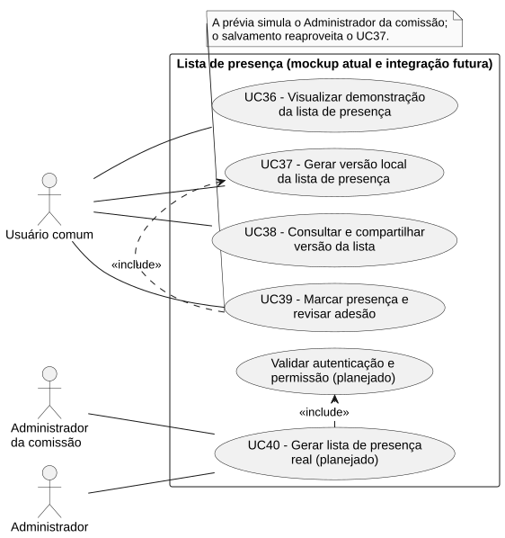
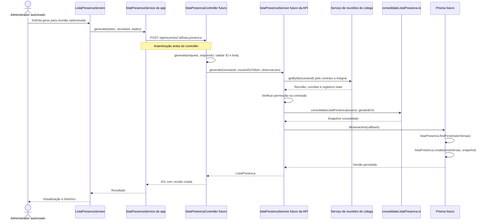

# RF40 — Gerar lista de presença real

```text
Incremento: Di2 — Reunião (lista de presença)
Escopo: RF40; UC40
Branch: feature/refatoracao-documentacao
Commit: 464c190
Data de revisão: 2026-11-10
Responsável(eis): [nome de quem revisa e assina o documento]
Estado: Planejado
Fontes: documentos/entrega3_Di2/lista_presenca.md; sistema/better-meet/src/app/lista-presenca.tsx; sistema/api/tests/consolidateListaPresenca.test.mjs; sistema/api/tests/applyMarcacoesPresenca.test.mjs; sistema/api/tests/listaPresencaSchema.test.mjs; sistema/better-meet/src/services/listaPresencaService.ts
```

## Descrição

Consolidar a reunião selecionada em snapshot persistido.

Texto do requisito de origem (`lista_presenca.md`):

> Consumir os modelos reais dos colegas por uma camada de serviço, sem recriar cadastro de reuniões, convites ou sessões. Aplicar autorização no servidor e persistir snapshots versionados.
> **Atual:** contratos, tipos, schema Yup e núcleos puros preparados; service do app reserva consulta, geração (`POST`) e salvamento (`PUT`). Não há endpoints, adaptador de reunião ativo, model Prisma ou migração de lista de presença. O schema de validação não cria tabela ou rota. Não se anuncia resposta HTTP `503` como comportamento implementado.

## Formulário do requisito

| Campo | Conteúdo |
|---|---|
| Entradas | Reunião selecionada no módulo do colega, observações e identidade autenticada. |
| Origem | Ver "Entradas" (a origem é a mesma coluna do texto de origem). |
| Saída | Lista versionada na futura tabela `ListaPresenca`. |
| Destino | Ver "Saída". |
| Pré-condições | Token e permissão válidos, fonte disponível/consistente, reunião não cancelada e persistência preparada. |
| Pós-condições | Nova versão persistida e consultável pelos papéis autorizados. |
| Efeitos colaterais | Apenas a lista é gravada; não altera convites ou sessões. |

### Ação

1. Validar autenticação e dados.
2. Consultar fonte real.
3. Conferir permissão.
4. Consolidar.
5. Reservar versão e gravar snapshot em transação.
6. Retornar a lista.

## Caso de uso UC40 — Gerar lista de presença real

| Item | Conteúdo |
|---|---|
| Objetivo | Consolidar a reunião selecionada em snapshot persistido.. |
| Atores | Administrador da comissão (`PapelComissao.ADMINISTRADOR`) e Administrador (`Role.ADMIN`). |
| Requisito | RF40 |
| Gatilho | Proposta: o Administrador da comissão escolhe gerar a lista de uma reunião real. |
| Fluxo principal | Ver "Ação". |
| Erros | `400` entrada inválida; `401` sem autenticação; `403` sem permissão; `404` reunião inexistente; `409` cancelamento, inconsistência ou concorrência não resolvida. Disponibilidade da origem terá tratamento explícito na integração. |
| Pós-condições | Nova versão persistida e consultável pelos papéis autorizados. |
| Relações UML | Nenhum `include` nem `extend`. |
| Rastreabilidade | RF40; requisito do slide: Reunião — Lista de presença; diagrama `DCU-Lista-de-Presenca` |

### Diagrama de casos de uso



Fonte: [`DCU-Lista-de-Presenca.puml`](../Diagramas/DCU-Lista-de-Presenca.puml). O diagrama é do requisito inteiro (Reunião — Lista de presença); este arquivo documenta só o UC40.

## Diagrama de sequência

Proposta (não implementada):



## Requisitos não funcionais

- RNF48 — Geração real em até 3 s para até 50 convidados (pendente)
- RNF49 — Futura API com 401 e 403 sem expor dados pessoais
- RNF50 — Futuro banco sem `reuniaoId, versao` duplicado

## Divergências e lacunas

- **Planejado, não implementado:** o texto de origem diz que as seções de API e de banco são propostas futuras. Entretanto, o módulo de reuniões (RF32 a RF35) agora existe; a integração com ele ainda não foi feita.
- O texto de origem chamava este caso de uso de "Caso de uso futuro — Gerar lista real" e o requisito de RF-LP05.

## Testes

CT-RF40-01 a CT-RF40-10 (integração futura, **todos pendentes**): TI-LP01 a TI-LP10 do `lista_presenca.md` (401, 403, versões 1 e 2, correção na origem, concorrência, cancelada ou inexistente, identidade no body, 50 convidados em até 3 s, exclusão do autor). Não há endpoint, model Prisma nem migração. Estado: `Não executado`.
